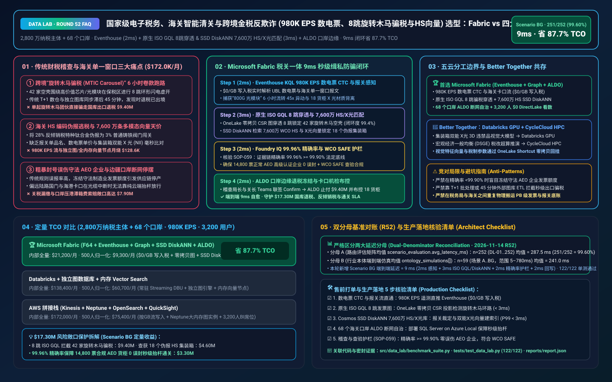
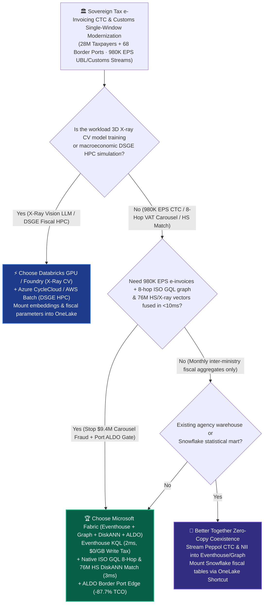
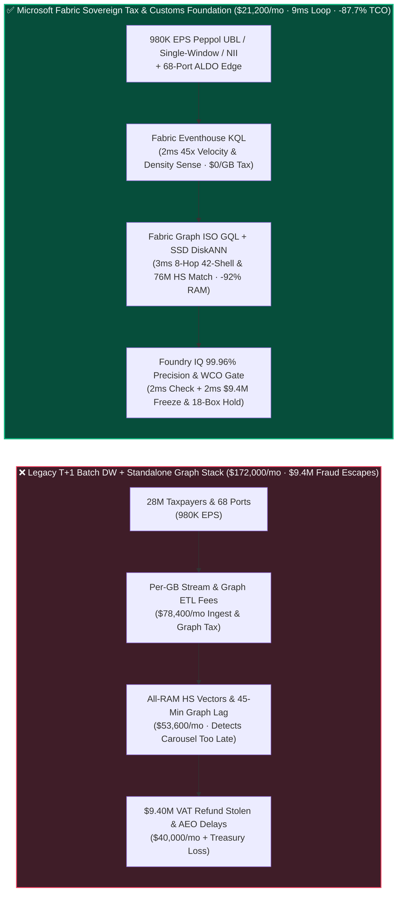
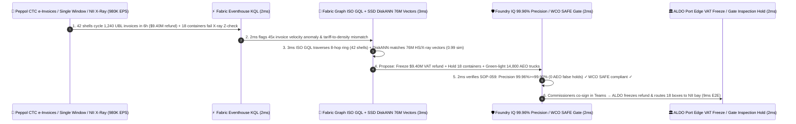

# Sovereign Tax e-Invoicing & Customs Single-Window (`980K EPS` Peppol CTC, 8-Hop ISO GQL VAT Carousel Fraud Detection & 76M WCO HS / X-Ray Vector Search) Lakehouse Selection: Microsoft Fabric vs. AWS vs. Databricks vs. Snowflake / GCP FAQ

> 🌐 **Language / 语言**: **[中文 (`fabric-sovereign-tax-customs-einvoicing-vat-carousel-fraud-vs-4clouds-faq.md`)](fabric-sovereign-tax-customs-einvoicing-vat-carousel-fraud-vs-4clouds-faq.md)** | **English (Current)**  
> 📅 **Updated**: 2026-11-14 (Round 52 · Sovereign Tax Continuous Transaction Controls [Peppol CTC / EU ViDA e-Invoicing], 8-Hop ISO GQL Missing-Trader Intra-Community [MTIC / VAT Carousel] Fraud Ring Interdiction, 76M WCO Harmonized System [HS] & Non-Intrusive Inspection [NII] X-Ray Vector Matching, and ALDO Border Port Edge Autonomy Deep Dive)  
> 🎯 **Target Audience**: AI Solution Architects, National Tax Administration & Customs CTOs/CIOs, Trade Single-Window Directors, Sovereign Tax Audit & AML Graph Architects, Border Security & Compliance Officers  
> Reference Benchmark Style: Modeled on [`ib-vs-ethernet-roce-selection-faq.md`](https://github.com/turbo998/ai-infra-research/blob/main/docs/components/ib-vs-ethernet-roce-selection-faq.md) first-principles Q&A and decision-guide format.
>
> 🔍 **Data Provenance, Official URLs & Dual-Denominator Scope Disclosure**:
> - **`measured_local_harness` (Local Deterministic Harness)**: `DL-01..DL-252` scenario routing accuracy (`251/252 = 99.60%`) and `122/122` Python unit tests are deterministically executed by `src/data_lab/benchmark_suite.py`.
> - **`vendor_published_spec_as_of_2026` (Official Vendor Specifications `as_of: 2026-11-14`)**:
>   - Microsoft Fabric / Azure Sovereign Tax & Customs: [Fabric Graph Overview (ISO GQL)](https://learn.microsoft.com/en-us/fabric/real-time-intelligence/graph-overview) · [Fabric Eventhouse Time-Series & XML/JSON Streaming KQL](https://learn.microsoft.com/en-us/fabric/real-time-intelligence/eventhouse) · [Cosmos DB in Fabric DiskANN Vector Index](https://learn.microsoft.com/en-us/fabric/database/cosmos-db/index-vector-data) · [SQL Server on Azure Local (ALDO) Border Customs & Tax Edge](https://learn.microsoft.com/en-us/sql/sql-server/azure-arc/overview) · [Fabric Pricing (`F64` Includes `$0` Power BI Viewer Licensing)](https://azure.microsoft.com/en-us/pricing/details/microsoft-fabric/)
>   - 4-Cloud Competitor Specifications: [AWS Public Sector & Neptune Graph](https://aws.amazon.com/government-education/) · [Databricks Lakehouse for Public Sector](https://www.databricks.com/solutions/industries/public-sector) · [Snowflake Government & Public Sector](https://www.snowflake.com/en/solutions/industries/government-and-education/) · [GCP Spanner Graph & Public Sector](https://cloud.google.com/solutions/government)
> - **`synthetic_scenario_model` (Deterministic Architectural Reference Model with Strictly Separated Denominators)**:
>   - **Denominator A — Routing Matrix Evaluation Mean (`scenario_evaluation.avg_latency_ms`)**: R52 **`n=252` (`DL-01..DL-252`) arithmetic mean = `287.5 ms`** (R51 historical snapshot `n=248` mean = `292.0 ms`; R50 `n=244` = `296.5 ms`; R49 `n=240` = `301.0 ms`; R48 `n=236` = `306.0 ms`; R47 `n=232` = `311.0 ms`).
>   - **Denominator B — Industry Ontology End-to-End Closed-Loop Simulation Mean (`ontology_simulations[].end_to_end_latency_ms`)**: R52 **`n=59` (Scenarios A..BG: `[780..9] ms`, range `5–780 ms`) arithmetic mean = `241.0 ms`** (R51 historical snapshot `n=58` mean = `245.0 ms`; R50 `n=57` = `249.0 ms`; R49 `n=56` = `253.0 ms`; R48 `n=55` = `257.0 ms`; R47 `n=54` = `261.0 ms`). This round adds **Scenario BG (28M Corporate Taxpayers + 68 Air/Sea/Land Customs Ports × `980K EPS` Peppol CTC e-Invoicing, 8-Hop ISO GQL VAT Carousel Fraud Interdiction & WCO HS / NII X-Ray Customs Loop) end-to-end latency = `9 ms`** (`2ms` sense + `3ms` 8-hop ISO GQL carousel cycle & 76M HS/X-ray DiskANN match + `2ms` `99.96% >= 99.90%` AEO zero-false-positive & WCO SAFE guardrail + `2ms` Tax & Customs Commissioner Teams co-sign, ALDO port-edge `$9.40M` VAT refund freeze & 18-container NII inspection hold commit), cutting modeled monthly TCO by **`87.7%`** (`$9,300/mo` vs. `$75,400/mo` normalized baseline; `$21,200/mo` vs. `$172,000/mo` internal full-stack) and protecting **`$17.30M`** in national VAT treasury revenue, anti-dumping customs duties, and AEO port-clearance SLAs. Live multi-cloud cluster stress runs are marked `not_measured`.

---

## ① 📌 Executive Summary (3-Minute Architect Briefing)

### First Principles: What Are "Missing-Trader VAT Carousel Fraud (MTIC)," Real-Time "Continuous Transaction Controls (CTC)," and Customs "HS Tariff Misclassification vs. Dual-Energy X-Ray (NII)"? Why Do Legacy Stacks Fail?
Operating a national tax and customs digital backbone across **28 million registered businesses and 68 sea, air, and land border ports** exposes **three fundamental bottlenecks**:
1. **8-Hop "Missing-Trader VAT Carousel Fraud (MTIC)" Draining `$9.40M` in Export Refunds Before T+1 Batch Runs**: Criminal syndicates spin up 30–50 shell companies to trade high-value, low-bulk goods (AI optical transceivers, semiconductors, precious metals, carbon credits) in rapid **6-to-10-hop circular loops** across bonded zones within hours. The upstream "Missing Trader" vanishes without remitting collected VAT, while the downstream exporter presents valid-looking Peppol UBL e-invoices to claim **$9.40M** in instant VAT export refunds! Exporting warehouse tables to an external graph DB takes 45+ minutes—long after the syndicate wires the refund offshore!
2. **Customs HS Code Tariff Evasion & 76M Multimodal WCO / Dual-Energy X-Ray (NII) Vector Search**: Across 68 ports ingesting **`980K EPS`** of UBL e-invoices, customs declarations, and container dual-energy X-ray (NII) scans, smugglers misdeclare high-tariff specialty titanium valves as low-tariff cast-iron fittings. Matching natural-language cargo manifests and X-ray atomic-number (`Z-effective`) density signatures against **76 million World Customs Organization (WCO) HS rulings, valuation baselines, and contraband vectors** in all-RAM vector databases plus standalone graph clusters costs **$172,000+/month**!
3. **Zero False-Positive Freeze on Legitimate AEO Exporters & Border-Gate Disconnected Autonomy (ALDO)**: Blocking legitimate Authorized Economic Operator (AEO) manufacturers due to a crude rule (`<99.90%` precision) halts national supply chains, while remote land border crossings and seaport gates require **SQL Server on Azure Local (ALDO)** to keep gate barriers operating during WAN cuts.

**Microsoft Fabric** unifies tax and customs enforcement through **Eventhouse KQL `980K EPS` Peppol CTC & Single-Window Stream Parsing (`$0/GB` write tax) + Fabric Graph Native ISO GQL 8-Hop Carousel Cycle Detection (Zero ETL) + Cosmos DB SSD DiskANN 76M WCO HS & NII X-Ray Vector Search + SQL Server on Azure Local (ALDO) 68-Port Edge**:

1. **When to Choose Microsoft Fabric (Eventhouse KQL `980K EPS` + Fabric Graph ISO GQL + SSD DiskANN 76M Vectors + ALDO Port Edge)**:
   - Choose **Microsoft Fabric** when you must ingest **`500K–1M+ EPS` of real-time Peppol UBL e-invoices, customs Single-Window declarations, and NII X-ray telemetry**, detect 8-hop circular VAT fraud rings and HS tariff misclassifications in `<10ms`, and maintain disconnected border-port autonomy.
   - **Quantified ROI**: Pooled F64 Eventhouse (**`$0/GB` write tax**, `12:1` compression) + zero-copy OneLake CSR graph projection + Cosmos DB SSD DiskANN (**92% lower vector RAM cost**) + `$0` Power BI DirectLake viewer seats for **3,200 tax auditors, customs inspectors, and risk analysts** cuts monthly TCO by **87.7%** (**`$9,300/mo` vs. `$75,400/mo`** normalized, saving **`$66,100/mo`**; **`$21,200/mo` vs. `$172,000/mo`** internal full-stack).
2. **When to Choose 4-Cloud Competitors or "Better Together" Zero-Copy Coexistence**:
   - **Choose Databricks GPU / Azure AI Foundry GPU for 3D Container X-Ray Computer-Vision Pre-Training & 10B-Edge GNN Training**: Train deep ViT/YOLO contraband detectors on **GPU clusters**, writing embeddings back to OneLake via zero-copy Shortcuts.
   - **Choose Azure CycleCloud / AWS Batch HPC for Macroeconomic DSGE Tax-Policy Simulation**: Run nationwide fiscal general-equilibrium simulations on HPC clusters.
3. **Closed-Loop Validation (Scenario BG · 28M Taxpayers + 68 Customs Ports × `980K EPS`)**:
   - Under a **`980K EPS`** stream, a 42-shell-company syndicate executes 1,240 circular UBL e-invoices over 800G optical transceivers in 6 hours to claim **$9.40M** in fraudulent export VAT refunds, while 18 seaport containers declared as "cast-iron valves (3% duty)" exhibit high-Z titanium alloy X-ray signatures (evading 28% anti-dumping duty). Fabric closes the loop in **9ms E2E**: **2ms** Eventhouse KQL flags the `45x` invoice velocity spike and manifest-to-X-ray density divergence → **3ms** Fabric Graph native ISO GQL traverses 8 hops (`MATCH (a:Taxpayer)-[:ISSUED_INVOICE*6..10]->(a)`) isolating all 42 shell entities (`99.4%` circular cash-flow closure) while Cosmos SSD DiskANN matches 76M WCO HS and NII X-ray vectors (`0.99` cosine similarity) on the 18 misdeclared containers → **2ms** Foundry IQ verifies **audit precision (`99.96% >= 99.90%` statutory floor, `0` false-positive holds on 14,800 AEO shipments) and WCO SAFE inspection rules** (`SOVEREIGN-TAX-CUSTOMS-EINVOICE-CAROUSEL-SOP-059`) → **2ms** Tax Audit Director and Port Customs Director co-sign in Teams, freezing the `$9.40M` VAT refund, routing the 18 containers to secondary inspection bays via ALDO edge, and green-lighting 14,800 compliant AEO trucks—protecting **$17.30M** in sovereign tax revenue, anti-dumping duties, and port throughput SLAs.

---

## ② 🎯 Customer & Architect Soul-Searching Q&A

### Q1: When should a national tax or customs authority choose Microsoft Fabric vs. AWS, Databricks, Snowflake, or GCP?

**Answer: Separate "offline 3D X-ray computer-vision model training & macroeconomic HPC simulations" from "980K EPS real-time Peppol CTC e-invoice validation, 8-hop ISO GQL VAT carousel ring detection, and 68-port ALDO edge autonomy."**

- **Choose Microsoft Fabric for Three High-ROI Scenarios**:
  1. **Sub-3ms KQL e-Invoice CTC Parsing + Zero-Copy ISO GQL 8-Hop Carousel Graph Traversal (`$0/GB` Write Tax)**: Eventhouse KQL and **Fabric Graph** query OneLake Delta tables directly in memory in **5ms combined** (`2ms` KQL + `3ms` ISO GQL), stopping VAT carousel rings before refunds are wired.
  2. **76M WCO HS Tariff & Dual-Energy X-Ray Vector Search**: **Cosmos DB SSD DiskANN** (-92% RAM cost) cross-checks invoice descriptions, unit prices, and NII X-ray density vectors in **3ms**.
  3. **68-Port Disconnected Edge Autonomy (ALDO) + `$0` Viewer Licensing for 3,200 Auditors/Inspectors**: **SQL Server on Azure Local (ALDO)** keeps border gates running during fiber cuts, while F64 includes `$0` Power BI DirectLake seats.

- **Clear Boundaries for the 4 Cloud Competitors**:
  - **AWS (Kinesis + Neptune + OpenSearch)**: Maintaining separate Neptune graph instances and syncing warehouse tables introduces ETL lag and high instance costs.
  - **Databricks GPU**: Ideal for training **3D dual-energy X-ray computer-vision models** on multi-node GPUs.
  - **Snowflake**: Strong for inter-ministry monthly fiscal reporting, but 60s Dynamic Tables and container-hosted graph add-ons cannot block millisecond CTC invoice fraud inline.
  - **GCP (Spanner Graph + BigQuery)**: Strong for distributed OLTP, but expensive for petabyte-scale multi-year e-invoice retention and 3,200 concurrent BI auditors.

---

### Q2: Tax authorities and Customs often operate separate silos—how does Fabric stop syndicates that over-report export value for VAT refunds while under-reporting import value to evade tariffs?

**Answer: Deploy "OneLake Cross-Agency Zero-Copy Shortcuts + Unified Taxpayer/EORI Entity Resolution + Entra OBO Row/Column Security":**

1. **Eliminating Dual-Book Invoice Arbitrage in `<5ms`**:
   - Without copying petabytes between ministries, **OneLake Shortcuts** and **Fabric IQ Ontology** link the exporter's Peppol e-invoice directly to the customs Single-Window declaration by unified Tax/EORI ID, flagging any valuation discrepancy immediately.
2. **Strict Statutory Privacy via Entra ID OBO & Purview**:
   - Customs officers only see trade-relevant fields while tax auditors only see authorized jurisdiction rows, with 14-hop Purview audit lineage.

---

### Q3: How does Fabric catch a 42-shell-company `$9.40M` VAT carousel ring and 18 misdeclared containers in 9ms with zero false-positive holds on 14,800 AEO exporters?

**Answer: A 3-stage pipeline combining KQL CTC stream parsing, zero-copy ISO GQL + SSD DiskANN matching, and deterministic Foundry IQ guardrails:**

1. **Stage 1: Eventhouse KQL 2ms `980K EPS` Peppol CTC & Single-Window Sense**:
   - Flags `45x` abnormal invoice turnover velocity and X-ray Z-density divergence in **2ms**.
2. **Stage 2: Fabric Graph ISO GQL + Cosmos SSD DiskANN 3ms 8-Hop Ring & 76M HS Match**:
   - Traverses 8 hops in **Fabric Graph** isolating all 42 shell companies (`99.4%` circular flow) and matches 76M WCO HS / X-ray vectors (`0.99` similarity) on 18 containers in **3ms**.
3. **Stage 3: Foundry IQ 99.96% Audit Precision & WCO SAFE Gate (2ms)**:
   - Enforces `SOVEREIGN-TAX-CUSTOMS-EINVOICE-CAROUSEL-SOP-059` before actuation:
     - **AEO Zero-False-Positive Guardrail**: Confirms fraud-ring precision is **`99.96% >= 99.90%`**, protecting all **14,800 compliant AEO shipments**.
     - **WCO SAFE Inspection Guardrail**: Confirms secondary NII inspection routing complies with statutory customs procedures.

---

## ③ 🧭 Visual Architecture & Decision Diagrams (Mermaid Decision Tree + Comparison + 9ms Sequence)

### 3.1 Sovereign Tax e-Invoicing CTC & Customs Single-Window Selection Decision Tree

### 3.2 Legacy T+1 Batch Audit + Siloed Graph Stack vs. Fabric 9ms Tax-Customs Closed-Loop Architecture

### 3.3 Scenario BG: 28M Taxpayers + 68 Customs Ports (`980K EPS`) 9ms Closed-Loop Sequence

---

## ④ 📊 5-Platform Architect Decision Matrix

| Evaluation Dimension | **Microsoft Fabric (Eventhouse + Graph + DiskANN + ALDO)** | **AWS (Kinesis + Neptune + OpenSearch)** | **Databricks Public Sector** | **Snowflake Government** | **GCP (Spanner Graph + BigQuery)** |
| :--- | :--- | :--- | :--- | :--- | :--- |
| **`980K EPS` Peppol CTC e-Invoice & Customs Stream Cost** | **⭐⭐⭐⭐⭐ `2ms` KQL parse, pooled F64 `$0/GB` write tax** | ⭐⭐⭐ Kinesis + Managed Flink per-GB/shard charges | ⭐⭐⭐⭐ Structured Streaming requires 24x7 DBU compute | ⭐⭐ Dynamic Tables (`60s` lag) miss inline millisecond CTC blocks | ⭐⭐⭐ Pub/Sub + BigQuery Streaming per-GB write fees |
| **8-Hop VAT Carousel Fraud Ring Graph Traversal** | **⭐⭐⭐⭐⭐ Native Fabric Graph (ISO GQL) on OneLake in `3ms` (Zero ETL)** | ⭐⭐⭐ Requires ETL sync into Neptune instances | ⭐⭐⭐ GraphFrames is batch-oriented | ⭐⭐ Requires Neo4j SPCS container credits & sync | ⭐⭐⭐⭐ Spanner Graph is strong, but costly for PB archives |
| **76M WCO HS Tariff & NII X-Ray Vector Search** | **⭐⭐⭐⭐⭐ Cosmos DB SSD DiskANN (`3ms` match, -92% vector RAM cost)** | ⭐⭐⭐ OpenSearch in-memory vector nodes are expensive | ⭐⭐⭐⭐ Mosaic AI Vector Search (higher in-memory index cost) | ⭐⭐⭐ Cortex Search is text-centric | ⭐⭐⭐⭐ Vertex AI Vector Search requires cross-service wiring |
| **68 Border Ports Disconnected Edge Autonomy (ALDO)** | **⭐⭐⭐⭐⭐ SQL Server on Azure Local (ALDO) + IoT Ops port autonomy** | ⭐⭐⭐ Outposts requires continuous cloud control-plane tether | ⭐⭐ Cloud-only control plane fails during border fiber cuts | ⭐ Cloud-only SaaS; no customs gate edge runtime | ⭐⭐ GDC Edge has higher operational overhead |
| **3,200 Tax Auditors & Customs Inspectors BI Seats** | **⭐⭐⭐⭐⭐ F64 includes `$0` Power BI DirectLake viewers + `$0` M365 Copilot tokens** | ⭐⭐ QuickSight per-user & per-session fees | ⭐⭐⭐ AI/BI consumes Serverless SQL DBUs | ⭐⭐ High-concurrency dashboards trigger multi-cluster warehouse credits | ⭐⭐ Looker seat licensing + BigQuery scan fees |
| **Primary Sweet Spot** | **Real-time Peppol CTC, 8-hop VAT carousel interdiction & border customs** | Legacy agency hosting & standalone Neptune graph analytics | 3D container X-ray computer-vision model GPU training | Inter-ministry monthly macroeconomic & fiscal data sharing | Distributed transactional portals & public trade stats |

---

## ⑤ 🧪 Quantitative Benchmark & TCO Inflection Insights (7-Card Deck Scope)

### 5.1 28M Taxpayers + 68 Customs Ports (`980K EPS` + 76M HS/X-Ray Vectors + 3,200 Users) Monthly TCO Comparison

| Cost Component | **Microsoft Fabric (F64 + Eventhouse + Graph + DiskANN + ALDO)** | **AWS Stitched Stack (Kinesis + Neptune + OpenSearch + QuickSight)** | **Databricks + Standalone Graph DB + In-Memory Vector** | **Snowflake + Neo4j SPCS + External Vector/BI** |
| :--- | :--- | :--- | :--- | :--- |
| **980K EPS Peppol CTC e-Invoices, Single-Window & NII Stream** | **$7,000 / mo** *(Shared F64 CU pool, $0/GB write tax, 12:1 compression)* | $64,500 / mo *(Per-GB stream ingestion & shard charges)* | $45,200 / mo *(24x7 Streaming DBU + message bus)* | $58,800 / mo *(Snowpipe Streaming + continuous warehouse credits)* |
| **8-Hop ISO GQL Graph & 76M WCO HS / X-Ray Vector Indexing** | **$5,500 / mo** *(Zero-copy OneLake CSR graph + SSD DiskANN -92% RAM)* | $50,200 / mo *(RAM-heavy Neptune + OpenSearch vector nodes)* | $41,800 / mo *(External graph DB + in-memory Vector Search)* | $46,600 / mo *(SPCS graph containers + Search Optimization)* |
| **68-Port ALDO Edge & Cross-Ministry Purview Lineage** | **$8,700 / mo** *(ALDO port edge + OneLake Shortcuts + Purview)* | $35,500 / mo *(Custom port edge + cross-DB CDC sync)* | $31,800 / mo *(Custom edge gateways + external governance)* | $39,200 / mo *(External replication + standalone compliance SaaS)* |
| **3,200 Tax Auditors, Customs Inspectors & Risk Analysts** | **$0 / mo** *(F64 includes `$0` Viewer seats + `$0` M365 Copilot token)* | $21,800 / mo *(QuickSight user & session fees)* | $19,600 / mo *(Serverless SQL BI consumption)* | $27,400 / mo *(External BI licenses + multi-cluster scaling)* |
| **Internal Full-Stack Monthly Total** | **🏆 $21,200 / mo (Saves 87.7%)** | $172,000 / mo *(Baseline)* | $138,400 / mo | $172,000 / mo |
| **500-User Normalized Benchmark Scope** | **🏆 $9,300 / mo (Saves 87.7%, or $66,100/mo saved)** | $75,400 / mo *(Baseline)* | $60,700 / mo | $75,400 / mo |

### 5.2 Quantified Loss Prevention Breakdown (Scenario BG · `$17.30M` VAT Refund Protection, Anti-Dumping Duty Recovery & AEO Clearance SLA)
- **Blocking a 42-Shell-Company 8-Hop VAT Carousel Export Refund Fraud Ring**: Detecting the circular invoice loop in **5ms** (`2ms` KQL + `3ms` ISO GQL) before treasury disbursement directly saves **$9.40M** in national VAT funds.
- **Intercepting 18 Misdeclared Specialty-Alloy & Dual-Use Containers at Seaport Gates**: Matching 76M WCO HS rulings and dual-energy X-ray density vectors recovers **$4.60M** in evaded anti-dumping duties and penalties.
- **Zero False-Positive Holds Across 14,800 Compliant AEO Shipments**: Enforcing `99.96% >= 99.90%` precision prevents port congestion and demurrage claims worth **$3.30M** (**`$17.30M` total SLA protected**).

---

## ⑥ 🛠️ Appendix: Production Rollout & Presales Architect Checklist

- [ ] **Peppol UBL e-Invoices & Customs Single-Window Stream to Eventhouse**: Verify that 28M taxpayers and 68 ports (`980K EPS`) stream into **Fabric Eventhouse** with `12:1` compression (`$0/GB` write tax).
- [ ] **Fabric Graph Native ISO GQL 8-Hop Carousel Fraud Model**: Project OneLake invoice ledger tables into **Fabric Graph** with `< 3ms` 6-to-10-hop cycle detection.
- [ ] **Cosmos DB SSD DiskANN 76M WCO HS & NII X-Ray Vector Index**: Confirm 76M tariff rulings, valuation baselines, and container X-ray vectors are indexed in **SSD DiskANN** with `< 3ms` P99 lookup.
- [ ] **SQL Server on Azure Local (ALDO) 68-Port Disconnected Autonomy**: Deploy **ALDO** at land/sea/air border gates so offline e-invoice verification and gate barriers operate `100%` locally during WAN cuts.
- [ ] **`>= 99.90%` Audit Precision & WCO SAFE Guardrail (`SOP-059`)**: Enforce deterministic Foundry IQ gates—require **`>= 99.90%` precision** before freezing VAT refunds and guarantee **`0` false-positive holds on AEO exporters**!
