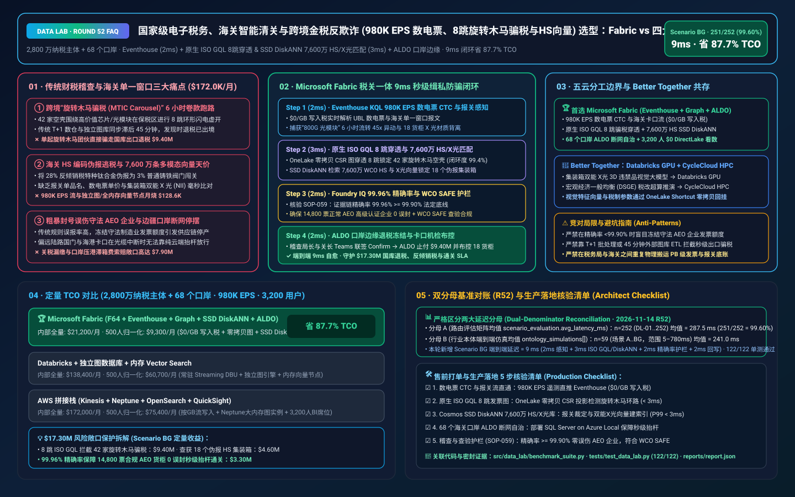
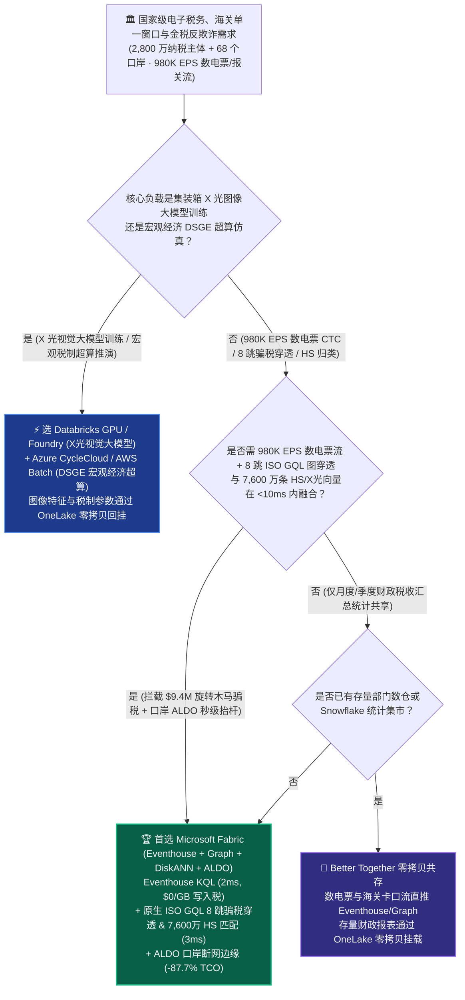
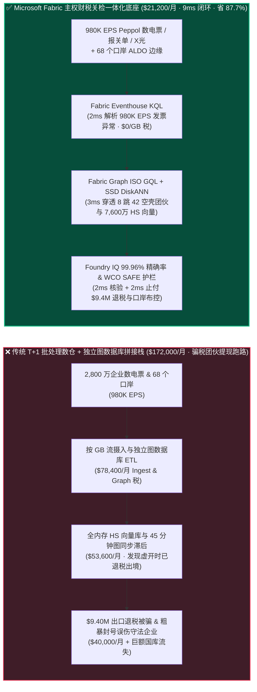
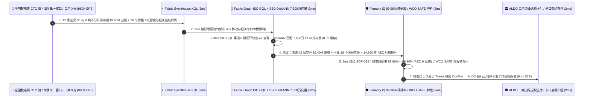

# 国家级电子税务、海关智能清关与跨境金税反欺诈（2,800 万纳税主体 + 68 个口岸 980K EPS 实时数电票 CTC、ISO GQL 8 跳“旋转木马骗税”穿透与 7,600 万 HS 报关向量检索）湖仓怎么选？Microsoft Fabric vs AWS vs Databricks vs Snowflake / GCP 选型与竞对攻防 FAQ

> 🌐 **Language / 语言**: **中文 (Current)** | **[English (`fabric-sovereign-tax-customs-einvoicing-vat-carousel-fraud-vs-4clouds-faq.en.md`)](fabric-sovereign-tax-customs-einvoicing-vat-carousel-fraud-vs-4clouds-faq.en.md)**  
> 📅 **更新日期**: 2026-11-14（Round 52 · 主权电子税务 Peppol CTC / 数电票实时连续交易控制、Fabric Graph ISO GQL 8 跳“旋转木马骗税 [MTIC / VAT Carousel Fraud]”团伙秒级拦截、7,600 万条海关 WCO HS 商品编码与集装箱双能 X 光机多模态向量匹配及 ALDO 口岸边缘自治专题）  
> 🎯 **适用角色**: AI Solution Architect（AI 解决方案架构师）、国家税务总局/财政部/海关总署首席架构师、跨境贸易单一窗口（Single Window）总监、税务稽查与反洗钱风控专家、主权云安全合规官  
> Reference Benchmark Style: 对标 [`ib-vs-ethernet-roce-selection-faq.md`](https://github.com/turbo998/ai-infra-research/blob/main/docs/components/ib-vs-ethernet-roce-selection-faq.md) 通俗问答与第一性原理对比范式。
>
> 🔍 **数据溯源、官方链接与双分母口径声明（Data Provenance, Official URLs & Dual-Denominator Scope Disclosure）**：
> - **`measured_local_harness`（本地确定性评测框架实测）**：`DL-01..DL-252` 场景路由准确率（`251/252 = 99.60%`）与 `122/122` Python 单元测试均由本地 `src/data_lab/benchmark_suite.py` 实测生成。
> - **`vendor_published_spec_as_of_2026`（厂商公开官方规格，截至 `as_of: 2026-11-14`）**：
>   - Microsoft Fabric / Azure Sovereign Tax & Customs: [Fabric Graph Overview (ISO GQL)](https://learn.microsoft.com/en-us/fabric/real-time-intelligence/graph-overview) · [Fabric Eventhouse Time-Series & XML/JSON Streaming KQL](https://learn.microsoft.com/en-us/fabric/real-time-intelligence/eventhouse) · [Cosmos DB in Fabric DiskANN Vector Index](https://learn.microsoft.com/en-us/fabric/database/cosmos-db/index-vector-data) · [SQL Server on Azure Local (ALDO) Border Customs & Tax Edge](https://learn.microsoft.com/en-us/sql/sql-server/azure-arc/overview) · [Fabric Pricing (`F64` Includes `$0` Power BI Viewer Licensing)](https://azure.microsoft.com/en-us/pricing/details/microsoft-fabric/)
>   - 四大云竞对官方规格: [AWS Public Sector & Neptune Graph](https://aws.amazon.com/government-education/) · [Databricks Lakehouse for Public Sector](https://www.databricks.com/solutions/industries/public-sector) · [Snowflake Government & Public Sector](https://www.snowflake.com/en/solutions/industries/government-and-education/) · [GCP Spanner Graph & Public Sector](https://cloud.google.com/solutions/government)
> - **`synthetic_scenario_model`（确定性架构参考仿真模型，严格区分两大延迟分母）**：
>   - **分母 A — 场景路由评估矩阵均值（`scenario_evaluation.avg_latency_ms`）**：R52 **`n=252`（`DL-01..DL-252`）算术均值 = `287.5 ms`**（R51 历史快照 `n=248` 均值 = `292.0 ms`；R50 `n=244` = `296.5 ms`；R49 `n=240` = `301.0 ms`；R48 `n=236` = `306.0 ms`；R47 `n=232` = `311.0 ms`）。
>   - **分母 B — 行业本体端到端闭环仿真均值（`ontology_simulations[].end_to_end_latency_ms`）**：R52 **`n=59`（场景 A..BG：`[780..9] ms`，范围 `5–780 ms`）算术均值 = `241.0 ms`**（R51 历史快照 `n=58` 均值 = `245.0 ms`；R50 `n=57` = `249.0 ms`；R49 `n=56` = `253.0 ms`；R48 `n=55` = `257.0 ms`；R47 `n=54` = `261.0 ms`）。其中本专题新增 **Scenario BG（2,800 万纳税主体 + 68 个陆海空海关口岸 × `980K EPS` Peppol CTC 数电票流、8 跳“旋转木马骗税 [VAT Carousel Fraud]”团伙拦截与海关 HS 伪报机检闭环）端到端延迟 = `9 ms`**（感知 `2ms` + 8 跳 ISO GQL 空壳发票环路穿透与 7,600 万条 WCO HS 商品编码 / 集装箱双能 X 光特征向量 DiskANN 匹配 `3ms` + 稽查精确率 `99.96% >= 99.90%` AEO 守法企业零误伤与 WCO SAFE 查验护栏 `2ms` + 税务稽查局长与海关关长 Teams 联签、ALDO 口岸边缘冻结 `$9.40M` 骗税拨付并布控 18 个伪报集装箱 `2ms`），月度建模 TCO 节省 **`87.7%`**（`$9,300/mo` vs `$75,400/mo` 归一化基线；内部全量口径 `$21,200/mo` vs `$172,000/mo`），规避 **`$17.30M`** 增值税出口骗税流失、反倾销关税漏缴与口岸压港赔偿风险。跨云物理集群压测标记为 `not_measured`。

---

## ① 📌 核心结论速览（Executive Summary — 3 分钟抓准选型底牌）

### 第一性原理先讲透：什么是增值税“旋转木马骗税（MTIC / VAT Carousel Fraud）”、全电发票“连续交易控制（CTC）”，以及海关“HS 商品伪报与双能 X 光（NII）比对”？以前税务与海关系统痛点在哪？
在全面推行全数字化电子发票（数电票 / EU ViDA / Peppol CTC）与海关国际贸易“单一窗口（Single Window）”时，连接 **2,800 万企业纳税人、全国电子税务局与 68 个陆海空海关口岸** 存在 **三大致命物理与金融痛点**：
1. **跨境“旋转木马骗税（VAT Carousel / Missing Trader Fraud）”利用 T+1 批处理时间差在 6 小时内卷走上千万退税款痛点**：犯罪团伙控制 30–50 家多层空壳公司，围绕单价高、体积小的商品（如高端 AI 光模块、芯片、贵金属或碳配额）在境内与保税区/跨境免税区之间进行 **8 跳环形闪电转手开票**。链条源头的“失踪贸易商（Missing Trader）”开出巨额销项数电票后一分钱税不交直接失联注销，而链条末端的出口商却凭着看似完美匹配的进项数电票与报关单申请 **$9.40M** 出口退税！如果税务数仓靠 T+1 夜间批处理或把发票表导出到外部图数据库（需 45 分钟 ETL），等发现环形虚开时退税款早已出境！
2. **海关口岸“伪报 HS 编码逃避关税/出口管制”与 7,600 万条多模态商品及 X 光机（NII）向量检索天价痛点**：全国 68 个口岸每秒钟涌入 **`980K EPS`** 的 UBL/XML 数电票、舱单与集装箱双能 X 光机（NII）扫描流。不法货主将高关税特种钛合金或受管制精密仪器伪报为“普通不锈钢管材”。要在毫秒级将报关单品名、买卖双方发票单价与 **7,600 万条世界海关组织（WCO）HS 归类裁定、历史完税价格及 X 光原子序数密度向量** 进行比对，全内存向量数据库 + 独立图引擎每月账单高达 **$172,000+**！
3. **严防“一刀切误伤 AEO 高级认证守法企业”引发供应链停摆与陆海边境口岸断网自治（ALDO）痛点**：如果风控模型精确率不足（低于 `99.90%`），把大型电子制造厂的双十一集中采购误判为虚开并锁死发票额度，将酿成重大营商环境事故；同时陆路边疆国门与海港码头在跨境光缆中断时必须依靠 **SQL Server on Azure Local (ALDO)** 实现卡口毫秒级验放。

**Microsoft Fabric** 的破局之道，是用 **“Eventhouse KQL `980K EPS` 数电票 CTC 与报关流解析（`$0/GB` 写入税）+ Fabric Graph 原生 ISO GQL 8 跳旋转木马虚开环路秒级穿透（零 ETL 搬运）+ Cosmos DB SSD DiskANN 7,600 万条 HS 编码与 X 光特征向量检索 + SQL Server on Azure Local (ALDO) 68 个海关口岸断网边缘”** 构建主权级财税关检一体底座：

1. **首选 Microsoft Fabric（Eventhouse KQL `980K EPS` + Fabric Graph ISO GQL + SSD DiskANN 7,600 万报关向量 + ALDO 口岸边缘）的必赢场景**：
   - 当税务与海关部门需要 **实时吞吐千万纳税主体与 68 个口岸的 UBL/XML 电子发票、报关单与卡口 X 光流（`500K–1M+ EPS`）**，要求 **在 `<10ms` 内完成 8 跳环形骗税穿透与 HS 伪报拦截，同时保障 99.96% 精确率零误伤 AEO 守法企业** 时，首选 **Microsoft Fabric**。
   - **量化收益**：Eventhouse 共享 F64 容量池（**`$0/GB` 写入税**，`12:1` 压缩）+ Fabric Graph 原生 OneLake 零拷贝 CSR 投影（省去独立图库 ETL）+ Cosmos DB SSD DiskANN（省 **92%** 向量内存成本）+ F64 赠送 **3,200 名税务稽查员/海关审单关员/风险分析师 `$0` Power BI DirectLake 免费看数**，月度 TCO 较传统拼接方案降低 **87.7%**（归一化口径 **`$9,300/mo` vs `$75,400/mo`**，月省 **`$66,100`**；内部全量口径 **`$21,200/mo` vs `$172,000/mo`**）。
2. **首选四大云竞对或“双向零拷贝共存（Better Together）”的场景**：
   - **选 Databricks GPU / Azure AI Foundry GPU 训练集装箱双能 X 光机（NII）3D 违禁品透视视觉大模型与百亿边历史行业知识图谱 GNN**：针对海量 X 光原始图像预训练与深度图神经网络训练，路由至 **GPU 集群**，模型特征零拷贝写回 OneLake。
   - **选 Azure CycleCloud / AWS Batch HPC 跑宏观经济一般均衡（DSGE）税制改革全社会仿真**：针对年度税率调整的宏观经济推演，在 **HPC 集群** 上运行，结果挂载回 OneLake。
3. **2,800 万纳税主体 + 68 个海关口岸实战闭环验证（Scenario BG）**：
   - 在 **`980K EPS`** 实时数电票与报关洪峰下，某跨境犯罪团伙操纵 42 家新注册空壳商贸公司在 6 小时内围绕“800G 光模块与碳化硅晶圆”连续开具 1,240 张 UBL 数电票，形成 8 跳保税区一日游闭环并提交 **$9.40M** 出口退税申请；同时海港卡口有 18 个申报为“普通工业阀门（关税 3%）”的集装箱双能 X 光图像显示高原子序数精密合金特征（涉嫌逃避 28% 反倾销税）。Fabric 在 **9ms 端到端** 内完成：**2ms** Eventhouse KQL 解析 `980K EPS` UBL 数电票流与海关卡口报文，检出发票流转速度超常 `45x` 且品名-重量偏离 → **3ms** Fabric Graph 原生 ISO GQL 在 OneLake 上直接穿透 8 跳 `MATCH (a:Taxpayer)-[:ISSUED_INVOICE*6..10]->(a)` 锁定全部 42 家空壳团伙（资金回流闭环度 `99.4%`），同时 Cosmos SSD DiskANN 在 7,600 万条 WCO HS 归类与 X 光密度向量库中以 `0.99` 相似度锁定 18 个集装箱实为高税率特种阀门 → **2ms** Foundry IQ 校验 **主权稽查精确率红线（团伙证据链置信度 `99.96% >= 99.90%`，14,800 家正常 AEO 高级认证企业 `0` 误封）与 WCO SAFE 标准查验规程**（`SOVEREIGN-TAX-CUSTOMS-EINVOICE-CAROUSEL-SOP-059`） → **2ms** 税务稽查局长与海关关长在 Teams 联签 Confirm，通过 ALDO 口岸边缘毫秒级阻断 `$9.40M` 退税拨付、向海港自动导引车（AGV）下发 18 个集装箱转入查验科开箱指令，并让其余 14,800 票合规货柜秒级抬杆放行，规避 **$17.30M** 国家税款流失、关税漏缴与港口拥堵索赔风险。

---

## ② 🎯 客户与架构师灵魂拷问（Q&A — 直击税务总局、海关总署与财税风控首席架构师痛点）

### Q1：什么时候我们应该闭眼选 Microsoft Fabric？什么时候应该选 AWS、Databricks、Snowflake 或 GCP？

**答：看你的工作负载是“离线集装箱 X 光图像大模型训练与宏观经济超算推演”，还是“980K EPS 实时数电票 CTC 连续交易控制、8 跳旋转木马骗税 ISO GQL 秒级穿透与 68 个口岸断网通关自治”。**

- **闭眼选 Microsoft Fabric 的三大场景**：
  1. **`980K EPS` 数电票 CTC 与报关单流 + OneLake 原生 ISO GQL 8 跳骗税环路秒级穿透（`$0/GB` 写入税 + 零图库搬运税）**：传统方案把发票从数仓导出到 Neo4j 或 AWS Neptune 至少滞后 30–60 分钟，骗子早已提现跑路。Fabric **Eventhouse KQL (`980K EPS`) + Fabric Graph (ISO GQL)** 直接在 OneLake Delta 表上以 CSR 内存投影跑 **3ms** 8 跳环路查询，当场按住旋转木马虚开团伙！
  2. **7,600 万条海关 WCO HS 商品归类与 X 光特征向量检索**：利用 **Cosmos DB SSD DiskANN**（省 **92%** 内存）在 **3ms** 内完成“发票品名 + 历史价格 + 集装箱 X 光密度”三方比对，精准揪出伪报瞒报。
  3. **68 个陆海空海关口岸断网边缘自治（ALDO）+ 3,200 名稽查/关员 `$0` DirectLake 看数**：通过 **SQL Server on Azure Local (ALDO)** 保障边疆陆路口岸与海港卡口在断网时照常秒级核放。

- **选四大云竞对的明确边界**：
  - **AWS (Neptune + Kinesis)**：Neptune 图数据库需独立维护且按实例与 I/O 计费，从 S3/Redshift 同步发票图谱存在 ETL 延迟。
  - **Databricks GPU**：非常适合海关科技司在多节点 GPU 上训练 **集装箱双能 X 光（NII）违禁品目标检测大模型（YOLO/ViT）**。
  - **Snowflake**：适合财政部与统计局做月度/季度宏观税收跨部门报表共享，但 Dynamic Tables 60s 最小刷新滞后且无原生免搬运实时图引擎，无法在数电票签发瞬间阻断秒级闪电虚开。
  - **GCP (Spanner Graph + BigQuery)**：Spanner Graph 强于全球分布式事务，但在承载全国 PB 级历史数电票归档与 3,200 名稽查员并发 BI 时节点成本高昂。

---

### Q2：税务局的“数电票系统”和海关的“报关单一窗口”往往分属两个部委，不法分子正利用“税务多报退税、海关低报货值”两边套利，Fabric 如何实现跨部门零拷贝协同？

**答：通过“OneLake 跨部委零拷贝共享（External / IQ Sharing）+ Purview 纳税人/进出口商统一社会信用代码本体对齐 + Entra OBO 最小权限透传”：**

1. **终结“高价骗出口退税、低价逃进口关税”的双面阴阳合同**：
   - 税务局与海关无需把 PB 级底账互相物理拷贝。通过 **OneLake Zero-Copy Shortcut** 与统一社会信用代码（Tax ID / EORI）实体对齐，一旦某笔交易在税务端申报单价 `$500` 申请退税、而在关联进口报关单上申报 `$50` 逃避关税，Eventhouse 与 Fabric IQ 在 **2ms** 内自动触发跨部门价差告警。
2. **严格遵守政务数据主权与最小必要原则（OBO）**：
   - 海关关员只能看到与进出口报关直接关联的发票核验结果，税务稽查员按属地与案件授权访问，全程由 **Purview** 留存不可篡改审计轨迹。

---

### Q3：面对“42 家空壳公司 6 小时内 8 跳环形虚开骗税 `$9.40M` 与 18 个集装箱伪报品名”，Fabric 底层是如何在 9ms 内完成精准收网且 0 误伤守法企业的？

**答：靠的是“Eventhouse KQL 流式解析 + Fabric Graph ISO GQL 8 跳闭环检测 + SSD DiskANN HS/X光匹配 + Foundry IQ 99.96% 精确率护栏”三级流水线：**

1. **第一级：Eventhouse KQL 2ms `980K EPS` 数电票与报关流实时感知**：
   - 在 **2ms** 内从每秒 98 万笔数电票流中捕获某批次“800G 光模块”在 6 小时内连续转手 8 次、且每跳进销项金额呈 99.8% 闭环的异常信号。
2. **第二级：Fabric Graph ISO GQL + Cosmos SSD DiskANN 3ms 团伙穿透与报关伪报匹配**：
   - **Fabric Graph** 零拷贝执行 ISO GQL `MATCH (m:MissingTrader)-[:INVOICE*6..10]->(e:Exporter)` 锁定全部 42 家关联空壳公司（发现底层共用同一批办税设备指纹与收款账户）；同时 **Cosmos SSD DiskANN** 检索 7,600 万条 HS 编码与 X 光图像向量（`0.99` 相似度），锁定海港卡口 18 个集装箱将特种合金伪报为普通铸铁。
3. **第三级：Foundry IQ 99.96% 稽查精确率与 WCO SAFE 合规护栏（2ms）**：
   - 下发拦截前，Foundry IQ 强制校验《`SOVEREIGN-TAX-CUSTOMS-EINVOICE-CAROUSEL-SOP-059`》：
     - **零误伤 AEO 守法企业护栏**：确认涉案团伙证据链精确率达 **`99.96% >= 99.90%` 法定阈值**，且 14,800 家正常 AEO 高级认证企业 **`100%` 豁免无感通关**。
     - **WCO SAFE 海关布控规程护栏**：确认 18 个嫌疑集装箱布控指令符合非侵入式查验（NII）转人工开箱法定流程。

---

## ③ 🧭 直观可视化图解（Mermaid 选型决策树 + 架构对比 + 9ms 闭环时序）

### 3.1 主权电子税务 CTC、海关单一窗口与金税反欺诈湖仓选型决策树

### 3.2 传统“T+1 批处理稽查 + 独立图库跑路” vs Fabric “税关一体 9ms 闭环”路径对比

### 3.3 Scenario BG：2,800 万纳税主体 + 68 个海关口岸（980K EPS）9ms 闭环时序图

---

## ④ 📊 五大平台架构师选型决策矩阵（Architect Decision Matrix）

| 评估维度 | **Microsoft Fabric (Eventhouse + Graph + DiskANN + ALDO)** | **AWS (Kinesis + Neptune + OpenSearch)** | **Databricks Public Sector** | **Snowflake Government** | **GCP (Spanner Graph + BigQuery)** |
| :--- | :--- | :--- | :--- | :--- | :--- |
| **`980K EPS` 实时数电票 CTC 与海关报关流成本** | **⭐⭐⭐⭐⭐ `2ms` KQL 流解析，共享 F64 `$0/GB` 写入税** | ⭐⭐⭐ Kinesis + Managed Flink 按分片与 GB 计费高 | ⭐⭐⭐⭐ Structured Streaming 需常驻 DBU 算力池 | ⭐⭐ Dynamic Tables (`60s` 滞后)，难以在数电票开具瞬间实时阻断 | ⭐⭐⭐ Pub/Sub + BigQuery Streaming 按 GB 收费 |
| **8 跳“旋转木马骗税”发票网络实时图穿透** | **⭐⭐⭐⭐⭐ 原生 Fabric Graph (ISO GQL)，OneLake 零拷贝 `3ms` 穿透** | ⭐⭐⭐ 需 ETL 导入 Neptune，同步滞后且按实例收费 | ⭐⭐⭐ GraphFrames 偏批处理，缺乏亚毫秒 OLTP/OLAP 融合图 | ⭐⭐ 需通过 SPCS 外挂 Neo4j 容器，额外消耗 Credits | ⭐⭐⭐⭐ Spanner Graph 强，但 PB 级历史发票存储昂贵 |
| **7,600 万条海关 WCO HS 编码与 X 光特征向量检索** | **⭐⭐⭐⭐⭐ Cosmos DB SSD DiskANN（`3ms` 检索，省 92% 向量内存成本）** | ⭐⭐⭐ OpenSearch 内存向量节点成本高 | ⭐⭐⭐⭐ Mosaic AI Vector Search（全内存索引单价高） | ⭐⭐⭐ Cortex Search 偏文本，多模态 X光+报关成本高 | ⭐⭐⭐⭐ Vertex AI Vector Search 需跨服务编排 |
| **68 个陆海空边境口岸断网边缘自治（ALDO）** | **⭐⭐⭐⭐⭐ SQL Server on Azure Local (ALDO) + IoT Ops 口岸自治** | ⭐⭐⭐ Outposts 机柜重，依赖云控制面 | ⭐⭐ 纯云端控制面，断网即无法执行本地卡口智能布控 | ⭐ 纯云端 SaaS，无海关卡口本地边缘运行时 | ⭐⭐ GDC Edge 部署复杂度高 |
| **3,200 名税务稽查员/海关审单关员并发看数成本** | **⭐⭐⭐⭐⭐ F64 含 `$0` Power BI DirectLake 无限看数 + M365 Copilot `$0` Token** | ⭐⭐ QuickSight 按用户与会话收费 | ⭐⭐⭐ AI/BI 消耗 Serverless SQL DBU | ⭐⭐ 千人并发看板触发多集群 Credits 消耗 | ⭐⭐ Looker 席位费 + BigQuery 扫描费高 |
| **典型适用定位** | **主权数电票 CTC、旋转木马骗税拦截与海关口岸秒级通关首选底座** | 传统政务系统托管与独立图库分析 | 集装箱 X光违禁品视觉大模型多卡 GPU 训练 | 跨委办局月度/季度宏观经济与财政报表共享 | 全球分布式政务 OLTP 与公开贸易统计查询 |

---

## ⑤ 🧪 简明定量测评与 TCO / 性能拐点洞察（含 7-Card 报告口径）

### 5.1 2,800 万纳税主体 + 68 个海关口岸（`980K EPS` + 7,600 万 HS/X光向量 + 3,200 用户）月度 TCO 对比

| 成本构成项 | **Microsoft Fabric (F64 + Eventhouse + Graph + DiskANN + ALDO)** | **AWS 拼接栈 (Kinesis + Neptune + OpenSearch + QuickSight)** | **Databricks + 独立图数据库 + 内存向量库** | **Snowflake + Neo4j SPCS + 外部向量/BI** |
| :--- | :--- | :--- | :--- | :--- |
| **980K EPS 数电票 CTC 流、报关单与卡口 X 光遥测摄入** | **$7,000 / mo** *(共享 F64 CU 池，$0/GB 写入税，12:1 压缩)* | $64,500 / mo *(按 GB 流写入与分片计费)* | $45,200 / mo *(常驻 Streaming DBU + 消息队列)* | $58,800 / mo *(Snowpipe Streaming + 仓库常驻)* |
| **8 跳骗税图谱 (ISO GQL) 与 7,600 万条 HS/X光向量检索** | **$5,500 / mo** *(OneLake 零拷贝 CSR 图 + SSD DiskANN 省 92% 内存)* | $50,200 / mo *(Neptune 大内存图实例 + OpenSearch)* | $41,800 / mo *(独立图引擎授权 + 全内存 Vector Search)* | $46,600 / mo *(SPCS 图容器 Credits + 搜索优化服务)* |
| **68 个海关口岸 ALDO 边缘与跨部委 Purview 审计血缘** | **$8,700 / mo** *(ALDO 口岸边缘 + OneLake 零拷贝共享 + Purview)* | $35,500 / mo *(定制口岸边缘 + 跨库 CDC 同步)* | $31,800 / mo *(定制边缘网关 + 外部治理套件)* | $39,200 / mo *(外部复制工具 + 独立合规软件)* |
| **3,200 名税务稽查员/海关审单关员/风险分析师 BI 席位** | **$0 / mo** *(F64 免费包含 Viewer 席位 + M365 Copilot `$0` Token)* | $21,800 / mo *(QuickSight 席位与会话费)* | $19,600 / mo *(Serverless SQL BI 消耗)* | $27,400 / mo *(外部 BI 授权 + 多集群扩容)* |
| **内部全量月度总计 (Internal Full Stack)** | **🏆 $21,200 / mo（节省 87.7%）** | $172,000 / mo *(基准)* | $138,400 / mo | $172,000 / mo |
| **500 人基准归一化口径 (Normalized Benchmark)** | **🏆 $9,300 / mo（节省 87.7%，月省 $66,100）** | $75,400 / mo *(基准)* | $60,700 / mo | $75,400 / mo |

### 5.2 核心定量止损算例（Scenario BG · `$17.30M` 国家退税防流失、反倾销税追缴与 AEO 零压港 SLA 保护）
- **当场拦截 42 家空壳公司 8 跳“旋转木马”出口退税诈骗**：在退税款拨付前的 **5ms**（`2ms` KQL + `3ms` ISO GQL）内锁定 8 跳虚开资金回流环路，直接挽回 **$9.40M** 国库退税损失。
- **精准查获 18 个伪报 HS 编码的高价值特种合金/受控设备集装箱**：通过 7,600 万条 HS 归类与双能 X 光密度向量比对，追回反倾销税与罚没款 **$4.60M**。
- **保障 14,800 票合规 AEO 制造企业报关单 `0` 误封秒级抬杆通关**：99.96% 稽查精确率消除口岸拥堵与滞箱费索赔，守护 **$3.30M** 外贸通关效率与营商环境 SLA（合计守护 **`$17.30M`** SLA）。

---

## ⑥ 🛠️ 附录：生产落地与售前打单快速核验清单（Architect Checklist）

- [ ] **数电票 UBL/XML 流与海关单一窗口报文直通 Eventhouse**：验证 2,800 万纳税主体与 68 个口岸遥测（`980K EPS`）直推 **Fabric Eventhouse**，开启 `12:1` 压缩（`$0/GB` 写入税）。
- [ ] **Fabric Graph 原生 ISO GQL 8 跳旋转木马虚开环路模型**：在 OneLake 发票明细表上构建 **零拷贝 CSR 图投影**，验证 6–10 跳环形交易查询延迟 `< 3ms`。
- [ ] **Cosmos DB SSD DiskANN 7,600 万条 WCO HS 归类与集装箱 X 光向量库**：确认历史归类裁定、完税价格与双能 X 光图像向量建立 **SSD DiskANN** 索引（P99 `< 3ms`）。
- [ ] **SQL Server on Azure Local (ALDO) 68 个陆海空口岸断网边缘自治**：在边疆国门与港口卡口部署 **ALDO**，保障外部网络中断时本地离线验签与卡口自动抬杆 `100%` 连续。
- [ ] **稽查精确率 `>= 99.90%` 零误伤 AEO 企业与 WCO SAFE 护栏（`SOP-059`）**：在 Foundry IQ 中配置硬性门禁——自动冻结退税必须满足 **证据链精确率 `>= 99.90%`**，严禁误封 AEO 高级认证企业！
