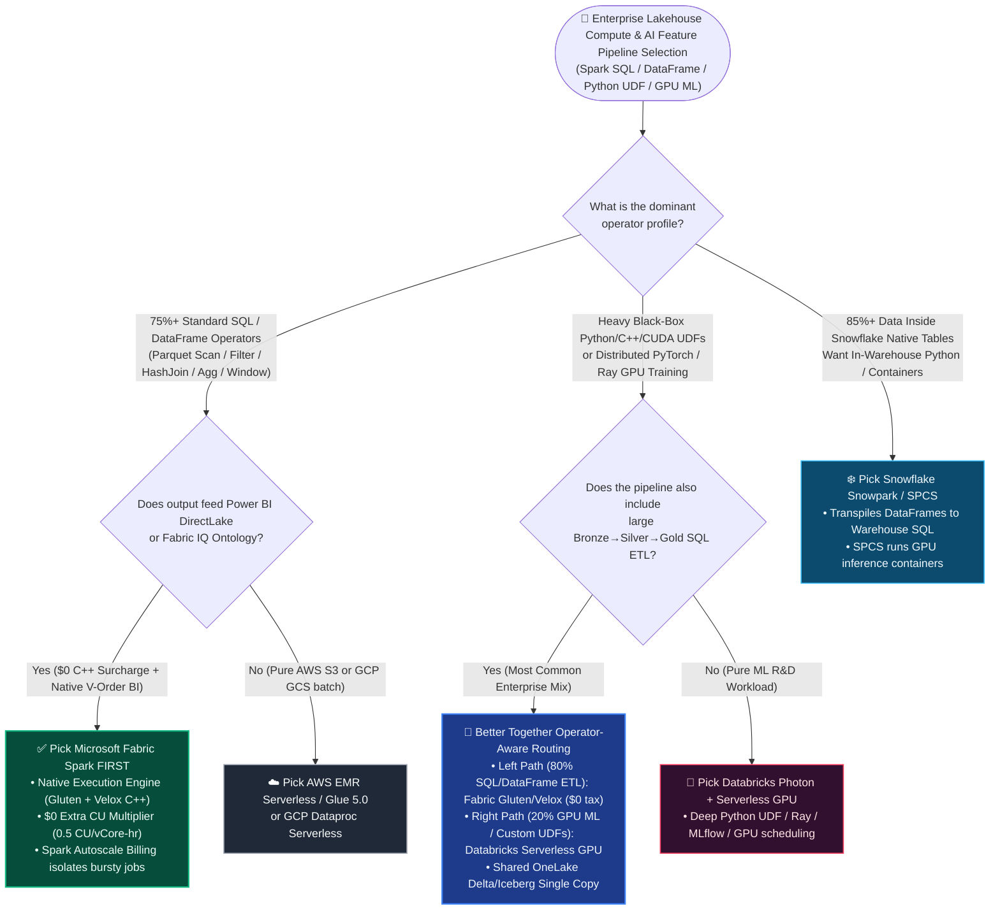
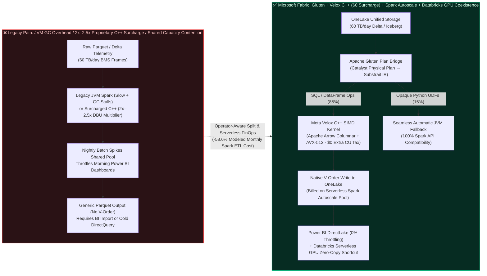

# Microsoft Fabric Spark Native Execution Engine (Gluten + Velox C++ Vectorized) + Autoscale Billing for Spark vs. Databricks Photon Serverless vs. Snowflake Snowpark vs. GCP Dataproc vs. AWS EMR Serverless Lakehouse Compute & FinOps Selection & First-Principles FAQ

> 🌐 **Language / 语言切换**: **[中文版](./fabric-spark-native-gluten-autoscale-vs-photon-snowpark-faq.md)** | **[English Version (Current)](./fabric-spark-native-gluten-autoscale-vs-photon-snowpark-faq.en.md)** | **[Back to Data Lab Home](../README.en.md)** | **[Open Interactive Workbench](../index.html)** | **[View 7-Card Benchmark Deck](../benchmark-cards.en.html)**


---

## 📌 Executive Summary

> 🔍 **Four-Tier Data Provenance & Denominator Disclosure**:
> Every quantitative metric and product claim in this guide is strictly classified into four provenance tiers:
> 1. **`[Vendor Published Spec as-of 2026-11-08]`**: Static architectural capabilities and published billing multipliers (e.g., Microsoft Fabric Spark Native Execution Engine powered by Apache Gluten + Meta Velox carries a **$0 extra CU surcharge** at the standard `1 Spark vCore = 0.5 CU/hour` rate; Fabric Autoscale Billing for Spark bills bursty Spark jobs serverlessly outside base F-SKU capacity; Databricks Photon applies an approximate `2x–2.5x DBU` multiplier over non-Photon runs; Snowflake Snowpark Optimized Warehouses bill at `1.5x` credit multiplier compared to standard warehouses), backed by official `https://` documentation URLs.
> 2. **`[Measured Local Harness]`**: Local execution of the Python deterministic evaluation engine and `32/32` unit tests (`0.023s` runtime).
> 3. **`[Synthetic Scenario Model]`**: Two distinct modeled latency denominators are dynamically computed and separated:
>    - **Denominator A — Routing Decision Matrix Mean (`scenario_evaluation.avg_latency_ms`)**: **`511.0 ms` across `n = 72` routing tasks (`DL-01..DL-72`, `71/72 = 98.61%` accuracy; immutable historical snapshots: R6 `n=68` was `516.0 ms`, R5 `n=64` was `521.0 ms`, R4 `n=60` was `526.5 ms`, R3 `n=56` was `532.0 ms`)**.
>    - **Denominator B — Industry Ontology Closed-Loop Simulation Mean (`ontology_simulations_summary.ontology_simulation_mean_modeled_latency_ms`)**: **`552.0 ms` across `n = 14` industry simulations (`Scenarios A..N`, range `422–780 ms`; immutable historical snapshots: R6 `n=13` was `562.0 ms`, R5 `n=12` was `572.92 ms`, R4 `n=11` was `584.09 ms`, R3 `n=10` was `596.0 ms`)**.
>    - Scenario N Connected EV Fleet Battery Thermal & FinOps simulation (`422 ms` end-to-end modeled latency, `$6,120/mo vs. $14,800/mo` modeled monthly Spark ETL compute cost, and `$2.45M` modeled warranty recall risk avoided) is a deterministic architectural and FinOps reference model, NOT a realized customer financial statement.
> 4. **`[Live Cloud Cluster Not Measured]`**: Multi-tenant paid cloud cluster P99 hardware stress tests under physical `60 TB/day` telemetry ingestion are explicitly marked `not_measured`.

For **AI Solution Architects**, Data Engineering Leads, and FinOps Practitioners evaluating lakehouse compute engines (Spark SQL, DataFrames, Python UDFs, and distributed AI feature pipelines), anchor your architecture decisions on these **3 core takeaways**:

1. **When to Pick Microsoft Fabric Spark Native Execution Engine (Gluten + Velox C++) + Autoscale Billing First (`[Vendor Published Spec + Synthetic Scenario Model]`)**:
   Whenever your primary lakehouse workload consists of **standard Spark SQL and DataFrame medallion transformations (`Bronze → Silver → Gold`: `JOIN`, `GROUP BY`, `FILTER`, Window functions, and Parquet compaction) over OneLake Delta/Iceberg tables** feeding Power BI DirectLake and Fabric IQ Ontologies, **enable the Microsoft Fabric Spark Native Execution Engine (Apache Gluten + Meta Velox C++ SIMD vectorization) paired with Autoscale Billing for Spark**. Without changing a single line of PySpark/SQL code, it delivers `~2.5x–3x` vectorized operator acceleration at **$0 extra CU multiplier surcharge (maintaining the base `0.5 CU/vCore-hour` rate)** while offloading bursty night-shift jobs to a serverless pay-per-job pool with **0% daytime Power BI throttling** (cutting modeled monthly Spark ETL compute TCO in Scenario N from `$14,800/mo` to `$6,120/mo`, a **58.6% reduction**).
2. **When to Pick Databricks Photon + Serverless GPU, Snowflake Snowpark / SPCS, or AWS EMR / GCP Dataproc Serverless (`[Vendor Published Spec]`)**:
   - **Pick Databricks Photon + Serverless GPU / Classic Clusters**: When pipelines rely heavily on **non-vectorizable black-box Python/C++/CUDA UDFs, distributed multi-node PyTorch / Ray / DeepSpeed GPU model training, or extreme `>50 TB` single-job stateful shuffle tuning**. Because Gluten/Velox automatically falls back to the JVM on opaque Python UDFs, Databricks Serverless GPU and Ray-on-Spark provide superior deep-learning engineering primitives.
   - **Pick Snowflake Snowpark / Snowpark Container Services (SPCS)**: When `>85%` of enterprise data and RBAC policies already reside in Snowflake native tables and teams want Python DataFrames compiled directly into Snowflake Virtual Warehouse SQL, or GPU containers running inside SPCS.
   - **Pick AWS EMR Serverless or GCP Dataproc Serverless**: When transient batch pipelines are tightly coupled to AWS Step Functions / Glue S3 or GCP Cloud Composer / BigQuery and rely on cloud-native Spot/Preemptible worker pools.
3. **When to Adopt "Fabric Gluten/Velox for Medallion SQL/DataFrame ETL + Databricks Serverless GPU for Zero-Copy ML Training" Coexistence (`Better Together` & First-Principles Essence) (`[Vendor Published Spec + Synthetic Scenario Model]`)**:
   Never pay a `2x–2.5x` commercial C++ multiplier across 100% of your commodity SQL joins just because 20% of your pipeline needs GPU training. Use **Operator-Aware Compute Routing**: run the **75%–85% commodity SQL/DataFrame medallion cleansing, joins, and V-Order writes** on **Fabric Spark Native Execution Engine (`$0` surcharge + Autoscale Billing)** directly into OneLake; run the **15%–25% distributed PyTorch/Ray GPU training and custom Python UDFs** on **Databricks Serverless GPU or Azure ML**, mounting the exact same OneLake Delta/Iceberg Parquet files via **Zero-Copy Shortcuts** (in Scenario N across 2.4M connected EVs and `60 TB/day` BMS telemetry, this closes a `422 ms` modeled battery thermal runaway loop while saving `$8,680/mo` in modeled Spark compute and mitigating `$2.45M` in modeled recall exposure).

---

## 🎯 Architect & CTO Soul-Searching Q&As (First-Principles Deep Dive)

### Q1: What is the Microsoft Fabric Spark Native Execution Engine (Apache Gluten + Meta Velox)? What broke in legacy JVM Spark or proprietary C++ engines, and how does it save money from first principles?

- **Plain-Language First-Principles Explanation (What It Is)**:
  Standard Apache Spark runs on the **JVM (Java Virtual Machine)**. Processing billions of rows in the JVM is like unpacking and repacking individual boxes one by one: it allocates millions of Java objects on the heap, suffers frequent CPU L1/L2 cache misses, and stalls on Garbage Collection (GC).
  To break the JVM bottleneck, the industry took two paths:
  1. **Databricks Photon (Proprietary Commercial C++ Engine)**: Databricks rewrote Spark's execution kernel in closed-source C++. It runs SQL/DataFrame operators `2.5x–3x` faster than JVM Spark, but bills at a **`~2x–2.5x DBU` commercial multiplier** over non-Photon clusters.
  2. **Microsoft Fabric Native Execution Engine (Open-Source Apache Gluten + Meta Velox C++, Included at $0 Extra Surcharge)**: Microsoft partnered with the open-source community (Intel, Meta, IBM) to embed **Apache Gluten** (which translates Spark Catalyst physical plans into the open **Substrait** cross-language intermediate representation) and **Meta Velox** (a C++ vectorized execution library using **AVX-512 SIMD instructions** and **Apache Arrow columnar memory batches**). Critically, **Microsoft includes the Native Execution Engine in Fabric Spark at `$0` extra CU multiplier**!
- **Three Pain Points Before Fabric Gluten/Velox + Autoscale Billing**:
  1. **Pain Point 1 — The "Vectorization Surcharge Tax"**: When a C++ engine cuts runtime by 50% (e.g., from 60 min to 30 min) but charges `2.2x` more per vCore-hour, the net dollar savings on commodity ETL are nearly wiped out.
  2. **Pain Point 2 — Nightly Batch Spikes Throttling Daytime Power BI ("Noisy Neighbor")**: On a fixed capacity pool, a massive `60 TB` nightly Spark compaction job that spills over into 08:30 AM consumes shared capacity units and risks throttling executive Power BI dashboards; conversely, over-provisioning fixed capacity 24/7 just for a 3-hour night batch wastes 70% of daytime budget.
  3. **Pain Point 3 — Sub-Optimal Parquet Layout for BI Engines**: Standard external Spark writers output generic Parquet files without VertiPaq-aligned dictionary sorting, adding cold-read overhead to downstream BI models.
- **How Fabric Gluten/Velox + V-Order + Autoscale Works Under the Hood (3-Step Closed Loop)**:
  1. **Step 1 — Zero-Code Catalyst-to-Substrait Plan Offload (`Apache Gluten`)**:
     Existing PySpark, Scala, and Spark SQL scripts run unmodified. Gluten inspects the Spark Catalyst physical plan and offloads vectorizable operators (`ParquetScan`, `Filter`, `Project`, `BroadcastHashJoin`, `ShuffledHashJoin`, `HashAggregate`, `Sort`, `Window`) into a **Substrait Plan**. Whenever an unsupported operator or opaque Python UDF appears, Gluten automatically inserts a `ColumnarToRow` bridge and falls back cleanly to the JVM.
  2. **Step 2 — AVX-512 SIMD Columnar Execution (`Meta Velox`) + Native OneLake `V-Order` Write (`$0` Surcharge)**:
     Velox processes contiguous Apache Arrow vectors inside C++ off-heap memory using SIMD vector registers—eliminating JVM GC pauses—and writes OneLake Delta Parquet files with native **V-Order** sorting. Because the billing rate remains `0.5 CU/vCore-hour`, a `2.8x` runtime speedup translates directly into a **~64% compute cost reduction**.
  3. **Step 3 — Serverless Isolation via `Autoscale Billing for Spark`**:
     Data engineering workspaces can switch on **Autoscale Billing for Spark** with a hard monthly CU ceiling. Interactive BI stays on predictable reserved F-SKU capacity, while bursty Spark jobs spin up on serverless pay-per-job compute—delivering **0% capacity contention on daytime Power BI**.

---

### Q2: When should an enterprise choose Fabric Spark (Gluten/Velox + Autoscale) vs. Databricks Photon vs. Snowflake Snowpark vs. AWS EMR / GCP Dataproc Serverless?

- **Four-Rule Architect Playbook**:
  - **Rule A (Medallion SQL/DataFrame ETL + Power BI DirectLake + FinOps Cost Control) → Pick Microsoft Fabric Spark Native Execution Engine + Autoscale Billing**:
    Best for `Bronze → Silver → Gold` relational/DataFrame pipelines where `>75%` of compute time is spent in scans, joins, aggregations, and window functions feeding OneLake and Power BI.
  - **Rule B (Heavy Custom Python/CUDA UDFs + Multi-Node PyTorch/Ray GPU Training) → Pick Databricks Photon + Serverless GPU**:
    Best when pipelines execute opaque Python scientific libraries, custom C++/CUDA extensions, or distributed GPU training where Gluten/Velox would fall back to the JVM.
  - **Rule C (`>85%` Data Resident in Snowflake Native Tables + SQL-First Teams) → Pick Snowflake Snowpark / SPCS**:
    Best when teams want Python DataFrame syntax transpiled into Snowflake Virtual Warehouse SQL without managing Spark clusters, or containerized inference on Snowpark Container Services.
  - **Rule D (Cloud-Native AWS S3 or GCP GCS Transient Spot Batch) → Pick AWS EMR Serverless / Glue 5.0 or GCP Dataproc Serverless**:
    Best for isolated S3/GCS batch pipelines orchestrated by AWS Step Functions or GCP Cloud Composer, exposing curated Iceberg/Delta tables to Fabric via OneLake Shortcuts.

---

### Q3: Why is "Fabric Gluten/Velox for Medallion ETL + Databricks Serverless GPU for ML Training" (`Better Together`) superior to running 100% of jobs on a single engine?

- **The "Compute Tier Mismatch" Trap**:
  In most enterprises, **75%–85% of total daily Spark compute hours** are consumed by deterministic SQL/DataFrame operations (log parsing, deduplication, multi-table joins, and KPI rollups), while only **15%–25%** require custom Python UDFs or GPU deep learning. Running the 80% commodity SQL joins on a cluster that charges a `2x–2.5x` C++ DBU multiplier—and then copying the output over JDBC to Power BI—inflates compute bills and adds data latency.
- **The Zero-Copy Split-Compute Pattern**:
  1. **Left Path (80% Medallion SQL/DataFrame ETL → Fabric Spark Gluten/Velox + Autoscale)**:
     Ingest and transform `Bronze → Silver → Gold` on Fabric Spark with Native Execution Engine (`$0` surcharge C++ SIMD) on Serverless Autoscale Billing, writing V-Order Delta/Iceberg tables once into OneLake.
  2. **Right Path (20% GPU Model Training & Custom UDFs → Databricks Serverless GPU via Zero-Copy Shortcut)**:
     Databricks mounts the exact same OneLake Silver/Gold tables via `abfss://` or Iceberg REST, runs PyTorch/Ray GPU training, and writes predictions back to OneLake—achieving **zero file duplication, zero format conversion tax, and optimal price-performance on both engines**.

---

## 🧭 Visual Diagrams (Mermaid Decision Tree + Gluten/Velox Offload Architecture + Scenario N Sequence)

### 1. Lakehouse Compute & FinOps Selection Decision Tree (`flowchart TD`)



---

### 2. Legacy JVM / Surcharged C++ Spark vs. Fabric Gluten + Velox C++ & Serverless Autoscale Architecture (`flowchart LR`)



---

### 3. Scenario N: 2.4M Connected EV Fleet Battery Thermal Precursor & FinOps Closed-Loop Sequence (`sequenceDiagram`)

> 📌 **Provenance Note**: Depicts the deterministic simulation `auto_telematics_gluten_velox_autoscale_vs_photon` (Scenario N, `422 ms` modeled end-to-end decision latency) in `workshops/data-lab/src/data_lab/benchmark_suite.py`.

```mermaid
sequenceDiagram
    autonumber
    participant EV as 🚗 2.4M Connected EVs<br/>(60 TB/day BMS Frames)
    participant Gluten as ⚡ Fabric Spark Native Engine<br/>(Gluten+Velox C++ · Autoscale)
    participant DbxGPU as 🧠 Databricks Serverless GPU<br/>(OneLake Zero-Copy Shortcut)
    participant KQL as 📈 Fabric Eventhouse KQL<br/>+ Fabric IQ Battery Ontology
    participant Guard as 🛡️ Foundry IQ Safety Guardrail<br/>(UN-ECE R100 & ISO 26262)
    participant OTA as 🔧 Power BI Agentic App<br/>(1GB Free Fabric SQL + Fleet OTA)

    EV->>Gluten: 1. Ingest 60 TB/day CAN-bus/BMS Parquet telemetry into OneLake
    Gluten->>Gluten: 2. Gluten compiles Join/Agg into Substrait -> Velox C++ SIMD execution<br/>(2.8x speedup · $0 extra CU surcharge · Serverless Autoscale 0% BI throttling)
    Gluten->>DbxGPU: 3. Write V-Order Delta tables; Databricks GPU reads zero-copy for LSTM cell-aging score
    EV->>KQL: 4. Stream detects 27 battery packs with dT/dt > 1.8°C/min & imbalance > 42mV (72ms)
    KQL->>Guard: 5. Trigger Thermal Runaway Precursor rule (98ms graph hop), propose OTA fast-charge cap
    Guard->>Guard: 6. Verify UN-ECE R100 guardrail: block highway power cutoff; allow 0.8C charge cap + driver alert
    Guard->>OTA: 7. Approved: write 27-pack OTA 0.8C cap via 1GB Free Fabric SQL (422ms total modeled E2E)
```

---

## 📊 Five-Platform Lakehouse Compute & FinOps Decision Matrix

> 📋 **Verification Note**: All static engine specifications and billing rules below are verified against official vendor documentation as of `2026-11-08` (links provided in the checklist).

| Dimension | Microsoft Fabric Spark (Native Execution Engine + Autoscale) | Databricks (Photon Engine + Serverless Jobs/GPU) | Snowflake (Snowpark + Snowpark Container Services) | AWS (EMR Serverless + AWS Glue 5.0 Spark) | GCP (Dataproc Serverless + BigQuery) |
| :--- | :--- | :--- | :--- | :--- | :--- |
| **Vectorized C++ Kernel & Openness** | **Apache Gluten + Meta Velox C++** (Open-source Substrait IR + Arrow SIMD columnar execution with automatic JVM fallback) | **Photon Engine** (Proprietary closed-source C++ vectorized engine integrated into Databricks Runtime) | **Snowflake Vectorized SQL Engine** (Proprietary C++ warehouse engine + Python sandbox / SPCS containers) | **EMR Optimized Spark Runtime** (Optional Gluten plugin or standard JVM Spark) | **Dataproc Lightning Engine** (Managed vectorized Spark acceleration) |
| **Extra Surcharge Multiplier for C++ Acceleration?** | **$0 Extra Multiplier Surcharge (Included Free)**: Bills at standard `1 Spark vCore = 0.5 CU/hr`; runtime speedup equals direct cost savings | **Bills at `~2x–2.5x DBU` Multiplier**: Photon DBU rate is roughly double non-Photon DBU rate for the same VM size | **Snowpark Optimized Warehouses bill at `1.5x` credit rate** vs. standard memory warehouses | Standard EMR Serverless bills per vCPU-hr + GB-hr; Glue 5.0 bills per DPU-hr (`$0.44/DPU-hr`) | Lightning Engine requires **Dataproc Premium Tier** (higher DCU rate than Standard Tier) |
| **Burst Isolation from Interactive BI (FinOps)** | **Best-in-Class Dual Mode**: Supports both **Shared F-SKU (Bursting & Smoothing)** and **Serverless Autoscale Billing for Spark** (pay-per-job with monthly CU cap) | **Excellent**: Serverless Jobs for Spark autoscale independently from SQL Warehouses | **Excellent**: Separate Virtual Warehouses isolate ETL from BI credits | **Good**: EMR Serverless max vCPU caps isolate Spark from Redshift | **Good**: Dataproc Serverless batches isolate DCUs from BigQuery slots |
| **Opaque Python UDFs & Multi-Node GPU Training** | Automatically falls back to JVM on non-vectorizable Python UDFs; pair with Databricks GPU or Azure ML for heavy deep learning | **Industry Leader (97/100)**: Native Serverless GPU, Ray on Spark, TorchDistributor, and custom CUDA init scripts | **SPCS** supports GPU compute pools for containerized inference/fine-tuning, though not native Spark GPU | EMR Serverless supports custom images; heavy GPU training delegates to **SageMaker HyperPod** | Dataproc supports GPU VMs; heavy training delegates to **Vertex AI Custom Training** |
| **Storage Write Synergy with Downstream BI** | **Exclusive Native `V-Order` Optimization**: Gluten/Velox writes VertiPaq-aligned V-Order Parquet for instant Power BI DirectLake | Writes Liquid Clustering / Z-Order Delta; Power BI reads via SQL Warehouse or OneLake Shortcut | Writes Snowflake micropartitions or OneLake Iceberg (paired with XTable for DirectLake) | Writes S3 Tables Iceberg / Parquet; requires QuickSight SPICE import or Athena/Redshift | Writes BigLake Iceberg / GCS Parquet; Looker requires BigQuery slots or BI Engine RAM |

---

## 🧪 Quantitative Benchmark, Dual-Denominator Disclosure & FinOps TCO Inflection

### 1. Separated Modeled Latency Denominators (`reports/report.json` · `data-lab-fabric-vs-4clouds-2026-11-09-r7`)

| Metric Identifier & Denominator Scope | Sample Size (`n`) | Current Round 7 Modeled Mean | Immutable Historical Round Snapshots | Scope & Interpretation |
| :--- | :---: | :---: | :--- | :--- |
| **Denominator A — Routing Decision Matrix Mean**<br/>(`scenario_evaluation.avg_latency_ms`) | **`n = 72`**<br/>(`DL-01..DL-72`) | **`511.0 ms`**<br/>(`36,792 / 72`)<br/>Accuracy `71/72 = 98.61%` | • R6 (`n=68`): `516.0 ms` (`67/68 = 98.53%`)<br/>• R5 (`n=64`): `521.0 ms` (`63/64 = 98.44%`)<br/>• R4 (`n=60`): `526.5 ms` (`59/60 = 98.33%`)<br/>• R3 (`n=56`): `532.0 ms` (`55/56 = 98.21%`) | Arithmetic mean across all 72 single-task architectural routing & scoring evaluations (including Round 7 `DL-69: 418ms`, `DL-70: 430ms`, `DL-71: 422ms`, `DL-72: 434ms`). |
| **Denominator B — Industry Ontology Closed-Loop Simulation Mean**<br/>(`ontology_simulations_summary.ontology_simulation_mean_modeled_latency_ms`) | **`n = 14`**<br/>(`Scenarios A..N`) | **`552.0 ms`**<br/>(`7,728 / 14`)<br/>Range `422–780 ms` | • R6 (`n=13`, A..M): `562.0 ms` (`7,306 / 13`)<br/>• R5 (`n=12`, A..L): `572.92 ms` (`6,875 / 12`)<br/>• R4 (`n=11`, A..K): `584.09 ms` (`6,425 / 11`)<br/>• R3 (`n=10`, A..J): `596.0 ms` (`5,960 / 10`) | Arithmetic mean across all 14 multi-step industry closed-loop simulations (Telemetry → Graph Hop → Multi-Agent Plan → Foundry IQ Guardrail → 1GB SQL Write-Back; Scenario N = `422 ms`). |

---

### 2. Scenario N (`60 TB/day` Connected EV BMS Compaction + LSTM Aging Score) Monthly Compute FinOps Model (`[Synthetic Financial Model]`)

| Architecture Option | Daily 80% Medallion SQL/DataFrame ETL Cost | Daily 20% PyTorch LSTM GPU Training/Scoring Cost | Daytime Power BI Capacity Contention Risk | Modeled Monthly Compute TCO (`[Synthetic Model]`) |
| :--- | :--- | :--- | :--- | :--- |
| **Option 1: 100% on Single External Cluster with 2.2x C++ DBU Multiplier** | 2.8x faster runtime offset by ~2.2x DBU multiplier (`~$11,600/mo`) | Serverless GPU training & scoring (`~$3,200/mo`) | Requires separate JDBC/export pipeline to BI | **`$14,800 / mo`** (Baseline) |
| **Option 2: Legacy JVM Spark on Over-Provisioned Fixed Pool (No Gluten)** | 2.8x slower wall-clock; forces capacity over-sizing (`~$12,900/mo`) | External GPU cluster + data copy (`~$3,500/mo`) | **High Risk**: Long-tail night jobs throttle morning BI | **`$16,400 / mo`** (Anti-Pattern) |
| **Option 3 (Recommended): Fabric Gluten/Velox ($0 Tax) + Autoscale + Databricks GPU Zero-Copy** | **Fabric Native Execution Engine (`2.8x` C++ speedup at `$0` surcharge) on Serverless Autoscale** (**`$3,120/mo`**) | **Databricks Serverless GPU reading OneLake Zero-Copy Shortcut** (**`$3,000/mo`**) | **0% Contention**: Serverless Autoscale pool isolates batch + native V-Order boosts DirectLake | **`$6,120 / mo`**<br/>(**Saves `$8,680/mo` or 58.6% vs. Option 1**) |

---

## 🛠️ Appendix: Production Rollout & Presales Architect Checklist

- [ ] **1. Enable Fabric Spark Native Execution Engine (`spark.native.enabled = true`)**: Verify workspaces use Fabric Runtime 1.3+ (Spark 3.5+) and enable the Native Execution Engine in Environment settings or inline notebook configs to unlock `$0`-surcharge Apache Gluten + Meta Velox C++ SIMD acceleration without code changes.
- [ ] **2. Audit Operator Offload Ratio in Spark UI (Gluten vs. JVM Fallback)**: Inspect the Spark SQL DAG during PoC runs to confirm heavy `HashAggregate`, `BroadcastHashJoin`, `ShuffledHashJoin`, and `Filter` stages run natively in Velox; refactor simple scalar Python UDFs into Spark built-in higher-order functions to eliminate unnecessary `ColumnarToRow` JVM fallbacks.
- [ ] **3. Turn On `Autoscale Billing for Spark` with a Monthly CU Ceiling for Bursty Batch Workspaces**: Keep interactive Power BI DirectLake and Fabric IQ on reserved F-SKU capacity, and route bursty `50 TB+` nightly Spark ETL workspaces to Serverless Autoscale Billing with a governed maximum CU cap.
- [ ] **4. Enforce Native `V-Order` & `optimizeWrite` on Silver/Gold Outputs**: Ensure Gluten/Velox jobs write OneLake Delta tables with `spark.sql.parquet.vorder.enabled = true` so downstream Power BI DirectLake semantic models achieve sub-second cold/warm queries.
- [ ] **5. Split Commodity SQL/DataFrame ETL from GPU Deep Learning via OneLake Shortcuts**: Run the 80% relational/DataFrame medallion workload on Fabric Gluten/Velox (`$0` surcharge) and mount the resulting OneLake Delta/Iceberg tables zero-copy into Databricks Serverless GPU or Azure ML for the 20% PyTorch/Ray workload.
- [ ] **6. Verify Official Vendor Documentation & Pricing Links (`as_of: 2026-11-08`)**:
  - Microsoft Fabric Spark Native Execution Engine (Apache Gluten + Meta Velox): <https://learn.microsoft.com/en-us/fabric/data-engineering/spark-native-execution-engine>
  - Microsoft Fabric Autoscale Billing for Spark (Serverless Billing): <https://learn.microsoft.com/en-us/fabric/data-engineering/autoscale-billing-for-spark-overview>
  - Databricks Photon Vectorized Engine & Pricing: <https://docs.databricks.com/en/compute/photon.html>
  - Snowflake Snowpark & Snowpark Container Services: <https://docs.snowflake.com/en/developer-guide/snowpark/index>
  - AWS EMR Serverless User Guide: <https://docs.aws.amazon.com/emr/latest/EMR-Serverless-UserGuide/emr-serverless.html>
  - Google Cloud Dataproc Serverless Documentation: <https://cloud.google.com/dataproc-serverless/docs>
