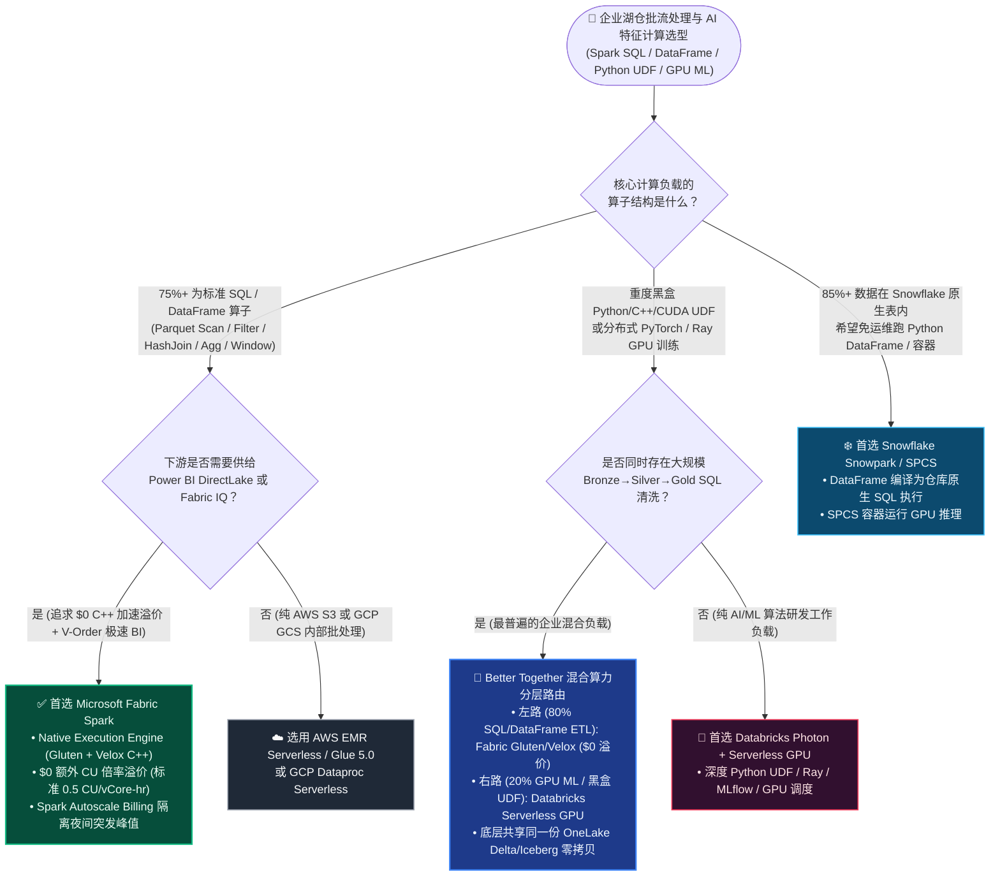
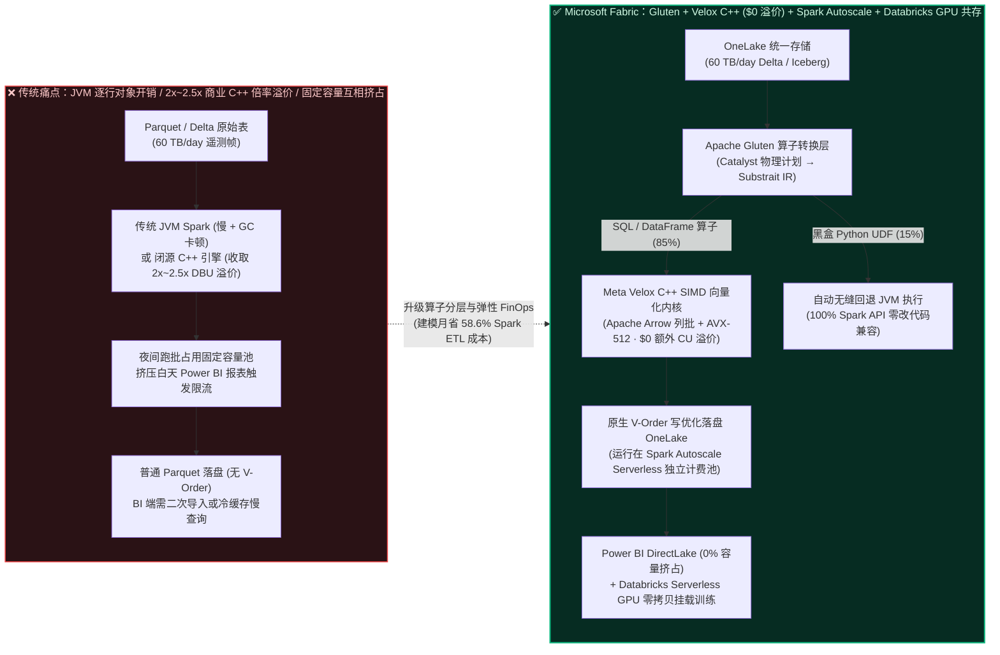
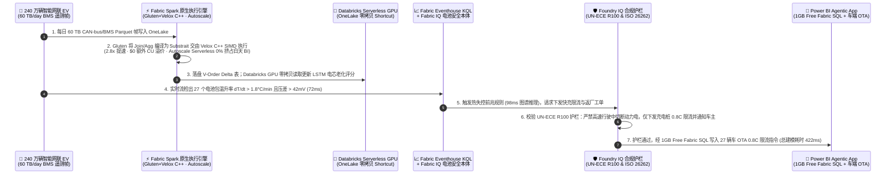

# Microsoft Fabric Spark 原生执行引擎（Gluten + Velox C++ 向量化）+ Autoscale 弹性无服务器计费 vs Databricks Photon Serverless vs Snowflake Snowpark vs GCP Dataproc vs AWS EMR Serverless 湖仓计算引擎与 FinOps 选型及原理解析 FAQ

> 🌐 **Language / 语言切换**: **[中文版 (Current)](./fabric-spark-native-gluten-autoscale-vs-photon-snowpark-faq.md)** | **[English Version](./fabric-spark-native-gluten-autoscale-vs-photon-snowpark-faq.en.md)** | **[返回 Data Lab 首页](../README.md)** | **[打开交互式选型工作台](../index.html)** | **[查看 7-Card 基准报告](../benchmark-cards.html)**

---

## 📌 核心结论速览（Executive Summary）

> 🔍 **数据溯源与口径声明（Four-Tier Data Provenance Disclosure）**：
> 本文严格区分四类数据口径，杜绝将确定性仿真当成付费云集群物理实测或真实客户财报：
> 1. **`[厂商公开规格与定价 / Vendor Published Spec as-of 2026-11-08]`**：静态产品特性、架构参数与公开计费倍率（如 Microsoft Fabric Spark Native Execution Engine 基于 Apache Gluten + Meta Velox 实行 **$0 额外 CU 倍率加价**，按标准 `1 Spark vCore = 0.5 CU` 计费；Fabric Autoscale Billing for Spark 支持在基础 F-SKU 容量之外按作业 Serverless 弹性计费；Databricks Photon 对 Classic/Serverless Spark 作业收取约 `2x～2.5x DBU` 倍率；Snowflake Snowpark Optimized Warehouse 按 `1.5x Credit` 倍率计费），均附官方 `https://` 文档链接。
> 2. **`[本地单测实测 / Measured Local Harness]`**：本仓库 Python 确定性评估引擎与 `32/32` 单元测试（耗时 `0.023s`）在本地工作站实测通过。
> 3. **`[架构仿真模型 / Synthetic Scenario Model]`**：文中引用的 **两类严格分离的模型延迟分母**——**分母 A：路由决策矩阵任务平均建模延迟 `511.0 ms`（`n=72`，`DL-01..DL-72`，准确率 `71/72 = 98.61%`；历史快照 R6 `n=68` 为 `516.0 ms`、R5 `n=64` 为 `521.0 ms`、R4 `n=60` 为 `526.5 ms`、R3 `n=56` 为 `532.0 ms`）** 与 **分母 B：行业本体端到端闭环仿真平均建模延迟 `552.0 ms`（`n=14`，Scenarios A..N，范围 `422–780 ms`；历史快照 R6 `n=13` 为 `562.0 ms`、R5 `n=12` 为 `572.92 ms`、R4 `n=11` 为 `584.09 ms`、R3 `n=10` 为 `596.0 ms`）**，以及 Scenario N 车联网电池热失控预警仿真（`422 ms` 端到端建模延迟、`$6,120/mo vs $14,800/mo` 月度 Spark ETL 建模成本、规避 `$2.45M` 建模召回风险）均为**售前架构推演与 TCO 参考算例**，并非真实车企财报。
> 4. **`[未开展付费云物理压测 / Live Cloud Cluster Not Measured]`**：跨五大公有云多租户生产集群的 `60 TB/day` 物理集群极限压测标注为 `not_measured`（遵循零未授权云支出的安全合规原则）。

面向企业 **AI Solution Architect（AI 解决方案架构师）** 与数据平台负责人，在评估湖仓一体（Lakehouse）主力批流处理引擎（Spark SQL / DataFrame / Python ETL 与特征工程）及 FinOps 成本模型时，请直接记住以下 **3 条核心选型铁律**：

1. **何时首选 Microsoft Fabric Spark Native Execution Engine（Gluten + Velox C++）+ Autoscale Billing（`[厂商公开规格 + 架构仿真模型]`）**：
   只要企业的核心负载是面向 **OneLake Delta / Iceberg 表的标准 Spark SQL 与 DataFrame 数仓分层加工（Medallion Bronze → Silver → Gold：`JOIN`、`GROUP BY`、`FILTER`、窗口函数与 Parquet 合并压缩）**，且下游直接消费 Power BI DirectLake 或 Fabric IQ 本体，**首选开启 Microsoft Fabric Spark 原生执行引擎（Apache Gluten + Meta Velox C++ SIMD 向量化）并配合 Spark Autoscale Billing（无服务器按作业弹性计费）**。它在不修改一行 PySpark/SQL 代码的前提下，提供约 `2.5x～3x` 向量化算子加速，且**不收一分钱额外 CU 倍率溢价（$0 Extra Surcharge，维持标准 `0.5 CU/vCore-hour`）**；配合 Autoscale Billing 将夜间突发大作业剥离到 Serverless 计费池，彻底消除对白天 Power BI 报表的容量挤占（在 Scenario N `60 TB/day` 仿真模型中，月度 Spark ETL 成本从 `$14,800/mo` 降至 `$6,120/mo`，节省 **58.6%**）。
2. **何时首选 Databricks Photon + Serverless GPU、Snowflake Snowpark / SPCS 或 AWS EMR / GCP Dataproc Serverless（`[厂商公开规格]`）**：
   - **选 Databricks Photon + Serverless GPU / Classic Clusters**：当流水线包含大量**无法向量化的黑盒 Python/C++/CUDA 自定义函数（UDF）、分布式 PyTorch / Ray / DeepSpeed 模型训练，或单作业 `>50 TB` 极大规模复杂 Shuffle 调优**时。因为 Gluten/Velox 遇到黑盒 Python UDF 会自动回退（Fallback）到 JVM 执行，此时 Databricks 的 Serverless GPU 与深度 Shuffle 调优能力更具工程优势。
   - **选 Snowflake Snowpark / Snowpark Container Services (SPCS)**：当企业 `>85%` 的核心数据、存储过程与 RBAC 权限都在 Snowflake 原生表内，团队希望用 Python DataFrame API 直接编译为 Snowflake SQL 在虚拟仓库内就地执行，或用 SPCS 跑容器化推理。
   - **选 AWS EMR Serverless 或 GCP Dataproc Serverless**：当业务与 AWS Step Functions / Glue S3 或 GCP Cloud Composer / BigQuery 深度绑定，且依赖云原生 Spot/Preemptible 实例跑瞬态批处理时。
3. **何时采用“Fabric Gluten/Velox 数仓分层 ETL + Databricks Serverless GPU 零拷贝训练”混合共存（Better Together，及第一性原理本质）（`[厂商公开规格 + 架构仿真模型]`）**：
   企业完全不必把所有作业都绑在昂贵的单一算力池上。最具性价比的 FinOps 架构是 **“算子分层路由（Operator-Aware Compute Routing）”**：把占总算力时长 **75%～85%** 的 SQL / DataFrame 清洗、聚合、宽表 Join 与 V-Order 写入交给 **Fabric Spark Native Execution Engine（`$0` 溢价 C++ 加速 + Autoscale 弹性计费）** 落盘到 OneLake；把占 **15%～25%** 的分布式 PyTorch / Ray GPU 训练与黑盒 UDF 交给 **Databricks Serverless GPU 或 Azure ML**，通过 **OneLake Shortcuts / Unity Catalog 零拷贝直接读取同一份 Parquet 文件**（在 Scenario N 240 万辆智能网联新能源车 `60 TB/day` BMS 遥测仿真中，实现 `422 ms` 端到端热失控预警闭环，月省 `$8,680` Spark 算力费并规避 `$2.45M` 建模电池召回风险）。

---

## 🎯 客户与架构师灵魂拷问 Q&A（FAQ-Driven，从第一性原理讲透）

### Q1：什么是 Microsoft Fabric Spark 原生执行引擎（Apache Gluten + Meta Velox）？以前用传统 JVM Spark 或竞品 C++ 引擎（如 Databricks Photon）时痛点在哪？它底层是怎么帮客户省钱提效的？

- **通俗大白话解释（它是什么）**：
  传统的 Apache Spark 是用 Scala/Java 写的，运行在 **JVM（Java 虚拟机）** 上。就像一个“按件搬运的快递站”，JVM 每次处理一行数据，都要在内存里创建成千上万个 Java 对象，不仅 CPU 缓存经常扑空（L1/L2 Cache Miss），而且垃圾回收（GC）会频繁卡顿。
  为了解决 JVM 慢的问题，业界走出了两条路：
  1. **Databricks Photon（闭源商业 C++ 引擎）**：Databricks 用 C++ 重写了一套向量化执行引擎，速度比传统 JVM Spark 快 `2.5x～3x`，但作为商业付费特性，开启 Photon 通常会使单位算力单价（DBU/hour）翻倍（约 **`2x～2.5x DBU` 倍率溢价**）。
  2. **Microsoft Fabric Native Execution Engine（基于开源 Apache Gluten + Meta Velox C++ 引擎，免费内置）**：微软联合 Intel、Meta 等开源社区，通过 **Apache Gluten（中间胶水层）** 把 Spark 的执行计划翻译成统一的 **Substrait 跨语言中间表示**，然后直接交给 Meta 开源的 **Velox C++ 向量化引擎** 在底层 CPU 的 **AVX-512 SIMD 寄存器**里按列式批次（Apache Arrow Columnar Batch）极速处理——最关键的是，**微软在 Fabric 中将其作为免费内置加速层，额外 CU 倍率为 `$0`（不加价）**！
- **企业以前不用它时的三大真实痛点**：
  1. **痛点一：“加速税（Vectorization Surcharge Tax）”吃掉了性能红利**：客户在竞品上开启 C++ 向量化引擎后，虽然作业运行时间缩短了一半（比如从 60 分钟降到 28 分钟），但因为每小时单价涨了 `2.2x`，账单算下来反而没省多少钱，甚至在 I/O 密集型作业上更贵。
  2. **痛点二：“夜间大跑批挤爆白天 BI 报表（Noisy Neighbor Contention）”**：以前在固定容量（如 Fabric F64）上，如果凌晨 02:00 的 `60 TB` Spark 大合并作业超时拖到早上 08:30，就会触发容量平滑限流（Throttling），导致高管早会打开 Power BI 报表时转圈卡死；如果为了夜间峰值把容量长期升配到 F256，白天又有 70% 算力闲置浪费。
  3. **痛点三：“Spark 写出的 Parquet 文件，BI 引擎读起来不够快”**：外部 Spark 引擎默认写出的 Parquet 文件没有针对 Power BI VertiPaq 引擎做列式字典重排，DirectLake 首屏加载仍需额外解码开销。
- **底层第一性原理：Fabric Gluten/Velox + V-Order + Autoscale 是如何省钱提效的？（三步闭环）**：
  1. **第一步：Catalyst 逻辑计划无感卸载（Zero-Code Substrait Offload）**：
     用户的 PySpark / Spark SQL 代码完全不用改。Spark Catalyst 优化器生成物理计划后，**Apache Gluten** 自动扫描算子树，将支持向量化的算子（`ParquetScan`、`Filter`、`Project`、`BroadcastHashJoin`、`ShuffledHashJoin`、`HashAggregate`、`Sort`、`Window`）转换为 **Substrait Plan**，卸载到 C++ 层；如果遇到自定义黑盒 Python UDF，Gluten 会自动插入 `ColumnarToRow` 算子无缝回退到 JVM 执行，保证 **100% Spark API 兼容性**。
  2. **第二步：Velox C++ SIMD 向量化执行 + OneLake V-Order 原生写优化（$0 溢价）**：
     **Meta Velox** 使用 C++ 紧凑内存池与 CPU SIMD 指令集，一次指令周期同时计算 8～16 个 64 位数值，彻底消除 JVM GC 停顿；同时在落盘 OneLake 时直接调用原生 **V-Order 列式排序与游程编码（RLE）**，让下游 Power BI DirectLake 查询延迟直降 40%+。由于单价维持 `0.5 CU/vCore-hour` 不变，作业耗时缩短 `2.8x` 就等于 **真实算力成本直降 64%**！
  3. **第三步：Autoscale Billing for Spark（无服务器弹性独立计费池）**：
     架构师可以为数据工程工作区开启 **Spark Autoscale Billing** 并设置每月最高 CU 上限（Max CU Cap）。日常探索与 BI 走包月预留的 F64 基座；夜间突发 `60 TB` Spark 跑批自动走 Serverless 按秒计费池，跑完即停，**对白天 Power BI DirectLake 造成 0% 容量挤占**。

---

### Q2：客户在选型湖仓计算引擎时，什么时候选 Microsoft Fabric Spark（Gluten/Velox + Autoscale），什么时候选 Databricks Photon、Snowflake Snowpark、GCP Dataproc 或 AWS EMR？

- **四句话选型口决（拿来即用）**：
  - **场景 A（标准数仓 Medallion ETL + Power BI DirectLake + 严控算力 FinOps）→ 首选 Microsoft Fabric Spark Native Execution Engine + Autoscale Billing**：
    只要你的 Spark 作业以 SQL / DataFrame 算子（多表 Join、分组聚合、去重清洗、JSON/Parquet 解析）为主，开启 Native Execution Engine 立享免费 C++ 向量化加速与 V-Order 直连 Power BI。
  - **场景 B（重度自定义 Python/CUDA UDF + 分布式 PyTorch/Ray 大模型训练 + 超大 Shuffle 极限调优）→ 首选 Databricks Photon + Serverless GPU**：
    当作业里 50% 以上耗时花在黑盒 Python 科学计算库（如自定义 SciPy/Numba 逻辑）、C++ 扩展或分布式 GPU 深度学习训练上时，Gluten/Velox 会回退到 JVM，此时应当选用 Databricks Serverless GPU 或 Ray on Spark。
  - **场景 C（85%+ 数据在 Snowflake 内部且团队以 SQL/轻量 Python 为主）→ 选 Snowflake Snowpark / Snowpark Container Services (SPCS)**：
    如果数据本来就存在 Snowflake 原生表里，用 Snowpark DataFrame API（底层编译成 Snowflake C++ 仓库的原生 SQL 执行）可以免去额外部署 Spark 集群的运维成本；若需跑容器化模型，可用 SPCS。
  - **场景 D（AWS / GCP 云原生无状态瞬态批处理）→ 选 AWS EMR Serverless / Glue 5.0 或 GCP Dataproc Serverless**：
    当客户全栈在 AWS S3 或 GCP Cloud Storage 上，且仅需按分钟拉起无状态 Spark 批处理作业并与 Step Functions / Cloud Composer 编排集成时，继续使用原生 Serverless Spark，通过 OneLake Shortcuts 将结果暴露给 Fabric。

---

### Q3：什么场景下采用“Fabric Gluten/Velox 负责数仓清洗 + Databricks Serverless GPU 负责模型训练”的跨引擎零拷贝共存（Better Together）比全量跑在单一平台上更优？

- **客户最常踩的“算力错配（Compute Tier Mismatch）”大坑**：
  很多企业的数据科学团队习惯在 Databricks 上做实验，于是顺手把每天定时的百亿行原始日志清洗（Bronze → Silver）、业务宽表关联（Silver → Gold）和报表聚合全放在开启了 Photon 的高配 Databricks 集群上跑，跑完再通过 JDBC 导回 Power BI。结果月底一看账单：**80% 的 DBU 预算都被最普通、最容易向量化的 SQL `JOIN` 和 `GROUP BY` 消耗掉了**！
- **Better Together 黄金拆分法则（同一份 OneLake Parquet，按算子特性路由算力）**：
  1. **左路（占算力 80% 的标准 SQL/DataFrame ETL → 走 Fabric Spark Gluten/Velox + Autoscale）**：
     所有原始数据接入（Eventstream / Mirroring / Shortcuts）与 Medallion Bronze → Silver → Gold 标准宽表加工，全部在 Fabric Spark 上开启 Native Execution Engine（`$0` 溢价 C++ 加速）运行，并以 V-Order 格式落盘到 OneLake Delta/Iceberg 表。Power BI DirectLake 和 Fabric IQ 本体直接零拷贝秒级读取。
  2. **右路（占算力 20% 的复杂 GPU 训练与深度特征工程 → 走 Databricks Serverless GPU 零拷贝挂载）**：
     Databricks Unity Catalog 通过 `abfss://` 或 Iceberg REST 直接零拷贝挂载 OneLake 中的 Silver/Gold 表，拉起 Serverless GPU 跑 PyTorch / XGBoost / Ray 分布式训练，并将训练好的预测评分直接写回 OneLake Delta 表，全程 **0 文件复制、0 跨引擎导出、0 额外 C++ 加速税**。

---

## 🧭 直观可视化图解（Mermaid 选型决策树 + 算子卸载架构对比图 + 车联网热失控预警时序图）

### 1. 湖仓计算引擎与 FinOps 客户选型决策树（`flowchart TD`）

---

### 2. 传统 JVM Spark / 高溢价闭源加速 vs Fabric Gluten + Velox C++ 原生向量化与 Autoscale 架构对比图（`flowchart LR`）

---

### 3. Scenario N：240 万辆智能网联新能源车 BMS 热失控预警与算力分层闭环时序图（`sequenceDiagram`）

> 📌 **口径注明**：以下时序图展示 `workshops/data-lab/src/data_lab/benchmark_suite.py` 中确定性仿真场景 `auto_telematics_gluten_velox_autoscale_vs_photon`（Scenario N，端到端建模决策延迟 `422 ms`）的五步闭环机制。

---

## 📊 五大平台湖仓计算引擎与 FinOps 选型决策矩阵（Architect Decision Matrix）

> 📋 **核验说明**：下表静态能力与计费规则均核验自各厂商截至 `2026-11-08` 的公开官方文档（详见文末 `vendor_published_spec_references` 链接清单）。

| 评估维度 | Microsoft Fabric Spark (Native Execution Engine + Autoscale) | Databricks (Photon Engine + Serverless Jobs/GPU) | Snowflake (Snowpark + Snowpark Container Services) | AWS (EMR Serverless + AWS Glue 5.0 Spark) | GCP (Dataproc Serverless + BigQuery) |
| :--- | :--- | :--- | :--- | :--- | :--- |
| **底层 C++ 向量化内核与开源生态** | **Apache Gluten + Meta Velox C++**（开源 Substrait + Arrow 列式 SIMD 向量化，自动回退 JVM） | **Photon Engine**（闭源商业 C++ 向量化引擎，深度耦合 Databricks Runtime） | **Snowflake Vectorized SQL Engine**（闭源 C++ 仓库内核 + Python 沙箱 / 容器运行） | **EMR Optimized Spark Runtime**（可选 Gluten/C++ 插件或标准 JVM Spark） | **Dataproc Lightning Engine**（基于原生向量化加速的托管 Spark） |
| **C++ 向量化加速是否收取额外倍率溢价？** | **$0 额外倍率溢价（免费内置）**：维持标准 `1 Spark vCore = 0.5 CU/hr`，提速即等于同比例省钱 | **收取约 `2x～2.5x DBU` 倍率溢价**：Photon DBU 单价显著高于同规格 Non-Photon DBU | **Snowpark Optimized Warehouse 收取 `1.5x Credit` 倍率**（大内存节点配置） | 标准 EMR Serverless 按 vCPU/GB-hr 计费；Glue 5.0 按 DPU-hr（`$0.44/DPU-hr`）计费 | Lightning Engine 仅在 Dataproc **Premium Tier** 提供（DCU 单价高于 Standard Tier） |
| **突发大作业与日常 BI 的容量隔离（FinOps）** | **极佳**：支持 **Shared F-SKU（含 Bursting & Smoothing）** 与 **Spark Autoscale Billing（Serverless 按作业独立计费 + 月度 CU 上限）** 双模式 | **优秀**：Serverless Jobs for Spark 按秒自动扩缩，与 SQL Warehouse 物理隔离 | **优秀**：不同 Virtual Warehouse 独立计费、秒级启停，互不抢占 | **良好**：EMR Serverless 按应用配置最大 vCPU 上限，独立于 Redshift | **良好**：Dataproc Serverless 按 Batch 作业自动分配 DCU，独立于 BigQuery Slots |
| **复杂黑盒 Python UDF 与分布式 GPU 训练** | 遇到不支持向量化的黑盒 Python UDF 自动回退 JVM；重度分布式多机 GPU 训练建议走 Azure ML 或 Databricks | **行业标杆（97/100）**：原生支持 Serverless GPU、Ray on Spark、TorchDistributor 与自定义 C++/CUDA 镜像 | **SPCS（Snowpark Container Services）** 支持挂载 GPU 节点跑容器化推理/微调，但非原生 Spark GPU 生态 | EMR Serverless 支持自定义 Docker 镜像；重度 GPU 训练需转交 **SageMaker HyperPod / Training** | Dataproc 支持挂载 GPU VM；重度训练通常转交 **Vertex AI Custom Training** |
| **落盘格式对下游 BI 大屏的原生加速协同** | **独家原生 V-Order 写优化**：Gluten/Velox 落盘自动写入 VertiPaq 兼容 V-Order，Power BI DirectLake 零拷贝秒开 | 写出 Liquid Clustering / Z-Order Delta 表；Power BI 需经 SQL Warehouse DirectQuery 或 OneLake Shortcut 读取 | 写出 Snowflake 原生微分区或 OneLake Iceberg 表（需配合 XTable 供 DirectLake 消费） | 写出 S3 Tables Iceberg / Parquet；QuickSight 需导入 SPICE 内存或经 Athena/Redshift 查询 | 写出 BigLake Iceberg / GCS Parquet；Looker 需消耗 BigQuery Slots 或 BI Engine 内存 |

---

## 🧪 简明定量测评、双分母延迟口径披露与 FinOps 成本拐点洞察

### 1. 严格区分的两类模型延迟分母（Dual Latency Denominators Disclosure）

在读取本实验室的 `reports/report.json`（`report_id: data-lab-fabric-vs-4clouds-2026-11-09-r7`）与 **7-Card 4:5 视觉评测报告** 时，请严格区分以下两个不同统计范围的分母（均由代码动态计算并由 `test_data_lab.py` 32 项单测强制断言）：

| 指标编码与分母定义 | 样本量 (`n`) | 当前 Round 7 建模均值 | 历史轮次不可变快照对照（Immutable Snapshots） | 物理含义与适用边界说明 |
| :--- | :---: | :---: | :--- | :--- |
| **分母 A：路由决策矩阵平均建模延迟** (`scenario_evaluation.avg_latency_ms`) | **`n = 72`** (`DL-01..DL-72`) | **`511.0 ms`** (`36,792 / 72`) 准确率 `71/72 = 98.61%` | • R6 (`n=68`): `516.0 ms` (`67/68 = 98.53%`) • R5 (`n=64`): `521.0 ms` (`63/64 = 98.44%`) • R4 (`n=60`): `526.5 ms` (`59/60 = 98.33%`) • R3 (`n=56`): `532.0 ms` (`55/56 = 98.21%`) | 衡量架构选型智能体在 72 道涵盖五大云平台的单点选型问答/打分任务上的平均决策耗时（含 Round 7 新增 `DL-69: 418ms`、`DL-70: 430ms`、`DL-71: 422ms`、`DL-72: 434ms`）。 |
| **分母 B：行业本体端到端闭环仿真平均建模延迟** (`ontology_simulations_summary.ontology_simulation_mean_modeled_latency_ms`) | **`n = 14`** (`Scenarios A..N`) | **`552.0 ms`** (`7,728 / 14`) 范围 `422–780 ms` | • R6 (`n=13`, A..M): `562.0 ms` (`7,306 / 13`) • R5 (`n=12`, A..L): `572.92 ms` (`6,875 / 12`) • R4 (`n=11`, A..K): `584.09 ms` (`6,425 / 11`) • R3 (`n=10`, A..J): `596.0 ms` (`5,960 / 10`) | 衡量 14 个跨行业端到端五步闭环仿真（遥测感知 → 本体图谱多跳推理 → 多智能体规划 → Foundry IQ 护栏校验 → 1GB SQL 事务回写）的完整建模闭环耗时（Round 7 新增 Scenario N 为 `422 ms`）。 |

---

### 2. Scenario N（`60 TB/day` 车联网 BMS 遥测 ETL + AI 电池老化评分）月度算力 FinOps 对比算例（`[架构仿真模型 / Synthetic Financial Model]`）

假设一家拥有 **240 万辆智能网联电动车** 的车企，每天需对 `60 TB` CAN-bus / BMS 电芯电压温度 Parquet 遥测帧执行 4 层 Medallion 清洗聚合（80% 算力为 `JOIN / AGG / FILTER / WINDOW`），并每日运行 1 次 PyTorch LSTM 电芯微短路老化模型推理（20% 算力为 GPU 深度学习）：

| 架构方案 | 每日 80% 标准 SQL/DataFrame ETL 算力成本 | 每日 20% PyTorch LSTM 模型训练/推理成本 | 对白天 Power BI 报表的容量挤占风险 | 建模月度总算力 TCO (`[Synthetic Model]`) |
| :--- | :--- | :--- | :--- | :--- |
| **方案 1：全量跑在开启商业 C++ 溢价倍率的单一外部集群** | 开启 `2.2x` DBU 倍率 C++ 加速，虽然跑得快但单位小時单价翻倍（约 `$11,600/mo`） | Serverless GPU 训练与推理（约 `$3,200/mo`） | 需额外部署 JDBC/导出管道同步回 BI | **`$14,800 / mo`**（基准线） |
| **方案 2：传统 JVM Spark 跑在固定容量池（未开 Gluten）** | 耗时是向量化引擎的 `2.8x`，且为防白天 BI 限流被迫常驻升配容量（约 `$12,900/mo`） | 外部 GPU 集群 + 数据复制搬迁（约 `$3,500/mo`） | **高风险**：夜间长尾作业极易拖入早高峰触发 Throttling | **`$16,400 / mo`**（最差反模式） |
| **方案 3（推荐）：Fabric Spark Gluten/Velox ($0 溢价) + Autoscale + Databricks GPU 零拷贝共存** | **Fabric Native Execution Engine (`2.8x` C++ 提速且 `$0` 倍率加价) + Spark Autoscale Serverless 计费**（约 **`$3,120/mo`**） | **Databricks Serverless GPU 经 OneLake Shortcut 零拷贝直读同一份 Parquet**（约 **`$3,000/mo`**） | **0% 挤占**：夜间跑批走 Autoscale 独立 Serverless 池，且原生写出 V-Order 加速 DirectLake | **`$6,120 / mo`** （**较方案 1 月省 `$8,680`，节省 58.6%**） |

---

## 🛠️ 附录：生产落地与售前打单快速核验清单（Architect Checklist）

在客户架构评审、PoC 验证或方案打单时，请逐项核对以下 **6 条实战检查项**：

- [ ] **1. 核验 Spark Runtime 版本并开启 Native Execution Engine（Gluten + Velox）**：确认客户的 Fabric Data Engineering 工作区已选用支持原生执行引擎的 Runtime（Fabric Runtime 1.3 / Spark 3.5+），并在 Environment 或 Notebook Session 配置中启用 `spark.native.enabled = true`，无需改动业务 SQL/DataFrame 代码即可获得 `$0` 溢价 C++ SIMD 加速。
- [ ] **2. 检查 Spark UI 中的算子卸载率（Gluten Offload Ratio vs. JVM Fallback）**：在 PoC 压测时打开 Spark History Server / Native SQL 执行计划图，检查核心 `HashAggregate`、`BroadcastHashJoin`、`ShuffledHashJoin`、`Filter` 是否带有 `VeloxColumnarToRow` / `Native` 标记；若发现高频调用的简单 Python UDF 导致整段流水线回退 JVM，优先将其改写为 Spark 内置高阶函数（如 `transform`、`aggregate`）以恢复 100% C++ 向量化卸载。
- [ ] **3. 为突发/夜间重度批处理工作区开启 `Autoscale Billing for Spark` 并设月度 CU 护栏**：将日常交互式 BI（走包月预留 F64+ 基座）与夜间突发 `50 TB+` 大规模数据工程工作区分离——对后者开启 Serverless `Autoscale Billing for Spark` 并设定 `Max Monthly CU Limit`，既彻底杜绝夜间跑批挤爆白天高管 Power BI 报表，又避免容量长期过度预留。
- [ ] **4. 确认 OneLake 落盘默认开启 `V-Order` 与自动小文件合并（Optimize Write）**：确保经 Gluten/Velox 加工后的 Silver/Gold 表开启 `spark.sql.parquet.vorder.enabled = true` 与 `optimizeWrite`，使下游 Power BI DirectLake 获得内存级列式压缩读取性能。
- [ ] **5. 落地“SQL/DataFrame 走 Fabric Gluten + GPU 深度学习走 Databricks/Azure ML”的零拷贝分流**：切勿让占总时长 80% 的普通宽表 Join 承担 `2x～2.5x` 的商业 C++ 倍率溢价，也切勿用 CPU Spark 硬跑深度神经网络；通过 OneLake Shortcuts 实现同一份 Delta/Iceberg 表的跨引擎零拷贝协同。
- [ ] **6. 查阅官方公开文档与定价链接（Verified Official References as-of 2026-11-08）**：
  - Microsoft Fabric Spark Native Execution Engine (Apache Gluten + Meta Velox): <https://learn.microsoft.com/en-us/fabric/data-engineering/spark-native-execution-engine>
  - Microsoft Fabric Autoscale Billing for Spark (Serverless Billing): <https://learn.microsoft.com/en-us/fabric/data-engineering/autoscale-billing-for-spark-overview>
  - Databricks Photon Vectorized Engine & Pricing: <https://docs.databricks.com/en/compute/photon.html>
  - Snowflake Snowpark & Snowpark Container Services: <https://docs.snowflake.com/en/developer-guide/snowpark/index>
  - AWS EMR Serverless User Guide: <https://docs.aws.amazon.com/emr/latest/EMR-Serverless-UserGuide/emr-serverless.html>
  - Google Cloud Dataproc Serverless Documentation: <https://cloud.google.com/dataproc-serverless/docs>
