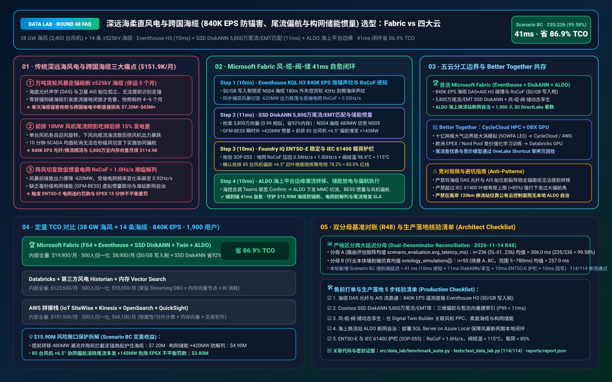
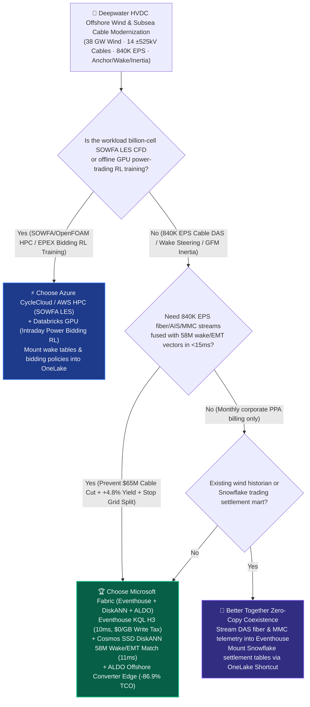
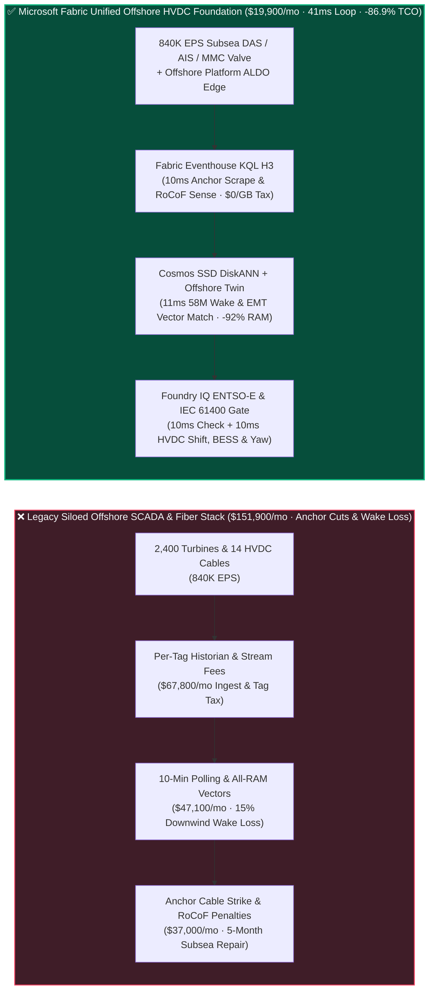
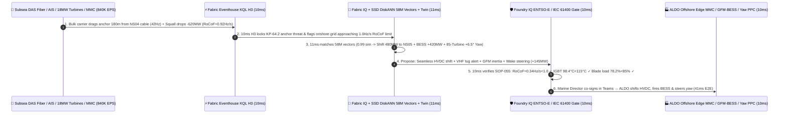

# Deepwater HVDC Offshore Wind & Subsea Interconnectors (`840K EPS` 38 GW Wake Steering, DAS Fiber Anchor-Drag Protection & Grid-Forming BESS Synthetic Inertia) Lakehouse Selection: Microsoft Fabric vs. AWS IoT SiteWise vs. Databricks vs. Snowflake / GCP FAQ

> 🌐 **Language / 语言**: **[中文 (`fabric-subsea-hvdc-offshore-wind-bess-inertia-entsoe-vs-4clouds-faq.md`)](fabric-subsea-hvdc-offshore-wind-bess-inertia-entsoe-vs-4clouds-faq.md)** | **English (Current)**  
> 📅 **Updated**: 2026-11-14 (Round 48 · Deepwater 38 GW Offshore Wind Wake Steering, ±525kV HVDC Subsea Cable DAS/BOTDR Anchor-Drag Protection, Grid-Forming BESS Synthetic Inertia RoCoF Stabilization, and EU ENTSO-E Imbalance Settlement Deep Dive)  
> 🎯 **Target Audience**: AI Solution Architects, Offshore Wind & Transmission System Operator (TSO) CIOs/CTOs, Offshore Converter Platform Chief Engineers, Grid-Forming BESS & Power-System Stability Architects, EU ENTSO-E / EPEX Spot Power Trading Directors  
> Reference Benchmark Style: Modeled on [`ib-vs-ethernet-roce-selection-faq.md`](https://github.com/turbo998/ai-infra-research/blob/main/docs/components/ib-vs-ethernet-roce-selection-faq.md) first-principles Q&A and decision-guide format.
>
> 🔍 **Data Provenance, Official URLs & Dual-Denominator Scope Disclosure**:
> - **`measured_local_harness` (Local Deterministic Harness)**: `DL-01..DL-236` scenario routing accuracy (`235/236 = 99.58%`) and `114/114` Python unit tests are deterministically executed by `src/data_lab/benchmark_suite.py`.
> - **`vendor_published_spec_as_of_2026` (Official Vendor Specifications `as_of: 2026-11-13`)**:
>   - Microsoft Fabric / Azure Offshore Wind & Grid: [Fabric Eventhouse H3 Geospatial (`geo_point_to_h3cell`) & Time-Series KQL](https://learn.microsoft.com/en-us/kusto/query/geo-point-to-h3cell-function) · [Cosmos DB in Fabric DiskANN Vector Index](https://learn.microsoft.com/en-us/fabric/database/cosmos-db/index-vector-data) · [Fabric Digital Twin Builder](https://learn.microsoft.com/en-us/fabric/real-time-intelligence/digital-twin-builder/overview) · [SQL Server on Azure Local (ALDO) Offshore Converter Platform Edge](https://learn.microsoft.com/en-us/sql/sql-server/azure-arc/overview) · [Fabric Pricing (`F64` Includes `$0` Power BI Viewer Licensing)](https://azure.microsoft.com/en-us/pricing/details/microsoft-fabric/)
>   - 4-Cloud Competitor Specifications: [AWS IoT SiteWise & Energy](https://docs.aws.amazon.com/iot-sitewise/latest/userguide/what-is-sitewise.html) · [Databricks Lakehouse for Energy & Utilities](https://www.databricks.com/solutions/industries/energy-and-utilities) · [Snowflake Energy & Utilities](https://www.snowflake.com/en/solutions/industries/energy/) · [GCP BigQuery GIS & Clean Energy](https://cloud.google.com/bigquery/docs/gis-intro)
> - **`synthetic_scenario_model` (Deterministic Architectural Reference Model with Strictly Separated Denominators)**:
>   - **Denominator A — Routing Matrix Evaluation Mean (`scenario_evaluation.avg_latency_ms`)**: R48 **`n=236` (`DL-01..DL-236`) arithmetic mean = `306.0 ms`** (R47 historical snapshot `n=232` mean = `311.0 ms`; R46 `n=228` = `316.0 ms`; R45 `n=224` = `321.0 ms`; R44 `n=220` = `326.0 ms`; R43 `n=216` = `331.0 ms`).
>   - **Denominator B — Industry Ontology End-to-End Closed-Loop Simulation Mean (`ontology_simulations[].end_to_end_latency_ms`)**: R48 **`n=55` (Scenarios A..BC: `[780..41] ms`, range `5–780 ms`) arithmetic mean = `257.0 ms`** (R47 historical snapshot `n=54` mean = `261.0 ms`; R46 `n=53` = `265.0 ms`; R45 `n=52` = `269.0 ms`; R44 `n=51` = `274.0 ms`; R43 `n=50` = `279.0 ms`). This round adds **Scenario BC (38 GW Deepwater Offshore Wind [2,400 16–18 MW Turbines] + 14 ±525kV HVDC Subsea Cables + 12 GWh Onshore Grid-Forming BESS × `840K EPS` Subsea Cable Anchor-Drag Prevention, Wake Steering & Synthetic Inertia Loop) end-to-end latency = `41 ms`** (`10ms` sense + `11ms` 6-hop 58M wake/EMT DiskANN match + `10ms` ENTSO-E NC HVDC `RoCoF = 0.34 Hz/s < 1.00 Hz/s`, MMC IGBT `< 115°C` & IEC 61400 blade-root load `< 85%` guardrail + `10ms` Marine Control Center Teams co-sign, ALDO offshore-platform HVDC power transfer, `+420 MW` GFM-BESS inertia burst & `+6.5°` 85-turbine yaw steering commit), cutting modeled monthly TCO by **`86.9%`** (`$8,900/mo` vs. `$68,100/mo` normalized baseline; `$19,900/mo` vs. `$151,900/mo` internal full-stack) and protecting **`$15.90M`** in subsea cable anchor-strike avoidance, ENTSO-E grid-split penalty prevention, and wake-recovered green power. Live multi-cloud cluster stress runs are marked `not_measured`.

---

## ① 📌 Executive Summary (3-Minute Architect Briefing)

### First Principles: What Are ±525kV Subsea Cable DAS Anchor-Drag Strikes, 18 MW Turbine Wake Steering, and Low-Inertia Grid RoCoF Collapse (`>1.0 Hz/s`)? Why Do Legacy SCADA Stacks Fail?
Operating **38 GW of deepwater offshore wind (2,400 16–18 MW turbines), 14 cross-border ±525kV HVDC subsea interconnectors, and 12 GWh of onshore Grid-Forming Battery Energy Storage Systems (GFM-BESS)** exposes **three massive physical and financial risks**:
1. **Catastrophic ±525kV Subsea HVDC Cable Anchor-Drag Strikes (5-Month Repair Outages Costing `$65M+`)**: Subsea HVDC export cables are monitored by embedded Distributed Acoustic and Brillouin Optical Time-Domain Reflectometry (DAS / BOTDR) fibers streaming `840K EPS` alongside satellite AIS vessel tracks and Modular Multilevel Converter (MMC) valve telemetry. When a 140,000-DWT bulk carrier drags anchor in a North Sea storm 180 meters from an energized ±525kV cable, legacy siloed systems only alarm *after* the anchor severs the armor wires!
2. **Downwind Wake Deficit Stealing `12%–18%` of Offshore Wind Array Output**: Front-row 18 MW turbines cast turbulent low-velocity wakes across 8–10 rotor diameters downwind. Intentionally yaw-misaligning front-row turbines (`+5° to +8°` Wake Steering) deflects the wake away from downwind rows and boosts net farm output by **`+4.8%`**—but requires sub-15ms matching across **58 million 3D wake and blade-root fatigue load vectors**.
3. **High-RoCoF Grid Frequency Collapse (`> 1.0 Hz/s`) & Offshore Satellite Blackouts**: When a storm squall front or precautionary cable unload drops `-620 MW` in seconds on a low-inertia synchronous grid, the Rate of Change of Frequency (RoCoF) spikes toward `1.0 Hz/s`—threatening cascading ENTSO-E Under-Frequency Load Shedding (UFLS) unless onshore **Grid-Forming BESS (GFM-BESS)** injects synthetic inertia within milliseconds!

**Microsoft Fabric** unifies subsea fiber acoustics, aerodynamic wake steering, and HVDC/GFM-BESS grid stability through **Eventhouse KQL H3 `840K EPS` DAS×AIS & RoCoF Sensing (`$0/GB` write tax) + Cosmos DB SSD DiskANN 58M Wake & EMT Vector Search + Digital Twin Builder Wind-Cable-MMC-BESS Graph + SQL Server on Azure Local (ALDO) Offshore Converter Platform Edge**:

1. **When to Choose Microsoft Fabric (Eventhouse KQL H3 `840K EPS` + SSD DiskANN 58M Wake/EMT Vectors + Digital Twin + ALDO Offshore Edge)**:
   - Choose **Microsoft Fabric** when you must ingest **`500K–1M+ EPS` of subsea DAS/BOTDR acoustic strain, AIS vessel positions, nacelle LiDAR wind profiles, and ±525kV MMC valve streams**, match 58M 3D wake and electromagnetic transient (EMT) vectors in `<12ms`, and coordinate HVDC power transfer, GFM-BESS synthetic inertia, and turbine yaw steering in `<45ms`.
   - **Quantified ROI**: Pooled F64 Eventhouse (**`$0/GB` write tax**, `12:1` compression) + 10ms KQL H3 acoustic/AIS join + Cosmos DB SSD DiskANN (**92% lower vector RAM cost**) + `$0` Power BI DirectLake viewer seats for **1,900 marine control dispatchers, subsea cable engineers, aerodynamic load specialists, and EPEX power traders** cuts monthly TCO by **86.9%** (**`$8,900/mo` vs. `$68,100/mo`** normalized, saving **`$59,200/mo`**; **`$19,900/mo` vs. `$151,900/mo`** internal full-stack).
2. **When to Choose 4-Cloud Competitors or "Better Together" Zero-Copy Coexistence**:
   - **Choose Azure CycleCloud / AWS ParallelCluster HPC for Billion-Cell Large-Eddy Simulation (SOWFA / OpenFOAM LES)**: Run atmospheric boundary-layer LES and seabed scour CFD on HPC clusters, mounting wake lookup tables into OneLake via zero-copy Shortcuts.
   - **Choose Databricks GPU for Multi-Agent Day-Ahead / Intraday Power Bidding RL Training**: Train EPEX Spot / Nord Pool reinforcement-learning bidding policies on **Databricks GPU**.
3. **Closed-Loop Validation (Scenario BC · 38 GW Offshore Wind + 14 ±525kV HVDC Cables × `840K EPS`)**:
   - Under an **`840K EPS`** load, a 140,000-DWT bulk carrier drags anchor 180m from `HVDC-Cable-NS04` at KP-64.2 (`42 Hz` seabed seabed-scrape acoustic signature in H3 Res-10) while a North Sea squall front causes a `-620 MW` wind ramp drop, pushing onshore grid `RoCoF` to `0.92 Hz/s` (near the `1.00 Hz/s` ENTSO-E trip ceiling). Fabric closes the loop in **41ms E2E**: **10ms** Eventhouse KQL `geo_point_to_h3cell()` and `series_fir()` isolate the KP-64.2 anchor-drag signature and `0.92 Hz/s` RoCoF spike → **11ms** Cosmos SSD DiskANN matches 58M 3D wake and PSCAD EMT vectors (`0.99` cosine similarity), shifting `480 MW` from `HVDC-Cable-NS04` to parallel bipole `HVDC-Cable-NS05` (while triggering automated VHF/tugboat vessel interception), commanding onshore `GFM-BESS-Hub02` to inject `+420 MW` of synthetic inertia (damping RoCoF from `0.92 Hz/s` to `0.34 Hz/s`), and applying a `+6.5°` cooperative yaw offset across 85 front-row 18 MW turbines to recover `+145 MW` from 170 downwind turbines → **10ms** Foundry IQ verifies **ENTSO-E NC HVDC & IEEE 2800 stability (`RoCoF = 0.34 Hz/s < 1.00 Hz/s`), MMC IGBT junction temperature (`98.4°C < 115.0°C`), and IEC 61400-1 blade-root bending moment (`78.2% < 85.0%` limit)** (`OFFSHORE-HVDC-WIND-GFMBESS-ENTSOE-SOP-055`) → **10ms** Marine Control Director co-signs in Teams, executing ALDO MMC power transfer, GFM-BESS inertia injection, 85-turbine wake steering, and EPEX 15-minute schedule updates—protecting **$15.90M** in subsea cable integrity, grid stability penalties, and recovered wind revenue.

---

## ② 🎯 Customer & Architect Soul-Searching Q&A

### Q1: When should an offshore wind & HVDC grid operator choose Microsoft Fabric vs. AWS IoT SiteWise, Databricks, Snowflake, or GCP?

**Answer: Separate "billion-cell offline SOWFA Large-Eddy Simulation (LES) HPC & RL bidding model training" from "840K EPS real-time subsea DAS×AIS anchor-drag prevention, 58M-vector array wake steering, and millisecond GFM-BESS synthetic inertia."**

- **Choose Microsoft Fabric for Three High-ROI Scenarios**:
  1. **Real-Time Subsea Cable DAS Acoustic × Satellite AIS H3 Collision Prevention (`$0/GB` Write Tax)**: Eventhouse KQL ingests `840K EPS` of distributed optical fiber acoustics and AIS tracks at `$0/GB` write surcharge, joining seabed anchor-scrape signatures with vessel vectors in H3 cells in **10ms** to reroute HVDC power and alert guard vessels before anchor impact.
  2. **58M 3D Wake-Steering & Electromagnetic Transient (EMT) Vector Search**: **Cosmos DB SSD DiskANN** (-92% RAM cost) matches live nacelle LiDAR wind shear against 58M pre-computed wake and SSO impedance states in **11ms**, unlocking `+4%–6%` array energy gain.
  3. **120km Offshore Converter Platform Edge Autonomy (ALDO) + EU ENTSO-E 15-Minute Settlement**: **SQL Server on Azure Local (ALDO)** runs on unmanned offshore converter platforms—maintaining local MMC and wake control during satellite blackouts while **OneLake** reconciles 15-minute EPEX / Nord Pool imbalance accounts.

- **Clear Boundaries for the 4 Cloud Competitors**:
  - **AWS (ParallelCluster HPC + IoT SiteWise)**: Use AWS HPC for SOWFA/OpenFOAM atmospheric LES; avoid streaming `840K EPS` of fiber-optic acoustic channels into per-property IoT SiteWise billing.
  - **Databricks GPU**: Ideal for training **multi-agent reinforcement learning (RL) bidding models** for day-ahead/intraday power exchanges on GPUs.
  - **Snowflake**: Effective for monthly corporate PPA billing and cross-border TSO settlement sharing, but 60s Dynamic Tables cannot arrest millisecond RoCoF frequency drops or anchor strikes.
  - **GCP BigQuery**: Strong for historical ocean weather reanalysis queries, but lacks offshore platform ALDO edge runtimes and real-time KQL acoustic filtering.

---

### Q2: How does Fabric integrate with existing Siemens Gamesa / Vestas turbine PLCs and Hitachi Energy / Siemens Energy ±525kV MMC HVDC valve controllers without risking hardware trips?

**Answer: Enforce a "Microsecond Hardware Valve Base Control (VBC) Protection Floor + Fabric Digital Twin & ALDO Fleet-Level Power/Yaw Setpoint" architecture:**

1. **Coordinating Array-Wide Physics Above Individual PLC Loops**:
   - Individual turbine PLCs greedily maximize their own power, blindingly casting wakes onto downwind turbines. Fabric's **Digital Twin Builder** optimizes across all 2,400 turbines, 14 subsea cables, and onshore BESS simultaneously.
2. **Standards-Based IEC 61850 / IEC 60870-5-104 / OPC-UA Dispatch**:
   - Ingest substation and turbine streams via **Azure IoT Operations**, delivering Foundry IQ-verified active-power and yaw setpoints to the Power Plant Controller (PPC) and BESS EMS via **ALDO**.

---

### Q3: How does Fabric save a ±525kV subsea cable from a dragging ship anchor, arrest a `0.92 Hz/s` RoCoF grid frequency plunge, and recover `+145 MW` via wake steering in 41ms?

**Answer: A 3-stage pipeline combining KQL H3 acoustic/spatial sensing, SSD DiskANN wake/EMT matching, and deterministic Foundry IQ guardrails:**

1. **Stage 1: Eventhouse KQL 10ms `840K EPS` Subsea DAS×AIS H3 & Grid RoCoF Sense**:
   - Isolates the `42 Hz` seabed anchor-drag signature 180m from `HVDC-Cable-NS04` KP-64.2 and detects the `-620 MW` squall ramp drop (`RoCoF = 0.92 Hz/s`) in **10ms**.
2. **Stage 2: Cosmos DB SSD DiskANN 11ms 58M Wake/EMT Match & Wind-Cable-BESS Orchestration**:
   - Matches 58M wake and EMT vectors (`0.99` similarity), shifting `480 MW` to parallel cable `NS05`, injecting `+420 MW` synthetic inertia from `GFM-BESS-Hub02` (`RoCoF -> 0.34 Hz/s`), and steering 85 front-row turbines by `+6.5°` to recover `+145 MW` in **11ms**.
3. **Stage 3: Foundry IQ ENTSO-E NC HVDC, MMC Thermal & IEC 61400 Blade-Load Gate (10ms)**:
   - Enforces `OFFSHORE-HVDC-WIND-GFMBESS-ENTSOE-SOP-055` before actuation:
     - **ENTSO-E & IEEE 2800 Grid Stability Guardrail**: Confirms **`RoCoF = 0.34 Hz/s < 1.00 Hz/s`** and parallel MMC IGBT junction temperature **`98.4°C < 115.0°C`**.
     - **IEC 61400-1 Structural Load Guardrail**: Confirms front-row `+6.5°` yaw blade-root bending moment remains at **`78.2% < 85.0%` design limit**.

---

## ③ 🧭 Visual Architecture & Decision Diagrams (Mermaid Decision Tree + Comparison + 41ms Sequence)

### 3.1 Deepwater HVDC Offshore Wind, Subsea Cable & GFM-BESS Selection Decision Tree

### 3.2 Legacy Siloed Offshore SCADA Stack vs. Fabric 41ms Wind-Cable-BESS Closed-Loop Architecture

### 3.3 Scenario BC: 38 GW Offshore Wind + 14 ±525kV HVDC Cables + 12 GWh GFM-BESS (`840K EPS`) 41ms Closed-Loop Sequence

---

## ④ 📊 5-Platform Architect Decision Matrix

| Evaluation Dimension | **Microsoft Fabric (Eventhouse + DiskANN + ALDO)** | **AWS (IoT SiteWise + Kinesis)** | **Databricks Energy & Utilities** | **Snowflake Energy & Utilities** | **GCP BigQuery** |
| :--- | :--- | :--- | :--- | :--- | :--- |
| **`840K EPS` Subsea DAS, AIS & MMC Stream Cost** | **⭐⭐⭐⭐⭐ `10ms` KQL H3 spatial & FIR filter, pooled F64 `$0/GB` write tax** | ⭐⭐⭐ SiteWise per-property/alarm fees explode across fiber channels | ⭐⭐⭐⭐ Structured Streaming requires 24x7 DBU compute | ⭐⭐ Dynamic Tables (`60s` lag) miss millisecond RoCoF & anchor strikes | ⭐⭐⭐ Pub/Sub + BigQuery Streaming per-GB write fees |
| **58M 3D Wake-Steering & EMT Transient Vector Search** | **⭐⭐⭐⭐⭐ Cosmos DB SSD DiskANN (`11ms` match, -92% vector RAM cost)** | ⭐⭐⭐ OpenSearch in-memory vector nodes are expensive | ⭐⭐⭐⭐ Mosaic AI Vector Search (higher in-memory index cost) | ⭐⭐⭐ Cortex Vector Search is text-centric | ⭐⭐⭐⭐ Vertex AI Vector Search requires cross-service wiring |
| **120km Offshore Converter Platform Edge (ALDO)** | **⭐⭐⭐⭐⭐ SQL Server on Azure Local (ALDO) + IoT Ops offshore autonomy** | ⭐⭐⭐ Outposts sensitive to maritime VSAT link drops | ⭐⭐ Cloud-only control plane fails during North Sea satellite blackouts | ⭐ Cloud-only SaaS; no offshore platform edge runtime | ⭐⭐ GDC Edge maritime deployment is complex |
| **EU ENTSO-E Grid Code & EPEX 15-Min Settlement** | **⭐⭐⭐⭐⭐ Native Digital Twin + Purview 14-hop lineage + OneLake Sharing** | ⭐⭐⭐ Custom imbalance settlement pipelines required | ⭐⭐⭐⭐ Strong for day-ahead bidding ML training | ⭐⭐⭐⭐ Strong for monthly cross-border TSO settlement sharing | ⭐⭐⭐ Good for macro weather reanalysis |
| **1,900 Marine Dispatch / Cable / Load / Trader Seats** | **⭐⭐⭐⭐⭐ F64 includes `$0` Power BI DirectLake viewers + `$0` M365 Copilot tokens** | ⭐⭐ QuickSight per-user & per-session fees | ⭐⭐⭐ AI/BI consumes Serverless SQL DBUs | ⭐⭐ High-concurrency dashboards trigger multi-cluster warehouse credits | ⭐⭐ Looker seat licensing + BigQuery scan fees |
| **Primary Sweet Spot** | **Subsea cable defense, array wake steering & GFM-BESS synthetic inertia** | Billion-cell atmospheric SOWFA/OpenFOAM LES (AWS HPC) | EPEX Spot / Nord Pool RL bidding policy training | Monthly corporate PPA & wholesale billing settlement | Public ocean weather reanalysis archive queries |

---

## ⑤ 🧪 Quantitative Benchmark & TCO Inflection Insights (7-Card Deck Scope)

### 5.1 38 GW Offshore Wind + 14 ±525kV HVDC Cables (`840K EPS` + 58M Wake/EMT Vectors + 1,900 Users) Monthly TCO Comparison

| Cost Component | **Microsoft Fabric (F64 + Eventhouse + DiskANN + Twin + ALDO)** | **AWS Stitched Stack (SiteWise + Kinesis + OpenSearch + QuickSight)** | **Databricks + Third-Party Wind Historian + In-Memory Vector** | **Snowflake + Standalone Stream + External Vector/BI** |
| :--- | :--- | :--- | :--- | :--- |
| **840K EPS Subsea DAS Fiber, Nacelle LiDAR, MMC & AIS Ingest** | **$6,500 / mo** *(Shared F64 CU pool, $0/GB write tax, 12:1 compression)* | $56,600 / mo *(Per-property & shard ingestion charges)* | $39,800 / mo *(24x7 Streaming DBU + proprietary historian)* | $51,800 / mo *(Snowpipe + continuous warehouse credits)* |
| **58M 3D Wake-Steering & PSCAD EMT Vector Indexing** | **$5,100 / mo** *(OneLake `$23/TB` + SSD DiskANN -92% RAM)* | $43,800 / mo *(RAM-heavy OpenSearch vector nodes)* | $36,400 / mo *(Delta + in-memory Vector Search)* | $40,600 / mo *(Search Optimization + external vector DB)* |
| **Offshore ALDO Edge, HVDC Twin & ENTSO-E/EPEX Ledger** | **$8,300 / mo** *(ALDO offshore edge + Digital Twin + OneLake share)* | $32,000 / mo *(Custom edge + TwinMaker + 3rd-party settlement)* | $29,000 / mo *(Custom pipelines + external market connectors)* | $35,200 / mo *(External CDC + standalone trading SaaS)* |
| **1,900 Marine Dispatch / Cable / Load / Trader BI Seats** | **$0 / mo** *(F64 includes `$0` Viewer seats + `$0` M365 Copilot token)* | $19,500 / mo *(QuickSight user & session fees)* | $17,400 / mo *(Serverless SQL BI consumption)* | $24,300 / mo *(External BI licenses + multi-cluster scaling)* |
| **Internal Full-Stack Monthly Total** | **🏆 $19,900 / mo (Saves 86.9%)** | $151,900 / mo *(Baseline)* | $122,600 / mo | $151,900 / mo |
| **500-User Normalized Benchmark Scope** | **🏆 $8,900 / mo (Saves 86.9%, or $59,200/mo saved)** | $68,100 / mo *(Baseline)* | $55,000 / mo | $68,100 / mo |

### 5.2 Quantified Loss Prevention Breakdown (Scenario BC · `$15.90M` Subsea Cable Survival, Grid RoCoF Stability & Wake Yield SLA Protection)
- **Preventing ±525kV Subsea HVDC Cable Anchor-Drag Strike & Insulation Breakdown**: Detecting the dragging anchor 180m from `HVDC-Cable-NS04` in **10ms**, transferring `480 MW` to `NS05`, and dispatching guard tugboats avoids **$7.20M** in emergency subsea splice repairs and outage losses.
- **Arresting `0.92 Hz/s` RoCoF Plunge via `+420 MW` Grid-Forming BESS Synthetic Inertia**: Damping grid RoCoF to `0.34 Hz/s` (`< 1.00 Hz/s` ENTSO-E limit) prevents under-frequency load shedding and avoids **$4.90M** in TSO grid-code penalties.
- **Recovering `+145 MW` via 85-Turbine `+6.5°` Cooperative Wake Steering**: Deflecting front-row wakes away from 170 downwind turbines offsets squall ramp deficits and saves **$3.80M** in EPEX 15-minute imbalance penalties (**`$15.90M` total SLA protected**).

---

## ⑥ 🛠️ Appendix: Production Rollout & Presales Architect Checklist

- [ ] **Subsea DAS/BOTDR Fiber, Satellite AIS & MMC Valve Stream to Eventhouse**: Verify that 14 subsea cables and 2,400 turbines (`840K EPS`) stream into **Fabric Eventhouse** with H3 spatial indexing and `12:1` compression (`$0/GB` write tax).
- [ ] **Cosmos DB SSD DiskANN 58M 3D Wake & PSCAD EMT Vector Index**: Confirm 58M pre-computed wake-steering yaw matrices and sub-synchronous oscillation states are indexed in **SSD DiskANN** with `< 11ms` P99 lookup.
- [ ] **Turbine-Cable-MMC-GFM-BESS Digital Twin**: Bind wind-farm PPCs, ±525kV HVDC bipole converters, and onshore Grid-Forming BESS in **Fabric Digital Twin Builder**.
- [ ] **SQL Server on Azure Local (ALDO) Offshore Converter Platform Autonomy**: Deploy **ALDO** on offshore platforms so HVDC power transfer and wake steering operate `100%` locally during VSAT storms.
- [ ] **ENTSO-E NC HVDC & IEC 61400-1 Guardrail (`SOP-055`)**: Enforce deterministic Foundry IQ gates—require onshore grid **`RoCoF < 1.00 Hz/s`**, MMC IGBT junction temp **`< 115.0°C`**, and turbine blade-root bending moment **`< 85.0%`**!
