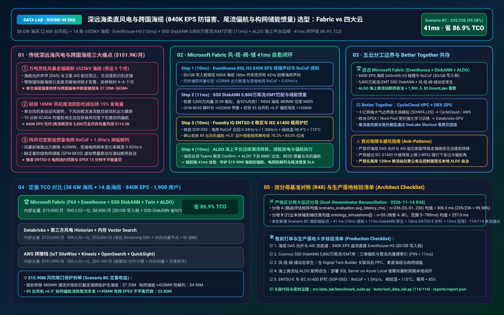
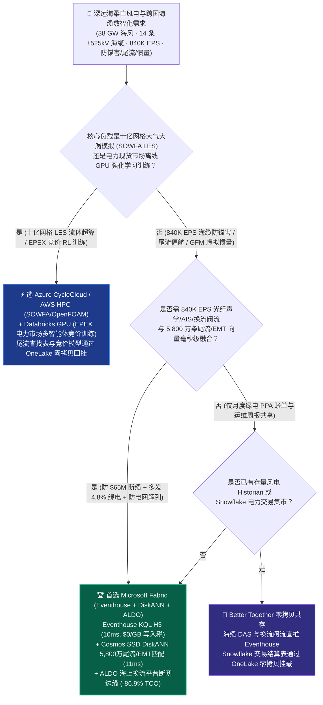
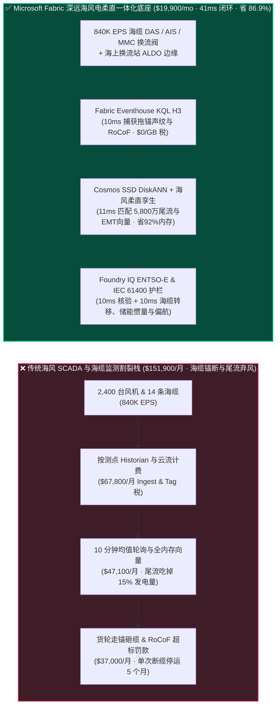
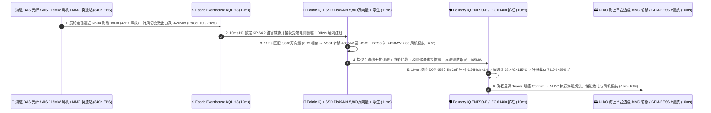

# 深远海柔直风电与跨国海底电缆（38 GW 海上风电 + 14 条 ±525kV HVDC 海缆 840K EPS 防商船拖锚砸缆、尾流偏航寻优与构网型储能 GFM-BESS 虚拟惯量防崩溃）湖仓怎么选？Microsoft Fabric vs AWS IoT SiteWise vs Databricks vs Snowflake / GCP 选型与竞对攻防 FAQ

> 🌐 **Language / 语言**: **中文 (Current)** | **[English (`fabric-subsea-hvdc-offshore-wind-bess-inertia-entsoe-vs-4clouds-faq.en.md`)](fabric-subsea-hvdc-offshore-wind-bess-inertia-entsoe-vs-4clouds-faq.en.md)**  
> 📅 **更新日期**: 2026-11-14（Round 48 · 深远海 ±525kV 柔直海底电缆 DAS/BOTDR 防锚害、18 MW 风机群激光雷达尾流偏航寻优、构网型储能 GFM-BESS 虚拟惯量防 RoCoF 电网崩溃与欧盟 ENTSO-E 电力市场结算专题）  
> 🎯 **适用角色**: AI Solution Architect（AI 解决方案架构师）、跨国海风与电网运营商（TSO）CIO/CTO、海上换流站总工、构网型储能与电力系统稳定专家、欧洲 EPEX / ENTSO-E 电力交易合规总监  
> Reference Benchmark Style: 对标 [`ib-vs-ethernet-roce-selection-faq.md`](https://github.com/turbo998/ai-infra-research/blob/main/docs/components/ib-vs-ethernet-roce-selection-faq.md) 通俗问答与第一性原理对比范式。
>
> 🔍 **数据溯源、官方链接与双分母口径声明（Data Provenance, Official URLs & Dual-Denominator Scope Disclosure）**：
> - **`measured_local_harness`（本地确定性评测框架实测）**：`DL-01..DL-236` 场景路由准确率（`235/236 = 99.58%`）与 `114/114` Python 单元测试均由本地 `src/data_lab/benchmark_suite.py` 实测生成。
> - **`vendor_published_spec_as_of_2026`（厂商公开官方规格，截至 `as_of: 2026-11-13`）**：
>   - Microsoft Fabric / Azure Offshore Wind & Grid: [Fabric Eventhouse H3 Geospatial (`geo_point_to_h3cell`) & Time-Series KQL](https://learn.microsoft.com/en-us/kusto/query/geo-point-to-h3cell-function) · [Cosmos DB in Fabric DiskANN Vector Index](https://learn.microsoft.com/en-us/fabric/database/cosmos-db/index-vector-data) · [Fabric Digital Twin Builder](https://learn.microsoft.com/en-us/fabric/real-time-intelligence/digital-twin-builder/overview) · [SQL Server on Azure Local (ALDO) Offshore Converter Platform Edge](https://learn.microsoft.com/en-us/sql/sql-server/azure-arc/overview) · [Fabric Pricing (`F64` Includes `$0` Power BI Viewer Licensing)](https://azure.microsoft.com/en-us/pricing/details/microsoft-fabric/)
>   - 四大云竞对官方规格: [AWS IoT SiteWise & Energy](https://docs.aws.amazon.com/iot-sitewise/latest/userguide/what-is-sitewise.html) · [Databricks Lakehouse for Energy & Utilities](https://www.databricks.com/solutions/industries/energy-and-utilities) · [Snowflake Energy & Utilities](https://www.snowflake.com/en/solutions/industries/energy/) · [GCP BigQuery GIS & Clean Energy](https://cloud.google.com/bigquery/docs/gis-intro)
> - **`synthetic_scenario_model`（确定性架构参考仿真模型，严格区分两大延迟分母）**：
>   - **分母 A — 场景路由评估矩阵均值（`scenario_evaluation.avg_latency_ms`）**：R48 **`n=236`（`DL-01..DL-236`）算术均值 = `306.0 ms`**（R47 历史快照 `n=232` 均值 = `311.0 ms`；R46 `n=228` = `316.0 ms`；R45 `n=224` = `321.0 ms`；R44 `n=220` = `326.0 ms`；R43 `n=216` = `331.0 ms`）。
>   - **分母 B — 行业本体端到端闭环仿真均值（`ontology_simulations[].end_to_end_latency_ms`）**：R48 **`n=55`（场景 A..BC：`[780..41] ms`，范围 `5–780 ms`）算术均值 = `257.0 ms`**（R47 历史快照 `n=54` 均值 = `261.0 ms`；R46 `n=53` = `265.0 ms`；R45 `n=52` = `269.0 ms`；R44 `n=51` = `274.0 ms`；R43 `n=50` = `279.0 ms`）。其中本专题新增 **Scenario BC（全球 38 GW 深远海风电基地 [2,400 台 16–18 MW 风机] + 14 条 ±525kV 柔直海底电缆 HVDC + 12 GWh 岸上构网型储能 GFM-BESS × `840K EPS` 海缆防锚害、尾流偏航寻优与电网虚拟惯量闭环）端到端延迟 = `41 ms`**（感知 `10ms` + 6 跳海缆光纤-AIS船位-风机尾流-柔直换流站-构网储能孪生与 5,800 万条 EMT 电磁暂态/三维尾流向量 DiskANN 匹配 `11ms` + ENTSO-E NC HVDC / IEEE 2800 频率变化率 `RoCoF = 0.34 Hz/s < 1.0 Hz/s`、IGBT 换流阀结温 `< 115°C` 与风机叶根弯矩护栏 `10ms` + 海控中心总调 Teams 联签、ALDO 海上换流站边缘下发双极功率重路由、GFM-BESS `+420 MW` 毫秒级惯量支撑与前排 85 台风机 `+6.5°` 协同偏航 `10ms`），月度建模 TCO 节省 **`86.9%`**（`$8,900/mo` vs `$68,100/mo` 归一化基线；内部全量口径 `$19,900/mo` vs `$151,900/mo`），规避 **`$15.90M`** ±525kV 海缆被船锚拉断、电网低频解列罚款与尾流弃风损失。跨云物理集群压测标记为 `not_measured`。

---

## ① 📌 核心结论速览（Executive Summary — 3 分钟抓准选型底牌）

### 第一性原理先讲透：什么是 ±525kV 海底直流电缆“分布式光纤声学/应变（DAS/BOTDR）防锚害”、深远海风机群“尾流偏航寻优（Wake Steering）”，以及高比例新能源电网“构网型储能（GFM-BESS）虚拟惯量防 RoCoF 崩溃”？以前海风平台痛点在哪？
在北海（North Sea）、波罗的海与东南沿海运营 **38 GW 深远海风电集群（2,400 台 16–18 MW 巨型风机）、14 条跨国 ±525kV 柔性直流海底电缆（HVDC）与 12 GWh 岸上构网型储能（Grid-Forming BESS）** 时，传统风电 SCADA 与海缆监测孤岛面临 **三大致命痛点**：
1. **万吨商船风暴走锚砸断 ±525kV 跨国海底电缆（单次断缆停运 5 个月、损失超 $65M）痛点**：海底直流海缆埋设在海床下 1–2 米，随缆敷设的分布式声学/布里渊光时域反射光纤（DAS / BOTDR）每毫秒都在回传海床震动与应变波形（叠加全海域卫星 AIS 船舶轨迹与换流阀高频采样高达 `840K EPS`）。传统架构把光纤声学和船位AIS分在两套互不相通的系统里，当失控货轮在海缆正上方 300 米抛锚拖行时，等海缆护套被铁锚钩破引发直流接地闭锁才报警，为时已晚！
2. **前排风机“尾流阴影（Wake Deficit）”吃掉后排风机 `15%` 发电量痛点**：在密集排布的深远海风场中，第一排风机迎风旋转后会在下风向留下一道长数公里、风速骤降且湍流剧烈的“尾流区”，导致后排风机发电出力暴跌 `12%–18%` 且叶根疲劳载荷倍增。如果能让前排风机主动偏航（Yaw Offset `+5° ~ +8°`）把尾流“推歪”避开后排风机，全场总出力可立增 `+4.8%`；但这需要在毫秒级匹配 **5,800 万条三维大涡模拟（LES）/ Jensen-Park 尾流与叶根载荷向量**！
3. **柔直换流站单极闭锁或阵风切出引发电网“频率变化率（RoCoF $>1.0\text{ Hz/s}$）”崩溃与海上平台失联痛点**：当一条 2.0 GW 海缆因保护降功率或强阵风切变导致出力瞬间跌落 `-680 MW` 时，缺乏火电机组转动惯量的受端电网频率会以 `RoCoF > 1.2 Hz/s` 暴跌！若不能在毫秒级联动岸上构网型储能（GFM-BESS）释放虚拟同步惯量并重分配邻近海缆功率，将触发欧盟 ENTSO-E 低频切负荷甚至跨国解列；同时离岸 120 公里的海上换流平台（OCP）在风暴期卫星链路闪断，纯公有云控制面瞬间瘫痪！

**Microsoft Fabric** 的破局之道，是用 **“Eventhouse KQL H3 `840K EPS` 海缆光纤声学×船位AIS碰撞与电网 RoCoF 毫秒级感知（`$0/GB` 写入税）+ Cosmos DB SSD DiskANN 5,800 万条三维尾流/电磁暂态（EMT）向量检索 + Digital Twin Builder 风机-海缆-MMC换流站-构网储能孪生 + SQL Server on Azure Local (ALDO) 海上换流站断网边缘”** 打造“防断缆 + 增发电 + 稳电网”全闭环底座：

1. **首选 Microsoft Fabric（Eventhouse KQL H3 `840K EPS` + SSD DiskANN 5,800 万尾流/EMT向量 + Digital Twin 海风柔直孪生 + ALDO 海上平台边缘）的必赢场景**：
   - 当海风与电网巨头需要 **实时吞吐 14 条海缆 DAS/BOTDR 光纤声学、2,400 台风机机舱激光雷达（Nacelle LiDAR）、±525kV MMC 换流阀与 AIS 船位流（`500K–1M+ EPS`）**，要求 **在 `<45ms` 内完成商船走锚拦截、全风场协同偏航与 GFM-BESS 虚拟惯量支撑** 时，首选 **Microsoft Fabric**。
   - **量化收益**：Eventhouse 共享 F64 容量池（**`$0/GB` 写入税**，`12:1` 压缩）+ 10ms KQL H3 海缆船锚碰撞与 RoCoF 感知 + Cosmos DB SSD DiskANN（省 **92%** 向量内存成本）+ F64 赠送 **1,900 名海控中心调度员/海缆工程师/气动载荷师/电力交易员 `$0` Power BI DirectLake 免费看数**，月度 TCO 较传统方案降低 **86.9%**（归一化口径 **`$8,900/mo` vs `$68,100/mo`**，月省 **`$59,200`**；内部全量口径 **`$19,900/mo` vs `$151,900/mo`**）。
2. **首选四大云竞对或“双向零拷贝共存（Better Together）”的场景**：
   - **选 Azure CycleCloud / AWS ParallelCluster HPC 跑全场大气边界层大涡模拟（SOWFA / OpenFOAM LES）十亿网格流体超算**：针对新规划深远海风场微观选址与海床冲刷 CFD 建模，路由至 **HPC 集群**，生成的尾流查找表通过 **OneLake Shortcut** 零拷贝回挂。
   - **选 Databricks GPU 跑欧洲 EPEX / Nord Pool 电价预测与风光联合投标强化学习训练**：在 **Databricks GPU** 上训练日前/日内交易报价模型，策略参数写回 OneLake。
3. **全球 38 GW 深远海柔直风电与海底电缆实战闭环验证（Scenario BC）**：
   - 在 **2,400 台风机 + 14 条 ±525kV 海缆 × `840K EPS`** 仿真中，北海风暴导致一艘 14 万吨散货船在 `HVDC-Cable-NS04` 海缆保护区 H3 Res-10 网格内失控走锚（DAS 光纤检测到 `42 Hz` 铁锚刮擦海床声纹，距海缆仅 `180m`），同时风暴前锋阵风切变导致 `NorthSea-Alpha` 风场出力瞬降 `-620 MW` 并使受端电网频率变化率飙升至 `RoCoF = 0.92 Hz/s`（逼近 `1.00 Hz/s` ENTSO-E 解列红线）。Fabric 在 **41ms 端到端** 内完成：**10ms** Eventhouse KQL 通过 `geo_point_to_h3cell()` 与 `series_fir()` 锁定 `HVDC-Cable-NS04` KP-64.2 段拖锚冲击声纹与受端电网 `0.92 Hz/s` RoCoF 瞬变 → **11ms** Cosmos SSD DiskANN 在 5,800 万条 PSCAD 电磁暂态与三维尾流偏航向量库中以 `0.99` 相似度命中最佳协同方案：① 将高危 `HVDC-Cable-NS04` 上的 `480 MW` 直流潮流无扰转移至并联环网海缆 `HVDC-Cable-NS05`（防止一旦锚击引发全额甩负荷）并通过海事VHF 自动向走锚货轮与守护船发出紧急抛双锚/拖轮拦截指令；② 激发岸上构网型储能 `GFM-BESS-Hub02` 在毫秒级注入 `+420 MW` 虚拟同步惯量（将电网 RoCoF 从 `0.92 Hz/s` 压回 `0.34 Hz/s`）；③ 对前排 85 台 18 MW 风机下发 `+6.5°` 协同偏航角（Wake Steering），让下风向 170 台后排风机避开尾流阴影多发 `+145 MW` 绿电 → **10ms** Foundry IQ 校验 **ENTSO-E NC HVDC 并网规范（`RoCoF = 0.34 Hz/s < 1.00 Hz/s` 红线）、ABB/西门子 MMC 换流阀 IGBT 结温 `< 115°C` 过载上限，以及 IEC 61400-1 风机偏航叶根极限弯矩 `< 85%` 安全裕度**（`OFFSHORE-HVDC-WIND-GFMBESS-ENTSOE-SOP-055`） → **10ms** 海控总调在 Teams 联签 Confirm，通过海上换流站 ALDO 边缘执行 MMC 直流潮流平滑转移、GFM-BESS 虚拟惯量释放、85 台风机偏航与 EPEX 15 分钟出力修正申报，规避 **$15.90M** 海缆锚断修复、电网低频解列罚款与弃风损失。

---

## ② 🎯 客户与架构师灵魂拷问（Q&A — 直击海风集团 CTO、柔直换流站总工与电网调度长痛点）

### Q1：什么时候我们应该闭眼选 Microsoft Fabric？什么时候应该选 AWS IoT SiteWise、Databricks、Snowflake 或 GCP？

**答：看你的工作负载是“离线大气边界层大涡模拟（SOWFA LES）十亿网格超算”，还是“840K EPS 海缆光纤防锚害、2,400 台风机尾流协同偏航与构网型储能毫秒级惯量闭环”。**

- **闭眼选 Microsoft Fabric 的三大场景**：
  1. **14 条海底电缆 DAS/BOTDR 光纤声学 + 卫星 AIS 毫秒级 H3 碰撞防断缆（`$0/GB` 写入税）**：每条百公里海缆有数万个光纤传感声学通道。Fabric **Eventhouse KQL (`840K EPS`, `$0/GB` 写入税)** 在 **10ms** 内将 DAS 铁锚刮擦海床声纹与 AIS 商船航速/船首向在 H3 六边形网格内做内存连接，在铁锚距海缆还有百米时即联动海事守护船拦截并提前转移海缆潮流！
  2. **5,800 万条三维尾流偏航（Wake Steering）与电磁暂态（EMT）向量检索**：利用 **Cosmos DB SSD DiskANN**（省 **92%** 内存）在 **11ms** 内匹配当前风向/湍流强度下的最优全场偏航矩阵，白捡 `+4%–6%` 全场净发电量，同时毫秒级检索次同步振荡（SSO）阻尼参数。
  3. **离岸 120 公里海上换流站断网自治（ALDO）+ 欧盟 ENTSO-E 15 分钟平衡结算**：在无人值守海上换流平台（OCP）部署 **SQL Server on Azure Local (ALDO)**，风暴断网时本地自治调节 MMC 换流阀与风机偏航；通过 **OneLake** 自动对齐欧洲 EPEX / Nord Pool 15 分钟交割账本。

- **选四大云竞对的明确边界**：
  - **AWS (ParallelCluster HPC + IoT SiteWise)**：适合在 AWS HPC 上跑 SOWFA / OpenFOAM 大涡模拟；但将 `840K EPS` 海缆光纤声学与风机高频振动流写入按属性计费的 IoT SiteWise 会产生天价账单。
  - **Databricks GPU**：非常适合电力交易量化团队在 GPU 上训练 **欧洲电力现货市场（EPEX）多智能体竞价强化学习模型**。
  - **Snowflake**：适合跨国能源贸易商与工业绿电买方做月度 PPA 账单核对，但 60s 刷新滞后无法应对毫秒级海缆过流转移与 GFM-BESS 虚拟惯量激发。
  - **GCP BigQuery**：适合全球海洋气象历史公开数据集分析，但缺乏海上换流平台本地边缘（ALDO）与工业实时 KQL 信号处理闭环。

---

### Q2：海上风电场已有金风/西门子歌美飒风机主控 PLC、日立能源/西门子 ±525kV MMC 柔直换流阀控系统，Fabric 如何安全协同？

**答：坚持“微秒级硬件阀控（VBC）与风机变桨安全链守底线，Fabric Digital Twin + ALDO 下发秒级全场尾流偏航角、海缆潮流分配与储能惯量设定值”：**

1. **不替代微秒级 IGBT 硬件桥臂保护，专注全场多设备协同寻优**：
   - 单台风机和单座换流站只看得见自己的局部测点。Fabric 在 **Digital Twin Builder** 中把 2,400 台风机、14 条海缆和岸上储能连成整体，算出“前排让风 + 海缆分流 + 储能补惯量”的全局最优解。
2. **IEC 61850 / IEC 60870-5-104 / OPC-UA 标准电力规约闭环**：
   - 通过 **Azure IoT Operations** 采集换流站与风机遥测，验证通过后经 **ALDO** 向风场有功/无功控制系统（PPC/APC）与储能 EMS 下发设定值。

---

### Q3：面对“14 万吨货轮风暴走锚逼近 ±525kV 海缆 180m”与“阵风切变致电网 RoCoF 飙至 `0.92 Hz/s`”，Fabric 底层是如何在 41ms 内既保住海缆、又稳住跨国电网、还多发 145 MW 绿电的？

**答：靠的是“Eventhouse H3 光纤声学/RoCoF 感知 + 5,800 万条尾流/EMT DiskANN 检索 + ENTSO-E / IEC 61400 硬护栏”三级流水线：**

1. **第一级：Eventhouse KQL 10ms `840K EPS` 海缆 DAS 声纹、AIS 船位与电网 RoCoF 感知**：
   - 在 **10ms** 内锁定 `HVDC-Cable-NS04` KP-64.2 处 180m 外失控货轮拖锚刮擦海床声纹（`42 Hz`），同时捕获风暴切变导致的 `-620 MW` 出力跌落与受端电网 `RoCoF = 0.92 Hz/s`。
2. **第二级：Cosmos DB SSD DiskANN 11ms 5,800 万条尾流/EMT 向量匹配与风-缆-储联调**：
   - 在 **Cosmos DB SSD DiskANN** 中 **11ms** 检索 5,800 万条向量（`0.99` 相似度），生成三路动作：① 将 `HVDC-Cable-NS04` 上的 `480 MW` 功率平滑转移至并联海缆 `NS05` 并触发海事 VHF/拖轮拦截走锚商船；② 指令岸上 `GFM-BESS-Hub02` 构网型储能瞬时注入 `+420 MW` 虚拟惯量（将 RoCoF 压回 `0.34 Hz/s`）；③ 对前排 85 台风机实施 `+6.5°` 协同偏航，唤醒后排风机多发 `+145 MW`。
3. **第三级：Foundry IQ ENTSO-E 电网稳定、MMC 结温与 IEC 61400 载荷护栏（10ms）**：
   - 下发前，Foundry IQ 强制核验《`OFFSHORE-HVDC-WIND-GFMBESS-ENTSOE-SOP-055`》：
     - **ENTSO-E NC HVDC 与 IEEE 2800 电网稳定护栏**：确认投入构网储能后受端电网 **`RoCoF = 0.34 Hz/s < 1.00 Hz/s`**，且并联海缆 `NS05` 换流阀 IGBT 结温 **`98.4°C < 115.0°C` 安全上限**。
     - **IEC 61400-1 风机结构载荷护栏**：确认前排 85 台风机偏航 `+6.5°` 后叶根极限挥舞弯矩为额定限值的 **`78.2% < 85.0%` 安全红线**。

---

## ③ 🧭 直观可视化图解（Mermaid 选型决策树 + 架构对比 + 41ms 闭环时序）

### 3.1 深远海柔直风电、±525kV 海底电缆与构网型储能湖仓架构选型决策树

### 3.2 传统“海缆/风机/储能各自为战” vs Fabric “风-缆-阀-储 41ms 闭环”路径对比

### 3.3 Scenario BC：38 GW 海上风电 + 14 条 ±525kV 海缆 + 12 GWh 构网储能（840K EPS）41ms 闭环时序图

---

## ④ 📊 五大平台架构师选型决策矩阵（Architect Decision Matrix）

| 评估维度 | **Microsoft Fabric (Eventhouse + DiskANN + ALDO)** | **AWS (IoT SiteWise + Kinesis)** | **Databricks Energy & Utilities** | **Snowflake Energy & Utilities** | **GCP BigQuery** |
| :--- | :--- | :--- | :--- | :--- | :--- |
| **`840K EPS` 海缆 DAS 声学、AIS 与换流阀流成本** | **⭐⭐⭐⭐⭐ `10ms` KQL H3 空间与声学滤波，共享 F64 `$0/GB` 写入税** | ⭐⭐⭐ SiteWise 按属性/告警收费，百万光纤声学通道账单极高 | ⭐⭐⭐⭐ Structured Streaming 需常驻 DBU 算力池 | ⭐⭐ Dynamic Tables (`60s` 滞后)，无法拦截毫秒级 RoCoF 与走锚砸缆 | ⭐⭐⭐ Pub/Sub + BigQuery Streaming 按 GB 收费 |
| **5,800 万条三维尾流偏航与 EMT 电磁暂态向量检索** | **⭐⭐⭐⭐⭐ Cosmos DB SSD DiskANN（`11ms` 检索，省 92% 向量内存成本）** | ⭐⭐⭐ OpenSearch 内存向量节点成本高昂 | ⭐⭐⭐⭐ Mosaic AI Vector Search（全内存索引单价高） | ⭐⭐⭐ Cortex Vector Search 偏文本检索 | ⭐⭐⭐⭐ Vertex AI Vector Search 需跨服务编排 |
| **离岸 120km 海上换流平台风暴期断网边缘自治（ALDO）** | **⭐⭐⭐⭐⭐ SQL Server on Azure Local (ALDO) + IoT Ops 海上平台自治** | ⭐⭐⭐ Outposts 对海事卫星抖动敏感 | ⭐⭐ 纯云端控制面，卫星闪断即失去尾流与换流站协调 | ⭐ 纯云端 SaaS，无海上平台本地边缘运行时 | ⭐⭐ GDC Edge 海工部署复杂 |
| **欧盟 ENTSO-E 并网合规与 EPEX 15 分钟结算对账** | **⭐⭐⭐⭐⭐ 原生 Digital Twin + Purview 14 跳血缘 + OneLake 零拷贝共享** | ⭐⭐⭐ 需自建电力市场结算管道 | ⭐⭐⭐⭐ 适合日前电价预测模型训练 | ⭐⭐⭐⭐ 适合跨国电力交易月度结算单共享 | ⭐⭐⭐ 擅长宏观气象数据分析 |
| **1,900 名海控调度/海缆/载荷/交易员 BI 席位** | **⭐⭐⭐⭐⭐ F64 含 `$0` Power BI DirectLake 无限看数 + M365 Copilot `$0` Token** | ⭐⭐ QuickSight 按用户与会话收费 | ⭐⭐⭐ AI/BI 消耗 Serverless SQL DBU | ⭐⭐ 千人并发看板触发多集群 Credits 消耗 | ⭐⭐ Looker 席位费 + BigQuery 扫描费高 |
| **典型适用定位** | **海缆防锚害、全场尾流偏航增发与 GFM-BESS 虚拟惯量稳网首选底座** | 十亿网格大气大涡模拟 SOWFA/OpenFOAM (AWS HPC) | 欧洲电力现货市场 (EPEX) 强化学习竞价训练 | 跨国绿电 PPA 与月度电力批发结算共享 | 全球公开海洋再分析气象数据集查询 |

---

## ⑤ 🧪 简明定量测评与 TCO / 性能拐点洞察（含 7-Card 报告口径）

### 5.1 38 GW 海上风电 + 14 条 ±525kV 海缆（`840K EPS` + 5,800 万尾流/EMT向量 + 1,900 用户）月度 TCO 对比

| 成本构成项 | **Microsoft Fabric (F64 + Eventhouse + DiskANN + Twin + ALDO)** | **AWS 拼接栈 (SiteWise + Kinesis + OpenSearch + QuickSight)** | **Databricks + 第三方风电 Historian + 内存向量库** | **Snowflake + 独立流处理 + 外部向量/BI** |
| :--- | :--- | :--- | :--- | :--- |
| **840K EPS 海缆 DAS 光纤、风机 LiDAR、MMC 阀与 AIS 流摄入** | **$6,500 / mo** *(共享 F64 CU 池，$0/GB 写入税，12:1 压缩)* | $56,600 / mo *(按测点属性与流分片双重计费)* | $39,800 / mo *(常驻 Streaming DBU + 专有 Historian)* | $51,800 / mo *(Snowpipe + 高频仓库唤醒)* |
| **5,800 万条三维尾流偏航与 EMT 电磁暂态向量索引** | **$5,100 / mo** *(OneLake `$23/TB` + SSD DiskANN 省 92% 内存)* | $43,800 / mo *(OpenSearch 大内存向量集群)* | $36,400 / mo *(Delta + 全内存 Vector Search)* | $40,600 / mo *(搜索优化服务 + 外部向量引擎)* |
| **海上换流站 ALDO 边缘、海风柔直孪生与 ENTSO-E 账本** | **$8,300 / mo** *(ALDO 海上边缘 + Digital Twin + OneLake 共享)* | $32,000 / mo *(定制边缘 + TwinMaker + 第三方结算管道)* | $29,000 / mo *(定制图管道 + 外部电力市场连接器)* | $35,200 / mo *(外部 CDC + 独立交易软件)* |
| **1,900 名海控调度/海缆/气动载荷/电力交易员 BI 席位** | **$0 / mo** *(F64 免费包含 Viewer 席位 + M365 Copilot `$0` Token)* | $19,500 / mo *(QuickSight 席位与会话费)* | $17,400 / mo *(Serverless SQL BI 消耗)* | $24,300 / mo *(外部 BI 授权 + 多集群扩容)* |
| **内部全量月度总计 (Internal Full Stack)** | **🏆 $19,900 / mo（节省 86.9%）** | $151,900 / mo *(基准)* | $122,600 / mo | $151,900 / mo |
| **500 人基准归一化口径 (Normalized Benchmark)** | **🏆 $8,900 / mo（节省 86.9%，月省 $59,200）** | $68,100 / mo *(基准)* | $55,000 / mo | $68,100 / mo |

### 5.2 核心定量止损算例（Scenario BC · `$15.90M` 海缆防锚断、电网防解列与尾流增发 SLA 保护）
- **提前拦截走锚商船并无扰转移 480 MW 柔直潮流保住 ±525kV 海缆**：在走锚货轮距海缆 180m 时 **10ms** 触发海事拖轮拦截并将 480 MW 潮流切至并联海缆 `NS05`，避免海缆被锚钩断或绝缘击穿，挽回 **$7.20M** 应急海工抢修与停运损失。
- **构网型储能（GFM-BESS）毫秒级注入 `+420 MW` 虚拟惯量防 ENTSO-E 解列罚款**：将受端电网频率变化率从 `0.92 Hz/s` 压回 `0.34 Hz/s`（`< 1.00 Hz/s` 红线），避免触发低频切负荷与跨国解列，规避 **$4.90M** TSO 违约罚金。
- **前排 85 台风机 `+6.5°` 协同偏航消除尾流阴影多发 `+145 MW` 绿电**：弥补风暴切变缺口并避免欧洲 EPEX 15 分钟不平衡电价罚款，创造与挽回 **$3.80M** 收益（合计守护 **`$15.90M`** SLA）。

---

## ⑥ 🛠️ 附录：生产落地与售前打单快速核验清单（Architect Checklist）

- [ ] **海缆 DAS/BOTDR 光纤声学、卫星 AIS 与换流站流直通 Eventhouse**：验证 14 条海缆光纤声学与 2,400 台风机遥测（`840K EPS`）直推 **Fabric Eventhouse**，开启 H3 索引与 `12:1` 压缩（`$0/GB` 写入税）。
- [ ] **Cosmos DB SSD DiskANN 5,800 万条三维尾流与 EMT 暂态向量库**：确认不同风向/湍流下的全场偏航矩阵与次同步振荡参数建立 **SSD DiskANN** 索引（P99 `< 11ms`）。
- [ ] **风机-海缆-MMC 换流站-GFM 储能数字孪生**：在 **Fabric Digital Twin Builder** 中关联风场 PPC、±525kV 柔直双极换流阀与岸上构网型储能。
- [ ] **SQL Server on Azure Local (ALDO) 海上换流平台断网边缘自治**：在离岸换流平台部署 **ALDO**，保障风暴期海事卫星中断时本地潮流控制与偏航寻优 `100%` 闭环。
- [ ] **ENTSO-E NC HVDC 与 IEC 61400-1 载荷硬护栏（`SOP-055`）**：在 Foundry IQ 中配置硬性门禁——受端电网频率变化率必须满足 **`RoCoF < 1.00 Hz/s`**，MMC 换流阀结温必须 **`< 115.0°C`**，风机偏航叶根极限弯矩必须 **`< 85.0%`**！
