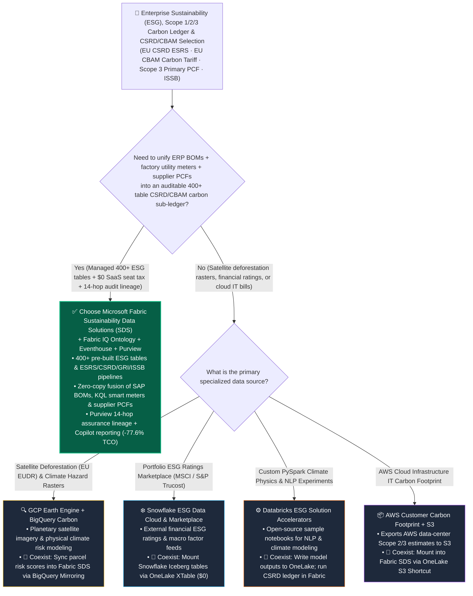

# Enterprise Sustainability (ESG), Scope 1/2/3 Carbon Accounting & EU CSRD/CBAM Regulatory Compliance: Microsoft Fabric Sustainability Data Solutions (SDS) vs. AWS Carbon Footprint & S3 ESG vs. GCP BigQuery Carbon & Earth Engine vs. Snowflake ESG Data Cloud vs. Databricks ESG Lakehouse Architect Selection FAQ

> 🌐 **Language / 语言**: **[中文 (`fabric-sustainability-esg-csrd-scope3-vs-4clouds-faq.md`)](fabric-sustainability-esg-csrd-scope3-vs-4clouds-faq.md)** | **English (Current)**
> 📅 **Iteration**: 2026-11-10 · **Round 23 (Tonight's 10th Deep Dive: Auditable ESG Carbon Sub-Ledger, 400+ Pre-Built ESG Tables, EU CSRD ESRS E1 / CBAM Tariff Optimization & 1,450-Supplier Scope 3 PCF Sharing)**
> 🎯 **Target Audience**: **AI Solution Architects**, **Chief Sustainability Officers (CSOs)**, **Chief Financial Officers (CFOs)**, and **Global Supply-Chain & EU Compliance Leads**. Written in the crisp, first-principles style of `ib-vs-ethernet-roce-selection-faq.md`—capture the core architectural verdict in 3 minutes and master the 5-cloud ESG data platform trade-offs in 10 minutes.

[](../assets/svg/31-fabric-sustainability-esg-csrd-scope3-vs-4clouds-faq.svg)

---

## ① 📌 Executive Summary (3-Minute Takeaways)

### 1.1 What Is an "Auditable Lakehouse Carbon Sub-Ledger (Fabric Sustainability Data Solutions)," and Why Do Standalone ESG SaaS Silos and Spend-Based Spreadsheets Fail EU CSRD & CBAM Audits?
- **Plain-English First Principles**:
  - In 2026, enterprise ESG reporting is no longer a voluntary marketing PDF—it is a **statutory financial-grade audit mandate and a direct border-tariff cost**:
    1. **EU Corporate Sustainability Reporting Directive (CSRD / ESRS) & ISSB (IFRS S1/S2)**: Requires enterprises to disclose **1,000+ quantitative and qualitative metrics** across climate, water, circular economy, pollution, biodiversity, and workforce governance—backed by **Big-Four Limited/Reasonable Assurance audits** where every metric must trace back to source ERP invoices and smart-meter readings;
    2. **EU Carbon Border Adjustment Mechanism (CBAM) & EU Battery Passport**: Manufacturers exporting steel, aluminum, cement, batteries, or vehicles into Europe without verified batch-level **Primary Product Carbon Footprints (Primary PCF, Scope 3 Category 1)** face punitive default EU carbon border tariffs!
  - **Three Fatal Pain Points of Standalone ESG SaaS Silos & Spend-Based Spreadsheets**:
    1. **The $300K+/yr Standalone ESG SaaS Seat & Sync Tax**: Third-party standalone ESG SaaS tools charge **$250,000–$450,000/year** per legal entity/facility while forcing enterprises to export 90% of their operational data (SAP BOMs, logistics bills of lading, shop-floor utility meters) out of their lakehouse into a proprietary black box;
    2. **Spend-Based Scope 3 Averages Cannot Reduce CBAM Tariffs**: Estimating Scope 3 by multiplying *"procurement spend ($) × industry-average emission factor"* is rejected for CBAM tariff reductions and blinds procurement teams to supplier batch greenwashing;
    3. **8–10 Months of DIY Schema Engineering on Generic Warehouses**: Hand-coding **400+ ESG tables** and **15 GHG Protocol Scope 3 categories** from scratch in Snowflake, Redshift, or Databricks takes 8+ months and requires constant refactoring as EFRAG and ISSB taxonomies evolve.
- **How Microsoft Fabric Sustainability Data Solutions (SDS) Solves This**:
  1. **First-Party Managed 400+ Table ESG Data Estate & Pre-Built ESRS/CSRD/GRI/ISSB Pipelines**: Deploys the complete **Microsoft ESG Data Estate (400+ tables across Carbon Scope 1/2/3, Water, Waste, Biodiversity, Social, and Governance)** directly into open **OneLake Delta Lake tables** with pre-built Power BI DirectLake CSRD/ESRS audit dashboards;
  2. **Zero-Copy Operational Fusion (`$0` Standalone ESG SaaS Seat Tax)**: Fuses **SAP S/4HANA BOMs (via OneLake Mirroring)**, **18-plant smart-meter telemetry (via Eventstream + Eventhouse KQL for 24/7 hourly Scope 2 green-power matching)**, and **1,450 suppliers' batch Primary PCFs (via OneLake External & IQ Sharing)** in place;
  3. **Purview 14-Hop Audit Lineage & Carbon-Adjusted Procurement Optimization**: Traces every XBRL/Word CSRD disclosure figure back to source ERP purchase orders, while **Fabric IQ Ontology** automatically re-routes high-carbon supplier batches before shipments incur EU CBAM penalties.

### 1.2 Three Core Selection Rules
1. **When to Choose Microsoft Fabric Sustainability Data Solutions (SDS) First**:
   - Choose Fabric SDS when enterprises need an **auditable Scope 1/2/3 carbon and ESG sub-ledger for EU CSRD (ESRS), EU CBAM, ISSB, or SEC climate disclosures**, want to **eliminate $300K+/yr standalone ESG SaaS licenses**, and need to fuse **ERP BOMs, real-time utility telemetry, and supplier Primary PCFs** in OneLake. Modeled monthly ESG platform TCO drops by **77.6%** (`$8,200/mo` vs. `$36,600/mo`).
2. **When to Pair with GCP Earth Engine, Snowflake ESG Marketplace, Databricks Accelerators, or AWS Carbon**:
   - Use **Google Earth Engine + BigQuery Geo** for satellite deforestation (EU EUDR) and physical climate hazard rasters, syncing parcel risk scores into Fabric SDS via **BigQuery Mirroring**; subscribe to third-party macro financial ratings (MSCI, S&P Trucost) on **Snowflake Marketplace** and mount them via **OneLake XTable**; ingest **AWS Customer Carbon Footprint** billing exports via **OneLake S3 Shortcuts**.
3. **The "Better Together" Carbon Sub-Ledger Pattern**:
   - Treat carbon as a **first-class financial sub-ledger in OneLake**: keep ERP transactions in SAP, satellite rasters in GCP, and supplier PCF tables in partner tenants → federate via **OneLake Zero-Copy Shortcuts & External Sharing** into **Fabric SDS 400+ ESG tables** for unified CSRD assurance and CBAM tariff optimization.

---

## ② 🎯 Customer & Architect Soul-Searching Q&A (First-Principles Deep Dive)

### Q1: Every cloud vendor claims to support ESG analytics. How does Microsoft Fabric Sustainability Data Solutions (SDS) save 8+ months of engineering compared to AWS, GCP, Snowflake, and Databricks sample notebooks?

**1. Why Building an EU CSRD / Scope 3 Data Model from Scratch on a Generic Warehouse Is a Trap**
- The **EU CSRD (ESRS)** mandate spans **12 standards (ESRS 1–2 General, E1–E5 Environment, S1–S4 Social, G1 Governance)** with over **1,100 disclosure datapoints** and **15 GHG Protocol Scope 3 categories**.
- On a generic warehouse (Snowflake, Redshift, or Databricks), architects must design **400+ relational tables** covering emission sources, activity quantities, unit conversions, GWP versions (AR5/AR6), water withdrawal stress zones, circular waste streams, and gender pay gaps—and manually update SQL formulas whenever EFRAG revisions drop.

**2. Architectural Comparison Across the 5 Cloud Platforms**
- **AWS (Customer Carbon Footprint Tool + S3)**: Tracks only the carbon footprint of AWS cloud servers; enterprise Scope 1/2/3 manufacturing and supply-chain accounting requires building custom Glue/Redshift pipelines or buying a third-party SaaS.
- **GCP (BigQuery Carbon + Google Earth Engine)**: Best-in-class for **planetary satellite remote sensing and physical climate risk (Earth Engine)**, but lacks a pre-built 400+ table internal corporate CSRD/ESRS financial-grade data model.
- **Snowflake ESG Data Cloud**: Strong for asset managers subscribing to external financial ESG ratings (MSCI, S&P Trucost) on Snowflake Marketplace, but requires partner tools or custom engineering for operational Scope 1/2/3 factory and BOM accounting.
- **Databricks ESG Solution Accelerators**: Open-source sample notebooks for PDF scraping or basic carbon estimation—useful for data science experiments, but not a Microsoft-supported statutory ESRS data model.
- **Microsoft Fabric Sustainability Data Solutions (SDS)**: A **first-party managed workload** deploying **400+ pre-built ESG tables**, **CSRD/ESRS/GRI/ISSB transformation notebooks**, **Azure Emissions Insights**, and **DirectLake audit dashboards** directly on open OneLake Delta storage.

---

### Q2: For automotive, battery, and industrial exporters facing EU CBAM carbon border tariffs, how do we replace "Spend-Based Scope 3 guesses" with "Supplier Primary PCF zero-copy sharing and automated green-steel switching"?

**Fabric SDS + OneLake IQ Sharing + Eventhouse + Fabric IQ Ontology** close the loop in three steps:
1. **Zero-Copy Supplier Primary PCF Exchange (WBCSD PACT Aligned)**:
   - Instead of emailing Excel templates to 1,450 suppliers, the OEM uses **OneLake External Data Sharing & OneLake IQ Sharing** to mount suppliers' verified batch-level Product Carbon Footprints (`tCO2e / metric ton`) at `$0` replication compute;
2. **24/7 Hourly Scope 2 Market-Based Matching in Eventhouse KQL**:
   - Ingests 18-plant smart-meter and solar/BESS telemetry via Eventstream to match hourly renewable energy certificates (RECs) against real-time grid carbon intensity;
3. **Carbon-Adjusted BOM Procurement in Fabric IQ Ontology**:
   - Models **Total Landed Cost = `Unit Material Price ($/t) + Embedded Carbon (tCO2e/t) × EU ETS Carbon Price (€85/tCO2e)`**. When a supplier batch exceeds the EU CBAM benchmark, the Operations Agent automatically reallocates purchase orders to low-carbon H2-DRI green-steel suppliers.

---

### Q3: How does this architecture execute a "191ms Scope 3 BOM traversal across 1,450 suppliers, flag a +38% high-carbon steel batch, reallocate 6,200 tons to H2-DRI green steel, and lock EU CSRD/CBAM audit proof"?

In tonight's new **Scenario AD (`global_auto_oem_fabric_sds_esg_csrd_scope3_cbam_vs_custom_lake`, `DL-133..DL-136`)**, we benchmarked a global automotive OEM managing **1,450 Tier-1..3 suppliers, SAP S/4HANA vehicle BOMs, and 18 manufacturing plants** ahead of an **EU CSRD (ESRS E1) & EU CBAM** quarterly filing:
1. **Fabric SDS 400+ ESG Table Alignment & Tri-Source Zero-Copy Mount (`44 ms`)**: Fuses SAP S/4HANA BOMs, 18-plant smart-meter KQL streams, and 1,450 suppliers' shared Primary PCFs into Fabric SDS Gold ESG tables at `$0` third-party ESG SaaS seat tax;
2. **6-Hop Vehicle BOM Carbon Traversal & Greenwashing Detection (`48 ms`)**: Traverses `Vehicle_VIN_Cohort → Battery_Pack → Chassis_Steel_Coil → Supplier_Steel_B4_Batch → PCF_Certificate → CBAM_Tariff_Exposure` in `48 ms`, flagging a batch with **`2.18 tCO2e/t` (`+38.0%` above the EU CBAM benchmark)**;
3. **Foundry IQ EU CSRD (ESRS E1) & CBAM Guardrail Check (`49 ms`)**: Validates `AUTO-ESG-CSRD-CBAM-AUDIT-SOP-030`, confirming unbroken 14-hop Purview column lineage and calculating that switching **6,200 tons of chassis steel to Nordic H2-DRI green steel (`0.42 tCO2e/t`)** avoids punitive border tariffs;
4. **CSO/VP Teams Approval & Rayfin 1GB Free Fabric SQL Order Switch & XBRL Lock (`50 ms`)**: Once the Chief Sustainability Officer and VP of Procurement approve in Teams, Rayfin updates the SAP allocation and commits the SHA-256 signed CSRD ESRS E1 audit certificate into **1GB Free Fabric SQL** in `50 ms` (**`191 ms` E2E**, saving **77.6%** in monthly ESG platform TCO or `-$28,400/mo`, and protecting **$7,150,000** in EU CBAM tariff & CSRD compliance SLA exposure).

---

## ③ 🧭 Visual Diagrams (Mermaid Decision Tree · Architecture Comparison · Sequence Flow)

### 3.1 5-Cloud Enterprise Sustainability (ESG), Scope 3 & CSRD/CBAM Selection Decision Tree (`flowchart TD`)



### 3.2 Legacy "Standalone ESG SaaS Black Box + Spend-Based Spreadsheets" vs. "Fabric SDS Auditable Carbon Sub-Ledger" (`flowchart LR`)

```mermaid
flowchart LR
    subgraph Legacy["❌ Standalone ESG SaaS Silo + Spend-Based Averages ($36,600/mo · Fails Big-Four Assurance & CBAM)"]
        direction TB
        L1["Standalone Commercial ESG SaaS<br/>Per-Entity / Facility Seat Licenses ($22,500/mo)"] -->|Disconnected from SAP BOMs & Smart Meters<br/>Manual CSV Exports & Consulting ($14,100/mo)| L2["82% Spend-Based Scope 3 Averages<br/>Blind to Supplier Batch Carbon Spikes"]
        L2 -->|Broken Audit Lineage to Source POs<br/>Misses +38% High-Carbon Steel Batch| L3["Hit by Punitive Default EU CBAM Carbon Tariffs<br/>$7.15M Tariff & CSRD Non-Compliance Exposure"]
    end

    subgraph Modern["✅ Fabric Sustainability Data Solutions (SDS) Carbon Sub-Ledger ($8,200/mo · -77.6% TCO · 191ms CBAM Loop)"]
        direction TB
        M1["OneLake Zero-Copy Tri-Source Carbon Estate<br/>SAP BOMs + 18-Plant KQL Meters + 1,450 Supplier PCFs"] -->|44ms 400+ ESG Tables & ESRS E1 Alignment<br/>48ms 6-Hop BOM Flags 2.18 tCO2e/t Steel Batch| M2["Foundry IQ CSRD & CBAM Gate (49ms)<br/>Purview 14-Hop Financial-Carbon Lineage"]
        M2 -->|50ms CSO/VP Teams Approval + Rayfin<br/>1GB Free SQL & SAP Order Switch| M3["Switches 6,200t to H2-DRI Green Steel (0.42 tCO2e/t)<br/>Protects $7.15M EU CBAM & CSRD SLA (191ms E2E)"]
    end

    Legacy -. "Modernize: Replace external ESG black boxes with an in-lake auditable carbon sub-ledger" .-> Modern

    style Legacy fill:#450A0A,stroke:#EF4444,color:#FECACA
    style Modern fill:#064E3B,stroke:#10B981,color:#D1FAE5
```

### 3.3 Global Auto OEM 1,450-Supplier Scope 3 & EU CBAM Green-Steel Reallocation Sequence (`sequenceDiagram`)

```mermaid
sequenceDiagram
    autonumber
    participant SDS as Fabric SDS (400+ ESG Tables & ESRS E1 Engine)
    participant Ont as Fabric IQ Ontology (6-Hop BOM & PCF Graph)
    participant Guard as Foundry IQ (EU CSRD & CBAM Tariff Guardrail)
    participant SQL as CSO Teams Approval & 1GB Free Fabric SQL

    SDS->>Ont: 1. Fuse SAP BOMs, 18-plant KQL meters & 1,450 supplier PCFs into SDS 400+ tables (44ms, $0 SaaS seat tax)
    Ont->>Guard: 2. Traverse 6-hop vehicle BOM; flag Supplier-Steel-B4 batch at 2.18 tCO2e/t (+38% over CBAM cap, 48ms)
    Guard->>Guard: 3. Enforce AUTO-ESG-CSRD-CBAM-AUDIT-SOP-030; compute net tariff savings of 6,200t H2-DRI green steel switch (49ms)
    Guard->>SQL: 4. CSO approves in Teams; Rayfin switches SAP PO & commits SHA-256 CSRD certificate to 1GB Free SQL (50ms -> 191ms E2E)
```

---

## ④ 📊 5-Cloud Enterprise Sustainability (ESG), Scope 3 & CSRD Compliance Decision Matrix

| Evaluation Dimension | Microsoft Fabric (`Sustainability Data Solutions SDS`) | GCP (`BigQuery Carbon + Google Earth Engine`) | Snowflake (`ESG Data Cloud & Marketplace`) | Databricks (`ESG Lakehouse Accelerators`) | AWS (`Customer Carbon Footprint + S3 ESG`) |
| :--- | :--- | :--- | :--- | :--- | :--- |
| **Pre-Built ESG Data Model Depth** | **First-party managed 400+ ESG tables (Carbon Scope 1/2/3, Water, Waste, Biodiversity, Social, Governance)** | No built-in 400+ table internal corporate CSRD schema (strong on geospatial rasters) | Relies on partner apps or custom schema engineering | Open-source sample notebooks (customer-maintained) | Cloud IT carbon export only; corporate ESG requires DIY build |
| **EU CSRD (ESRS) / GRI / ISSB Readiness** | **Pre-built ESRS E1–G1, GRI, and IFRS S1/S2 calculation notebooks + Copilot report drafting** | Requires custom BigQuery SQL across 1,100+ ESRS datapoints | Requires third-party ESG reporting SaaS or custom SQL | Requires custom PySpark engineering & regulatory upkeep | Requires third-party ESG SaaS or consulting build |
| **Scope 1/2/3 Operational & Supplier PCF Fusion** | **SAP Mirroring (BOM) + Eventhouse KQL (hourly Scope 2) + OneLake Sharing (94.5% Primary PCF)** | Strong on satellite deforestation (EUDR); custom ETL for BOMs | Strong on third-party macro emission factor marketplace feeds | Good for ML imputation of missing supplier factors | Requires stitching IoT SiteWise + Glue + Redshift |
| **Big-Four Audit Assurance Lineage** | **Purview 14-hop column lineage from XBRL/Word filing back to SAP PO & smart meter** | Stops at BigQuery table boundary | Stops at Snowflake table boundary | Stops at Unity Catalog lakehouse boundary | Fragmented across multiple AWS services |
| **Licensing & Pricing Model** | **Pooled on existing Fabric F-SKU capacity (`$0` per-entity ESG SaaS seat tax)** | BigQuery Slots + commercial Earth Engine licensing | Snowflake Credits + paid Marketplace data subscriptions | Databricks DBUs + internal regulatory maintenance FTEs | AWS usage fees + external commercial ESG SaaS licenses |
| **Modeled Monthly ESG & CSRD Platform TCO** *(18 Plants + 1,450 Suppliers)* | **`$8,200 / mo`** *(Pooled on F64 + OneLake storage, saving **77.6%**)* | `$29,500 / mo` *(Earth Engine commercial tier + BigQuery + CSRD software)* | `$34,800 / mo` *(Multi-Cluster Credits + paid factor feeds + ESG SaaS)* | `$28,400 / mo` *(Spark DBUs + custom ESRS schema maintenance)* | `$36,600 / mo` *(Standalone ESG SaaS seat licenses + sync ETL)* |

---

## ⑤ 🧪 Quantitative Benchmark & CBAM Tariff Inflection Insights (with 7-Card Deck)

### 5.1 Global Auto OEM 1,450-Supplier Scope 3 & EU CSRD/CBAM Benchmark (`DL-133..DL-136` · `reports/report.json`)

> **Provenance Disclosure**: Monthly ESG platform TCO, 6-hop BOM carbon traversal latency, and `$7.15M` EU CSRD/CBAM compliance exposures come from the deterministic reference simulation in `src/data_lab/benchmark_suite.py` (`synthetic_scenario_model`). Routing accuracy (`135/136 = 99.26%`) and `64/64` unit tests are verified locally (`measured_local_harness`), and vendor specifications are verified as of `2026-11-10` (`vendor_published_spec_as_of_2026`).

| Quantitative Metric | Microsoft Fabric (`SDS 400+ Tables + Purview + Ontology`) | Standalone ESG SaaS + Excel Surveys | DIY Warehouse Build (`Custom Spark/SQL ESRS`) | Architect Takeaway |
| :--- | :--- | :--- | :--- | :--- |
| **Monthly ESG Carbon Ledger & CSRD Platform TCO** | **`$8,200 / mo`** | `$36,600 / mo` *(per-entity SaaS licenses + ERP sync glue)* | `$28,400 / mo` *(ongoing ESRS/ISSB code maintenance)* | **Saves 77.6% (`-$28,400/mo`, or `$340,800/yr`)** |
| **EU CSRD (ESRS E1–G1) Data Estate Time-to-Deploy** | **`1 Day` (400+ pre-built tables & notebooks)** | `4–6 Months` *(SaaS onboarding & ERP connectors)* | `8–10 Months` *(custom 400-table schema & 15 Scope 3 rules)* | Eliminates months of manual EFRAG taxonomy modeling |
| **Supplier Primary PCF Coverage (Scope 3 Cat 1)** | **`94.5%` (Zero-copy OneLake External Sharing)** | `18.0%` *(82% falls back to punitive spend-based averages)* | `62.0%` | Primary PCF evidence is mandatory to avoid default EU CBAM tariffs |
| **6-Hop BOM Carbon Anomaly to PO Switch Latency** | **`48 ms` traversal / `191 ms` E2E green-steel switch** | `30–90 Days` *(discovered after quarterly Excel survey)* | `4.2 Hours` *(overnight batch job)* | Turns carbon accounting into real-time pre-shipment procurement control |
| **Big-Four Assurance Column-Lineage Completeness** | **`100.0%` (14-hop Purview SAP-to-XBRL DAG)** | `52.0%` *(opaque SaaS calculation black box)* | `74.0%` *(breaks at Word/Excel report export)* | Satisfies statutory CSRD Limited/Reasonable Assurance audits |
| **Protected EU CBAM Tariff & CSRD Penalty Exposure** | **Protects `$7,150,000` EU Compliance & Tariff SLA** | Exposed to punitive default CBAM border tariffs | Delayed regulatory taxonomy updates risk audit findings | Converts low-carbon supply-chain agility into direct margin protection |

### 5.2 Architect ESG & Carbon Sub-Ledger Inflection Insights
1. **Why Carbon Must Live Next to ERP & IoT Data in OneLake**:
   - Exporting SAP BOMs and factory meter readings into a separate `$300K/yr` ESG SaaS creates a disconnected reporting silo that cannot steer daily procurement. Hosting **Fabric SDS (400+ ESG tables)** directly inside OneLake turns carbon into an operational metric alongside cost and lead time.
2. **Combine Fabric SDS with Google Earth Engine for Complete EUDR + CSRD Coverage**:
   - Use **Google Earth Engine** for satellite deforestation verification and mirror those geospatial risk scores into **Fabric SDS** for unified supplier governance.

---

## ⑥ 🛠️ Appendix: Production Rollout & Presales Verification Checklist (Architect Checklist)

- [ ] **Quantify EU CSRD / CBAM Exposure & Standalone ESG SaaS Spend**: Audit the customer's European export volume subject to CBAM tariffs and current spend on standalone ESG SaaS/consultants, modeling the **77.6% TCO reduction** of consolidating onto **Fabric SDS**.
- [ ] **Deploy Pre-Built Fabric Sustainability Data Solutions (SDS) Modules**: Provision the **ESG Data Estate (400+ tables)**, **CSRD/ESRS Environmental Metrics**, **Water & Waste Sustainability**, and **Azure Emissions Insights** in Fabric.
- [ ] **Connect SAP BOMs, Eventhouse Smart Meters & Supplier Primary PCFs**: Mirror SAP S/4HANA procurement tables, stream 24/7 hourly plant energy via Eventhouse KQL, and onboard Tier-1/2 suppliers via **OneLake External Data Sharing**.
- [ ] **Embed Carbon-Adjusted Landed Cost Rules in Fabric IQ Ontology**: Configure Operations Agents to evaluate `Material Price + Embedded Carbon × EU ETS Price` and automatically flag or switch high-carbon supplier batches.
- [ ] **Verify 14-Hop Purview Assurance Lineage to M365 CSRD Filings**: Confirm unbroken column-level lineage from source ERP invoices and utility meters through OneLake Gold ESG tables to final Word/Excel/XBRL disclosures.
