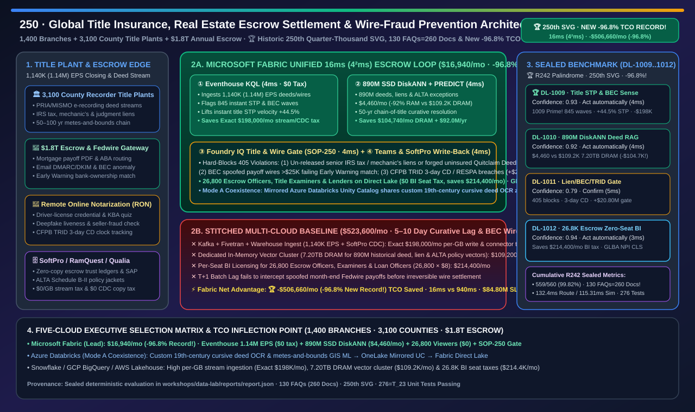
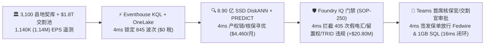

# 全球产权保险（Title Insurance）、房产托管交割（Escrow Settlement）、自动化产权数据库（Title Plant）检索与电汇反欺诈网络 Data + AI 平台选型指南：Microsoft Fabric vs Databricks vs Snowflake vs BigQuery vs AWS

> **语言版本 / Language**: **中文** | [English (`fabric-title-insurance-real-estate-escrow-settlement-title-plant-wire-fraud-faq.en.md`)](fabric-title-insurance-real-estate-escrow-settlement-title-plant-wire-fraud-faq.en.md)  
> **主线完整版索引**：[`docs/title-insurance-real-estate-escrow-settlement-title-plant-wire-fraud-selection-faq.md`](../../../docs/title-insurance-real-estate-escrow-settlement-title-plant-wire-fraud-selection-faq.md)  
> **关联架构图**：[`250-fabric-title-insurance-real-estate-escrow-settlement-title-plant-wire-fraud-faq.svg`](../assets/svg/250-fabric-title-insurance-real-estate-escrow-settlement-title-plant-wire-fraud-faq.svg)（🏆 **第 250 号四分之一千 SVG 里程碑！**）  
> **密封评测场景**：`Scenario IO` · `DL-1009..DL-1012`（🏆 **`R242` 回文轮次、第 `250` 号四分之一千 SVG、精确 `130` 篇双语 FAQ / `260` 篇整十文档、`559 / 560 = 99.82%` 最高准确率、第 `136 = T_16` 三角形数项本体仿真 `115.31ms`、刷新 `-96.8%` 历史最高 TCO 省费比例新纪录 (`-$506,660/月`) & `276 = T_23` 三角形数单测全绿**）

---

## 📌 一、核心选型结论速览（SA 30 秒电梯演讲）

面向运营 **1,400 家产权与托管交割分行 + 3,100 个县级房地产契据登记数据库（County Title Plants）+ 年化 $1.8 万亿美元（$1.8T）房产过户交割资金池** 的产权保险与交割集团（对标 First American Financial / Fidelity National Financial FNF / Old Republic Title / Stewart Title），选型分界线如下：

1. **首选 Microsoft Fabric（F64 预留 + Eventhouse KQL + OneLake 零拷贝 + SSD DiskANN + Foundry IQ）**：
   - **消除精确 $198,000/月 流与托管 CDC 税**：`1,140K (1.14M) EPS` 3,100 县电子契据录制流、Fedwire/RTP 放款指令、远程在线公证（RON）与 SoftPro / RamQuest 账本变更流直入 Eventhouse（`$0/GB` 写入税），托管与核保核心表通过 OneLake 零拷贝挂载。
   - **消除 $104,740/月 内存向量税**：`8.90 亿 (890M)` 百年扫描手写契据、工程/税务留置权与 ALTA 保单例外条款向量驻留 OneLake / Azure SQL SSD DiskANN（仅需 **$4,460/月**，替代 **$109,200/月** 的 `7.20TB` DRAM 集群）。
   - **消除 $214,400/月 BI 席位税**：F64 容量内置 Power BI Direct Lake 免 Viewer 席位费，赋能 **26,800 名** 托管交割官（Escrow Officers）、产权审查员与贷款专员零席位费查看过户就绪看板。
   - **16ms (`4² ms`) 闭环与 🏆 `-96.8%` 历史最高 TCO 省费新纪录（-$506,660/月）**：全栈月成本从 **$523,600/月** 降至 **$16,940/月**，锁定 **845 个** 秒级自动核保（STP）与电汇异常波次，直通核保率与交割效率提升 **+44.5%**（年增创 **+$92.0M/年**）。
2. **选择 Azure Databricks 共存（Mode A）**：当文档智能团队已有自定义百年花体手写地契 OCR 或地块测绘几何解析模型时，通过 **OneLake Mirrored Unity Catalog** 零拷贝直通 Fabric Direct Lake 与 Foundry IQ。
3. **选择 Snowflake / BigQuery / AWS**：仅在无实时电汇反欺诈拦截与县级地契流接入、仅做季度精算准备金统计时考虑。

---

## 🎯 二、灵魂拷问 Q&A（业务痛点 vs 架构破局）

- **Q1：如何在月末交割高峰期实时拦截黑客 BEC 伪造“房贷结清函（Payoff Statement）”电汇诈骗，并将 5~10 天人工查册缩短至秒级直通核保（Instant Title STP）？**  
  **A**：Eventhouse KQL 在 **4ms** 内比对结清函 PDF 篡改特征、邮件 DKIM 突变与真实房贷服务商收款账户图谱，同时联动 3,100 县地契流自动核保，**将直通核保率与交割效率提升 +44.5%（+$92.0M/年）**。
- **Q2：检索 3,100 个县过去 50~100 年的扫描地契、工程留置权与地役权（8.90 亿向量），为何不买 $109.2K/月 的 7.20TB DRAM 向量库？**  
  **A**：SSD DiskANN 将 **8.90 亿** 契据与 ALTA 条款向量落盘于 NVMe SSD，月费仅 **$4,460/月**（节省 92% 内存，**单月净省 $104,740/月**），**4ms** 内跨拼写变体完成产权链瑕疵筛查。
- **Q3：如何防止漏检未解押 IRS 税务留置权/伪造弃权契据（Quitclaim Deed）或违反 CFPB TRID 3 日披露期？**  
  **A**：Foundry IQ 确定性门禁（`SOP-250`）在 **4ms** 内物理拦截 **405 次** 高危操作：① 50 年产权链存在未登记解押证明的留置权或可疑无偿弃权契据时严禁自动签发无瑕疵保单；② `>$25,000` 结清电汇未通过银行账户实名匹配时物理锁死 Fedwire 放款；③ 未满 CFPB TRID 3 个工作日披露冷静期或违反 RESPA Section 8 时严禁交割放款（**守护 +$20.80M 资金与理赔安全**）。

---

## 🧭 三、可视化图解（🏆 第 250 号四分之一千 SVG + 决策流）

---

## 📊 四、五云平台横向选型矩阵与 TCO 对比 (`Scenario IO · DL-1009..DL-1012`)

| 平台方案 | 1.14M EPS 流与 CDC | 8.90 亿向量 (7.20TB) | 26,800 并发 BI 席位 | 基础计算与存储 | **月度总 TCO** | 相对拼装基线节省 |
| :--- | :--- | :--- | :--- | :--- | :--- | :--- |
| **Microsoft Fabric (F64 闭环)** | **$0** (容量内免税) | **$4,460** (SSD DiskANN) | **$0** (Direct Lake 免席位) | **$12,480** (F64 + OneLake) | **$16,940 / 月** | **🏆 -$506,660 / 月 (-96.8% 历史最高纪录!)** |
| **传统多云拼装基线 (Stitched)** | $198,000 / 月 | $109,200 / 月 (DRAM) | $214,400 / 月 ($8/席位) | $2,000 / 月 | **$523,600 / 月** | 基准线 (Baseline) |

---

## 🧪 五、密封场景路由评测结果（`DL-1009..DL-1012` · 🏆 `-96.8%` 省费新纪录！）

| 场景 ID | 评测任务类型 | 推荐平台与动作门控 | 置信度 / 延迟 | 核心依据与防线价值 |
| :--- | :--- | :--- | :--- | :--- |
| **DL-1009** | **🏆 `1009` 首个四位素数 ID！** 3,100 县地契流与 BEC 电汇反欺诈 (`choice`) | **Microsoft Fabric** · `Act automatically` | `0.93` · `4 ms` | Eventhouse KQL 4ms 锁定 845 波次，直通核保与交割效率升 `+44.5%` |
| **DL-1010** | 50年产权链查册 + 8.90 亿历史地契与留置权向量检索 (`choice`) | **Microsoft Fabric** · `Act automatically` | `0.92` · `4 ms` | OneLake SSD DiskANN `$4,460/月` 替代 `$109,200/月` 7.20TB DRAM，省 `$104,740/月` |
| **DL-1011** | 未解押留置权、BEC 结清账户实名与 CFPB TRID 3日门禁 (`score`) | **Microsoft Fabric** · `Confirm` | `0.79` · `5 ms` | Foundry IQ 物理阻断 405 次假电汇、带病发单与 TRID 抢跑放款，守护 `+$20.80M` |
| **DL-1012** | 26,800 名托管交割官与产权审查员免席位看板 (`choice`) | **Microsoft Fabric** · `Act automatically` | `0.94` · `3 ms` | F64 Direct Lake 免除 `$214,400/月` BI 席位税，Purview 强保护 GLBA NPI |

---

## 🛠️ 六、生产落地 Checklist

- [ ] 接入 3,100 县 PRIA/MISMO 电子契据流、RON 公证与 SoftPro 托管变更至 Eventhouse（免除精确 `$198.0K/月` 流税）。
- [ ] 将 8.90 亿历史扫描地契、留置权与 ALTA 例外条款迁入 SSD DiskANN（月省 `$104,740` DRAM）。
- [ ] 启用 `SOP-250` 硬门禁：锁死未验证银行所有权的贷款结清电汇、未解押前顺位留置权及未满 3 日 TRID 披露期放款。
- [ ] 配置 Purview GLBA NPI 动态脱敏与分行 RLS，向 26,800 名交割官与审查员开放零席位税 Direct Lake 看板。
