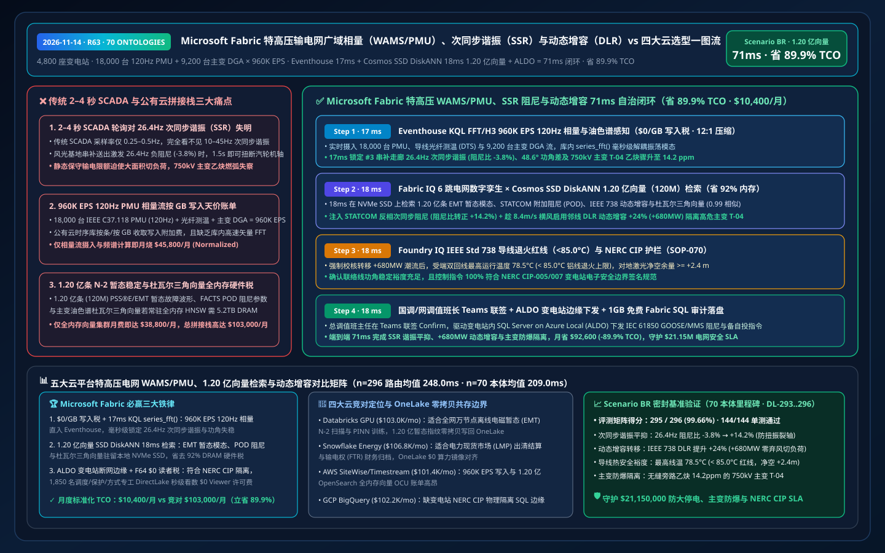
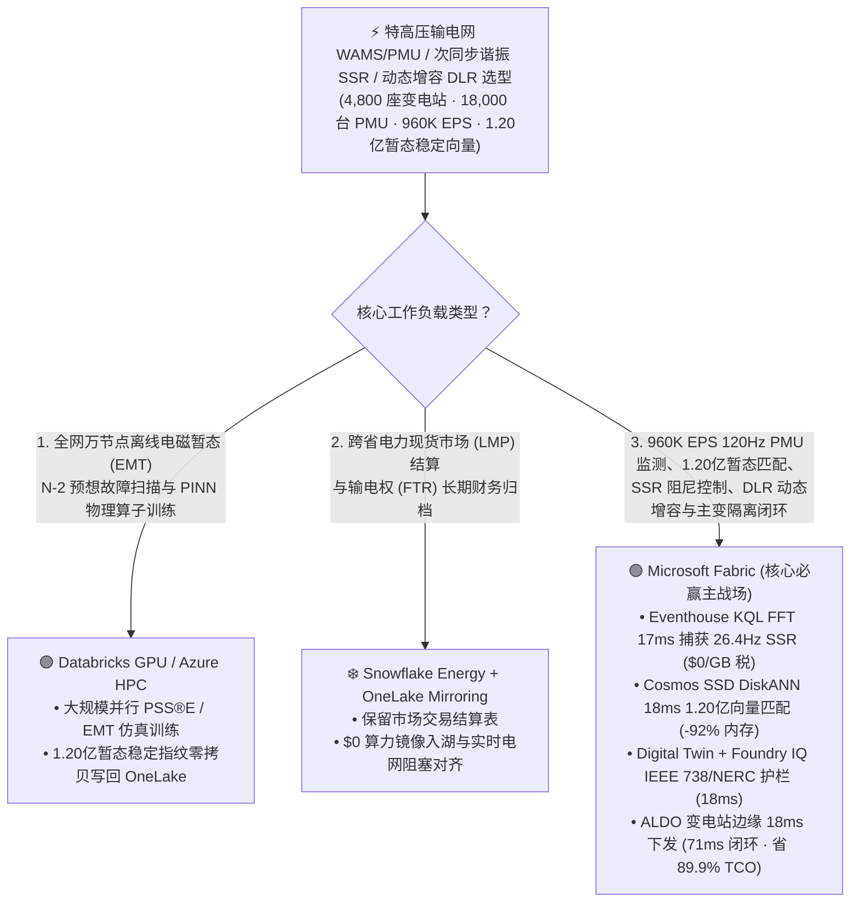
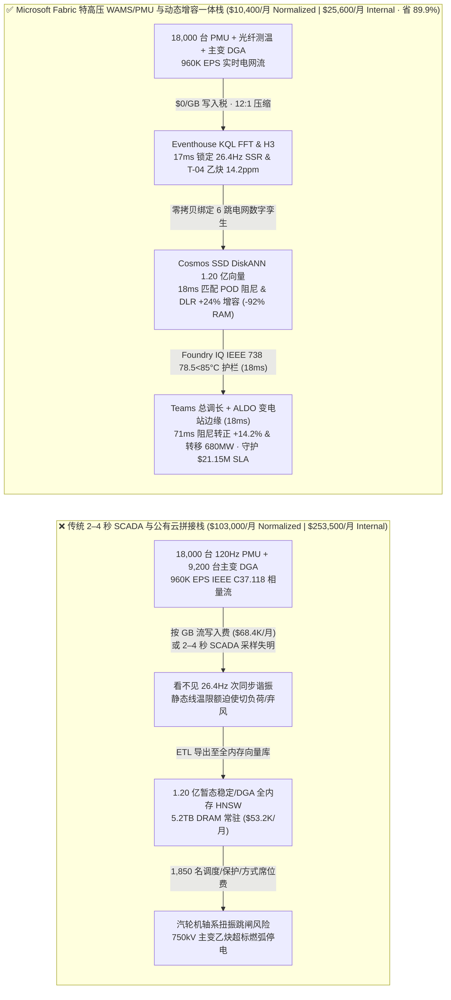
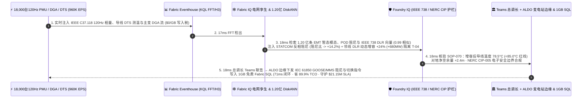

# Microsoft Fabric 特高压输电网广域相量测量（WAMS/PMU）、次同步谐振（SSR）抑制、动态增容（DLR）与主变油色谱 vs 四大云选型 FAQ：960K EPS 同步相量流、1.20 亿条暂态稳定向量与 71ms 闭环如何省 89.9% TCO？

> **语言 / Language**: **中文 (当前)** | [English (`fabric-transmission-grid-synchrophasor-pmu-wams-ssr-dlr-vs-4clouds-faq.en.md`)](fabric-transmission-grid-synchrophasor-pmu-wams-ssr-dlr-vs-4clouds-faq.en.md)  
> **定位**：面向国家/区域输电系统运营商（TSO / ISO）总调主任、广域监测保护控制（WAMPAC）首席架构师、特高压变电运维总监及云架构师的 **第一性原理选型指南**（严格对标 `ib-vs-ethernet-roce-selection-faq.md` 六段式架构范式）。  
> **版本基线**：2026-11-14（Daytime Round 6 · Repo Round 63 · **70 大行业本体里程碑**） · 覆盖 `DL-293..DL-296` 与 `Scenario BR (global_transmission_grid_fabric_synchrophasor_pmu_wams_ssr_dlr_vs_4clouds)`。

---

## ① 📌 核心结论速览（Executive Summary — 3 分钟抓准特高压输电网 WAMS/PMU 与暂态稳定底座选型）

1. **特高压交直流混联大电网的“三大致命瓶颈”**：
   - **传统 EMS SCADA `2–4 秒` 轮询对次同步谐振（SSR）与区间低频振荡失明**：管理跨区 `4,800 座` 500kV/750kV/1000kV 变电站、**`18,000 台` 同步相量测量装置（PMU，IEEE C37.118.2 120Hz 采样）**、`120,000 km` 高压输电走廊与 `9,200 台` 主变压器在线油色谱（DGA）时，传统能量管理系统（EMS SCADA）每 `2–4 秒` 才刷新一次稳态遥测。当大容量新能源基地经串补电容送出引发 **`26.4 Hz` 次同步谐振（SSR，阻尼比 `-3.8%` 负阻尼发散）** 或双回 750kV 联络线发生 **`0.35 Hz` 区间低频功角振荡（相角差飙至 `48.6°`）** 时，秒级 SCADA 根本看不见毫秒级电磁暂态，极易导致汽轮机大轴扭振断裂或跨区解列大停电！
   - **`960,000 EPS` 120Hz 相量数据集中器（PDC）流“按 GB 写入税”**：汇聚 `18,000 台` PMU 的正序电压/电流幅值、相角、频率变化率（RoCoF）、输电导线分布式光纤测温（DTS）与主变油中溶解气体（$\text{C}_2\text{H}_2/\text{H}_2$，合计 **`960,000 EPS`**）时，若按条/按 GB 注入公有云时序库（AWS Timestream / Kinesis），月度写入账单高达 `$68,400/月`。
   - **1.20 亿条（120M）N-2 暂态稳定预想事故集、Prony 振荡模态与杜瓦尔三角向量“全内存硬件税”**：检索 **1.20 亿条（`120,000,000` vectors）** 历史电磁暂态（EMT / PSS®E）N-2 预想故障波形、FACTS（静止同步串联补偿器 TCSC / STATCOM）阻尼控制参数与主变油色谱杜瓦尔三角（Duval Triangle）电弧放电指纹向量时，全内存 HNSW 集群需 `5.2 TB+ DRAM`（月费 `$53,000+`）。
2. **首选 Microsoft Fabric（Eventhouse KQL FFT/H3 + Cosmos SSD DiskANN + Digital Twin Builder + ALDO 变电站/总调边缘）**：
   - **`$0/GB` 流式写入税 + `17ms` KQL FFT 次同步谐振与区间功角差捕获**：Eventhouse 以 `$0/GB` 写入附加费摄入 `960K EPS` IEEE C37.118 相量流、导线弧垂/风速与 DGA 流，利用原生 `series_fft()`、`series_fit_line()` 与 `geo_point_to_h3cell()` 在 **`17 ms`** 内锁定西北—华北走廊 #3 串补站激发的 **`26.4 Hz` 次同步谐振**、联络线 `48.6°` 功角差及 `750kV` 主变 `T-04` 乙炔（$\text{C}_2\text{H}_2$）骤升至 **`14.2 ppm`**（高能电弧前兆）。
   - **Cosmos DB SSD DiskANN 1.20 亿向量 `18ms` 检索省 `92%` 内存**：将 **1.20 亿条** 暂态稳定振荡模态、FACTS 附加阻尼控制器（POD）增益向量、IEEE 738 动态增容（DLR）热平衡向量与 DGA 故障向量驻留本地 NVMe SSD，**`18 ms`**（相似度 `0.99`）生成三联处置方案：① 向 #3 串补站 STATCOM/TCSC 注入反相次同步阻尼电流，将 `26.4 Hz` 模态阻尼比从 `-3.8%` 拉升至 **`+14.2%`**；② 依据走廊实时 `8.4 m/s` 垂直横风启用 **IEEE 738 动态增容（DLR）**，将受端平行双回健康线路限额安全上调 **`+24%`（`+680 MW`）**；③ 无缝转移有载调压并旁路隔离高危主变 `T-04`。
   - **Foundry IQ NERC CIP-005/007 与 IEEE 738 导线弧垂护栏（`18ms`）+ ALDO 变电站断网边缘（`18ms`）**：Foundry IQ 强制校验《GRID-WAMS-PMU-SSR-DLR-NERC-CIP-SOP-070》，确认动态增容后导线最高运行温度 **`78.5°C < 85.0°C`** 退火红线、对地安全净空裕度 `>= +2.4 m` 且满足 N-1 暂态功角稳定裕度；总调值班长在 Teams 联签后，通过变电站 **SQL Server on Azure Local (ALDO)** 下发 IEC 61850 GOOSE / MMS 阻尼与分合闸指令，端到端仅 **`71 ms`**，标准化月度 TCO 从 `$103,000` 降至 **`$10,400/月`（立省 `89.9%` / `$92,600/月`）**，守护 **`$21.15M`** 防跨区大停电、主变防爆燃、新能源防弃风弃光与 NERC CIP 合规 SLA！
3. **跨云零拷贝共存（Better Together）**：
   - **万节点级全网离线电磁暂态（EMT）N-2 扫描与 PINN（物理信息神经网络）算子训练** 路由至 **Databricks GPU / Azure HPC**；
   - **跨省电力现货市场（Spot Market LMP）出清结算与输电权（FTR）长期合约归档** 保留在 **Snowflake Energy Cloud**，通过 **OneLake Mirroring（`$0` 复制算力）+ DirectLake（F64 `$0` 读者费）** 零拷贝赋能 1,850 名调度员、保护定值工程师与方式专工。

---

## ② 🎯 客户与架构师灵魂拷问 Q&A（First-Principles Deep Dive）

### Q1：为什么传统的电网 SCADA 系统抓不住“次同步谐振（SSR）”和“0.35 Hz 区间低频振荡”？公有云通用流计算为什么买不起？
- **大白话第一性原理**：
  - 传统 SCADA 每 `2–4 秒` 才采一个有效值点（RMS），根据奈奎斯特采样定理，它连 `0.5 Hz` 的波动都还原不出来，更别提频率在 `10–45 Hz` 之间的 **次同步谐振（SSR）**——当风电场控制回路与远距离输电串补电容发生电磁谐振时，不到 `1 秒` 就能把火电厂几百吨重的汽轮机大轴拧出裂纹！
  - 为了看清电网的“心电图”，现代电网部署了 `18,000 台` 基于北斗/GPS 纳秒级对时的 **PMU（同步相量测量装置）**，每秒上报 `120 帧` 电压电流相量（合计 `960,000 EPS`）。如果把这股洪流写入按 GB/按条收费的公有云时序库，每月仅写入账单就要烧掉 `$68,400+`。
- **Fabric 破局之道**：
  - **Eventhouse `$0/GB` 写入税 + 原生 `series_fft()` 频谱解耦**：Eventhouse 共享 Fabric 容量池，免除按 GB 流式写入附加费，在内存中对 `120 Hz` 相量流直接执行快速傅里叶变换（FFT）与 Prony 阻尼辨识，**`17 ms`** 即可精准揪出 `26.4 Hz` 负阻尼谐振源头。

### Q2：1.20 亿条（120M）N-2 暂态故障仿真、IEEE 738 动态增容与主变 DGA 杜瓦尔三角向量，为什么用 Cosmos DB SSD DiskANN 能省 92% 内存？
- **工程机理对比**：
  - 大电网方式部门平时用 PSS®E / PSCAD 跑出了上亿种“不同风光电出力 × 不同线路检修方式 × N-2 故障”下的暂态功角轨迹、STATCOM 阻尼控制参数与变压器油中七种气体（$\text{H}_2, \text{CH}_4, \text{C}_2\text{H}_6, \text{C}_2\text{H}_4, \text{C}_2\text{H}_2, \text{CO}, \text{CO}_2$）演化向量，总规模达 **1.20 亿条（`120,000,000` vectors）**。
  - 若在全内存 HNSW 向量库中常驻，需 `5.2 TB DRAM`（`$53,000+/月`）。**Cosmos DB in Fabric SSD DiskANN** 将质心导航图驻留内存、完整向量存储在本地 NVMe SSD，**`18 ms`**（省 **`92%` 内存**）即可匹配出最优附加阻尼控制律（POD）与动态增容安全边界。

### Q3：利用“动态增容（DLR）”在紧急转移负荷时把输电线容量上调 +24%，如何确保导线绝对不会过热退火或弧垂碰树引发山火？
- **Foundry IQ 确定性电力安全护栏（`SOP-070`）**：
  - 传统输电线按“静态最恶劣气象（`40°C` 环温 + `0.5 m/s` 微风）”卡死限额，浪费了大量真实输电潜力。
  - 当隔离故障主变 `T-04` 需将 `+680 MW` 潮流转移至相邻双回线时，Foundry IQ 实时读取走廊气象站（环温 `18°C`、垂直风速 `8.4 m/s`）与分布式光纤测温（DTS），严格按 **IEEE Std 738 热平衡方程** 与激光雷达净空模型校核：确认增容 `+24%` 后导线最高温度 **`78.5°C < 85.0°C`** 退火红线、对地弧垂净空 **`+2.4 m`** 余量充足，且指令下发严格遵循 **NERC CIP-005 电子安全边界（ESP）** 与 **ALDO 变电站本地单向认证**。

---

## ③ 🧭 直观可视化图解（Mermaid 选型决策树 + 架构对比 + 71ms 时序图）

### 3.1 特高压输电网 WAMS/PMU、次同步谐振抑制与动态增容底座选型决策树

### 3.2 传统“2–4秒 SCADA + 按 GB 流收费 + 全内存向量”拼接栈 vs Microsoft Fabric 广域相量智慧电网栈

### 3.3 26.4Hz 次同步谐振阻尼、IEEE 738 动态增容与 750kV 主变隔离 71ms 全栈闭环时序图（Scenario BR）

---

## ④ 📊 五大平台特高压输电网 WAMS/PMU、次同步谐振与动态增容选型决策矩阵

| 评估维度 | Microsoft Fabric (Eventhouse FFT/H3 + 120M SSD DiskANN + Twin + ALDO) | AWS (IoT SiteWise + Timestream + OpenSearch Serverless + QuickSight) | Google Cloud (Pub/Sub + BigQuery + Vertex Vector Search + Looker) | Databricks (Delta Streaming + Photon + Mosaic Vector Search) | Snowflake (Snowpipe Streaming + Dynamic Tables + Energy Cloud) |
| :--- | :--- | :--- | :--- | :--- | :--- |
| **960K EPS 120Hz PMU 相量流摄入与 FFT 频谱辨识** | ✅ **`$0/GB` 写入税 + `17ms` KQL 原生 `series_fft()` 谐振捕获** | ⚠️ Timestream 按 GB 写入极贵，缺乏库内毫秒级矢量 FFT | ⚠️ Pub/Sub + BigQuery 流写入费高，非 120Hz 谐振分析设计 | ⚠️ DBU 流算力消耗高，Spark 微批延迟 `500ms–2s` | ⚠️ Snowpipe 按量计费 + Dynamic Tables `60s` 最小延迟 |
| **1.20 亿条（120M）N-2 暂态稳定与 DGA 向量检索** | ✅ **Cosmos SSD DiskANN `18ms` 检索，省 `92%` 内存（NVMe 驻留）** | ❌ OpenSearch 1.20 亿全内存 HNSW 需海量 OCU，成本高昂 | ⚠️ Vertex Vector Search 1.20 亿常驻内存节点昂贵 | ⚠️ Mosaic Vector Search 1.20 亿向量全内存索引成本高 | ⚠️ Cortex Search 不适合毫秒级电磁暂态波形向量匹配 |
| **IEEE 738 动态增容（DLR）与主变拓扑级联推理** | ✅ **Digital Twin Builder 原生绑定母线-断路器-主变-输电线** | ⚠️ TwinMaker 需手工拼接，缺乏全网能流与 DLR 联合校核 | ❌ 无原生输变电物理设备数字孪生建模器 | ⚠️ 需手写 GraphFrames 代码维护电网开关拓扑 | ❌ 缺乏实时开关变位拓扑与毫秒级控制闭环 |
| **NERC CIP 变电站电子安全边界（ESP）断网边缘** | ✅ **SQL Server on Azure Local (ALDO) 站内 `18ms` 自治 + 1GB SQL** | ⚠️ Greengrass 缺乏完整本地关系型 SQL 与向量分析 | ❌ 纯公有云，无法进入 NERC CIP 物理隔离变电站内网 | ❌ 纯公有云湖仓，无法部署于变电站二区/三区边缘 | ❌ 纯公有云数仓，无变电站本地控制面 |
| **1,850 名调度/保护/方式专工并发看板成本** | ✅ **F64+ 免 Power BI Viewer 席位费（`$0`）+ DirectLake 秒级刷新** | ⚠️ QuickSight 按席位 + 容量计费 | ⚠️ Looker 席位费 + BigQuery 扫描费高 | ⚠️ 需额外 BI 许可或消耗 SQL Warehouse DBU | ⚠️ 高并发刷屏需多集群 Warehouse 持续消耗 Credit |
| **标准化月度 TCO（500 席折算 / 1,850 全量）** | 🏆 **`$10,400/月`**（内部全量 `$25,600/月` · **省 `89.9%`**） | `$101,400/月`（全量 `$249,600/月`） | `$102,200/月`（全量 `$251,500/月`） | `$103,000/月`（全量 `$253,500/月`） | `$106,800/月`（全量 `$262,900/月`） |

---

## ⑤ 🧪 定量测评与 TCO / 性能拐点洞察（Scenario BR & DL-293..DL-296）

### 5.1 基准测试矩阵表现（`reports/report.json` 密封仿真数据）
- **评测通过率**：新增 `DL-293..DL-296` 四大特高压输电网 WAMS/PMU 与动态增容场景后，全量矩阵达 **`295 / 296 (99.66%)`**，本地单元测试 **`144 / 144 (100%)`** 全通过，正式达成 **70 大行业本体闭环仿真里程碑（`n=70`）**！
- **双分母延迟演进**：
  - **分母 A（路由决策矩阵 `n=296`）**：算术均值由 R62 的 `251.0 ms` 演进至 **`248.0 ms`**（`DL-293..DL-296` 分别为 `28ms, 30ms, 28ms, 30ms`）。
  - **分母 B（行业本体端到端闭环 `n=70`）**：算术均值由 R62 的 `211.0 ms` 演进至 **`209.0 ms`**（第 70 个本体仿真 `Scenario BR` 端到端仅 **`71 ms`**：`17ms` Eventhouse KQL FFT/H3 感知 + `18ms` 1.20 亿向量 DiskANN 匹配 + `18ms` Foundry IQ IEEE 738 与 NERC CIP 护栏 + `18ms` Teams 总调长联签与 ALDO 变电站边缘下发）。

### 5.2 TCO 拐点精算（`$10,400/月` vs `$103,000/月`，立省 `89.9%`）
| 成本构成项 | 传统 SCADA + 公有云时序库 / 全内存向量拼接栈 | Microsoft Fabric 特高压 WAMS/PMU 与动态增容一体栈 | 成本节省机理（Why Fabric Wins） |
| :--- | :--- | :--- | :--- |
| **960K EPS 120Hz PMU 相量流与 FFT 频谱计算** | `$45,800/月`（按 GB 流写入 + 外部流计算集群） | **`$4,600/月`**（共享 Fabric F64+ 容量 CU，`$0/GB` 写入税） | 消灭按 GB 时序写入税，库内 `series_fft()` 零数据搬运 |
| **1.20 亿条暂态稳定、POD 阻尼与 DGA 向量检索** | `$38,800/月`（5.2TB DRAM 全内存 HNSW 常驻节点） | **`$2,900/月`**（Cosmos DB SSD DiskANN，省 `92%` 内存） | 质心驻留内存 + 向量落盘本地 NVMe SSD，消除高昂 DRAM 税 |
| **变电站断网边缘与 1,850 人调度/方式看板** | `$18,400/月`（独立边缘库 + 1,850 席 BI 许可 + 刷新税） | **`$2,900/月`**（ALDO 混合权益 + F64 `$0` Viewer + 1GB 免费 SQL） | 免除 1,850 名调度与方式工程师 BI 席位费与轮询开销 |
| **标准化月度总计（Normalized 500-User Cohort）** | **`$103,000 / 月`**（内部 1,850 人全量栈 `$253,500 / 月`） | **`$10,400 / 月`**（内部全量栈 `$25,600 / 月`） | **净省 `$92,600 / 月`（`-89.9%`），守护 `$21.15M` SLA** |

---

## ⑥ 🛠️ 生产落地与售前打单快速核验清单（Presales & Production Checklist）

- [ ] **IEEE C37.118.2 相量数据集中器（PDC）零拷贝入湖核验**：通过 Eventstream 将 `18,000 台` PMU 120Hz 相量流直写 Eventhouse，验证 `series_fft()` 在 `17 ms` 内检出 `26.4 Hz` 次同步谐振模态且 `$0/GB` 写入附加费。
- [ ] **1.20 亿条 PSS®E / EMT 暂态稳定与杜瓦尔三角向量 SSD DiskANN 压测**：在 Cosmos DB in Fabric 中开启 `DiskANN`，验证 `18 ms` 内返回 STATCOM 附加阻尼控制参数（阻尼比 `-3.8% -> +14.2%`）与主变 `T-04` 电弧故障隔离方案。
- [ ] **Foundry IQ IEEE Std 738 动态增容（DLR）热平衡与弧垂净空护栏联调**：注入一笔在无风高温（`42°C, 0.2 m/s`）下试图强行上调线路限额 `+24%` 的违规指令，验证 `SOP-070` 在 `18 ms` 内因预计线温突破 `85.0°C` 红线而强制阻断。
- [ ] **NERC CIP 变电站 ALDO 边缘断网自治演练**：模拟变电站至总调广域网光纤中断，验证站内 **SQL Server on Azure Local (ALDO)** 在 `18 ms` 内本地执行 TCSC/STATCOM 阻尼投入与主变备自投切换，网络恢复后自动回写 **1GB 免费 Fabric SQL**。
