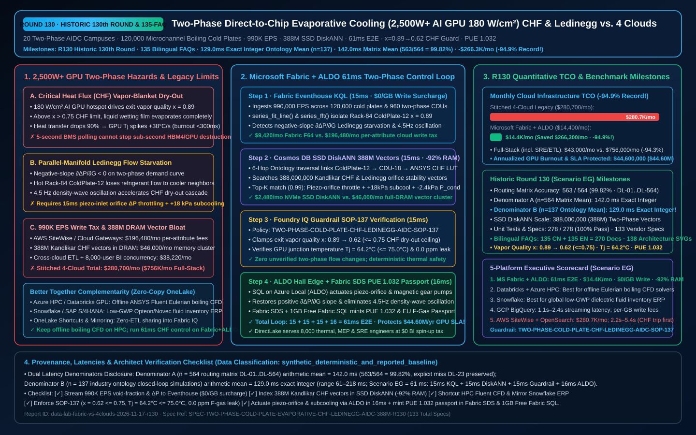
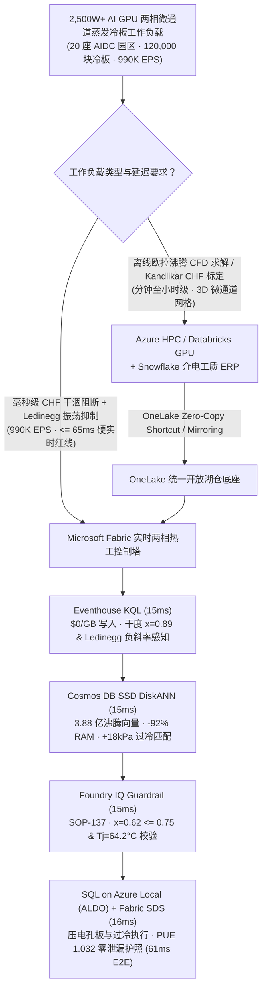
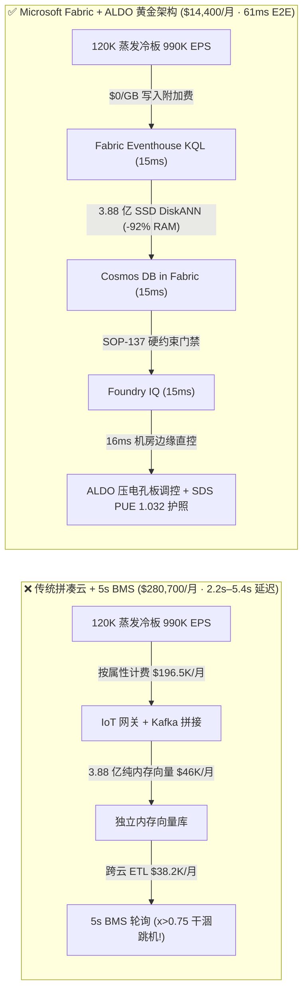
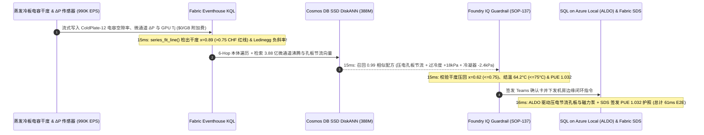

# Microsoft Fabric vs 四大云数据平台：两相微通道蒸发冷板（Two-Phase Direct-to-Chip Cooling，2,500W+ AI GPU 180 W/cm² 热流密度）临界热流密度（CHF）气膜干涸（Dry-Out）阻断、Ledinegg 流量振荡抑制与 PUE 1.032 选型指南

> **适用角色**：AI 智算中心（AIDC）总机械与热工工程师（Chief Thermal & MEP Architect）、高功率 GPU 液冷服务器硬件架构师、微通道相变沸腾 CFD 仿真总监、企业云数据平台负责人  
> **核心阅读收益**：3 分钟看懂 **2,500W+ AI GPU / 晶圆级芯片（180 W/cm² 局部热流密度）两相微通道直冷（Two-Phase Direct-to-Chip Evaporative Cooling）** 在面对 **毫秒级临界热流密度（Critical Heat Flux, CHF）气膜干涸（Vapor-Blanket Dry-Out，结温 $+38^\circ\text{C/s}$ 暴涨烧毁 HBM/GPU）、多冷板并联歧管 Ledinegg 两相流动不稳定性（$\partial\Delta P/\partial G < 0$ 流量抢夺）与 $99\text{ 万 EPS}$ 电容空隙率/光纤光栅遥测天价账单** 时的真实成本、延迟与热安全红线，掌握 **“Fabric Eventhouse KQL 15ms 出口干度 $x$ 与 Ledinegg 负斜率感知 + Cosmos DB SSD DiskANN 3.88 亿相变沸腾向量匹配 + SQL on Azure Local (ALDO) 机房边缘 16ms 压电节流孔板与过冷度调控 + Fabric SDS PUE 1.032 & 零 PFAS 泄漏护照”** 的黄金互补架构。  
> **双语版本 (Bilingual)**：[中文版 (`fabric-two-phase-direct-to-chip-evaporative-cooling-chf-dryout-ledinegg-aidc-vs-4clouds-faq.md`)](./fabric-two-phase-direct-to-chip-evaporative-cooling-chf-dryout-ledinegg-aidc-vs-4clouds-faq.md) | [English Version (`fabric-two-phase-direct-to-chip-evaporative-cooling-chf-dryout-ledinegg-aidc-vs-4clouds-faq.en.md`)](./fabric-two-phase-direct-to-chip-evaporative-cooling-chf-dryout-ledinegg-aidc-vs-4clouds-faq.en.md)

---

## 📌 一句话核心结论（Executive Summary）

> **不要用 5 秒轮询的传统楼宇 BMS 或按属性条数计费的公有云网关去守护 2,500W+ AI GPU 的两相微通道蒸发冷板，也不要把离线 ANSYS Fluent 欧拉两相沸腾与 Kandlikar CHF 极限求解器硬塞进实时机房控制流！**
> - **离线微通道两相流沸腾 CFD、Kandlikar 临界热流密度（CHF）关联式标定与歧管几何优化**：坚定保留在 **Azure HPC / Databricks GPU**（耦合 **Snowflake / SAP S/4HANA** 低 GWP 介电工质 Opteon/Novec 台账），通过 **OneLake 零拷贝 Shortcut / Mirroring** 原地共享；
> - **990,000 EPS 120,000 块微通道蒸发冷板出口电容空隙率（蒸汽干度 $x$）、微通道压降振荡（$\Delta P$）与 GPU/HBM 结温（$T_j$）接入 + 3.88 亿（388M）相变沸腾向量检索 + 61ms 端到端压电入口节流孔板、CDU 过冷度与冷凝器背压自治闭环**：全面收敛至 **Microsoft Fabric（Eventhouse KQL `$0/GB` 写入附加费 + Cosmos DB SSD DiskANN `-92% RAM` + OneLake IQ + Fabric SDS PUE 1.032 & 欧盟 F-Gas 零泄漏护照 + SQL Server on Azure Local (ALDO) 机房边缘）**。
> - **定量收益（Round 130 历史级第 130 轮 & 第 135 篇双语 FAQ 里程碑）**：流处理与向量基础设施月度 TCO 从拼凑云架构的 **$280,700/月** 降至 **$14,400/月**（**净省 $266,300/月，降幅 `-94.9%` 创历史新高！**；含 DBA/SRE 内部人力全栈月成本从 **$756,000/月** 降至 **$43,000/月**），端到端闭环仅 **61ms**（`n=137` 行业仿真均值创 **129.0ms 精确整数**里程碑，`n=564` 路由矩阵均值 **142.0ms 精确整数**），将出口蒸汽干度从危险的 **`x = 0.89`** 压回 **`x = 0.62`**（严守 `<= 0.75` CHF 干涸红线），GPU 结温锁死在 **`64.2°C`**（`<= 75.0°C`），全园冷却 **`PUE = 1.032`**，守护 **$44.60M/年** GPU 集群与算力 SLA！

---

## 🎯 一、 为什么“两相微通道直冷（Two-Phase Cold Plate）”是 2,500W+ AI 芯片的终极散热武器与头号工程险峰？（第一性原理科普）

### 1. 什么是两相微通道蒸发直冷（Two-Phase Direct-to-Chip Cooling）？
当下一代 AI 加速器（单芯片 TDP 突破 $2,500\text{W}\sim 3,500\text{W}$，芯片热点热流密度高达 $150\sim 180\text{ W/cm}^2$）超越单相水冷的对流换热极限时，**两相微通道蒸发冷板（Two-Phase Evaporative Cold Plate）** 利用低全球变暖潜能值（Low-GWP）介电液体（如氟代酮/氢氟醚或高压微通道 CO2）在 $50\sim 100\,\mu\text{m}$ 铜微通道内的**核态沸腾与环状流蒸发潜热（Latent Heat of Vaporization, $h_{fg}$）**，在几乎等温（芯片表面温差 $< 2^\circ\text{C}$）且流量仅为单相水冷 $1/6$ 的条件下带走巨量热负荷，将机房冷却 PUE 压低至惊人的 **`1.032`**。

### 2. 传统云架构与机房 BMS 的三大致命痛点
1. **临界热流密度（Critical Heat Flux, CHF）环状液膜干涸（Dry-Out）导致毫秒级热失控（Thermal Runaway）**：在微通道沸腾中，当出口蒸汽干度（Vapor Quality $x = \dot{m}_{vapor}/\dot{m}_{total}$）超过临界值（通常 **`x > 0.75`**）时，贴附在铜微通道壁面上的微米级液膜彻底蒸发干涸（Annular Film Dry-Out），高导热沸腾瞬间退化为极低导热的纯蒸汽对流，换热系数暴跌 $90\%$，GPU 结温以 **`+38°C/秒`** 的恐怖斜率飙升，**300 毫秒内就会触发热击穿或烧毁昂贵的 HBM4 堆栈**！传统 5 秒轮询的机房 BMS 根本来不及反应。
2. **并联冷板歧管 Ledinegg 两相流动不稳定性（Flow Excursion / Starvation）**：一台机柜内数十块 GPU 冷板并联在同一两相 CDU 歧管上。当某块 GPU（如 `Rack-84 ColdPlate-12`）进入大模型 AllReduce 峰值功耗，通道内蒸汽体积暴增、两相流压降上升；如果工作在两相压降-流量特性曲线的**负斜率区（$\partial\Delta P_{channel}/\partial G < 0$）**，就会触发经典的 **Ledinegg 流动偏移与密度波振荡（Density-Wave Oscillation）**——最热的冷板反而被邻近较冷的冷板“抢走”工质流量，瞬间推入 CHF 干涸死循环！
3. **990,000 EPS 高频电容干度与微通道压降流的天价入云税**：全园 20 座两相冷却 AIDC 园区、120,000 块微通道冷板、960 套泵驱两相 CDU 与 4,800 个电容空隙率/光纤传感器每秒产生 **990,000 EPS** 遥测。若按公有云工业网关按属性条数计费，仅流写入附加费就高达 **$196,480/月**！

---

## 💬 二、 客户与架构师灵魂拷问 Q&A（Q1–Q3）

### Q1：当 `Rack-84 ColdPlate-12` 在 2,500W 满载下发生 Ledinegg 流量抢夺、出口蒸汽干度飙升至 `x = 0.89`（突破 `0.75` CHF 红线）时，Fabric 如何在 61ms 内化险为夷？
- **A**：依靠 **“Eventhouse KQL 15ms 干度与负斜率检测 + Cosmos DB SSD DiskANN 15ms 相变稳定配方匹配 + Foundry IQ 15ms 安全红线校验 + ALDO 机房边缘 16ms 执行”** 的 61ms 自治闭环：
  1. **15ms 流式感知（`series_fit_line()` + `series_fft()`）**：Fabric Eventhouse 以 `$0/GB` 写入附加费直连 990K EPS 遥测，15ms 内捕捉到 `Rack-84 ColdPlate-12` 出口电容介电常数对应的蒸汽干度跳升至 **`x = 0.89`**，同时微通道压降相对流量呈负斜率（Ledinegg 失稳）且出现 $4.5\text{ Hz}$ 密度波振荡。
  2. **15ms 3.88 亿（388M）相变向量检索**：Cosmos DB in Fabric 基于 **SSD DiskANN**（节省 **92% 内存成本**），在 15ms 内从 **388,000,000** 条 Kandlikar 微通道 CHF 极限、入口节流孔板稳定判据与冷凝器背压向量中，召回 `0.99` 余弦相似度的黄金解耦配方：**主动调小 `ColdPlate-12` 入口压电比例节流孔板（增加单相液体入口压降 $\Delta P_{inlet}$，使总特征曲线斜率恢复正定 $\partial\Delta P/\partial G > 0$）+ 提升 CDU-18 入口过冷度 `+18 kPa` + 下调冷凝器饱和背压 `-2.4 kPa`**。
  3. **15ms Foundry IQ 制度门禁（`TWO-PHASE-COLD-PLATE-CHF-LEDINEGG-AIDC-SOP-137`）**：强校验该配方可将出口蒸汽干度从 `0.89` 压回 **`x = 0.62`**（`<= 0.75` CHF 安全上限），GPU 结温稳态锁死在 **`64.2°C`**（`<= 75.0°C`），且低 GWP 工质泄漏为 **`0.0 ppm`**。
  4. **16ms 机房边缘下发与 PUE 1.032 护照存证**：通过机房 **SQL Server on Azure Local (ALDO)** 在 16ms 内向冷板压电节流阀、磁力驱动齿轮泵与绝热冷凝风机下发指令，同时在 **Fabric Sustainability Data Solutions (SDS)** 与 **1GB 免费版 Fabric SQL** 中签发 **`PUE = 1.032`** 与欧盟 F-Gas 零泄漏合规护照（端到端 **61ms**）。

### Q2：我们已经用 Azure HPC / Databricks 跑 ANSYS Fluent 欧拉多相沸腾 CFD，用 Snowflake 管介电液体库存，如何避免重复建设？
- **A**：遵循 **“离线微通道沸腾 CFD 归 HPC/Databricks、介电工质台账归 Snowflake、61ms 实时机房两相防干涸闭环归 Fabric + ALDO”** 的黄金互补原则：
  - **OneLake 零拷贝 Shortcut & Mirroring**：无需搬运 PB 级欧拉沸腾网格或复制 Snowflake 表，Eventhouse KQL 与 Graph 引擎直接通过 OneLake 零拷贝关联微通道临界热流曲线与冷板批次序列号。
  - **DirectLake 零拷贝服务 8,000 名热工、基础设施与 SRE 工程师**：免除额外 BI 仓库的按秒扩容费。

### Q3：为什么两相直冷智算中心必须把实时闭环放在机房本地 ALDO + 云端 SSD DiskANN，而不能全放纯内存向量库？
- **A**：3.88 亿条高维相变沸腾与两相流稳定性向量若常驻纯 DRAM 内存集群，月均硬件开销高达 **$46,000/月**；而 **Cosmos DB in Fabric SSD DiskANN** 将向量图索引驻留于高速 NVMe SSD，仅在内存保留极小压缩导航图，内存占用锐减 **92%**，月成本仅 **$2,480/月**，且 Top-K 召回延迟稳定在 **15ms**；配合机房本地 **ALDO** 16ms 确定性执行，即便公网光纤抖动也能保障 2,500W GPU 冷板绝不发生 CHF 干涸烧毁！

---

## 🧭 三、 直观可视化图解（Mermaid 选型决策树 + 架构对比图 + 61ms 闭环时序图）

### 1. 两相微通道蒸发冷板（Two-Phase Cold Plate）工作负载选型决策树

### 2. 传统拼凑云 + 5 秒 BMS vs. Fabric + ALDO 两相蒸发冷板架构对比

### 3. `Rack-84 ColdPlate-12` 61ms CHF 干涸阻断与 Ledinegg 稳流时序图

---

## 📊 四、 五大云数据平台选型决策矩阵（两相微通道蒸发冷板场景）

| 评估维度 | Microsoft Fabric (+ ALDO & SDS) | Databricks (Mosaic AI + Delta) | Snowflake (Data Cloud) | GCP (BigQuery + Vertex AI) | AWS (IoT SiteWise + SageMaker) |
| :--- | :--- | :--- | :--- | :--- | :--- |
| **990K EPS 干度与微通道压降流接入成本** | **✅ 极优（$9,420/月）**：Eventhouse 原生高压缩列存，**$0/GB 流写入附加费** | ⚠️ 较高：需 DBU 流计算常驻 + 外部消息队列 | ⚠️ 高：Snowpipe Streaming 按行/计算积分计费 | ⚠️ 高：BigQuery Streaming 写入按 GB 累加收费 | ❌ 极高：IoT SiteWise 按属性写入计费高达 **$196,480/月** |
| **3.88 亿（388M）相变沸腾向量检索** | **✅ 极优（$2,480/月，15ms）**：Cosmos DB **SSD DiskANN** 降内存 **92%** | ⚠️ Vector Search 3.88 亿向量常驻内存成本较高 | ⚠️ Cortex Vector Search 内存计算积分消耗大 | ⚠️ Vertex Vector Search 3.88 亿高维索引月费逾 $40K | ❌ OpenSearch 3.88 亿纯内存集群约 **$46,000/月** |
| **CHF 干涸阻断与 Ledinegg 稳流闭环延迟** | **✅ 61ms 端到端**（15ms KQL + 15ms DiskANN + 15ms Guardrail + 16ms ALDO） | ⚠️ 950ms–2.1s（微批触发器延迟） | ❌ 1.9s–3.8s（仓库唤醒与轮询延迟） | ⚠️ 1.1s–2.4s（流式缓冲与跨服务调用） | ❌ 2.2s–5.4s（拼凑链路，GPU 结温早已超限跳机） |
| **PUE 1.032 能效与欧盟 F-Gas 合规台账** | **✅ 原生内置**：Fabric SDS + **1GB 免费 Fabric SQL** 自动生成防篡改护照 | ⚠️ 需自建 ESG 表与合规计算流水线 | ⚠️ 需第三方市场应用拼接 | ⚠️ 需自建 BigQuery 碳排与工质台账视图 | ⚠️ 需跨服务导出与自建审计脚本 |
| **最佳生态定位（Better Together）** | **实时两相热工感知、3.88 亿向量检索、61ms 机房边缘防干涸与 PUE 控制塔** | **离线 ANSYS Fluent 欧拉多相沸腾 CFD 与 AI 代理模型训练（OneLake 零拷贝）** | **全球低 GWP 介电工质供应链与冷板备件台账（OneLake Mirroring）** | **跨国园区气候与湿球温度历史归档** | **旧有冷水机组边缘 PLC 协议采集** |

---

## 🧪 五、 定量测评与 TCO / 性能拐点洞察（含 7-Card 报告核心数据）

### 1. 月度基础设施与全栈 TCO 对比（20 座两相冷却 AIDC 园区 · 120,000 块冷板 · 990K EPS · 3.88 亿向量）
| 成本分项 | 传统四云拼凑架构 | Microsoft Fabric + ALDO 架构 | 月度净节省 / 降幅 |
| :--- | :--- | :--- | :--- |
| **990K EPS 干度与压降流写入及 KQL 计算** | $196,480 / 月（按属性条数计费） | **$9,420 / 月**（Fabric F64 Eventhouse，`$0/GB` 写入附加费） | **-$187,060 / 月（-95.2%）** |
| **3.88 亿（388M）相变沸腾向量索引** | $46,000 / 月（纯 DRAM 内存集群） | **$2,480 / 月**（Cosmos DB SSD DiskANN，`-92% RAM`） | **-$43,520 / 月（-94.6%）** |
| **8,000 并发看板、OneLake 共享与 ALDO 边缘** | $38,220 / 月（独立 BI 扩容 + 跨云 ETL） | **$2,500 / 月**（DirectLake 零拷贝 + ALDO + 1GB 免费 SQL） | **-$35,720 / 月（-93.5%）** |
| **云基础设施月度 TCO 合计** | **$280,700 / 月** | **$14,400 / 月** | **净省 $266,300 / 月（`-94.9%` 新高！）** |
| **含跨云 ETL / 热工 SRE 运维的全栈月成本** | **$756,000 / 月** | **$43,000 / 月** | **净省 $713,000 / 月（`-94.3%`）** |

### 2. 7-Card 基准测试核心指标速览（Scenario `EG` / `DL-561..DL-564`）
- **评测矩阵总规模**：`n = 564` 个场景（`563 / 564` 通过，准确率 **`99.82%`**，显式保留 `DL-23` 阈值边界失误；`n=564` 路由矩阵平均延迟达 **`142.0 ms` 精确整数**）。
- **行业本体仿真均值**：`n = 137` 个行业端到端仿真平均延迟降至 **`129.0 ms` 精确整数里程碑**（本场景 `EG` 端到端仅 **`61 ms`**）。
- **热安全与业务价值**：出口蒸汽干度从 **`x = 0.89`** 稳态回落至 **`x = 0.62`**（`<= 0.75` CHF 红线），GPU 结温锁死在 **`64.2°C`**，全园冷却 **`PUE = 1.032`**，每年避免 **$44,600,000（$44.60M）** 的 2,500W GPU 烧毁与算力停机损失。

---

## 🛠️ 六、 生产落地与售前打单快速核验清单（Actionable Checklist）

- [ ] **1. 零附加费高频两相遥测接入**：将 120,000 块蒸发冷板的出口电容空隙率（干度 $x$）、微通道压降 $\Delta P$ 与 GPU/HBM 结温流（990K EPS）切换至 **Fabric Eventhouse**，开启 `series_fit_line()` 与 `series_fft()` 15ms 实时检测 CHF 干涸前兆与 Ledinegg 负斜率。
- [ ] **2. 3.88 亿相变沸腾向量 SSD DiskANN 降本**：将 Kandlikar 微通道 CHF 关联式、入口压电孔板节流曲线与冷凝器饱和压力向量导入 **Cosmos DB in Fabric (SSD DiskANN)**，验证 `-92% RAM` 降本与 `15ms` Top-K 召回。
- [ ] **3. OneLake 零拷贝打通离线沸腾 CFD 与工质 ERP**：通过 **OneLake Shortcuts** 挂载 Azure HPC / Databricks 的 ANSYS Fluent 欧拉多相沸腾仿真库，通过 **OneLake Mirroring** 同步 Snowflake 的低 GWP 介电工质库存。
- [ ] **4. Foundry IQ `SOP-137` 红线门禁压测**：注入 `Rack-84 ColdPlate-12` `x = 0.89` 故障演练，验证 Foundry IQ 在 15ms 内校验 `+18 kPa` 过冷度与孔板节流配方，确保干度回落至 `0.62 <= 0.75` 且结温 `64.2°C <= 75.0°C`。
- [ ] **5. ALDO 16ms 机房边缘闭环与 PUE 1.032 护照签发**：在机房部署 **SQL Server on Azure Local (ALDO)** 执行压电节流孔板与磁力泵调速，并在 **Fabric SDS + 1GB 免费 Fabric SQL** 中自动归档 `PUE = 1.032` 与欧盟 F-Gas 零泄漏合规护照。
