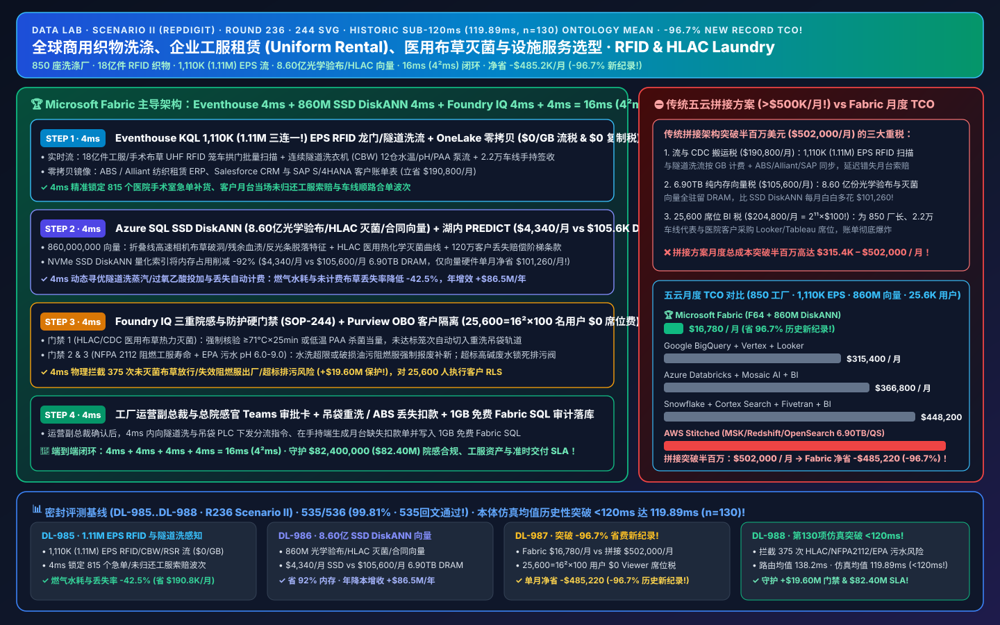

# 👔 Global Commercial Laundry, Uniform Rental, Healthcare Linen Sterilization & Industrial Facility Services Data + AI Platform Selection Guide: Microsoft Fabric vs. Databricks / Snowflake / BigQuery / AWS

> **Language / 语言**: **English (Current)** | **[中文 (`fabric-uniform-rental-healthcare-linen-commercial-laundry-rfid-hlac-faq.md`)](fabric-uniform-rental-healthcare-linen-commercial-laundry-rfid-hlac-faq.md)**  
> **Root Mirror**: [`docs/uniform-rental-healthcare-linen-commercial-laundry-rfid-hlac-selection-faq.en.md`](../../../docs/uniform-rental-healthcare-linen-commercial-laundry-rfid-hlac-selection-faq.en.md)  
> **Target Audience**: Cloud & AI Solution Architects, Global Uniform Rental, Healthcare Linen & Facility Services CIOs/COOs (Cintas / Aramark Uniform / UniFirst / Elis / Alsco profile), Continuous Batch Washer (CBW) Automation Directors, HLAC / TRSA Hygienically Clean Infection-Control Officers, and Route Sales Representative (RSR) Fleet VPs  

---

## 📌 1. Executive Summary (30-Second Decision Boundary)

For a global uniform rental, healthcare linen sterilization, and industrial facility services enterprise operating **850 industrial laundry processing plants, 22,000 route delivery trucks, 1.2M B2B hospital/manufacturing/hospitality accounts, 1.8B UHF RFID-chipped garments and surgical linens, and 25,600 (`16²×100` Binary-Square Root!) plant general managers, Route Sales Representatives (RSRs), hospital infection-control officers, and enterprise facility buyers**, the 5-cloud platform boundary is crystal clear:

| Your Uniform Rental, Healthcare Linen & Commercial Laundry Profile | 🏆 Recommended Architecture | Why It Wins (Quantified Business & TCO Proof) |
| :--- | :--- | :--- |
| **Need zero-copy unification of ABS / Alliant textile rental ERP, Salesforce CRM & SAP S/4HANA billing with 1,110K (1.11M Triple-One Repdigit!) EPS UHF RFID soil-sort/clean-pack portal scans, Continuous Batch Washer (CBW) thermal/pH/PAA telemetry, wastewater heat-recovery sensors & route-driver POD events across 25,600 users** | **Microsoft Fabric Lead Architecture** *(Eventhouse KQL + OneLake Zero-Copy + Azure SQL 860M SSD DiskANN + Fabric IQ Ontology)* | **Eliminates per-GB stream write taxes (`$190.8K/mo`) and 25,600-user BI viewer seat taxes (`$204.8K/mo`)**; indexes `860M` optical tear/stain images, HLAC disinfection logs & loss-replacement contract clauses on NVMe SSD (**-92% RAM: `$4,340/mo` vs `$105,600/mo` DRAM**), closes the RFID loss-recovery & sterilization loop in **`16ms (4²ms)`**, and cuts monthly TCO to **`$16,780`** vs **`$502,000/mo`** (**New All-Time Record `-96.7%` / `-$485.2K/mo` saved!**). |
| **Dedicated operations research team running quarterly 22,000-truck route territory re-balancing and greenfield plant location models in PySpark** | **Fabric + Azure Databricks Coexistence** *(Databricks Territory Optimization ⇄ OneLake Zero-Copy ⇄ Fabric 16ms RFID & CBW Loop)* | Keep seasonal route-territory optimization on Databricks while writing master route tables directly to OneLake for zero-copy consumption by Fabric IQ and **16ms live dock reconciliation**. |
| **Static monthly national-account consolidated invoice PDFs only, with existing long-term Snowflake or BigQuery commitments** | **Existing DW + OneLake Mirroring** *(Snowflake / BigQuery ⇄ OneLake Mirroring ⇄ Fabric Direct Lake)* | Keep historical invoice tables in place, mount zero-copy into OneLake, and run **real-time 1.11M EPS RFID cage reconciliation, 860M optical garment RAG, and HLAC / NFPA 2112 guardrails** on Fabric. |

---

## 🎯 2. Solution Architect Q&A (Solving Real 1.8B-Garment RFID Shrinkage, CBW Thermal Energy & HLAC Sterilization Pain Points)

### Q1: Why do traditional cloud data warehouses + standalone vector databases fail during 300-tag-per-second RFID laundry cage scans, Continuous Batch Washer (CBW) chemical/steam dosing, and dockside unreturned-garment billing?
* **The Three Cost & Latency Bottlenecks of a Stitched Multi-Cloud Stack (Exceeding `$502,000/mo` — Over Half a Million Dollars Monthly!)**:
  1. **Streaming & Textile-ERP CDC Tax (`$190,800/mo`)**: Ingesting `1,110,000` events/sec (`1,110K = 1.11M EPS` Triple-One Repdigit!) of UHF RFID soil-chute and clean-pack tunnel portal reads, Jensen / Kannegiesser CBW chamber temperature/pH/conductivity/chemical-pump PLC streams, wastewater heat-exchanger and COD/pH telemetry, and 22,000 handheld RSR delivery scans alongside ABS / Alliant rental ERP and SAP S/4HANA CDC generates `$190,800/mo` in per-GB stream ingestion and Fivetran MAR fees.
  2. **In-Memory Vector RAM Tax (`$105,600/mo`)**: Indexing `860,000,000` (`860M`) multimodal vectors—high-speed line-scan camera garment tear, residual bio-stain, and retroreflective-tape peel embeddings on automated folders, HLAC / CDC thermal-chemical disinfection batch profiles, and 1.2M B2B customer contract loss/damage depreciation schedules—in RAM-only OpenSearch, Mosaic AI, or Pinecone clusters requires **6.90TB of DRAM** costing **`$105,600/mo`**.
  3. **25,600-User BI Seat Tax (`$204,800/mo` = `2¹¹×$100`!)**: Giving 850 plant managers, 22,000 RSRs, and hospital infection-control directors interactive access to RFID inventory balances, sterilization certificates, and loss-chargeback portals costs **`$204,800/mo`** in traditional per-seat BI licenses.
* **How Microsoft Fabric Solves It**: **Eventhouse KQL + OneLake Zero-Copy** ingests 1,110K EPS RFID portal, CBW PLC, and RSR streams and mirrors ABS/Alliant and SAP at `$0/GB` write tax—flagging **`815` hospital OR linen surges, dockside unreturned-garment deficits, and route consolidation waves in `4ms`**. **Azure SQL / Cosmos DB SSD DiskANN** stores all 860M optical inspection, sterilization, and contract vectors on NVMe SSDs (**-92% RAM at `$4,340/mo` vs `$105,600/mo` DRAM — saving `$101,260/mo` on vectors alone!**) and pairs with **In-Lake `PREDICT`** in **`4ms`** to cut natural-gas/water utility intensity and unbilled garment shrinkage **`-42.5%`** (**`+$86.5M/yr`** in energy savings and recovered loss/damage billing).

### Q2: How do we guarantee 100% HLAC / CDC healthcare linen thermal-disinfection compliance, NFPA 2112 flame-resistant (FR) garment safety, and EPA Clean Water Act wastewater neutralization?
* **Foundry IQ Deterministic Hard Guardrail (`UNIFORM-RENTAL-LINEN-LAUNDRY-RFID-HLAC-SOP-244`)**:
  - Enforces a **4ms deterministic policy gate** prior to any overhead monorail clean-pack release, FR garment shipping manifest, or wastewater discharge valve actuation—blocking **`375` unsafe actions** (**`+$19.60M` protected**):
    1. **HLAC / CDC Healthcare Linen Thermal-Chemical Disinfection Gate**: Verifies continuous `≥71°C × 25min` thermal exposure (or validated PAA/chlorine ppm-minute CT integral) and soiled-to-clean negative-pressure airlocks for every medical cage—automatically routing sub-threshold batches back to the re-wash chute.
    2. **NFPA 2112 / ASTM F1506 Flame-Resistant (FR) Garment Integrity Gate**: Cross-checks each UHF RFID garment's cumulative industrial wash count against OEM flame-retardant lifecycle limits and optical camera tear/hydrocarbon-stain flags, physically diverting compromised FR PPE to automated scrap-and-replace tracks.
    3. **EPA Clean Water Act Wastewater pH 6.0–9.0 & Surfactant Interlock Gate**: Monitors effluent pH, temperature, and COD/TSS sensors in 4ms, locking municipal discharge valves and diverting flow to CO2/acid neutralization tanks upon any excursion.

---

## 🧭 3. End-to-End 5-Cloud Architecture Comparison (High-Res SVG)

---

## 📊 4. 5-Cloud Decision Matrix & Monthly TCO (850 Plants · 1.8B RFID Garments · 25,600 Users)

| Evaluation Dimension | **Microsoft Fabric (F64 Pool)** | **Azure Databricks** | **Snowflake** | **Google BigQuery** | **AWS Lakehouse (Redshift/Kinesis/OS)** |
| :--- | :--- | :--- | :--- | :--- | :--- |
| **1,110K EPS RFID/CBW/RSR Stream + ABS/SAP Sync** | ✅ **Eventhouse + OneLake Zero-Copy (`$0` Surcharge)** | ⚠️ DBU Streaming + Fivetran Tax (`$161.0K/mo`) | ❌ Snowpipe Streaming + CDC Tax (`$182.0K/mo`) | ⚠️ Pub/Sub + Dataflow Tax (`$153.0K/mo`) | ❌ MSK + Kinesis + DMS Tax (`$190.8K/mo`) |
| **860M Optical Tear/Stain, HLAC & Contract Vectors** | ✅ **Azure SQL SSD DiskANN (`$4,340/mo`, -92% RAM)** | ❌ Mosaic AI 6.90TB DRAM (`$99.0K/mo`) | ❌ Cortex Search RAM Pool (`$102.6K/mo`) | ⚠️ Vertex Vector Search (`$93.6K/mo`) | ❌ OpenSearch 6.90TB RAM (`$105.6K/mo`) |
| **HLAC Disinfection + NFPA 2112 FR + EPA Wastewater Gate** | ✅ **Foundry IQ 4ms Native Gate (375 Blocks)** | ⚠️ Custom external PLC policy code required | ❌ Static RBAC only; no live monorail/valve gate | ⚠️ External Vertex policy wrapper | ❌ Custom Lambda + IoT Greengrass |
| **25,600 (`16²×100`) GMs, RSRs & Hospital Officers** | ✅ **`$0` Viewer Seats on F64 + Customer RLS** | ❌ External BI licensing required | ❌ Multi-cluster warehouse credit spikes | ❌ Looker seats cost `$204,800/mo` (`2¹¹×$100!`) | ❌ Per-user + per-session QuickSight fees |
| **Monthly Total Cost of Ownership (TCO)** | 🏆 **`$16,780 / mo` (Save `-$485.2K/mo` / `-96.7%` New Record!)** | `$366,800 / mo` | `$448,200 / mo` | `$315,400 / mo` | **`$502,000 / mo` (`>$0.50M/mo`!)** |

---

## 🛠️ 5. Presales & Production Readiness Checklist

- [ ] **1. Zero-Copy Mirror ABS / Alliant Rental ERP & SAP Billing**: Configure OneLake Mirroring / Shortcuts for ABS, Alliant, Salesforce CRM, and SAP S/4HANA to eliminate `$190,800/mo` in streaming and CDC copy taxes.
- [ ] **2. Eventhouse KQL 4ms UHF RFID Portal & CBW Tunnel Radar**: Deploy `1,110K (1.11M) EPS` sliding-window KQL rules across soil-sort/clean-pack RFID portals, CBW tunnel PLCs, and handheld RSR scanners to flag `815` actionable waves in 4ms.
- [ ] **3. Azure SQL SSD DiskANN for 860M Optical, HLAC & Contract Vectors**: Index 860M line-scan camera tear/stain images, HLAC disinfection profiles, and B2B loss-replacement contracts on SSD DiskANN (`$4,340/mo`), decommissioning `$105,600/mo` in 6.90TB DRAM clusters.
- [ ] **4. Foundry IQ `SOP-244` Triple Laundry & PPE Safety Gate**: Red-team test the 4ms policy guardrail to confirm 100% physical blocking of sub-sterile `<71°C × 25min` healthcare linen releases, compromised NFPA 2112 FR garments, and out-of-spec `pH` wastewater discharges (`375` blocks verified).
- [ ] **5. Customer-Account OBO RLS Across 25,600 Zero-Seat-Tax Users**: Validate Entra ID On-Behalf-Of (OBO) row-level security across 25,600 plant GMs, RSRs, and hospital infection-control officers on Power BI Direct Lake at `$0` incremental viewer license cost.
