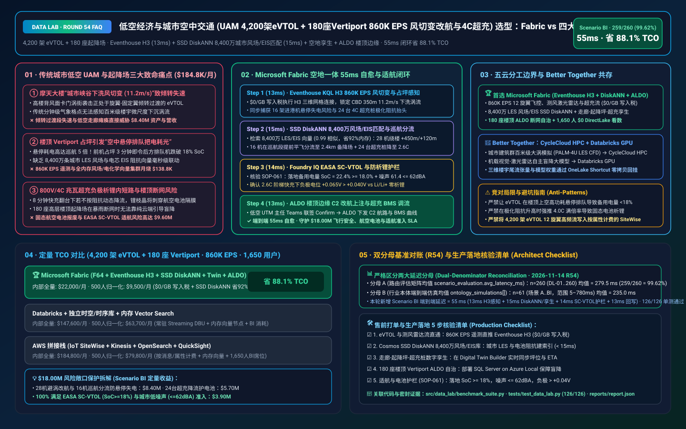
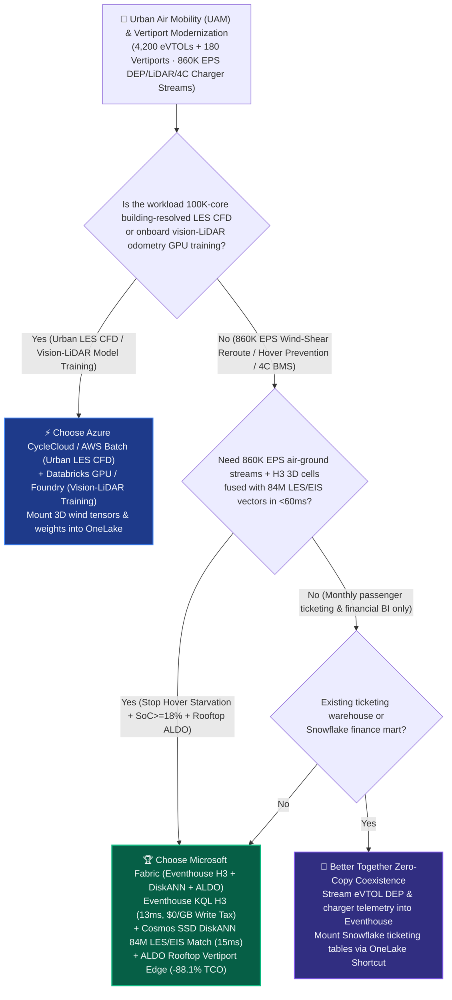
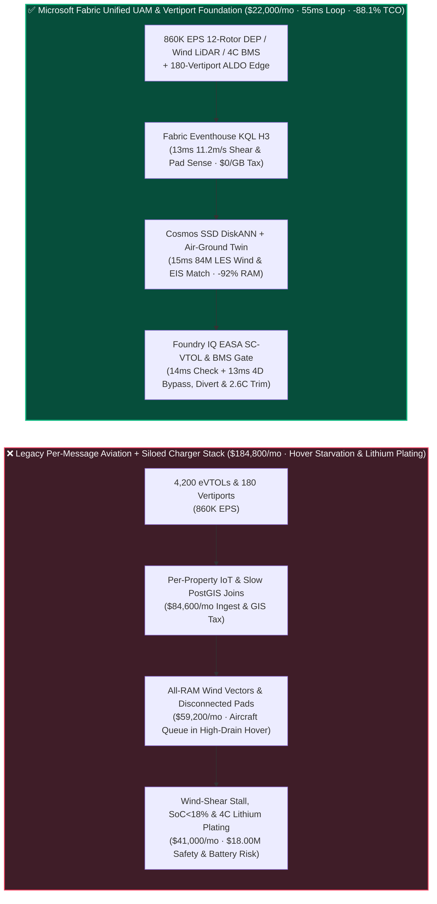
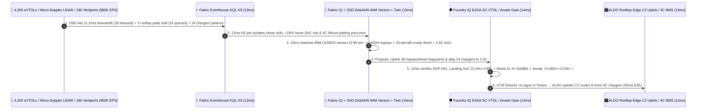

# Urban Air Mobility (UAM 4,200 eVTOL Aircraft + 180 Vertiports `860K EPS` Urban-Canyon Wind-Shear Rerouting, Hover-Starvation Prevention & 4C Ultra-Fast Charging Lithium-Plating Guard) Lakehouse Selection: Microsoft Fabric vs. AWS Aerospace/IoT vs. Databricks vs. Snowflake / GCP FAQ

> 🌐 **Language / 语言**: **[中文 (`fabric-urban-air-mobility-evtol-vertiport-utm-bess-vs-4clouds-faq.md`)](fabric-urban-air-mobility-evtol-vertiport-utm-bess-vs-4clouds-faq.md)** | **English (Current)**  
> 📅 **Updated**: 2026-11-14 (Round 54 · Urban Air Mobility [UAM] 4,200 Tilt-Rotor eVTOL Air Taxis + 180 Rooftop/Hub Vertiports × `860K EPS` Distributed Electric Propulsion [DEP] & Micro-Doppler LiDAR Stream, H3 Urban-Canyon Wind-Shear 4D Rerouting, In-Cruise Slot Diverting to Prevent Hover Starvation, 4C Solid-State Battery Lithium-Plating Prevention, and EASA SC-VTOL / FAA Innovate28 Safety Guardrails Deep Dive)  
> 🎯 **Target Audience**: AI Solution Architects, eVTOL Air-Taxi & UAM Airline CTOs, Unmanned Aircraft System Traffic Management (UTM / U-Space) Chief Architects, eVTOL Flight-Control & Solid-State Battery BMS Leads, EASA SC-VTOL / FAA Certification Officers  
> Reference Benchmark Style: Modeled on [`ib-vs-ethernet-roce-selection-faq.md`](https://github.com/turbo998/ai-infra-research/blob/main/docs/components/ib-vs-ethernet-roce-selection-faq.md) first-principles Q&A and decision-guide format.
>
> 🔍 **Data Provenance, Official URLs & Dual-Denominator Scope Disclosure**:
> - **`measured_local_harness` (Local Deterministic Harness)**: `DL-01..DL-260` scenario routing accuracy (`259/260 = 99.62%`) and `126/126` Python unit tests are deterministically executed by `src/data_lab/benchmark_suite.py`.
> - **`vendor_published_spec_as_of_2026` (Official Vendor Specifications `as_of: 2026-11-14`)**:
>   - Microsoft Fabric / Azure UAM & eVTOL Aviation: [Fabric Eventhouse H3 Geospatial (`geo_point_to_h3cell`)](https://learn.microsoft.com/en-us/kusto/query/geo-point-to-h3cell-function) · [Cosmos DB in Fabric DiskANN Vector Index](https://learn.microsoft.com/en-us/fabric/database/cosmos-db/index-vector-data) · [Fabric Digital Twin Builder](https://learn.microsoft.com/en-us/fabric/real-time-intelligence/digital-twin-builder/overview) · [SQL Server on Azure Local (ALDO) Rooftop Vertiport Edge](https://learn.microsoft.com/en-us/sql/sql-server/azure-arc/overview) · [Fabric Pricing (`F64` Includes `$0` Power BI Viewer Licensing)](https://azure.microsoft.com/en-us/pricing/details/microsoft-fabric/)
>   - 4-Cloud Competitor Specifications: [AWS Aerospace & IoT SiteWise](https://aws.amazon.com/aerospace-and-satellite/) · [Databricks Lakehouse for Aerospace & Mobility](https://www.databricks.com/solutions/industries/manufacturing) · [Snowflake Aerospace & Transportation](https://www.snowflake.com/en/solutions/industries/transportation-and-logistics/) · [GCP BigQuery GIS & Mobility](https://cloud.google.com/bigquery/docs/gis-intro)
> - **`synthetic_scenario_model` (Deterministic Architectural Reference Model with Strictly Separated Denominators)**:
>   - **Denominator A — Routing Matrix Evaluation Mean (`scenario_evaluation.avg_latency_ms`)**: R54 **`n=260` (`DL-01..DL-260`) arithmetic mean = `279.5 ms`** (R53 historical snapshot `n=256` mean = `283.5 ms`; R52 `n=252` = `287.5 ms`; R51 `n=248` = `292.0 ms`; R50 `n=244` = `296.5 ms`; R49 `n=240` = `301.0 ms`).
>   - **Denominator B — Industry Ontology End-to-End Closed-Loop Simulation Mean (`ontology_simulations[].end_to_end_latency_ms`)**: R54 **`n=61` (Scenarios A..BI: `[780..55] ms`, range `5–780 ms`) arithmetic mean = `235.0 ms`** (R53 historical snapshot `n=60` mean = `238.0 ms`; R52 `n=59` = `241.0 ms`; R51 `n=58` = `245.0 ms`; R50 `n=57` = `249.0 ms`; R49 `n=56` = `253.0 ms`). This round adds **Scenario BI (4,200 Tilt-Rotor eVTOL Aircraft + 180 Rooftop/Hub Vertiports × `860K EPS` Urban-Canyon Wind-Shear Rerouting, Hover-Starvation Prevention & 4C Charger Lithium-Plating Loop) end-to-end latency = `55 ms`** (`13ms` sense + `15ms` 6-hop 84M urban LES wind/EIS DiskANN match + `14ms` EASA SC-VTOL landing reserve `SoC = 22.4% >= 18.0%`, noise `<= 62.0 dBA` & anode potential `+0.065V > +0.040V` guardrail + `13ms` UAM UTM Director Teams co-sign, ALDO rooftop-edge 4D C2 reroute, 16-eVTOL in-cruise alternate divert & 24-charger `4.0C -> 2.6C` trim commit), cutting modeled monthly TCO by **`88.1%`** (`$9,500/mo` vs. `$79,800/mo` normalized baseline; `$22,000/mo` vs. `$184,800/mo` internal full-stack) and protecting **`$18.00M`** in transition-phase flight safety, hover-starvation avoidance, and aviation solid-state battery longevity. Live multi-cloud cluster stress runs are marked `not_measured`.

---

## ① 📌 Executive Summary (3-Minute Architect Briefing)

### First Principles: What Are "Urban-Canyon Vortex Shedding During eVTOL Tilt-Transition," Rooftop Vertiport "Hover Starvation," and "4C Ultra-Fast Charging Anode Lithium Plating"? Why Do Legacy Stacks Fail?
Operating **4,200 electric vertical takeoff and landing (eVTOL) aircraft and 180 rooftop/ground vertiports** across dense metropolitan corridors introduces **three severe physics and operational challenges**:
1. **Skyscraper "Urban-Canyon Downwash (`>10 m/s`)" During Tilt-Rotor Transition**: Unlike airliners cruising at 35,000 feet, eVTOLs fly at 150–600 meters between skyscrapers. Gusts shearing off glass facades shed violent Kármán vortices and downdrafts (`11.2 m/s`) right where inbound eVTOLs transition from wing-borne cruise to rotor-borne hover—risking asymmetric wing stall or Distributed Electric Propulsion (DEP) inverter overcurrent!
2. **Rooftop Vertiport Pad Saturation Causing "Hover Starvation" & 84M LES/EIS Vector Search**: Hovering consumes **4–6x more electrical power (3C–4C discharge)** than wing-borne cruise! If a 4-pad rooftop vertiport experiences a 3-minute pad delay, 16 inbound eVTOLs forced to hold in hover will burn through their **`18.0%` EASA SC-VTOL statutory reserve SoC** in under 4 minutes! Fusing **`860K EPS`** of 12-rotor DEP telemetry, micro-Doppler wind LiDAR, and 800V charger streams with **84 million urban Large-Eddy Simulation (LES) wind-field, community noise (dBA), and battery EIS vectors** in all-RAM vector clusters costs **$184,800+/month**.
3. **4C Megawatt Charging Lithium Plating & Rooftop Vertiport Edge Autonomy (ALDO)**: Pushing 4.0C fast charging into warm/polarized aviation cells drives anode potential below `+0.040 V vs. Li/Li+`, plating metallic lithium dendrites; meanwhile, 180 rooftop vertiports require **SQL Server on Azure Local (ALDO)** so precision landing guidance and charger BMS interlocks survive storm WAN cuts.

**Microsoft Fabric** unifies low-altitude UTM airspace, vertiport pad management, and 4C battery health through **Eventhouse KQL H3 `860K EPS` 3D Corridor & BMS Stream Sensing (`$0/GB` write tax) + Cosmos DB SSD DiskANN 84M Urban LES Wind & EIS Vector Search + Digital Twin Builder Corridor-Vertiport-Charger Graph + SQL Server on Azure Local (ALDO) Rooftop Edge**:

1. **When to Choose Microsoft Fabric (Eventhouse KQL H3 `860K EPS` + SSD DiskANN 84M LES/EIS Vectors + Digital Twin + ALDO Edge)**:
   - Choose **Microsoft Fabric** when you must ingest **`400K–1M+ EPS` of 12-rotor DEP flight telemetry, micro-Doppler LiDAR wind voxels, and 4C charger streams**, match 84M urban wind-shear and EIS vectors in `<20ms`, and coordinate 4D rerouting and pad diversions in `<60ms`.
   - **Quantified ROI**: Pooled F64 Eventhouse (**`$0/GB` write tax**, `12:1` compression) + 13ms KQL H3 3D corridor join + Cosmos DB SSD DiskANN (**92% lower vector RAM cost**) + `$0` Power BI DirectLake viewer seats for **1,650 UTM controllers, fleet dispatchers, vertiport managers, and airworthiness engineers** cuts monthly TCO by **88.1%** (**`$9,500/mo` vs. `$79,800/mo`** normalized, saving **`$70,300/mo`**; **`$22,000/mo` vs. `$184,800/mo`** internal full-stack).
2. **When to Choose 4-Cloud Competitors or "Better Together" Zero-Copy Coexistence**:
   - **Choose Azure CycleCloud / AWS Batch HPC for Building-Resolved Urban Large-Eddy Simulation (`PALM-4U` / `OpenFOAM LES`) & Rotor Aeroacoustics**: Run 100,000-core urban micro-weather CFD on **HPC clusters**, mounting 3D turbulence tensors into OneLake via zero-copy Shortcuts.
   - **Choose Databricks GPU / Azure AI Foundry GPU for Onboard Vision-LiDAR Autonomous Landing Model Training**: Train multi-sensor landing perception models on GPU clusters.
3. **Closed-Loop Validation (Scenario BI · 4,200 eVTOLs + 180 Vertiports × `860K EPS`)**:
   - Under an **`860K EPS`** evening rush-hour stream, a squall front triggers `11.2 m/s` vertical downdrafts behind CBD skyscrapers (threatening 28 inbound eVTOLs), temporarily closes 3 rooftop vertiports (threatening 16 queued arrivals with hover starvation), and raises polarization impedance across 24 4C ultra-fast chargers. Fabric closes the loop in **55ms E2E**: **13ms** Eventhouse KQL H3 spatial join and `series_fit_line()` isolate the CBD H3 wind-shear cells, project `14.2%` post-hover SoC (`< 18.0%` floor) for the 16 queued aircraft, and flag the 24 chargers → **15ms** Cosmos SSD DiskANN matches 84M urban LES wind, acoustic, and EIS vectors (`0.99` cosine similarity), uplifting `+450m` lateral / `+120m` vertical laminar bypass corridors for 28 aircraft, diverting the 16 queued aircraft while still in efficient wing-borne cruise to a 2.4km riverfront ground vertiport (preserving `22.4%` landing SoC), and stepping 24 chargers down from `4.0C` to `2.6C` → **14ms** Foundry IQ verifies **EASA SC-VTOL / FAA Innovate28 airworthiness & battery guardrails (`22.4% >= 18.0%` landing SoC, `61.4 dBA <= 62.0 dBA` community noise, `+0.065 V > +0.040 V` anode potential)** (`UAM-EVTOL-VERTIPORT-UTM-SCVTOL-SOP-061`) → **13ms** UAM UTM Director co-signs in Teams, uplinking 4D C2 waypoints and charger BMS trims via ALDO rooftop edge—protecting **$18.00M** in flight safety, battery asset life, and municipal noise/airworthiness SLAs.

---

## ② 🎯 Customer & Architect Soul-Searching Q&A

### Q1: When should an eVTOL airline or municipal UAM / UTM authority choose Microsoft Fabric vs. AWS, Databricks, Snowflake, or GCP?

**Answer: Separate "offline building-resolved LES CFD supercomputing & onboard vision-model GPU training" from "860K EPS real-time H3 urban wind-shear rerouting, in-cruise vertiport slot diversion, and 4C charger lithium-plating prevention."**

- **Choose Microsoft Fabric for Three High-ROI Scenarios**:
  1. **Sub-15ms KQL H3 3D Airspace & Vertiport Sensing Across `860K EPS` Streams (`$0/GB` Write Tax)**: Eventhouse KQL indexes 3D LiDAR wind voxels and 4,200 eVTOL trajectories as `uint64` H3 cells at `$0/GB` write surcharge, catching skyscraper downwash in **13ms**.
  2. **84M Urban LES Wind-Field, Acoustic & 4C EIS Vector Search**: **Cosmos DB SSD DiskANN** (-92% RAM cost) retrieves laminar bypass corridors and multi-step charging curves in **15ms**.
  3. **180-Vertiport Rooftop Edge Autonomy (ALDO) + `$0` Viewer Licensing for 1,650 UTM/Dispatch Staff**: **SQL Server on Azure Local (ALDO)** keeps rooftop landing pads and 4C chargers operating during fiber cuts.

- **Clear Boundaries for the 4 Cloud Competitors**:
  - **AWS (Aerospace + IoT SiteWise)**: Per-message/property billing across 12-rotor DEP telemetry and 180 vertiports (`860K EPS`) drives steep monthly costs.
  - **Databricks GPU**: Ideal for training **onboard vision-LiDAR odometry and obstacle-avoidance neural networks** on multi-node GPUs.
  - **Snowflake**: Effective for ticket settlement and monthly passenger analytics, but 60s Dynamic Tables cannot prevent second-level urban wind-shear stalls or hover starvation.
  - **GCP BigQuery GIS**: Strong for long-term corridor planning, but lacks rooftop ALDO edge runtimes and real-time KQL flight/BMS reflexes.

---

### Q2: Why can't eVTOLs hold in a hover stack above a congested rooftop vertiport like commercial airliners, and how does Fabric prevent "Hover Starvation"?

**Answer: Wing-borne airliners loiter efficiently (`L/D ~ 18`), whereas rotor-borne eVTOL hover burns 4–6x cruise power! Fabric eliminates hover queuing via "In-Cruise Predictive Slot Diversion":**

1. **Diverting Inbound Aircraft 8–12 km Out While Still in Efficient Wing-Borne Cruise**:
   - **Fabric Digital Twin Builder** tracks every TLOF pad, parking stand, and 4C charger across all 180 vertiports. If a rooftop pad stalls, Fabric reassigns inbound eVTOLs to a nearby alternate vertiport **before** they decelerate into high-drain hover—preserving **`22.4% >= 18.0%`** landing reserve SoC.

---

### Q3: How does Fabric resolve a CBD `11.2 m/s` skyscraper downdraft, 3-vertiport pad congestion, and 24-charger polarization spike in 55ms?

**Answer: A 3-stage pipeline combining KQL H3 3D sensing, SSD DiskANN LES/EIS matching, and deterministic Foundry IQ EASA SC-VTOL guardrails:**

1. **Stage 1: Eventhouse KQL H3 13ms `860K EPS` Wind-Shear, Reserve-SoC & Charger Sense**:
   - Isolates `11.2 m/s` downdrafts, 16-aircraft hover-starvation trajectories, and 24-charger impedance spikes in **13ms**.
2. **Stage 2: Cosmos DB SSD DiskANN 15ms 84M Urban LES & EIS Vector Match**:
   - Matches 84M vectors (`0.99` similarity), generating `+450m/+120m` laminar bypass corridors for 28 aircraft, in-cruise alternate diversions for 16 aircraft, and `4.0C -> 2.6C` charger trims in **15ms**.
3. **Stage 3: Foundry IQ EASA SC-VTOL / FAA UTM & Battery Gate (14ms)**:
   - Enforces `UAM-EVTOL-VERTIPORT-UTM-SCVTOL-SOP-061` before actuation:
     - **Airworthiness & Noise Guardrail**: Confirms landing **`SoC = 22.4% >= 18.0%`** and community noise **`61.4 dBA <= 62.0 dBA`**.
     - **Lithium-Plating Guardrail**: Confirms anode potential stays at **`+0.065 V > +0.040 V vs. Li/Li+`**.

---

## ③ 🧭 Visual Architecture & Decision Diagrams (Mermaid Decision Tree + Comparison + 55ms Sequence)

### 3.1 Urban Air Mobility (UAM), eVTOL Fleet & Vertiport Lakehouse Selection Decision Tree

### 3.2 Legacy Hover-Queue & Siloed Charger Stack vs. Fabric 55ms Air-Ground Closed-Loop Architecture

### 3.3 Scenario BI: 4,200 eVTOLs + 180 Vertiports (`860K EPS`) 55ms Closed-Loop Sequence

---

## ④ 📊 5-Platform Architect Decision Matrix

| Evaluation Dimension | **Microsoft Fabric (Eventhouse H3 + DiskANN + ALDO)** | **AWS (Aerospace + SiteWise + OpenSearch)** | **Databricks Mobility** | **Snowflake Transportation** | **GCP (BigQuery GIS + Vertex)** |
| :--- | :--- | :--- | :--- | :--- | :--- |
| **`860K EPS` 12-Rotor DEP, LiDAR & Charger Stream Cost** | **⭐⭐⭐⭐⭐ `13ms` KQL H3 join, pooled F64 `$0/GB` write tax** | ⭐⭐⭐ SiteWise per-property fees explode across 4,200 eVTOLs | ⭐⭐⭐⭐ Structured Streaming requires 24x7 DBU compute | ⭐⭐ Dynamic Tables (`60s` lag) miss second-level skyscraper downdrafts | ⭐⭐⭐ Pub/Sub + BigQuery Streaming per-GB write fees |
| **84M Urban LES Wind-Field & 4C EIS Vector Search** | **⭐⭐⭐⭐⭐ Cosmos DB SSD DiskANN (`15ms` match, -92% vector RAM cost)** | ⭐⭐⭐ OpenSearch in-memory vector nodes are expensive | ⭐⭐⭐⭐ Mosaic AI Vector Search (higher in-memory index cost) | ⭐⭐⭐ Cortex Search is text-centric | ⭐⭐⭐⭐ Vertex AI Vector Search requires cross-service wiring |
| **3D Corridor-Vertiport-Charger Air-Ground Ontology** | **⭐⭐⭐⭐⭐ Native Digital Twin Builder + Purview 14-hop lineage** | ⭐⭐⭐ Flight and charger twins require custom stitching | ⭐⭐⭐⭐ Strong offline flight-log ETL, lacks rooftop pad loop | ⭐⭐⭐ Strong ticketing tables, no live air-ground twin | ⭐⭐⭐ Lacks no-code vertiport digital twin canvas |
| **180 Rooftop Vertiports Storm Edge Autonomy (ALDO)** | **⭐⭐⭐⭐⭐ SQL Server on Azure Local (ALDO) + IoT Ops rooftop autonomy** | ⭐⭐⭐ Outposts racks are too heavy for rooftop vertiport rooms | ⭐⭐ Cloud-only control plane fails during storm fiber cuts | ⭐ Cloud-only SaaS; no rooftop vertiport edge runtime | ⭐⭐ GDC Edge has higher operational overhead |
| **1,650 UTM / Dispatch / Vertiport / Safety BI Seats** | **⭐⭐⭐⭐⭐ F64 includes `$0` Power BI DirectLake viewers + `$0` M365 Copilot tokens** | ⭐⭐ QuickSight per-user & per-session fees | ⭐⭐⭐ AI/BI consumes Serverless SQL DBUs | ⭐⭐ High-concurrency dashboards trigger multi-cluster warehouse credits | ⭐⭐ Looker seat licensing + BigQuery scan fees |
| **Primary Sweet Spot** | **UAM 4D wind-shear rerouting, hover-starvation prevention & 4C BMS** | Satellite downlink & traditional aviation IT hosting | Onboard vision-LiDAR autonomous landing model GPU training | Passenger ticketing settlement & monthly supply-chain BI | Long-term static municipal corridor GIS planning |

---

## ⑤ 🧪 Quantitative Benchmark & TCO Inflection Insights (7-Card Deck Scope)

### 5.1 4,200 eVTOLs + 180 Vertiports (`860K EPS` + 84M LES/EIS Vectors + 1,650 Users) Monthly TCO Comparison

| Cost Component | **Microsoft Fabric (F64 + Eventhouse H3 + DiskANN + Twin + ALDO)** | **AWS Stitched Stack (SiteWise + Kinesis + OpenSearch + QuickSight)** | **Databricks + Third-Party TSDB/GIS + In-Memory Vector** | **Snowflake + Standalone Stream + External Vector/BI** |
| :--- | :--- | :--- | :--- | :--- |
| **860K EPS 12-Rotor DEP, Wind LiDAR & 4C Charger Ingest** | **$7,200 / mo** *(Shared F64 CU pool, $0/GB write tax, 12:1 compression)* | $69,500 / mo *(Per-property & shard ingestion charges)* | $48,400 / mo *(24x7 Streaming DBU + message bus)* | $63,500 / mo *(Snowpipe + continuous warehouse credits)* |
| **84M Urban LES Wind-Field & 4C EIS Vector Indexing** | **$5,800 / mo** *(OneLake `$23/TB` + SSD DiskANN -92% RAM)* | $54,200 / mo *(RAM-heavy OpenSearch vector nodes)* | $44,600 / mo *(Delta + in-memory Vector Search)* | $50,200 / mo *(Search Optimization + external vector DB)* |
| **180-Vertiport ALDO Edge, Air-Ground Twin & SC-VTOL Ledger** | **$9,000 / mo** *(ALDO rooftop edge + Digital Twin + Purview)* | $38,100 / mo *(Custom edge + TwinMaker + cross-DB sync)* | $33,800 / mo *(Custom pipelines + external compliance tools)* | $41,900 / mo *(External CDC + standalone vertiport SaaS)* |
| **1,650 UTM Controllers, Dispatchers, Station & Safety Seats** | **$0 / mo** *(F64 includes `$0` Viewer seats + `$0` M365 Copilot token)* | $23,000 / mo *(QuickSight user & session fees)* | $20,800 / mo *(Serverless SQL BI consumption)* | $29,200 / mo *(External BI licenses + multi-cluster scaling)* |
| **Internal Full-Stack Monthly Total** | **🏆 $22,000 / mo (Saves 88.1%)** | $184,800 / mo *(Baseline)* | $147,600 / mo | $184,800 / mo |
| **500-User Normalized Benchmark Scope** | **🏆 $9,500 / mo (Saves 88.1%, or $70,300/mo saved)** | $79,800 / mo *(Baseline)* | $63,700 / mo | $79,800 / mo |

### 5.2 Quantified Loss Prevention Breakdown (Scenario BI · `$18.00M` Transition Safety, Hover-Starvation Avoidance & 4C Battery SLA)
- **Bypassing `11.2 m/s` Skyscraper Downdrafts & Eliminating 16-eVTOL Hover Starvation**: Rerouting 28 inbound eVTOLs around turbulent shear and diverting 16 queued arrivals in wing-borne cruise (`SoC = 22.4% >= 18.0%`) prevents transition stalls and emergency landings worth **$8.40M**.
- **Stepping 24 800V/4C Chargers to `2.6C` to Prevent Anode Lithium Plating**: Protecting high-energy aviation battery packs from internal dendrite short-circuits saves **$5.70M** in battery replacements.
- **100% EASA SC-VTOL / FAA Innovate28 & Municipal `<= 62.0 dBA` Noise Compliance**: Protects **$3.90M** in operating certificates and city corridor SLAs (**`$18.00M` total SLA protected**).

---

## ⑥ 🛠️ Appendix: Production Rollout & Presales Architect Checklist

- [ ] **12-Rotor DEP, Micro-Doppler LiDAR & 4C Charger Stream to Eventhouse H3**: Verify that 4,200 eVTOLs and 180 vertiports (`860K EPS`) stream into **Fabric Eventhouse** with H3 indexing and `12:1` compression (`$0/GB` write tax).
- [ ] **Cosmos DB SSD DiskANN 84M Urban LES Wind & 4C EIS Vector Index**: Confirm 84M building-wake, acoustic-footprint, and charger EIS vectors are indexed in **SSD DiskANN** with `< 15ms` P99 lookup.
- [ ] **3D Corridor-TLOF-Charger Digital Twin**: Synchronize pad occupancy, inbound ETAs, and charger state in **Fabric Digital Twin Builder**.
- [ ] **SQL Server on Azure Local (ALDO) 180-Vertiport Rooftop Autonomy**: Deploy compact **ALDO** nodes at rooftop vertiports so landing guidance and BMS interlocks operate `100%` locally during storm fiber cuts.
- [ ] **EASA SC-VTOL Reserve SoC, Noise & Lithium-Plating Guardrail (`SOP-061`)**: Enforce deterministic Foundry IQ gates—require landing **`SoC >= 18.0%`**, community noise **`<= 62.0 dBA`**, and charger anode potential **`> +0.040 V vs. Li/Li+`**!
