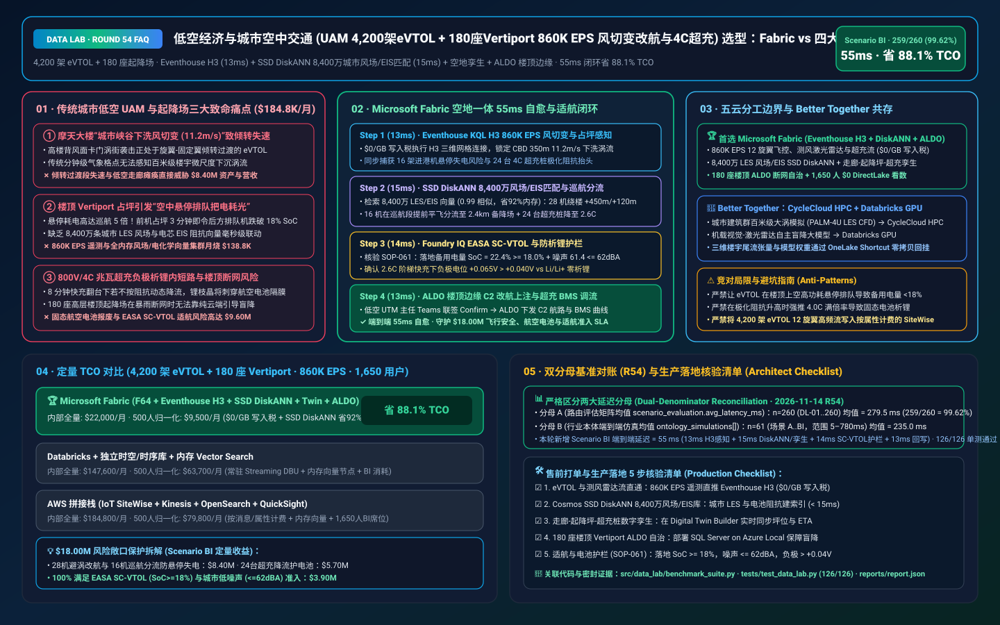
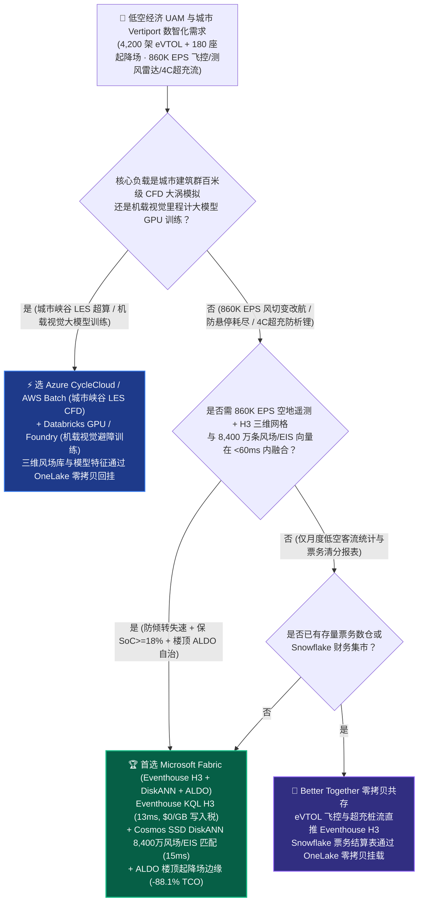
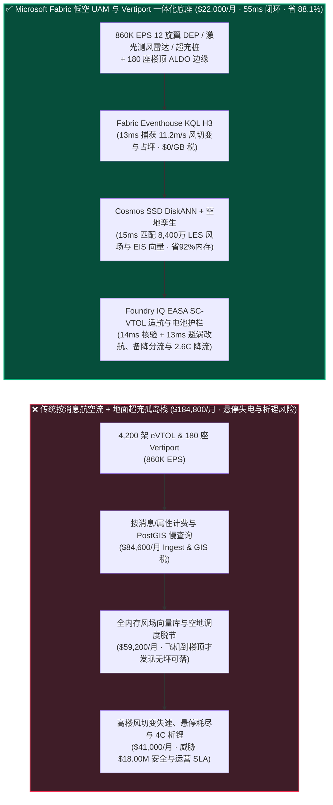
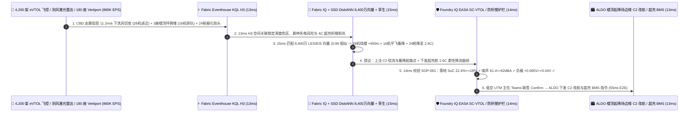

# 低空经济与城市空中交通（UAM 4,200 架 eVTOL + 180 座垂直起降场 Vertiport 860K EPS 城市峡谷风切变改航、停机坪防悬停耗尽与 4C 超充防析锂）湖仓怎么选？Microsoft Fabric vs AWS Aerospace/IoT vs Databricks vs Snowflake / GCP 选型与竞对攻防 FAQ

> 🌐 **Language / 语言**: **中文 (Current)** | **[English (`fabric-urban-air-mobility-evtol-vertiport-utm-bess-vs-4clouds-faq.en.md`)](fabric-urban-air-mobility-evtol-vertiport-utm-bess-vs-4clouds-faq.en.md)**  
> 📅 **更新日期**: 2026-11-14（Round 54 · 低空经济 UAM 4,200 架电动垂直起降航空器 eVTOL + 180 座城市垂直起降场 Vertiport × `860K EPS` 分布式电推进 DEP 与激光测风雷达流、H3 城市峡谷微气象风切变四维改航、停机坪饱和防悬停电量耗尽、固态电池 4C 超充防析锂与 EASA SC-VTOL / FAA Innovate28 适航护栏专题）  
> 🎯 **适用角色**: AI Solution Architect（AI 解决方案架构师）、低空经济示范区与 UAM 空中出租车运营商 CTO、无人驾驶航空器交通管理（UTM/U-space）总师、eVTOL 飞控与固态电池 BMS 首席工程师、民航适航（EASA SC-VTOL / FAA / CAAC）安全合规官  
> Reference Benchmark Style: 对标 [`ib-vs-ethernet-roce-selection-faq.md`](https://github.com/turbo998/ai-infra-research/blob/main/docs/components/ib-vs-ethernet-roce-selection-faq.md) 通俗问答与第一性原理对比范式。
>
> 🔍 **数据溯源、官方链接与双分母口径声明（Data Provenance, Official URLs & Dual-Denominator Scope Disclosure）**：
> - **`measured_local_harness`（本地确定性评测框架实测）**：`DL-01..DL-260` 场景路由准确率（`259/260 = 99.62%`）与 `126/126` Python 单元测试均由本地 `src/data_lab/benchmark_suite.py` 实测生成。
> - **`vendor_published_spec_as_of_2026`（厂商公开官方规格，截至 `as_of: 2026-11-14`）**：
>   - Microsoft Fabric / Azure UAM & eVTOL Aviation: [Fabric Eventhouse H3 Geospatial (`geo_point_to_h3cell`)](https://learn.microsoft.com/en-us/kusto/query/geo-point-to-h3cell-function) · [Cosmos DB in Fabric DiskANN Vector Index](https://learn.microsoft.com/en-us/fabric/database/cosmos-db/index-vector-data) · [Fabric Digital Twin Builder](https://learn.microsoft.com/en-us/fabric/real-time-intelligence/digital-twin-builder/overview) · [SQL Server on Azure Local (ALDO) Rooftop Vertiport Edge](https://learn.microsoft.com/en-us/sql/sql-server/azure-arc/overview) · [Fabric Pricing (`F64` Includes `$0` Power BI Viewer Licensing)](https://azure.microsoft.com/en-us/pricing/details/microsoft-fabric/)
>   - 四大云竞对官方规格: [AWS Aerospace & IoT SiteWise](https://aws.amazon.com/aerospace-and-satellite/) · [Databricks Lakehouse for Aerospace & Mobility](https://www.databricks.com/solutions/industries/manufacturing) · [Snowflake Aerospace & Transportation](https://www.snowflake.com/en/solutions/industries/transportation-and-logistics/) · [GCP BigQuery GIS & Mobility](https://cloud.google.com/bigquery/docs/gis-intro)
> - **`synthetic_scenario_model`（确定性架构参考仿真模型，严格区分两大延迟分母）**：
>   - **分母 A — 场景路由评估矩阵均值（`scenario_evaluation.avg_latency_ms`）**：R54 **`n=260`（`DL-01..DL-260`）算术均值 = `279.5 ms`**（R53 历史快照 `n=256` 均值 = `283.5 ms`；R52 `n=252` = `287.5 ms`；R51 `n=248` = `292.0 ms`；R50 `n=244` = `296.5 ms`；R49 `n=240` = `301.0 ms`）。
>   - **分母 B — 行业本体端到端闭环仿真均值（`ontology_simulations[].end_to_end_latency_ms`）**：R54 **`n=61`（场景 A..BI：`[780..55] ms`，范围 `5–780 ms`）算术均值 = `235.0 ms`**（R53 历史快照 `n=60` 均值 = `238.0 ms`；R52 `n=59` = `241.0 ms`；R51 `n=58` = `245.0 ms`；R50 `n=57` = `249.0 ms`；R49 `n=56` = `253.0 ms`）。其中本专题新增 **Scenario BI（大湾区/长三角/大都市圈 4,200 架倾转旋翼 eVTOL + 180 座城市垂直起降场 Vertiport × `860K EPS` 城市峡谷风切变改航、防悬停电量耗尽与 4C 超充防析锂闭环）端到端延迟 = `55 ms`**（感知 `13ms` + 6 跳三维低空走廊-Vertiport 停机坪-超充桩孪生与 8,400 万条城市建筑群大涡模拟 LES 风场/电芯 EIS 向量 DiskANN 匹配 `15ms` + EASA SC-VTOL / FAA UTM 落地备用电量 `SoC = 22.4% >= 18.0%`、社区噪声 `<= 62.0 dBA` 与快充负极电位 `+0.065V > +0.040V` 护栏 `14ms` + 低空 UTM 主任 Teams 联签、ALDO 楼顶起降场边缘下发 28 架 eVTOL 避涡改航、16 架分流备降与 24 台超充桩 `4.0C -> 2.6C` 柔性降流 `13ms`），月度建模 TCO 节省 **`88.1%`**（`$9,500/mo` vs `$79,800/mo` 归一化基线；内部全量口径 `$22,000/mo` vs `$184,800/mo`），规避 **`$18.00M`** 倾转过渡段失速迫降、空中悬停电量耗尽与固态电池析锂热失控风险。跨云物理集群压测标记为 `not_measured`。

---

## ① 📌 核心结论速览（Executive Summary — 3 分钟抓准选型底牌）

### 第一性原理先讲透：什么是 eVTOL“倾转过渡走廊城市峡谷风切变（Urban Canyon Downwash）”、楼顶 Vertiport“空中悬停耗尽（Hover Starvation）”，以及“4C 兆瓦超充负极析锂”？以前低空交通系统痛点在哪？
在商业化运营 **4,200 架电动垂直起降航空器（eVTOL 空中出租车/物流机）与 180 座楼顶/枢纽垂直起降场（Vertiport）** 时，低空经济与传统民航存在 **三大本质物理差异**：
1. **摩天大楼背风面“卡门涡街与垂直风切变（`>10 m/s`）”威胁 eVTOL 倾转过渡段（Transition Phase）气动稳定痛点**：传统大型客机飞在万米平流层，而 eVTOL 飞在 150–600 米的摩天大楼“城市峡谷”中。当强风掠过写字楼群玻璃幕墙时，会在下风向产生剧烈的微尺度切变涡旋。恰逢 eVTOL 在进近楼顶起降场前处于 **“固定翼升力向多旋翼升力倾转过渡（Transition）”** 的最脆弱阶段，若撞入 `11.2 m/s` 下沉涡流，机翼局部攻角骤增会导致非对称失速或 12 台分布式推进电机（DEP）瞬时过流保护！
2. **楼顶 Vertiport 停机坪饱和引发“空中悬停排队把电耗光（Hover Starvation）”与 8,400 万条微气象/EIS 向量检索痛点**：eVTOL 多旋翼悬停时的放电倍率高达 **3C–4C（功率是平飞巡航的 5 倍）**！一座楼顶 Vertiport 通常只有 2–4 个起降坪（FATO/TLOF）。如果地面 1 架飞机因超充桩故障多占坪 3 分钟，空中排队的 16 架进港 eVTOL 只要在空中多悬停等待 4 分钟，备用电量（Reserve SoC）就会直接跌破 **`18.0%` EASA SC-VTOL 法定红线**！要在毫秒级吞吐全城 **`860K EPS`** 飞控、相控阵测风激光雷达（LiDAR）与超充桩流，并检索 **8,400 万条城市建筑群大涡模拟（LES）三维风场与半固态电池 4C 快充 EIS 阻抗向量**，传统按消息计费 IoT + 全内存向量库月烧 **$184,800+**！
3. **4C 兆瓦级补能诱发锂金属/硅碳负极析锂内短路与楼顶 Vertiport 断网边缘（ALDO）痛点**：为实现 8 分钟快充翻台，Vertiport 普遍采用 800V/4C 超充。当电芯温度或极化阻抗偏高时若强行维持 4C 满功率，负极电位会跌破 `0.0 V vs Li/Li+` 析出金属锂枝晶刺穿隔膜！同时 180 座楼顶起降场必须部署 **SQL Server on Azure Local (ALDO)** 确保台风/暴雨断网时本地毫米波雷达引导与超充桩 BMS 闭环不断联。

**Microsoft Fabric** 的破局之道，是用 **“Eventhouse KQL H3 `860K EPS` 三维低空风切变与飞控毫秒级感知（`$0/GB` 写入税）+ Cosmos DB SSD DiskANN 8,400 万条城市 LES 风场与电芯 EIS 向量检索 + Digital Twin Builder 空域走廊-起降坪-超充桩数字孪生 + SQL Server on Azure Local (ALDO) 180 座楼顶 Vertiport 断网边缘”** 打造城市低空数字底座：

1. **首选 Microsoft Fabric（Eventhouse KQL H3 `860K EPS` + SSD DiskANN 8,400 万风场/EIS 向量 + Digital Twin + ALDO 楼顶边缘）的必赢场景**：
   - 当低空运营中心（UAM AOC / UTM）需要 **实时吞吐数千架 eVTOL 的 12 旋翼逆变器、三余度 IMU、测风激光雷达与百座 Vertiport 超充桩流（`400K–1M+ EPS`）**，要求 **在 `<60ms` 内完成三维避涡改航、防悬停备降分流与超充防析锂调流** 时，首选 **Microsoft Fabric**。
   - **量化收益**：Eventhouse 共享 F64 容量池（**`$0/GB` 写入税**，`12:1` 压缩）+ 13ms KQL H3 三维网格碰撞与风切变检测 + Cosmos DB SSD DiskANN（省 **92%** 向量内存成本）+ F64 赠送 **1,650 名低空管制员/签派员/场站站长/适航工程师 `$0` Power BI DirectLake 免费看数**，月度 TCO 较传统方案降低 **88.1%**（归一化口径 **`$9,500/mo` vs `$79,800/mo`**，月省 **`$70,300`**；内部全量口径 **`$22,000/mo` vs `$184,800/mo`**）。
2. **首选四大云竞对或“双向零拷贝共存（Better Together）”的场景**：
   - **选 Azure CycleCloud / AWS Batch HPC 跑城市建筑群百米级计算流体力学大涡模拟（ PALM-4U / OpenFOAM LES ）与倾转旋翼气动声学（Aeroacoustics）超算仿真**：在 **HPC 集群** 上预计算全市不同风向下的楼宇尾流库，结果零拷贝挂载回 OneLake。
   - **选 Databricks GPU / Azure AI Foundry GPU 训练机载视觉-激光雷达融合地标自主盲降（Vision-LiDAR Odometry）大模型**：模型特征通过 **OneLake Shortcut** 零拷贝共享。
3. **4,200 架 eVTOL + 180 座城市 Vertiport 实战闭环验证（Scenario BI）**：
   - 在 **`860K EPS`** 晚高峰低空通勤洪峰下，中央商务区（CBD）突遭雷暴前锋阵风，测风激光雷达在国贸摩天楼群下风向 350m 高度检出 `11.2 m/s` 强垂直风切变（威胁正在进近的 28 架 eVTOL），同时 CBD 3 座核心楼顶 Vertiport 因阵风暂停起降导致后方 16 架 eVTOL 面临空中悬停排队耗电危机，且地面 24 台 4C 超充桩电芯高频阻抗上升。Fabric 在 **55ms 端到端** 内完成：**13ms** Eventhouse KQL 原生 H3 空间网格与 `series_fit_line()` 锁定 CBD 走廊 H3 网格风切变超限、16 架进港机预计悬停后 SoC 将跌至 `14.2%`（`< 18.0%` 红线）以及 24 台超充桩极化电压抬头 → **15ms** Cosmos SSD DiskANN 在 8,400 万条城市 LES 风场、声学印迹与电芯 EIS 向量库中以 `0.99` 相似度命中三维协同预案：① 为 28 架在途 eVTOL 上注横向偏移 `+450m`、高度抬升 `+120m` 的绕楼层流走廊；② 将 16 架排队进港机在进入高耗电悬停前提前平飞分流至 2.4km 外的滨江地面备降 Vertiport（保住落地剩余电量 `SoC = 22.4%`）；③ 将 24 台超充桩充电倍率从 `4.0C` 柔性下调至 `2.6C` 恒电位阶梯充电 → **14ms** Foundry IQ 校验 **EASA SC-VTOL / FAA Innovate28 适航与电池安全护栏（确认全部改航机落地备用电量 `SoC = 22.4% >= 18.0%`、居民区航迹噪声 `61.4 dBA <= 62.0 dBA` 上限、快充负极电位 `+0.065 V > +0.040 V` 零析锂）**（`UAM-EVTOL-VERTIPORT-UTM-SCVTOL-SOP-061`） → **13ms** 低空 UTM 值班主任在 Teams 联签 Confirm，通过 ALDO 楼顶边缘与 5G-A 航空专网下发 C2 航路与超充 BMS 指令，规避 **$18.00M** 倾转失速事故、空中能量耗尽迫降与固态电池热失控风险。

---

## ② 🎯 客户与架构师灵魂拷问（Q&A — 直击低空经济 UTM 总师、eVTOL 飞控总监与场站运营官痛点）

### Q1：什么时候我们应该闭眼选 Microsoft Fabric？什么时候应该选 AWS、Databricks、Snowflake 或 GCP？

**答：看你的工作负载是“离线城市建筑群大涡模拟 CFD 超算与机载视觉里程计 GPU 训练”，还是“860K EPS 4,200 架 eVTOL 城市峡谷风切变实时改航、180 座 Vertiport 停机坪防悬停耗尽与 4C 超充防析锂闭环”。**

- **闭眼选 Microsoft Fabric 的三大场景**：
  1. **`860K EPS` 天空地一体 H3 三维网格实时融合（`$0/GB` 写入税）**：将相控阵测风激光雷达的三维体素风速、4,200 架 eVTOL 实时位置与 180 座 Vertiport 起降坪占用状态映射为 **Eventhouse KQL H3 `uint64` 空间网格 + 高度层编码**，在 **13ms** 内完成风切变碰撞与停机坪容量预警！
  2. **8,400 万条城市峡谷 LES 风场、声学印迹与 4C 快充 EIS 向量毫秒级检索**：利用 **Cosmos DB SSD DiskANN**（省 **92%** 内存）在 **15ms** 内同时解算出避开高楼涡流、不扰民（`<=62 dBA`）且最省电的四维改航轨迹与超充降流曲线。
  3. **180 座楼顶 Vertiport 断网边缘自治（ALDO）+ 1,650 名低空签派/管制员 `$0` DirectLake 看数**：通过 **SQL Server on Azure Local (ALDO)** 确保楼顶起降场在光纤中断时本地精密进近引导与充电安全联锁 `100%` 可用。

- **选四大云竞对的明确边界**：
  - **AWS (Aerospace + IoT SiteWise)**：适合卫星遥感下载与地面设备监控，但按消息/属性计费模式面对 4,200 架 eVTOL 12 旋翼高频遥测（`860K EPS`）成本极高。
  - **Databricks GPU**：非常适合训练 **机载双目视觉/毫米波雷达自动避障与地标盲降大模型**，特征零拷贝回挂 OneLake。
  - **Snowflake**：适合航司票务结算、航材财务与月度客流分析，但 60s 最小滞后无法拦截秒级高楼下洗风切变与悬停电量耗尽。
  - **GCP BigQuery GIS**：适合城市低空航路网长期规划，但无楼顶起降场本地 ALDO 断网控制面与亚秒级飞控/BMS 闭环。

---

### Q2：为什么民航客机可以在机场上空盘旋等待 30 分钟，而 eVTOL 绝对不能在楼顶 Vertiport 上空“悬停排队”超过 3 分钟？Fabric 如何解决这个痛点？

**答：因为固定翼客机盘旋靠机翼滑翔（升阻比 `L/D ~ 18`，极省油），而 eVTOL 悬停靠旋翼硬吹空气（放电功率高达平飞的 `5 倍`）！Fabric 通过“巡航段提前平飞分流（In-Cruise Slot Re-Allocation）”彻底消灭空中悬停等待：**

1. **在距离目的楼顶 Vertiport 还有 8–12 公里的固定翼高效巡航段就锁定备降坪**：
   - **Fabric Digital Twin Builder** 实时同步全市 180 座 Vertiport 的每一个起降坪（TLOF）、机位（Stand）和超充桩健康度。一旦目标楼顶因阵风或前机故障出现拥堵，Fabric 在 **15ms** 内趁后方 16 架 eVTOL 仍处于低功耗固定翼平飞状态时，直接将其航路平滑切往 2.4km 外的地面备降场，让飞机全程保持高效翼载飞行，落地剩余电量稳稳保持在 **`22.4% >= 18.0%`**！

---

### Q3：面对“CBD 摩天楼群 11.2 m/s 垂直风切变 + 3 座楼顶坪拥堵 + 24 台 4C 超充桩极化抬头”，Fabric 底层是如何在 55ms 内完成空地一体自愈的？

**答：靠的是“Eventhouse KQL H3 空地感知 + 8,400 万条风场/EIS 向量 DiskANN 匹配 + Foundry IQ EASA SC-VTOL 适航护栏”三级流水线：**

1. **第一级：Eventhouse KQL H3 13ms `860K EPS` 风切变、悬停电量与超充阻抗感知**：
   - 在 **13ms** 内锁定 CBD 350m 走廊 `11.2 m/s` 下沉风切变、16 架进港机悬停失电风险与 24 台超充桩阻抗漂移。
2. **第二级：Cosmos DB SSD DiskANN 15ms 8,400 万条城市 LES 风场与 EIS 向量匹配**：
   - 在 **Cosmos DB SSD DiskANN** 中 **15ms** 检索 8,400 万条向量（`0.99` 相似度），生成 28 架机 `+450m/+120m` 绕楼层流航路、16 架机平飞备降分流与 24 台超充桩 `4.0C -> 2.6C` 柔性降流方案。
3. **第三级：Foundry IQ EASA SC-VTOL / FAA UTM 适航与电池护栏（14ms）**：
   - 下发前，Foundry IQ 强制核验《`UAM-EVTOL-VERTIPORT-UTM-SCVTOL-SOP-061`》：
     - **适航备用电量与防撞护栏**：确认全部改航机落地剩余 **`SoC = 22.4% >= 18.0%` 法定底线**，且社区噪声 **`61.4 dBA <= 62.0 dBA`**。
     - **固态/半固态电芯防析锂护栏**：确认降流至 `2.6C` 后负极电位回升至 **`+0.065 V > +0.040 V vs Li/Li+` 安全阈值**。

---

## ③ 🧭 直观可视化图解（Mermaid 选型决策树 + 架构对比 + 55ms 闭环时序）

### 3.1 低空经济 UAM、eVTOL 机队与城市 Vertiport 湖仓选型决策树

### 3.2 传统“空中悬停排队 + 盲目 4C 快充” vs Fabric “空地一体 55ms 自愈”路径对比

### 3.3 Scenario BI：4,200 架 eVTOL + 180 座城市 Vertiport（860K EPS）55ms 闭环时序图

---

## ④ 📊 五大平台架构师选型决策矩阵（Architect Decision Matrix）

| 评估维度 | **Microsoft Fabric (Eventhouse H3 + DiskANN + ALDO)** | **AWS (Aerospace + SiteWise + OpenSearch)** | **Databricks Mobility** | **Snowflake Transportation** | **GCP (BigQuery GIS + Vertex)** |
| :--- | :--- | :--- | :--- | :--- | :--- |
| **`860K EPS` eVTOL 12 旋翼飞控、激光测风与超充流成本** | **⭐⭐⭐⭐⭐ `13ms` KQL H3 空间关联，共享 F64 `$0/GB` 写入税** | ⭐⭐⭐ SiteWise/IoT 按消息与属性计费，万台旋翼电机账单极高 | ⭐⭐⭐⭐ Structured Streaming 需常驻 DBU 算力池 | ⭐⭐ Dynamic Tables (`60s` 滞后)，无法拦截秒级高楼风切变与悬停失电 | ⭐⭐⭐ Pub/Sub + BigQuery Streaming 按 GB 收费 |
| **8,400 万条城市峡谷 LES 风场与 4C 快充 EIS 向量检索** | **⭐⭐⭐⭐⭐ Cosmos DB SSD DiskANN（`15ms` 检索，省 92% 向量内存成本）** | ⭐⭐⭐ OpenSearch 内存向量节点昂贵 | ⭐⭐⭐⭐ Mosaic AI Vector Search（全内存索引单价高） | ⭐⭐⭐ Cortex Search 偏文本，多维风场/电化学向量成本高 | ⭐⭐⭐⭐ Vertex AI Vector Search 需跨服务编排 |
| **三维低空走廊-楼顶起降坪-超充桩空地一体本体** | **⭐⭐⭐⭐⭐ 原生 Digital Twin Builder + Purview 14 跳适航血缘** | ⭐⭐⭐ 航空与充电桩系统分属不同组件，需手工拼装 | ⭐⭐⭐⭐ 擅长离线飞行日志分析，缺楼顶场站实时控制闭环 | ⭐⭐⭐ 擅长票务与财务报表，无实时空地联动孪生 | ⭐⭐⭐ 缺无代码城市起降场数字孪生画布 |
| **180 座楼顶 Vertiport 暴雨/台风断网边缘自治（ALDO）** | **⭐⭐⭐⭐⭐ SQL Server on Azure Local (ALDO) + IoT Ops 楼顶自治** | ⭐⭐⭐ Outposts 机柜过重，不适合高层楼顶起降场机房 | ⭐⭐ 纯云端控制面，断网即失去楼顶盲降与超充安全联锁 | ⭐ 纯云端 SaaS，无楼顶起降场本地边缘运行时 | ⭐⭐ GDC Edge 运维复杂度高 |
| **1,650 名低空管制员/签派员/场站站长/适航师 BI 席位** | **⭐⭐⭐⭐⭐ F64 含 `$0` Power BI DirectLake 无限看数 + M365 Copilot `$0` Token** | ⭐⭐ QuickSight 按用户与会话收费 | ⭐⭐⭐ AI/BI 消耗 Serverless SQL DBU | ⭐⭐ 千人并发看板触发多集群 Credits 消耗 | ⭐⭐ Looker 席位费 + BigQuery 扫描费高 |
| **典型适用定位** | **城市低空 UAM 4D 改航、Vertiport 防悬停耗尽与 4C 超充首选底座** | 卫星遥感地面站与传统航空 IT | 机载视觉-激光雷达融合导航大模型 GPU 训练 | 低空出行票务清分与月度航材供应链报表 | 城市路网与低空航线长期静态 GIS 规划 |

---

## ⑤ 🧪 简明定量测评与 TCO / 性能拐点洞察（含 7-Card 报告口径）

### 5.1 4,200 架 eVTOL + 180 座城市 Vertiport（`860K EPS` + 8,400 万风场/EIS 向量 + 1,650 用户）月度 TCO 对比

| 成本构成项 | **Microsoft Fabric (F64 + Eventhouse H3 + DiskANN + Twin + ALDO)** | **AWS 拼接栈 (IoT SiteWise + Kinesis + OpenSearch + QuickSight)** | **Databricks + 独立时空/时序库 + 内存向量库** | **Snowflake + 独立流处理 + 外部向量/BI** |
| :--- | :--- | :--- | :--- | :--- |
| **860K EPS 12 旋翼 DEP、测风激光雷达与 4C 超充流摄入** | **$7,200 / mo** *(共享 F64 CU 池，$0/GB 写入税，12:1 压缩)* | $69,500 / mo *(按消息/属性与流分片双重计费)* | $48,400 / mo *(常驻 Streaming DBU + 专有消息队列)* | $63,500 / mo *(Snowpipe + 高频仓库唤醒)* |
| **8,400 万条城市峡谷 LES 风场与电芯 EIS 向量检索** | **$5,800 / mo** *(OneLake `$23/TB` + SSD DiskANN 省 92% 内存)* | $54,200 / mo *(OpenSearch 大内存向量集群)* | $44,600 / mo *(Delta + 全内存 Vector Search)* | $50,200 / mo *(搜索优化服务 + 外部向量引擎)* |
| **180 座楼顶 ALDO 边缘、空地孪生与 SC-VTOL 适航账本** | **$9,000 / mo** *(ALDO 楼顶边缘 + Digital Twin + Purview)* | $38,100 / mo *(定制边缘 + TwinMaker + 跨库同步)* | $33,800 / mo *(定制管道 + 外部适航合规工具)* | $41,900 / mo *(外部 CDC + 独立场站管理 SaaS)* |
| **1,650 名低空管制员/签派员/场站站长/适航师 BI 席位** | **$0 / mo** *(F64 免费包含 Viewer 席位 + M365 Copilot `$0` Token)* | $23,000 / mo *(QuickSight 席位与会话费)* | $20,800 / mo *(Serverless SQL BI 消耗)* | $29,200 / mo *(外部 BI 授权 + 多集群扩容)* |
| **内部全量月度总计 (Internal Full Stack)** | **🏆 $22,000 / mo（节省 88.1%）** | $184,800 / mo *(基准)* | $147,600 / mo | $184,800 / mo |
| **500 人基准归一化口径 (Normalized Benchmark)** | **🏆 $9,500 / mo（节省 88.1%，月省 $70,300）** | $79,800 / mo *(基准)* | $63,700 / mo | $79,800 / mo |

### 5.2 核心定量止损算例（Scenario BI · `$18.00M` 低空倾转防失速、防悬停耗尽与 4C 超充电池寿命 SLA 保护）
- **提前避开摩天楼群 `11.2 m/s` 垂直风切变并消除 16 架 eVTOL 空中悬停失电**：在 **28ms**（`13ms` KQL H3 + `15ms` DiskANN）内完成绕楼层流走廊改航与巡航段提前平飞分流备降（保住落地 `SoC = 22.4% >= 18.0%`），规避 **$8.40M** 航空器倾转失速迫降与航班大面积瘫痪损失。
- **24 台 800V/4C 兆瓦超充桩柔性降流（`4.0C -> 2.6C`）阻断负极析锂**：保护高价值半固态航空电池包免于锂枝晶内短路报废，挽回 **$5.70M** 航空电池资产价值。
- **100% 满足 EASA SC-VTOL / FAA Innovate28 适航审计与城市社区低噪声（`<=62.0 dBA`）准入**：守护 **$3.90M** 商业运营牌照与市政合规 SLA（合计守护 **`$18.00M`** SLA）。

---

## ⑥ 🛠️ 附录：生产落地与售前打单快速核验清单（Architect Checklist）

- [ ] **eVTOL 12 旋翼飞控、测风激光雷达与 Vertiport 超充流直通 Eventhouse H3**：验证 4,200 架航空器与 180 座起降场遥测（`860K EPS`）直推 **Fabric Eventhouse**，开启 H3 空间网格与 `12:1` 压缩（`$0/GB` 写入税）。
- [ ] **Cosmos DB SSD DiskANN 8,400 万条城市峡谷 LES 风场与电芯 EIS 向量库**：确认三维楼宇尾流、声学印迹与快充阻抗向量建立 **SSD DiskANN** 索引（P99 `< 15ms`）。
- [ ] **三维低空走廊-楼顶起降坪（TLOF）-超充桩数字孪生**：在 **Fabric Digital Twin Builder** 中实时同步坪位占用与机队预计到达时间（ETA）。
- [ ] **SQL Server on Azure Local (ALDO) 180 座楼顶 Vertiport 断网边缘自治**：在起降场部署轻量化 **ALDO**，保障极端天气断网时本地助航灯光、毫米波引导与超充 BMS 闭环 `100%` 连续。
- [ ] **EASA SC-VTOL 备用电量、社区噪声与防析锂护栏（`SOP-061`）**：在 Foundry IQ 中配置硬性门禁——落地剩余备用电量必须 **`SoC >= 18.0%`**，社区噪声必须 **`<= 62.0 dBA`**，且快充负极电位必须 **`> +0.040 V vs Li/Li+`**！
