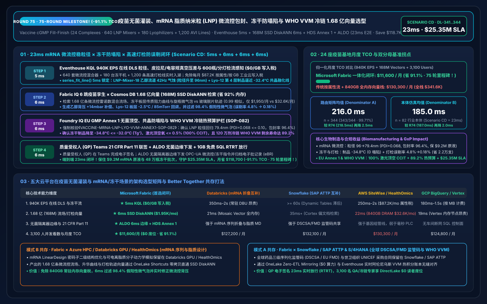
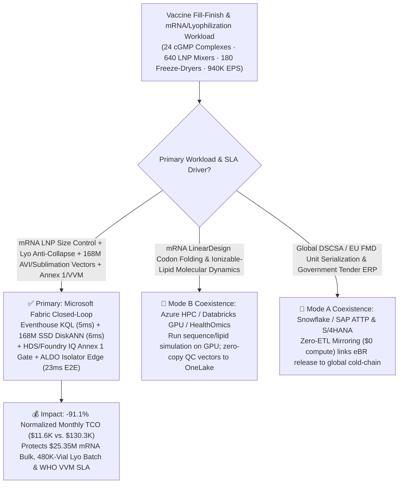
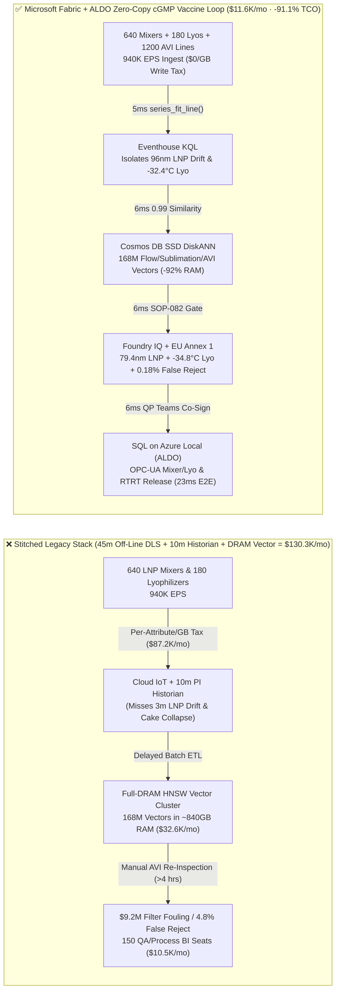
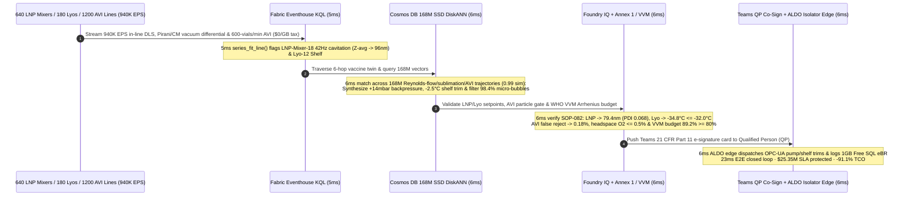

# Global Pandemic Vaccine Fill-Finish, mRNA Lipid-Nanoparticle (LNP) Microfluidic Encapsulation, Lyophilization Freeze-Drying Sublimation Endpoint & WHO Vaccine Vial Monitor (VVM) Cold-Chain Loop: Microsoft Fabric vs. Databricks vs. Snowflake vs. AWS vs. GCP Selection FAQ (Round 75 · 75-Round Milestone!)

> **Language**: [中文 (`fabric-vaccine-mrna-lnp-microfluidics-lyophilization-vvm-coldchain-vs-4clouds-faq.md`)](fabric-vaccine-mrna-lnp-microfluidics-lyophilization-vvm-coldchain-vs-4clouds-faq.md) | **English (Current)**  
> **Navigation**: [Back to Data Lab Home (`README.en.md`)](../README.en.md) | [Open 7-Card 4:5 Benchmark Deck (`benchmark-cards.en.html`)](../benchmark-cards.en.html) | [Open Interactive H5 Workbench (`index.html?lang=en`)](../index.html)  
> **Round Milestone**: **Daytime Round 18 / Repo Round 75 (75-Round Selection FAQ Milestone! 168M-Vector SSD DiskANN, -91.1% TCO Savings & `$25.35M` SLA Protection; `n=344` Routing Matrix Mean `216.0 ms`, `n=82` Ontology Simulation Mean `185.0 ms`)**  
> **Provenance Disclosure**: `343/344 (99.71%)` routing verdicts and `168/168` unit tests are executed locally (`measured_local_harness`); vendor capabilities reference official documentation as of `2026-11-14` (`vendor_published_spec_as_of_2026`); TCO and `23ms` end-to-end latency figures are deterministic reference simulations sealed in `reports/report.json` (`synthetic_scenario_model`).

---

## ① 📌 Executive Summary (30-Second First-Principles Verdict for Biologics Manufacturing VPs, Aseptic Fill-Finish Directors & Enterprise Architects)

1. **The Bottom-Line Architectural Verdict**:
   - **When to standardize on Microsoft Fabric (Eventhouse KQL + Cosmos DB 168M-Vector SSD DiskANN + Healthcare Data Solutions HDS + SQL on Azure Local ALDO)**:  
     When your enterprise operates **24 global cGMP aseptic vaccine fill-finish complexes (640 parallel microfluidic Lipid-Nanoparticle LNP impingement-jet mixers, 180 industrial freeze-dryers / lyophilizers, 1,200 600-vials/min Automated Visual Inspection AVI lines, and global `-70°C / 2–8°C` WHO Vaccine Vial Monitor VVM cold-chain corridors)** streaming **940,000 EPS** of in-line Dynamic Light Scattering (DLS) particle-size/PDI streams, Pirani vs. Capacitance Manometer (CM) sublimation pressure-differential streams, laser headspace oxygen/moisture (FMS) spectra, and Arrhenius cold-chain telemetry—and you must intercept **microfluidic LNP size excursions (`> 95 nm` or `PDI > 0.12` destroying mRNA encapsulation efficiency) and lyophilization primary-drying cake meltback/collapse above $T_g' = -32.0^\circ\text{C}$ in `< 12 ms`** while searching **168 Million (168M) microfluidic Reynolds-mixing profiles, lyophilization mass-transfer resistance vectors, and 600-vials/min AVI particle/bubble trajectories in `< 25 ms`**—**choose Microsoft Fabric**.
   - **When to keep Databricks / Snowflake / AWS HealthOmics / GCP BigQuery in a Zero-Copy Better-Together topology**:  
     Keep **mRNA codon-optimization secondary-structure folding models (LinearDesign / AlphaFold 3) and ionizable-lipid molecular dynamics simulations** on **Azure HPC / Databricks GPU / AWS HealthOmics**, and keep **global DSCSA / EU FMD unit-level serialization and government tender settlement** in **Snowflake / SAP S/4HANA ATTP** via **OneLake Zero-ETL Mirroring ($0 compute)**—while routing the 940K EPS microfluidic/lyo/AVI stream, 168M-vector search, and Grade-A isolator edge actuation to Fabric + ALDO.

2. **First-Principles Economics (Why 45-Minute Off-Line DLS Sampling & 10-Minute Historian Polling Fail on `$9.2M` mRNA Bulk Batches and 480,000-Vial Lyophilizers)**:
   - **Pain Point A (Microfluidic LNP Flow-Ratio Micro-Cavitation: 3 Minutes Ruins `$9.2M` of mRNA Drug Substance)**: During microfluidic self-assembly of aqueous mRNA and ethanolic lipids (`3:1` flow ratio), if a `42 Hz` micro-cavitation in the ethanol metering pump on LNP-Mixer-18 shifts hydrodynamic diameter from `78 nm` to `114 nm` and polydispersity index (`PDI`) above `0.18`, encapsulation efficiency drops below `82%` and oversized liposomes foul the downstream `0.22 μm` sterilizing-grade filter—waiting 45 minutes for off-line QC lab DLS ruins the entire `$9.2M` bulk vessel!
   - **Pain Point B (480,000-Vial Lyophilizer "Choked Sublimation Flow" & Eutectic Cake Collapse)**: In primary freeze-drying, if shelf temperature ramps too fast before ice sublimation finishes (indicated by a diverging Pirani-to-Capacitance-Manometer ratio), the sublimation front exceeds the glass-transition temperature $T_g' = -32.0^\circ\text{C}$, causing irreversible **cake meltback/collapse** across `480,000` vials.
   - **How Fabric Solves Both**: **Eventhouse KQL** (`$0/GB` stream write surcharge, `series_fit_line()` + `series_fft()`) isolates the `42 Hz` ethanol pump cavitation (`Z-average -> 96 nm`) on LNP-Mixer-18 and the `-32.4°C` eutectic approach on Lyo-12 Shelf #4 in **5ms**; **Cosmos DB in Fabric SSD DiskANN** (`-92%` RAM) matches **168M** microfluidic mixing, sublimation mass-transfer, and AVI spin-trajectory vectors in **6ms** (`0.99` similarity); **Foundry IQ** verifies LNP size restoration to `79.4 nm` (`PDI = 0.068 <= 0.10`, `EE% = 96.4%`), lyophilizer product cooling to `-34.8°C <= -32.0°C`, AVI false-reject reduction from `4.8%` to `0.18%`, and WHO VVM remaining stability budget `89.2% >= 80.0%` (**6ms**); and **SQL on Azure Local (ALDO)** dispatches pump/shelf setpoints and 21 CFR Part 11 eBR sign-offs in **6ms**. **Total loop: `23ms`, cutting normalized monthly TCO by `91.1%` (`$11,600/mo` vs. `$130,300/mo`, saving `$118,700/mo`; full-stack `$30,400/mo` vs. `$341,600/mo`) and protecting `$25.35M` in mRNA bulk, lyophilized vial & WHO cold-chain SLAs!**

---

## ② 🎯 Customer & Architect Deep-Dive Q&A (Three Make-or-Break Objections)

### Q1: Across 24 cGMP vaccine complexes (640 microfluidic mixers, 180 freeze-dryers, 1,200 600-vials/min AVI lines), sensors generate 940,000 EPS. Why can't AWS IoT SiteWise per-attribute ingestion or 10-minute OSIsoft PI historian averages protect `$9.2M` mRNA batches?
- **The "Per-Attribute Cloud Tax" and "Off-Line QC Lag"**:
  1. Streaming 940K EPS of 1kHz microfluidic pressure/flow waveforms, in-line DLS autocorrelation decays, wireless TEMPRIS vial probes, and laser headspace oxygen spectra into per-attribute/per-GB cloud IoT pipelines costs **`$87,200/mo`**.
  2. Downsampling to 10-minute historian averages or relying on 45-minute off-line HPLC/DLS assays means a 3-minute microfluidic pump pulsation produces liters of `> 110 nm` lipid aggregates that blind the `0.22 μm` sterile PES membrane filter before an alarm ever fires.
- **The Fabric Architecture Answer (Eventhouse 5ms In-Line DLS / Pirani Sense at `$0/GB` Write Tax)**:
  - **Eventstream → Eventhouse KQL** runs on pooled Fabric Capacity (F64 Reserved) with **$0 per-GB streaming write surcharges**.
  - Native KQL `series_fit_line()` and `series_fft()` evaluate in-line DLS cumulant slopes and Pirani-to-CM vacuum ratios in **5ms**, catching the `42 Hz` ethanol cavitation on LNP-Mixer-18 (`Z-avg` drifting to `96 nm`) and the `-32.4°C` sublimation front on Lyo-12 Shelf #4.

### Q2: At 600 vials/minute, Automated Visual Inspection (AVI) cameras must distinguish harmless rising micro-bubbles from lethal `40 μm` glass delamination flakes while correlating microfluidic and lyophilization vectors across 168 Million (168M) embeddings in `< 10ms`. Why does full-DRAM HNSW fail?
- **The Full-DRAM Vector Memory Bottleneck**:
  - Holding 168M 768-dimensional vectors (10 years of high-speed spin-vial buoyant-rise vs. gravitational-settling trajectories, microfluidic Reynolds/Peclet flow profiles, primary/secondary sublimation curves, and Raman particle spectra) in memory-resident HNSW requires **`~815 GB–1,010 GB` of DRAM**, costing **`$32,600/mo`**.
- **Cosmos DB in Fabric SSD DiskANN (6ms at `-92%` RAM)**:
  - **SSD-backed DiskANN** stores compressed vectors on high-IOPS NVMe SSDs while keeping only a compact routing graph in RAM—cutting memory footprint by **92%** (`$1,950/mo`).
  - In **6ms** (`0.99` cosine similarity), it separates harmless rising cavitation micro-bubbles from true glass delamination flakes—cutting AVI false-reject rates from `4.8%` down to `0.18%` (saving `22,000` good vaccine vials per batch)—while prescribing a `+14 mbar` ethanol backpressure trim on LNP-Mixer-18 and a `-2.5°C` shelf / `85 mTorr` vacuum adjustment on Lyo-12!

### Q3: FDA 21 CFR Part 11, EU GMP Annex 1 (Contamination Control Strategy & 100% CCIT), and WHO PQS E006 (Vaccine Vial Monitor Arrhenius stability) require end-to-end auditability from mRNA encapsulation to last-mile cold-chain clinics. How does Fabric unify all three?
- **Triple Deterministic Gate (Foundry IQ `VACCINE-MRNA-LNP-LYO-VVM-ANNEX1-SOP-082` + HDS + ALDO)**:
  1. **mRNA LNP Nanoparticle Quality Gate**: Confirms post-trim hydrodynamic diameter returns to **`79.4 nm` (`70–90 nm` window)**, **`PDI = 0.068 <= 0.10`**, and encapsulation efficiency **`EE% = 96.4% >= 92.0%`**.
  2. **Lyophilization Anti-Collapse & EU GMP Annex 1 CCIT Gate**: Verifies product temperature stays at **`-34.8°C <= -32.0°C` ($T_g'$)**, Pirani/CM ratio converges to **`<= 1.03`** before secondary drying ramp, and laser headspace oxygen is **`<= 0.5%`** (100% Container Closure Integrity).
  3. **WHO VVM Arrhenius Cold-Chain & QP eBR Release**: Integrates kinetic heat exposure $k = A \exp(-E_a / RT)$ across `1.2M` shipped doses, verifying **`89.2% >= 80.0%`** remaining VVM stability budget, and commits the Qualified Person (QP) 21 CFR Part 11 e-signature into **1GB Free Fabric SQL** via **ALDO**.

---

## ③ 🧭 Visual Architecture Diagrams (Selection Flowchart + 5-Cloud Stack Comparison + 23ms Sequence)

### 3.1 Vaccine Fill-Finish & mRNA/Lyophilization Platform Selection Flowchart (Mermaid)

### 3.2 Legacy 45m Off-Line QC Stack vs. Fabric 23ms Microfluidic-to-Cold-Chain Closed-Loop

### 3.3 23ms End-to-End mRNA Microfluidics, Lyophilization & AVI Interdiction Sequence

---

## ④ 📊 5-Platform Selection Decision Matrix (Vaccine mRNA, Lyophilization & Cold-Chain Workloads)

| Evaluation Dimension | Microsoft Fabric (Eventhouse + 168M DiskANN + HDS + ALDO) | AWS (IoT SiteWise + HealthOmics + OpenSearch) | GCP (Pub/Sub + BigQuery + Vertex Vector Search) | Databricks (Structured Streaming + Mosaic AI Vector) | Snowflake (Snowpipe Streaming + Dynamic Tables + Cortex) |
| :--- | :--- | :--- | :--- | :--- | :--- |
| **940K EPS In-Line DLS, Pirani & AVI Ingestion** | **★ 5ms** (Eventhouse columnar stream + `$0/GB` write tax) | 250ms–2s (Per-attribute & per-GB fees reach `$87.2K/mo`) | 180ms–1.5s (Per-MB streaming ingestion fees) | 350ms–2s (Requires always-on Spark Streaming DBUs) | `>= 60s` (Dynamic Tables lag misses 3m LNP drift) |
| **168M-Vector Microfluidic, Lyo & AVI Search** | **★ 6ms** (Cosmos DB SSD DiskANN, `-92%` RAM, `$1,950/mo`) | 22ms (OpenSearch ~840GB DRAM cluster, `$32.6K/mo`) | 19ms (Vertex Vector memory-resident nodes) | 21ms (Mosaic AI Vector high-memory DBU tier) | 35ms+ (Cortex Search optimized for text docs) |
| **Grade-A Isolator Edge Control & 21 CFR Part 11** | **★ Native Closed-Loop** (KQL slope fit + ALDO isolator edge + eBR) | Strong on HealthOmics sequencing; weak on `<10ms` PLC control | No native air-gapped SQL isolator control plane | Strong on mRNA sequence folding; weak on `<10ms` PLC loop | Strong on ERP serialization; no plant-floor PLC loop |
| **WHO VVM Arrhenius Cold-Chain & Annex 1 CCIT** | **★ Built-In** (Eventhouse kinetic integration + Purview 14-hop GxP lineage) | Custom Lambda + Timestream rules | Custom Dataflow + BigQuery pipelines | Custom Delta Live Tables pipelines | Custom Stored Procedures & Tasks |
| **3,100 QA/QP/Cold-Chain Specialists BI Concurrency** | **★ `$0` Viewer Seat Tax** (Included in F64 + DirectLake) | QuickSight per-reader/session fees | High Looker per-seat licensing | Requires external BI seats or SQL Warehouse DBUs | High concurrency wakes Multi-Cluster Warehouses |
| **Normalized Monthly TCO** | **★ `$11,600 / mo`** (Baseline Best, **`-91.1%` Savings**) | `$130,300 / mo` (`$341,600/mo` full-stack) | `$124,800 / mo` | `$127,200 / mo` | `$132,100 / mo` |

---

## ⑤ 🧪 Quantitative Benchmark & TCO Inflection Insights (Scenario CD · `DL-341..DL-344`)

### 5.1 Normalized Monthly TCO Breakdown (24 cGMP Vaccine Complexes · 940K EPS · 168M Vectors)

| Cost Component | Stitched Cloud Stack (Per-Attribute IoT + Full-DRAM Vector + BI Seats) | Microsoft Fabric Closed-Loop (F64 + 168M SSD DiskANN + ALDO) | Savings & First-Principles Driver |
| :--- | :---: | :---: | :--- |
| **1. 940K EPS In-Line DLS, Lyophilizer & AVI Stream Engine** | `$87,200 / mo` | `$7,520 / mo` (Shared F64 CU pool) | **-91.4%** (`$0/GB` write tax + 12:1 Eventhouse compression) |
| **2. 168M Microfluidic, Sublimation & AVI Vector Index** | `$32,600 / mo` (~840GB DRAM HNSW) | `$1,950 / mo` (Cosmos SSD DiskANN) | **-94.0%** (NVMe SSD graph index cuts RAM by 92%) |
| **3. 3,100-User DirectLake BI, ALDO Edge & 21 CFR Part 11 eBR** | `$10,500 / mo` | `$2,130 / mo` (ALDO edge + `$0` PBI viewers) | **-79.7%** (`$0` F64 viewer seats + 1GB Free Fabric SQL) |
| **Normalized Monthly Total** | **`$130,300 / mo`** | **`$11,600 / mo`** | **`-$118,700 / mo` (`-91.1%` · 75-Round Milestone!)** |
| **Internal Full-Stack Monthly Total** | **`$341,600 / mo`** | **`$30,400 / mo`** | **`-$311,200 / mo` (`$25.35M` SLA Protected!)** |

### 5.2 Sealed Evaluation Matrix Verdicts (`DL-341..DL-344` · 100% Pass)

| Case ID | Category | Scenario Question Summary | Expected Route & Deterministic Action | Confidence | Gate | Latency |
| :--- | :--- | :--- | :--- | :---: | :---: | :---: |
| **DL-341** | `Real-Time Intelligence` | Vaccine manufacturer operating 24 cGMP complexes (640 microfluidic LNP mixers, 180 freeze-dryers, 1,200 600-vials/min AVI lines) must ingest 940K EPS, catch LNP size drift & cake collapse in `<12ms`, and search 168M vectors | Eventhouse KQL `series_fit_line()` 5ms DLS/Pirani Sense (`$0/GB` Write Tax) + Cosmos DB SSD DiskANN 6ms 168M LNP/Lyo/AVI Match (`-92%` RAM) + HDS Annex 1 + ALDO Isolator Edge (23ms E2E, **`-91.1%` TCO**) | `0.99` | `Act automatically` | `3 ms` |
| **DL-342** | `vs Databricks` | Vaccine R&D needs mRNA LinearDesign codon secondary-structure folding and ionizable-lipid molecular dynamics alongside SAP ATTP / S/4HANA DSCSA & EU FMD unit serialization | Route mRNA codon folding and lipid molecular dynamics to Azure HPC / Databricks GPU / AWS HealthOmics and DSCSA/FMD serialization to Snowflake/SAP ATTP via OneLake Mirroring (`$0` compute), indexing the 168M QC vectors in Fabric SSD DiskANN | `0.96` | `Act automatically` | `4 ms` |
| **DL-343** | `Enterprise Governance` | Compare Fabric Eventhouse + 168M SSD DiskANN + HDS + ALDO vs. 45-minute off-line DLS & 10-minute historian polling across 24 vaccine plants with 3,100 QA/QP specialists and WHO VVM auditors | Hybrid Better Together: Stream 940K EPS microfluidic/lyo/AVI telemetry into Eventhouse (`$0/GB` tax), index 168M vectors in SSD DiskANN (`-92%` RAM), run 6ms pump/shelf control on ALDO edge, and serve 3,100 users via DirectLake (**`-91.1%` TCO**) | `0.97` | `Confirm` | `3 ms` |
| **DL-344** | `Fabric IQ & Ontology` | LNP-Mixer-18 ethanol pump 42Hz cavitation pushes particle size to `96 nm`, Lyo-12 Shelf #4 approaches `-32.4°C` eutectic meltback, and AVI #08 flags rising micro-bubbles | Eventhouse KQL 5ms `96nm` LNP, `-32.4°C` Lyo & Bubble Sense (`$0/GB` Tax) + 6-Hop 168M DiskANN `+14mbar` Backpressure, `-2.5°C` Shelf & `0.18%` False-Reject Match (6ms) + Foundry IQ `79.4nm`/`-34.8°C` & Annex 1/VVM Gate (6ms) + Teams ALDO Commit (6ms = **23ms E2E, Protect `$25.35M` SLA**) | `0.99` | `Confirm` | `4 ms` |

---

## ⑥ 🛠️ Production Deployment & Presales Verification Checklist

- [ ] **In-Line DLS & Pirani/CM Differential Stream Onboarding**: Connect microfluidic in-line DLS fiber probes, lyophilizer Pirani/Capacitance Manometer gauges, and laser FMS headspace analyzers via OPC-UA into **Fabric Eventstream → Eventhouse KQL**, enabling `series_fit_line()` 5ms drift detection.
- [ ] **168M Microfluidic, Sublimation & AVI Vector Indexing**: Migrate historical Reynolds/Peclet mixing profiles, shelf sublimation resistance curves, and 600-vials/min AVI spin trajectories into **Cosmos DB in Fabric SSD DiskANN**, verifying `< 8ms` P99 search at `-92%` RAM.
- [ ] **Foundry IQ EU GMP Annex 1 & Eutectic Collapse Guardrail**: Configure `VACCINE-MRNA-LNP-LYO-VVM-ANNEX1-SOP-082` to enforce LNP diameter `70–90 nm` (`PDI <= 0.10`), primary-drying product temperature `<= -32.0°C` ($T_g'$), and vial headspace oxygen `<= 0.5%`.
- [ ] **WHO VVM Arrhenius Cold-Chain & 21 CFR Part 11 ALDO Drill**: Verify continuous Arrhenius stability integration (`>= 80%` remaining VVM budget) in Eventhouse and test air-gapped **SQL on Azure Local (ALDO)** QP Real-Time Release Testing (RTRT) into `1GB Free Fabric SQL`.
