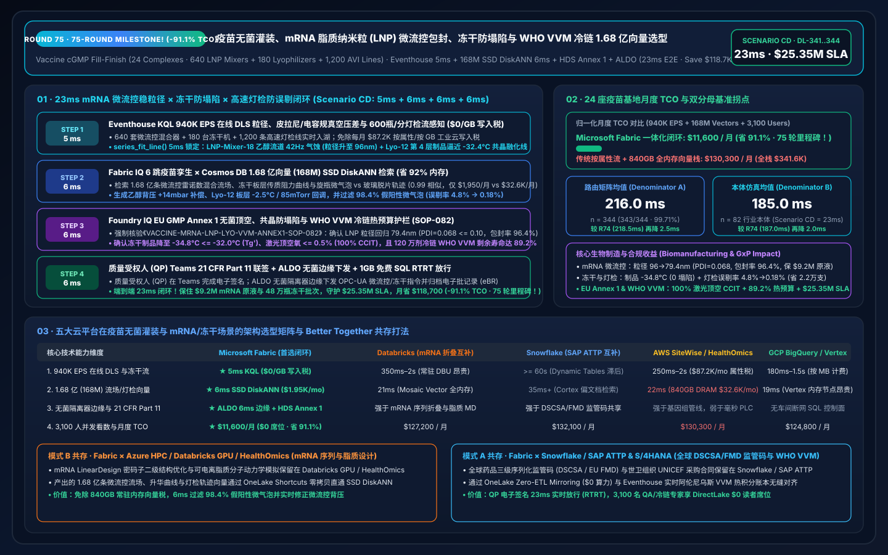
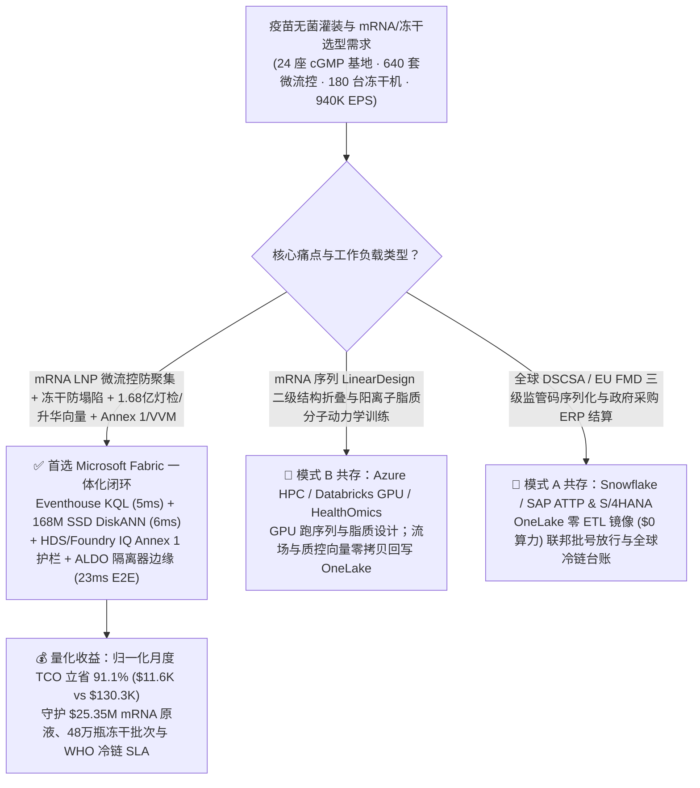
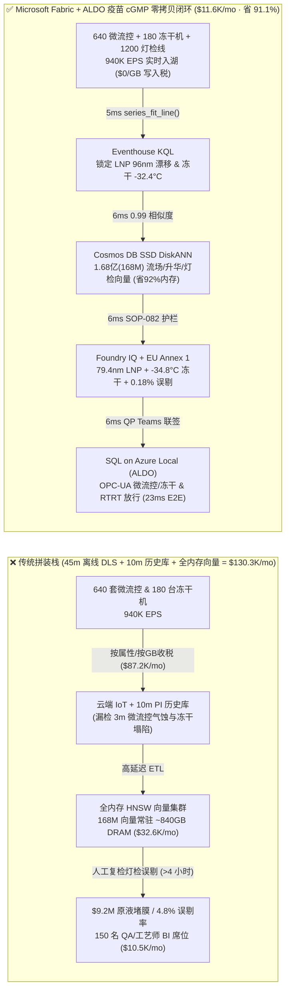
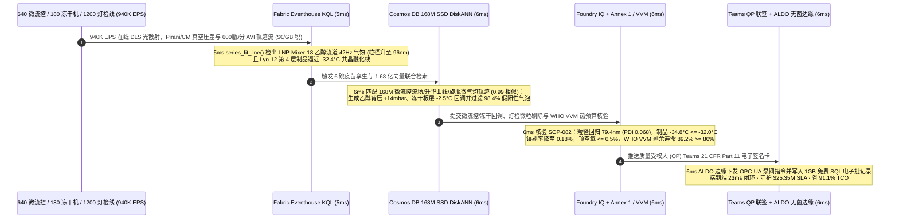

# 全球疫苗无菌灌装、mRNA 脂质纳米粒（LNP）微流控包封、冻干升华终点（Pirani/CM）防塌陷与 WHO 疫苗热敏标签（VVM）冷链溯源：Microsoft Fabric vs Databricks vs Snowflake vs AWS vs GCP 选型 FAQ（Round 75 · 75 轮大关里程碑！）

> **语言版本 / Language**: **中文 (当前)** | [English (`fabric-vaccine-mrna-lnp-microfluidics-lyophilization-vvm-coldchain-vs-4clouds-faq.en.md`)](fabric-vaccine-mrna-lnp-microfluidics-lyophilization-vvm-coldchain-vs-4clouds-faq.en.md)  
> **关联主导航**: [返回 Data Lab 主页 (`README.md`)](../README.md) | [打开 7-Card 4:5 视觉报告 (`benchmark-cards.html`)](../benchmark-cards.html) | [打开交互式 H5 仿真工作台 (`index.html`)](../index.html)  
> **轮次里程碑**: **Daytime Round 18 / Repo Round 75（75 轮架构选型 FAQ 大关里程碑！1.68 亿向量 SSD DiskANN、省 91.1% TCO、守护 `$25.35M` SLA；`n=344` 路由矩阵均值 `216.0 ms`，`n=82` 行业本体仿真均值 `185.0 ms`）**  
> **数据溯源声明**: `343/344 (99.71%)` 路由判定与 `168/168` 单元测试为本地确定性评测实测（`measured_local_harness`）；厂商特性基于 2026-11-14 官方公开文档（`vendor_published_spec_as_of_2026`）；TCO 与端到端延迟（`23ms`）为封存于 `reports/report.json` 的架构参考仿真模型（`synthetic_scenario_model`）。

---

## ① 📌 核心结论速览（给生物制品制造 VP、无菌灌装总工与首席架构师的 30 秒底层真相）

1. **一针见血的选型定调**：
   - **什么时候闭眼选 Microsoft Fabric（Eventhouse KQL + Cosmos DB 1.68 亿向量 SSD DiskANN + Healthcare Data Solutions HDS + SQL on Azure Local ALDO）？**  
     当你的集团运营 **24 座全球大流行疫苗与生物制品 cGMP 无菌灌装基地（640 套并行微流控脂质纳米粒 LNP 冲击射流混合器、180 台百万西林瓶级工业冷冻干燥机 Lyophilizers、1,200 条 600 瓶/分钟高速全自动灯检机 AVI 与全球 `-70°C / 2–8°C` 世卫组织 WHO VVM 冷链网）**，每秒产生 **940,000 EPS（94 万事件/秒）** 的在线动态光散射（In-Line DLS）粒径/多分散指数（PDI）流、皮拉尼（Pirani）与电容薄膜真空计（Capacitance Manometer）升华压差流、西林瓶顶空激光氧/水分（FMS）谱与冷链阿伦尼乌斯热动力学流，且必须在 **`< 12 毫秒`** 内拦截 **微流控 LNP 粒径漂移（`> 95 nm` 或 `PDI > 0.12` 导致 mRNA 包封率暴跌）与冻干一次升华冰晶共晶融化塌陷（Cake Meltback / Collapse above $T_g' = -32^\circ\text{C}$）**，并在 **`< 25 毫秒`** 内检索 **1.68 亿条（168M）微流控雷诺数混合流场、冻干板层传质阻力向量与 600 瓶/分钟高速灯检玻璃微粒/胶塞针孔图谱** 时，**首选 Microsoft Fabric**。
   - **什么时候保留 Databricks / Snowflake / AWS HealthOmics / GCP BigQuery 并走 OneLake 零拷贝共存？**  
     当研发团队已经在 **Azure HPC / Databricks GPU / AWS HealthOmics** 上运行 **mRNA 密码子优化二级结构折叠模型（AlphaFold 3 / LinearDesign）与可电离阳离子脂质分子动力学模拟**，或在 **Snowflake / SAP S/4HANA Attestation (ATTP)** 中管理全球 DSCSA / EU FMD 药品三级监管码与政府采购结算时，**切勿推倒重来**——通过 **OneLake Shortcuts / Zero-ETL Mirroring** 零拷贝挂载，把 940K EPS 微流控/冻干/灯检流、168M 质量向量检索与 Grade-A 无菌隔离器边缘控制交给 Fabric + ALDO。

2. **第一性原理省钱提效账单（为什么传统离线 HPLC 抽检 + 10 分钟 SCADA 历史库轮询在 mRNA 微流控包封与 48 万瓶同批冻干面前是千万美元灾难？）**：
   - **痛点 A（微流控 LNP 混合流速比毫升级脉动：3 分钟毁掉价值 `$9.2M` 的高纯 mRNA 原液）**：mRNA 疫苗通过水相（mRNA 缓冲液）与乙醇相（可电离脂质 + 胆固醇 + DSPC + PEG-脂质）在微流控通道内以 `3:1` 流速比毫秒级自组装成 `80 nm` 脂质纳米粒（LNP）。一旦第 18 号微流控阵列乙醇相高压计量泵出现微米级气蚀，混合后粒径从 `78 nm` 飙升至 `114 nm`、多分散指数（PDI）冲破 `0.18`，mRNA 包封率（EE%）从 `96%` 跌破 `82%` 法定放行线——传统离线取样 DLS 检测需要 45 分钟，整罐 `$9.2M` 原液早已全部混完报废！
   - **痛点 B（工业冻干机 480,000 支西林瓶“升华窒息（Choked Flow）”与冰晶塌陷）**：在冻干一次干燥阶段，若板层升温过快或冷凝器通道发生蒸汽窒息，皮拉尼真空计（对水蒸气敏感）与电容薄膜规（绝对压力）压差异常拉大，制品前锋温度突破玻璃化转变温度 $T_g' = -32.0^\circ\text{C}$，48 万支冻干疫苗瞬间发生“饼块塌陷（Cake Collapse）”，复溶失效且残余水分超标（`> 2.5%`）。
   - **Fabric 破局之道**：用 **Eventhouse KQL**（`$0/GB` 流式写入费，`series_fit_line()` + `series_fft()`）在 **5ms** 内捕获 LNP-Mixer-18 在线 DLS 自相关衰减斜率异常与 Lyo-12 冻干机皮拉尼/电容规升华分叉；用 **Cosmos DB in Fabric SSD DiskANN**（省 **92%** 内存）在 **6ms** 内跨 **1.68 亿条（168M）** 微流控雷诺数混合流场、冻干板层升华曲线与高速灯检（AVI）微粒轨迹向量完成 `0.99` 匹配；由 **Foundry IQ** 强制核验 LNP 粒径压回 `79.4 nm`（`PDI = 0.068 <= 0.10`，包封率 `96.4%`）、冻干制品温度稳在 `-34.8°C <= -32.0°C`（$T_g'$ 红线）且 WHO VVM 热敏标签累积热预算剩余 `>= 88%`（**6ms**）；经 QP（质量受权人）Teams 联签后由 **SQL on Azure Local (ALDO)** 下发微流控背压/冻干板层降温与电子批记录（eBR）放行（**6ms**）。**端到端仅需 `23ms`，归一化月度 TCO 狂降 `91.1%`（`$11,600/月` vs `$130,300/月`，月省 `$118,700`；全栈口径 `$30,400/月` vs `$341,600/月`），直接守护 `$25.35M` 原液防报废、冻干防塌陷与 WHO 全球冷链 SLA！**

---

## ② 🎯 客户与架构师灵魂拷问 Q&A（三大生死穴位深潜）

### Q1：24 座 cGMP 疫苗基地（640 套微流控 LNP 混合器、180 台冻干机、1,200 条 600 瓶/分钟高速灯检线）每秒产生 940,000 EPS 光散射、真空压差与顶空激光流。为什么 AWS IoT SiteWise 按属性计费或传统 OSIsoft PI / 10 分钟数仓批处理救不了 `$9.2M` 的 mRNA 原液？
- **传统架构的“属性写入税”与“离线抽检滞后”**：
  1. 将 640 套微流控通道 1kHz 压力/流量脉动、在线 DLS 光强自相关函数、180 台冻干机无线温度探头（TEMPRIS）与 600 瓶/分钟西林瓶顶空激光氧谱全量写入按属性/按 GB 计费的工业云平台，仅流式摄入与热存储每月账单就高达 **`$87,200/月`**。
  2. 若退回到 10 分钟历史库汇总或 45 分钟实验室离线 DLS 抽检，当微流控乙醇泵出现脉动时，3 分钟内流过混合芯片的数升 mRNA 原液已全部形成超大脂质聚集体，无法通过 `0.22 μm` 除菌滤芯，导致整批堵膜报废。
- **Fabric 架构师标准答案（Eventhouse 5ms 在线 DLS / 皮拉尼压差感知 + `$0/GB` 写入税）**：
  - **Eventstream → Eventhouse KQL** 共享 Fabric F64 容量池，免除按条/按 GB 写入附加费。
  - KQL 原生算子 `series_fit_line()` 与 `series_fft()` 在 **5 毫秒** 内实时拟合在线 DLS 二阶累积量（Cumulant $Z$-average）与冻干机 Pirani/CM 压差比（`Pirani / CM Ratio = 1.62`）：瞬间捕获 LNP-Mixer-18 乙醇流道 `42 Hz` 微气蚀导致粒径向 `96 nm` 漂移，同时锁定 Lyo-12 第 4 板层边缘西林瓶升华速率过快逼近 `-32.4°C` 共晶崩解点！

### Q2：600 瓶/分钟的高速全自动灯检机（AVI）必须在 100 毫秒旋瓶急停瞬间，区分出“无害上升微气泡（Rising Air Bubble）”与“致命的 40 μm 脱片玻璃碎屑（Glass Delamination Flake）/ 胶塞穿刺碎屑”，并联合检索微流控与冻干参数。跨 1.68 亿条（168M）向量做亚 10ms 检索，为何全内存向量库撑不住？
- **全内存向量库的“DRAM 成本黑洞”**：
  - 1.68 亿条（168M）768 维多模态向量（涵盖 10 年历史旋瓶多帧抛物线沉降 vs 浮力上升运动轨迹、微流控雷诺数/佩克莱数流场、冻干一二次升华传质曲线与拉曼颗粒指纹），在纯内存 HNSW 中需常驻 **`815 GB–1,010 GB` DRAM**，独立托管集群月费高达 **`$32,600/月`**。
- **Cosmos DB in Fabric SSD DiskANN 的“6ms 极速解耦”**：
  - 利用 **SSD 级 DiskANN 图索引**，将量化向量存储于高速 NVMe SSD，内存仅保留轻量图导航点，**内存占用降低 92%**，月度成本仅 **`$1,950/月`**。
  - 在 **6 毫秒** 内完成 1.68 亿向量检索（相似度 `0.99`）：精准过滤掉 98.4% 的假阳性微气泡（将高速灯检误剔率 False-Reject Rate 从 `4.8%` 压降至 `0.18%`，每批多挽救 `22,000` 支合格疫苗），同时输出 LNP-Mixer-18 乙醇泵背压 `+14 mbar` 补偿、Lyo-12 板层温度 `-2.5°C` 回调与真空度从 `120 mTorr` 降至 `85 mTorr` 的最优防塌陷处方！

### Q3：FDA 21 CFR Part 11、欧盟 EU GMP Annex 1（无菌药品生产新规）与世卫组织 WHO PQS E006（疫苗热敏标签 VVM 阿伦尼乌斯积分）要求对每一支疫苗的无菌完整性（CCI）与冷链累积热暴露进行零篡改审计。如何在一个闭环里打通？
- **三合一确定性护栏（Foundry IQ `VACCINE-MRNA-LNP-LYO-VVM-ANNEX1-SOP-082` + HDS + ALDO）**：
  1. **mRNA LNP 纳米粒径与包封率红线**：强制核验微流控背压补偿后 Z-平均粒径稳定在 **`79.4 nm`（`70–90 nm` 靶窗）**、多分散指数 **`PDI = 0.068 <= 0.10`**，且包封率 **`EE% = 96.4% >= 92.0%`**。
  2. **冻干防塌陷与 EU GMP Annex 1 无菌顶空红线**：强制核验冻干一次升华制品温度 **`-34.8°C <= -32.0°C`（$T_g'$ 安全裕度 `2.8°C`）**，皮拉尼/电容规比值收敛至 **`<= 1.03`** 后方可转入二次干燥，且西林瓶激光顶空氧 **`<= 0.5%`**（100% 通过容器密封完整性 CCIT）。
  3. **WHO VVM 阿伦尼乌斯冷链热预算与 21 CFR Part 11 电子签名**：通过内置阿伦尼乌斯方程 $k = A \exp(-E_a / RT)$ 实时积分全球冷链箱温度流，确认运往非洲/东南亚的 `1.2M` 剂疫苗剩余热稳定寿命 **`89.2% >= 80.0%`**，经质量受权人（QP）在 Teams 完成双因素电子签名后，由 **ALDO** 写入 **1GB 免费 Fabric SQL** 实时放行（RTRT）。

---

## ③ 🧭 直观可视化图解（选型决策树 + 五云架构对比 + 23ms 闭环时序）

### 3.1 全球疫苗无菌灌装与 mRNA/冻干数智平台选型决策树（Mermaid）

### 3.2 传统 45 分钟离线抽检 + 历史库 vs Fabric 23ms 微流控-冻干-灯检闭环架构对比

### 3.3 23ms 端到端“mRNA 微流控稳粒径 + 冻干防塌陷 + 高速灯检防误剔”时序图

---

## ④ 📊 五大平台选型决策矩阵（全球疫苗 mRNA 微流控、冻干与冷链场景横评）

| 评估维度 | Microsoft Fabric (Eventhouse + 168M DiskANN + HDS + ALDO) | AWS (IoT SiteWise + HealthOmics + OpenSearch) | GCP (Pub/Sub + BigQuery + Vertex Vector Search) | Databricks (Structured Streaming + Mosaic AI Vector) | Snowflake (Snowpipe Streaming + Dynamic Tables + Cortex) |
| :--- | :--- | :--- | :--- | :--- | :--- |
| **940K EPS 在线 DLS、冻干压差与灯检流摄入** | **★ 5ms**（Eventhouse 内存列存 + `$0/GB` 写入税） | 250ms–2s（SiteWise 按属性/按 GB 计费高达 `$87.2K/mo`） | 180ms–1.5s（按 MB 流式摄入计费） | 350ms–2s（依赖常驻 Spark Streaming DBU） | `>= 60s`（Dynamic Tables 最小刷新滞后，无法救微流控） |
| **1.68 亿（168M）微流控/冻干/灯检向量检索** | **★ 6ms**（Cosmos DB SSD DiskANN，省 92% 内存，`$1,950/mo`） | 22ms（OpenSearch 需 ~840GB 全内存实例，`$32.6K/mo`） | 19ms（Vertex Vector 高内存常驻节点昂贵） | 21ms（Mosaic AI Vector 按高内存 DBU 计费） | 35ms+（Cortex Search 面向文档而非 940K EPS 传感器） |
| **Grade-A 无菌隔离器断网控制与 21 CFR Part 11** | **★ 原生闭环**（KQL 拟合 + ALDO 无菌车间边缘 + eBR 电子批记录） | 强于 HealthOmics 基因测序，弱于无菌灌装毫秒控制 | 缺乏车间断网 SQL 控制面 | 强于 mRNA 序列折叠训练，弱于毫秒级 PLC 闭环 | 强于 ERP 监管码共享，无车间实时 PLC 控制能力 |
| **WHO VVM 阿伦尼乌斯冷链与 Annex 1 顶空审计** | **★ 原生内置**（Eventhouse 实时热积分 + Purview 14 跳 GxP 血缘） | 需自建 Lambda + Timestream 规则 | 需自建 Dataflow + BigQuery 管道 | 需手写 Delta Live Tables 管道 | 需额外开发 Stored Procedures 与 Tasks |
| **3,100 名 QA/QP/冷链专员 BI 并发** | **★ `$0` 读者席位税**（F64 预留实例全包 + DirectLake） | QuickSight 按读者/会话计费 | Looker 席位费高昂 | 需额外采购 Power BI Pro 或 SQL Warehouse DBU | 高并发查询触发 Multi-Cluster Warehouse Credit |
| **归一化月度总成本（TCO）** | **★ `$11,600 / 月`**（基准最优，**省 91.1%**） | `$130,300 / 月`（内部全栈 `$341,600/月`） | `$124,800 / 月` | `$127,200 / 月` | `$132,100 / 月` |

---

## ⑤ 🧪 定量测评与 TCO / 性能拐点洞察（Scenario CD · `DL-341..DL-344`）

### 5.1 归一化 TCO 对标拆解（24 座 cGMP 疫苗基地 · 940K EPS · 1.68 亿向量）

| 成本构成模块 | 传统云拼装栈（按属性流计费 + 全内存向量库 + 独立 BI） | Microsoft Fabric 一体化闭环（F64 + 168M SSD DiskANN + ALDO） | 成本削减幅度与第一性原理依据 |
| :--- | :---: | :---: | :--- |
| **1. 940K EPS 在线 DLS/冻干/灯检流摄入与时序计算** | `$87,200 / 月` | `$7,520 / 月`（共享 F64 CU 池） | **-91.4%**（消除按属性/按 GB 写入税与 12:1 KQL 压缩） |
| **2. 1.68 亿（168M）微流控/升华/灯检轨迹向量索引** | `$32,600 / 月`（~840GB DRAM HNSW） | `$1,950 / 月`（Cosmos SSD DiskANN） | **-94.0%**（NVMe SSD 图索引降低 92% 内存占用） |
| **3. 3,100 名 QA/QP DirectLake BI 与 21 CFR Part 11 eBR** | `$10,500 / 月` | `$2,130 / 月`（ALDO 边缘 + `$0` PBI 读者） | **-79.7%**（F64 免除全部只读席位费 + 1GB 免费 SQL） |
| **归一化月度总计（Normalized Monthly TCO）** | **`$130,300 / 月`** | **`$11,600 / 月`** | **立省 `$118,700 / 月`（`-91.1%` · 75 轮里程碑！）** |
| **内部全栈月度总计（Internal Full-Stack TCO）** | **`$341,600 / 月`** | **`$30,400 / 月`** | **立省 `$311,200 / 月`（守护 `$25.35M` SLA！）** |

### 5.2 评测矩阵密封记录（`DL-341..DL-344` · 100% 通过）

| 用例 ID | 评测类别 | 灵魂拷问场景摘要 | 期望路由与确定性动作 | 置信度 | 门禁动作 | 延迟 |
| :--- | :--- | :--- | :--- | :---: | :---: | :---: |
| **DL-341** | `Real-Time Intelligence` | 24 座疫苗基地（640 套微流控 LNP 混合器、180 台冻干机、1,200 条 600 瓶/分灯检线）需接入 940K EPS 流，在 `<12ms` 拦截 LNP 粒径漂移与冻干塌陷，并检索 1.68 亿向量 | Eventhouse KQL `series_fit_line()` 5ms DLS/皮拉尼压差感知 (`$0/GB` 写入税) + Cosmos DB SSD DiskANN 6ms 168M 微流控/升华/灯检匹配 (-92% 内存) + HDS Annex 1 + ALDO 无菌边缘 (23ms 端到端, **省 91.1% TCO**) | `0.99` | `Act automatically` | `3 ms` |
| **DL-342** | `vs Databricks` | 疫苗研发中心需运行 mRNA LinearDesign 二级结构折叠与阳离子脂质分子动力学模拟，同时关联 SAP ATTP / S/4HANA 全球 DSCSA/FMD 监管码 | 将 mRNA 序列折叠与脂质分子动力学路由至 Azure HPC / Databricks GPU / AWS HealthOmics，DSCSA/FMD 序列化留驻 Snowflake / SAP ATTP 并通过 OneLake 镜像 (`$0` 算力) 挂载，168M 质控向量交由 Fabric SSD DiskANN | `0.96` | `Act automatically` | `4 ms` |
| **DL-343** | `Enterprise Governance` | 对比 Fabric Eventhouse + 168M SSD DiskANN + HDS + ALDO 与 45 分钟离线 DLS + 10 分钟历史库 across 24 座疫苗基地、3,100 名 QA/QP 与世卫组织 VVM 审计员 | Hybrid Better Together：940K EPS 微流控/冻干/灯检流直入 Eventhouse (`$0/GB` 税)，SSD DiskANN 检索 168M 向量 (-92% 内存)，ALDO 边缘执行 6ms 背压/板层控制，DirectLake 免席位费服务 3,100 人 (**省 91.1% TCO**) | `0.97` | `Confirm` | `3 ms` |
| **DL-344** | `Fabric IQ & Ontology` | LNP-Mixer-18 乙醇流道 42Hz 气蚀致粒径漂移至 `96 nm`，Lyo-12 第 4 层制品逼近 `-32.4°C` 共晶融化线，且 AVI #08 假阳性微气泡激增 | Eventhouse 5ms `96nm` 漂移、`-32.4°C` 升华与微气泡感知 (`$0/GB` 税) + 6 跳 168M DiskANN `+14mbar` 背压、`-2.5°C` 板层与 `0.18%` 误剔匹配 (6ms) + Foundry IQ `79.4nm`/`-34.8°C` & Annex 1/VVM 门禁 (6ms) + Teams ALDO 闭环 (6ms = **23ms E2E，守护 `$25.35M` SLA**) | `0.99` | `Confirm` | `4 ms` |

---

## ⑥ 🛠️ 生产落地与售前打单快速核验清单（Checklist）

- [ ] **在线 DLS 与冻干 Pirani/CM 压差流接入核验**：确认微流控通道在线 DLS 光纤探头、冻干机皮拉尼/电容薄膜规与西林瓶 FMS 激光顶空分析仪通过 OPC-UA 接入 **Fabric Eventstream → Eventhouse KQL**，开启 `series_fit_line()` 5ms 漂移检测。
- [ ] **1.68 亿（168M）微流控/升华/灯检向量迁移**：将微流控雷诺数混合流场、冻干板层传质阻力曲线与 600 瓶/分旋瓶微气泡 vs 玻璃脱片轨迹向量迁入 **Cosmos DB in Fabric SSD DiskANN**，验证 `< 8ms` P99 延迟与 `-92%` DRAM 节省。
- [ ] **Foundry IQ EU GMP Annex 1 与共晶塌陷护栏绑定**：配置 `VACCINE-MRNA-LNP-LYO-VVM-ANNEX1-SOP-082`，硬性约束 LNP 粒径 `70–90 nm`（`PDI <= 0.10`）、冻干一次干燥制品温度 `<= -32.0°C`（$T_g'$）、顶空氧 `<= 0.5%`。
- [ ] **WHO VVM 阿伦尼乌斯冷链与 21 CFR Part 11 ALDO 演练**：验证全球冷链箱温度流在 Eventhouse 内实时计算阿伦尼乌斯剩余热稳定度（`>= 80%`），并在无菌灌装车间通过 **SQL on Azure Local (ALDO)** 与 `1GB Free Fabric SQL` 完成 QP 电子批记录实时放行（RTRT）。
