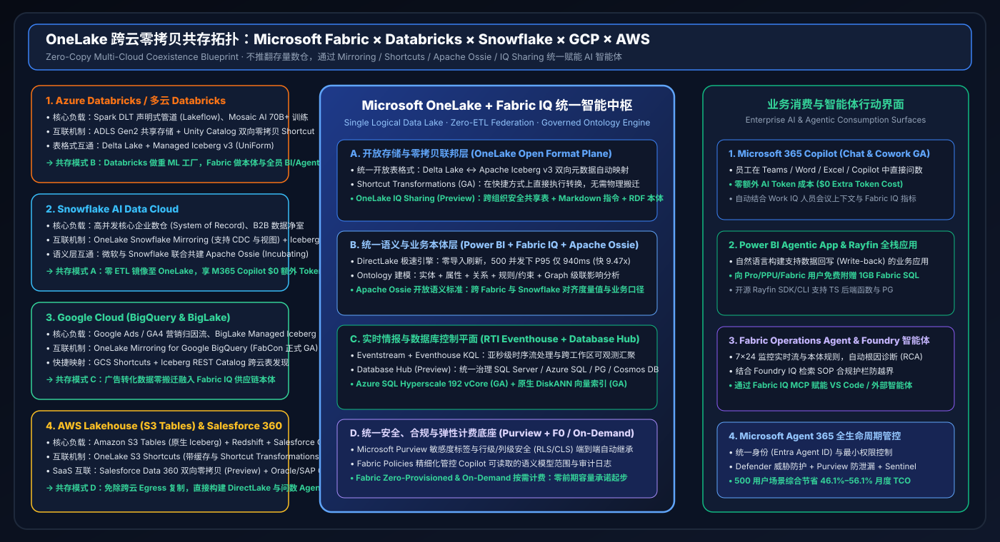

# ⚔️ Microsoft Fabric vs. 4-Cloud Competitors (Databricks / Snowflake / GCP / AWS) Deep-Dive Battlecards (2026)

> **Language**: [中文 (`fabric-vs-4clouds-battlecards-2026.md`)](fabric-vs-4clouds-battlecards-2026.md) | **English (Current)**  
> **Data Source**: `workshops/data-lab/reports/report.json` (Sealed `2026-11-04 / 11-05` · 40 Scenarios `97.50%`) · **Target Persona**: Principal AI Solution Architect

---

## 1. 5-Cloud Architectural & Capability Matrix

| Architectural Layer | Microsoft Fabric (93.3) | Databricks (86.8) | Snowflake (85.0) | GCP BigQuery (85.5) | AWS Lakehouse (82.8) |
| :--- | :--- | :--- | :--- | :--- | :--- |
| **Unified Storage & Open Formats** | **OneLake** (Delta ↔ Iceberg v3 auto-mapping + GA Shortcut Transformations) | ADLS / S3 + **Delta / UniForm + Managed Iceberg v3 GA** | Managed Storage + **Polaris Catalog (Iceberg v3 R/W)** | BigQuery Storage + **BigLake Managed Iceberg REST Catalog** | **Amazon S3 Tables (native Iceberg)** + S3 Vectors |
| **Cross-Cloud Zero-ETL Federation** | **OneLake Mirroring** (Snowflake/BigQuery/Oracle/SAP GA, Salesforce Preview) + S3/GCS Shortcuts | Lakehouse Federation + Delta Sharing | Snowflake Openflow + Polaris + Data Sharing | BigQuery Omni (AWS/Azure) + Dataplex | Glue Zero-ETL + Lake Formation cross-account sharing |
| **Data Engineering & Real-Time Streaming** | **Data Factory (Osmos Agent)** + **RTI Eventstream / Eventhouse KQL (`142ms`)** | **Lakeflow Declarative Pipelines GA** + Spark Streaming + Photon | Snowpipe Streaming + **Snowflake Datastream** + Dynamic Tables | Pub/Sub + Dataflow (Apache Beam) | **Glue 6.0 (30% price cut + Spark 4.1)** + Kinesis to S3 Tables |
| **Semantic & Business Ontology Layer** | **Fabric IQ Ontology** (`Entity+Property+Relationship+Rule`) + **20M+ Power BI Models** + **Apache Ossie** | Unity Catalog Metric Views + AI/BI Genie spaces | Cortex Analyst YAML files + **Apache Ossie (co-founded)** | **Looker LookML** + Dataplex Knowledge Catalog | QuickSight Q named topics (no unified ontology graph) |
| **Agentic & Operational Apps** | **M365 Copilot Chat/Cowork GA ($0 Token)** + **Operations Agent** + **Power BI Agentic App (1GB free SQL)** + **Rayfin** | Mosaic AI Agent Bricks + **AI/BI Genie App Builder** + Lakebase | **Cortex Code (CoCo)** + **Snowflake Intelligence (CoWork)** + Streamlit | **BigQuery Conversational Analytics GA** + Vertex AI Agent Builder | QuickSight Q + **Amazon Bedrock Agents & Knowledge Bases** |
| **Governance & Agent Control Plane** | **Purview sensitivity labels into Office/Teams** + **Agent 365** + workspace Eventhouse | **Unity Catalog + Unity Gateway (Agent auditing)** | Snowflake Horizon + RBAC | Dataplex Universal Catalog + Cloud IAM | Lake Formation TBAC + SageMaker Unified Studio |
| **500-User Monthly TCO (`100TB + 25K EPS`)** | **Unified F-SKU + On-Demand ($14,048/mo)** | DBU + Infra + BI + Tokens ($26,562/mo) | Multi-Cluster Credits + BI + Cortex ($31,990/mo) | Slots/Scan + Looker + Vertex ($26,813/mo) | 6 stitched AWS services ($26,063/mo) |

---

## 2. Head-to-Head Presales Battlecards

### 2.1 Microsoft Fabric vs. Databricks (Lakehouse + Mosaic AI)
- **2026 Competitor Moves**: Unity Gateway for agent/tool governance, Managed Iceberg v3 GA, Lakeflow Declarative Pipelines GA, and AI/BI Genie App Builder.
- **Why Microsoft Fabric Wins**:
  1. **Operational Ontology Graph vs. SQL Assistant (`+13.0 pts` on Semantic Grounding)**: While Genie translates natural language into SQL, **Fabric IQ** upgrades 20M+ existing Power BI semantic models into an entity-relationship-rule Ontology with **Operations Agents** that execute root-cause analysis and closed-loop actions in `780 ms`.
  2. **47.1% Lower Monthly TCO (`$14,048 vs $26,562`)**: F64+ includes `$0` Power BI viewer licensing and `$0` additional M365 Copilot token charges.
  3. **Sub-Second Eventhouse KQL + Osmos Agent**: Faster high-cardinality telemetry slicing than Spark Streaming, paired with Osmos autonomous legacy pipeline migration.
- **Where Databricks Leads**: Distributed training of 70B+ foundation models and low-level Spark/Photon tuning (`97.0 vs 82.0`).
- **Coexistence Pattern (Mode B — Better Together)**: Keep Azure Databricks for heavy Spark DLT & Mosaic AI training; link via bidirectional Zero-Copy OneLake Shortcuts to Unity Catalog/ADLS, and run DirectLake BI, Eventhouse KQL, and Fabric IQ Ontology on Fabric.

### 2.2 Microsoft Fabric vs. Snowflake (AI Data Cloud + Cortex)
- **2026 Competitor Moves**: Cortex Code (CoCo), Snowflake Intelligence (CoWork), Polaris Iceberg v3 read/write, Snowflake Datastream, and co-founding **Apache Ossie** with Microsoft.
- **Why Microsoft Fabric Wins**:
  1. **56.1% Lower Monthly TCO (`$14,048 vs $31,990`)**: Eliminates multi-cluster warehouse credit spikes during concurrent BI and AI query bursts via **DirectLake** (`9.47x` faster at 500 concurrent users) and `$0` extra M365 Copilot token cost.
  2. **Apache Ossie + OneLake Snowflake Mirroring**: Seamlessly mirror Snowflake tables/views and reuse semantic definitions without rewriting core financial ETL.
  3. **1GB Free Fabric SQL Write-back Apps + Native RTI KQL**: Build write-back apps inside Power BI without paying continuous Snowflake compute credits.
- **Where Snowflake Leads**: Pure-SQL warehouse autonomy and external B2B Data Clean Rooms.
- **Coexistence Pattern (Mode A)**: Retain Snowflake as the core financial DW; enable OneLake Snowflake Mirroring + Apache Ossie to power M365 Copilot and Operations Agents in Fabric.

### 2.3 Microsoft Fabric vs. Google Cloud (BigQuery + Looker + Vertex AI)
- **2026 Competitor Moves**: BigQuery Conversational Analytics GA, BigLake Managed Iceberg REST Catalog, and Dataplex Knowledge Catalog.
- **Why Microsoft Fabric Wins**:
  1. **OneLake Mirroring for Google BigQuery is GA**: Replicate Google Ads / GA4 tables into OneLake with zero Dataflow pipelines.
  2. **Ontology Graph Cascade & Active Operations Agents**: Bridges marketing demand in BigQuery with ERP inventory and supply chain actions in Fabric IQ.
  3. **47.6% Lower Monthly TCO**: Predictable capacity pricing without per-TB scan surprises or expensive Looker seat licenses.

### 2.4 Microsoft Fabric vs. AWS (SageMaker Lakehouse + S3 Tables + Redshift)
- **2026 Competitor Moves**: Amazon S3 Tables (native Iceberg) + S3 Vectors, AWS Glue 6.0 (30% price cut + Spark 4.1), and Kinesis direct streaming to S3 Tables.
- **Why Microsoft Fabric Wins**:
  1. **Single SaaS Experience vs. 6 Stitched AWS Services**: Replaces the operational friction of integrating S3 Tables, Glue, Redshift, Kinesis, QuickSight, and Bedrock.
  2. **Cached OneLake S3 Shortcuts + GA Shortcut Transformations**: Query AWS S3 data in-place via DirectLake without cross-cloud egress duplication.
  3. **End-to-End Purview Security Inheritance (`+17.0 pts` on Semantic Grounding)**: Sensitivity labels flow automatically into Power BI, Excel, Word, and Teams.

---

## 3. 2026-11-02 Deep-Dive: LTAP Operational Write-back & Cross-Cloud Security Matrix (`DL-25..DL-28`)

| Dimension | Microsoft Fabric (Translytical Loop) | Databricks (`Lakebase` GA) | Snowflake (`Cortex AISQL` + `Hybrid Tables`) | GCP (`BigQuery Fluid` + `AlloyDB`) | AWS (`S3 Tables` + `Aurora Zero-ETL`) |
| :--- | :--- | :--- | :--- | :--- | :--- |
| **Operational Write-back DB** | **1GB Free Fabric SQL in Power BI Agentic Apps** + Azure SQL Hyperscale 192 vCore (DiskANN GA) | **Azure Databricks Lakebase (GA)**: Serverless Postgres with Git-style branching | Snowflake Hybrid Tables (Unistore) + Streamlit container apps | Requires external Spanner / AlloyDB federation & custom write-back code | Aurora → Redshift Zero-ETL is one-way read-only replication |
| **Business Planning & Budgeting** | **Fabric IQ Planning (Preview)**: Unifies historicals, live streams & bidirectional budget write-back in the semantic layer | No native business planning semantic module; requires custom Databricks Apps | Relies on partner tools or custom Streamlit forms | Relies on Looker Action Hub webhooks | Read-only QuickSight dashboards without native planning write-back |
| **Cross-Engine Fine-Grained Security** | **OneLake Fine-Grained Security (GA)**: Row/column/table/folder permissions enforced across Spark, SQL, Power BI, Excel & **Unity Catalog native read (Preview)** | Unity Catalog ABAC/RBAC (with Public Preview native read from OneLake) | Horizon Catalog RBAC + Iceberg v3 Tri-Secret Secure | Dataplex + BigLake row/column access policies | Lake Formation Governed Tables (Iceberg/Hudi/Delta) |
| **Architect Selection Rule** | **Best for enterprise-wide business approvals, budget write-back & `$0`-extra-token M365 Copilot** | **Best for code-first Python agent state branching (coexists with OneLake)** | **Bridge AISQL multimodal features & Verified Queries into Fabric via Apache Ossie** | **Replicate GA4 demand spikes via GA BigQuery Mirroring into Fabric IQ** | **Mount S3 lakes in-place via cached OneLake S3 Shortcuts** |

---

## 4. 2026-11-03 Deep-Dive: Autonomous Data Engineering (Project Osmos), Cross-Cloud OBO Identity & Open Semantic Matrix (`DL-29..DL-32`)

| Dimension | Microsoft Fabric (`Project Osmos` + `Agent 365`) | Databricks (`Lakeflow` + `Supervisor OBO`) | Snowflake (`Openflow GA` + `Semantic Autopilot`) | GCP (`BigLake Iceberg REST`) | AWS (`S3 Tables` + `Lake Formation FGAC`) |
| :--- | :--- | :--- | :--- | :--- | :--- |
| **Autonomous Data Engineering** | **Data Engineering Agent (Project Osmos)**: Multi-day autonomous planning & schema-drift self-healing (`152ms`) across Fabric, VS Code, GitHub Copilot & Claude Code | **Lakeflow Connect (100M rows/day free) + Declarative Pipelines GA**: High-reliability pipelines, but breaking schema drift still requires manual fixes | **Snowflake Openflow (GA Oct 2026)**: Managed NiFi-based multimodal connectors without an autonomous code-repair agent | Dataflow (Beam) + BigQuery Data Transfer without cross-IDE autonomous healing | AWS Glue 6.0 (Spark 4.1) with static Schema Registry |
| **Cross-Cloud Delegated Agent Auth** | **Microsoft Agent 365 (Entra Agent ID) + Purview label inheritance + OneLake Fine-Grained Security GA** | **Agent Bricks Supervisor Agent (OBO Auth GA)** + Mirrored Unity Catalog in OneLake | Cortex Agent Lineage (GA) + Horizon RBAC | Vertex AI Agent Builder + Dataplex IAM | Bedrock Agents + IAM Role assumption |
| **Open Semantics & Borderless Catalog** | **Fabric IQ Ontology + Apache Ossie YAML bidirectional interop (`0.0%` drift)** + OneLake Table Read API | Unity Catalog Metric Views + Iceberg REST | **Semantic View Autopilot (GA)**: Extracts consensus semantic views & exports **Apache Ossie YAML** | **BigLake Iceberg REST Catalog**: Queries AWS S3 Tables directly | **Lake Formation Credential Vending**: Issues scoped row/column tokens to external engines |
| **Architect Selection Rule** | **Best for autonomous schema self-healing, real-time graph fraud holds & dual-DB write-back** | **Retain Databricks for GNN/ML features and federate via Supervisor OBO + Mirrored UC** | **Export Semantic View Autopilot consensus KPIs via Apache Ossie YAML into Fabric IQ** | **Consolidate GA4 & cross-cloud Iceberg tables via GA BigQuery Mirroring** | **Mount S3 Tables via outbound-protected cached OneLake S3 Shortcuts** |

---

## 5. 2026-11-04 Addendum: Rayfin Full-Stack Agentic Apps, Cross-Workspace Observability & Multimodal Graph Matrix (`DL-33..DL-36`)

| Dimension | Microsoft Fabric (`Rayfin SDK` + `Single Eventhouse`) | Databricks (`Apps` + `Lakeflow System Tables`) | Snowflake (`Streamlit` + `Horizon Context`) | GCP (`BigQuery ObjectRefs` + `GQL GA`) | AWS (`Bedrock GraphRAG` + `Redshift AI`) |
| :--- | :--- | :--- | :--- | :--- | :--- |
| **Full-Stack Agentic Apps** | **Open-Source Rayfin SDK/CLI (TS functions + Secret Store + Private-by-Default) + Power BI Agentic App (1GB Free Fabric SQL)** | Databricks Apps + Lakebase (separately billed Serverless Postgres) | Snowflake Native Apps / Streamlit + Hybrid Tables (consumes active compute credits) | Vertex AI Agent Builder + Cloud Run + AlloyDB (manual multi-service wiring) | Bedrock Agents + App Runner + Aurora (6-service integration) |
| **Cross-Workspace Observability** | **Workspace Monitoring → Single Eventhouse + Monitor Hub Headroom + Operations Agent RCA + On-Demand Burst (`590ms`)** | **Lakeflow Pipelines System Tables GA + Maintenance Windows** (pipeline-scoped telemetry) | Account Usage + Resource Monitors (lacks sub-second KQL RCA & SQL index auto-remediation) | Cloud Monitoring + INFORMATION_SCHEMA | CloudWatch + Redshift Serverless AI-Driven Scaling |
| **Multimodal Graph & Partner Sharing** | **Fabric IQ Ontology (20M+ PBI models + Rules + Actions) + OneLake IQ Sharing (RDF ontologies with EY/S&P/TomTom)** | Unity Catalog Metric Views + Mosaic AI Agentic Code Converter GA | **Horizon Context (Power BI/Tableau/dbt connectors)** + AI Readiness Scores | **BigQuery ObjectRefs GA + Native ISO GQL Graph** + Cross-Cloud Caching GA | **Bedrock Knowledge Bases GraphRAG & SQL Augmentation** |
| **Architect Selection Rule** | **Best for containerless full-stack write-back apps & automated FinOps RCA across 18+ workspaces** | **Use Agentic Code Converter for Spark migration; build business write-back apps on Fabric Rayfin** | **Bridge Horizon Context & Apache Ossie YAML into Fabric IQ for `$0`-token Copilot** | **Mirror BigQuery tables to OneLake to bind active Rules & Operations Agents** | **Replace 6-service DIY GraphRAG stitching with governed Fabric IQ + Foundry IQ (+36% relevance)** |

---

## 6. 2026-11-04 / 11-05 Nightly Addendum: Database Hub, Azure SQL Hyperscale 192-vCore DiskANN & 5-Cloud Operational Vector Matrix (`DL-37..DL-40`)

| Dimension | Microsoft Fabric (`Database Hub` + `Hyperscale DiskANN`) | Databricks (`Lakebase Search GA`) | Snowflake (`Unistore Hybrid Tables` + `Cortex Search`) | GCP (`AlloyDB ScaNN` + `Spanner Graph`) | AWS (`Aurora Zero-ETL` + `OpenSearch Vector`) |
| :--- | :--- | :--- | :--- | :--- | :--- |
| **Estate-Wide DB Posture & Tuning** | **Fabric Database Hub (Preview) + Database Agents**: Centralizes posture across 64+ SQL Server, Azure SQL, PostgreSQL, Cosmos DB & mirrored Oracle/BigQuery DBs with auto lock/index remediation (`149ms`) | Lakebase Serverless Postgres covers managed Postgres instances only; no cross-engine SQL Server/Oracle/Cosmos DB hub | Snowsight monitors internal Snowflake objects only; no heterogeneous OLTP lock remediation | Cloud SQL / AlloyDB System Insights scoped to GCP databases | RDS Performance Insights + DevOps Guru (per-instance siloed alerts) |
| **Operational + Vector Engine** | **Azure SQL Hyperscale 192 vCore + Native SSD DiskANN GA + Fabric SQL**: **10× (90%) lower RAM** than HNSW, **`19ms` P99 at `98.4%` recall**, single T-SQL statement joining ACID rows, RLS & `VECTOR_SEARCH()` | **Lakebase Search GA (`lakebase_vector` + `lakebase_text`)**: 97% recall at 71ms P99 on 100M vectors + Synced Tables, but no 1GB free embedded BI SQL | **Unistore Hybrid Tables + Cortex Search Multi-Index RAG**: Row + columnar joins, but requires dedicated compute credits | **AlloyDB ScaNN + Columnar Vector Acceleration** (4× faster queries, 3–4× lower RAM vs HNSW) + **Spanner Graph ISO GQL** | **Aurora + S3 Tables + OpenSearch Serverless Zero-ETL**: Spans 3 services & billing meters with sync lag and ACL drift risk |
| **Architect Selection Rule** | **Best for heterogeneous DB governance, low-RAM 100M+ vector ACID/RLS joins & 1GB free SQL write-back** | **Use Lakebase Search for Python agent state; drive enterprise BI & write-back on Fabric** | **Keep Snowflake core ledgers; mirror to OneLake + Hyperscale 50-DB pools instead of costly Unistore** | **Mirror BigQuery & Oracle to OneLake + Hyperscale DiskANN for closed-loop clinical/supply actions** | **Replace 3-service Aurora+OpenSearch+S3 Tables stitching with unified Hyperscale DiskANN + Fabric SQL** |

