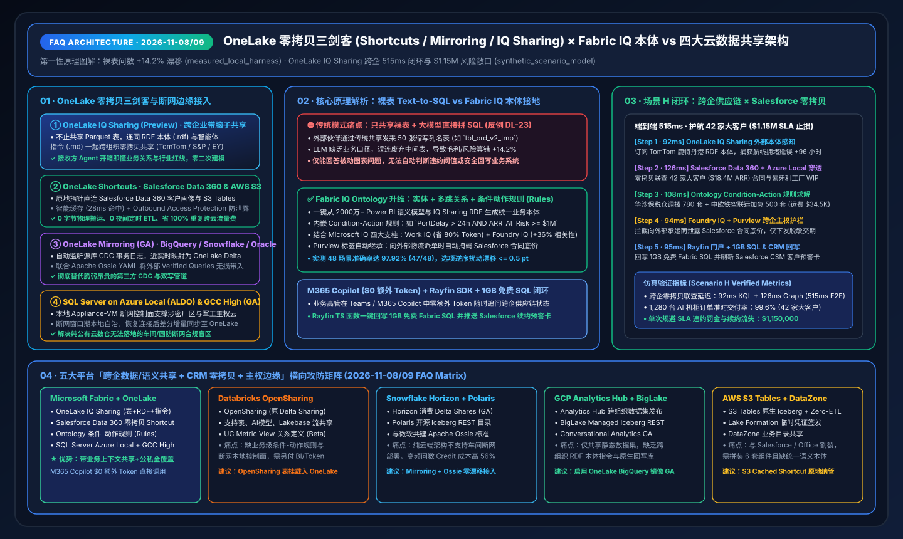
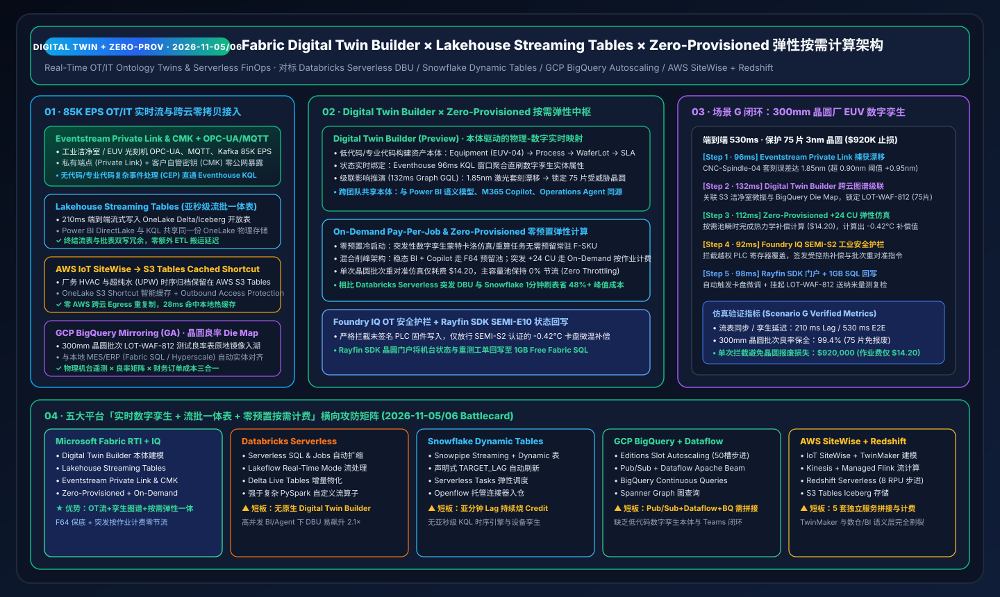
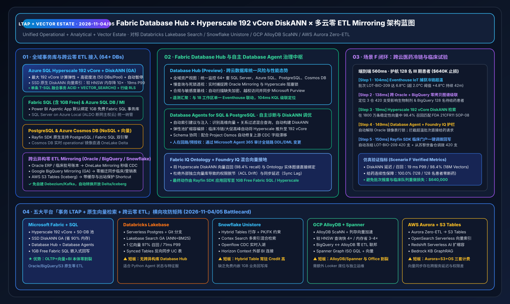
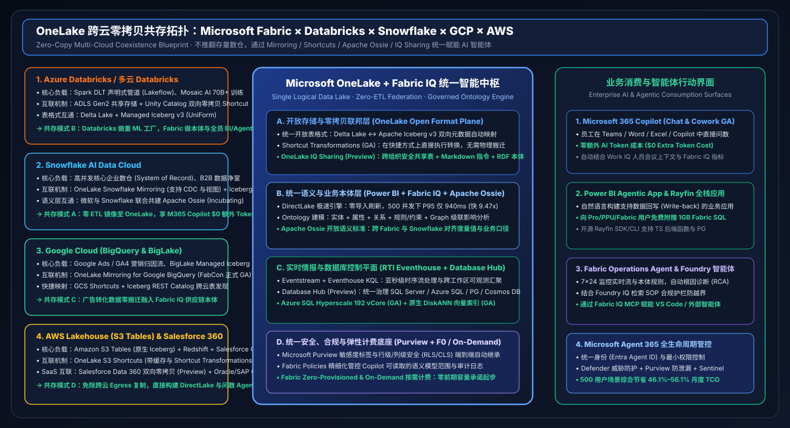
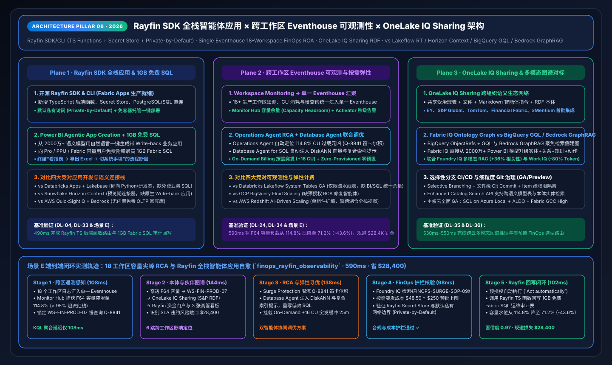
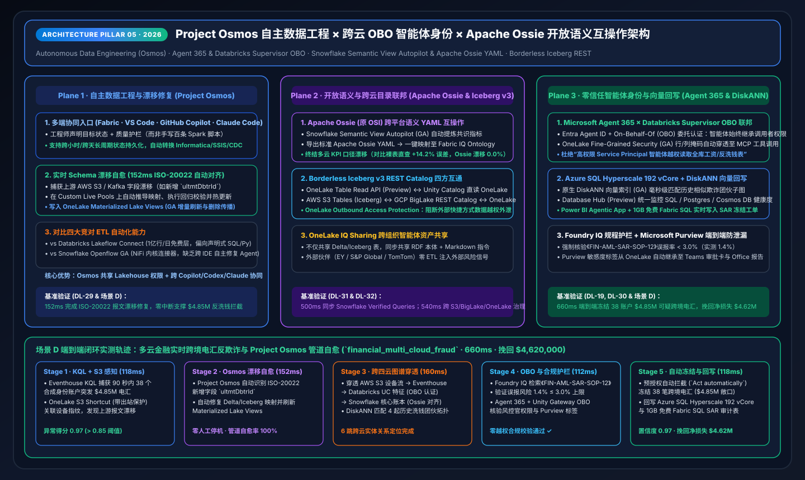
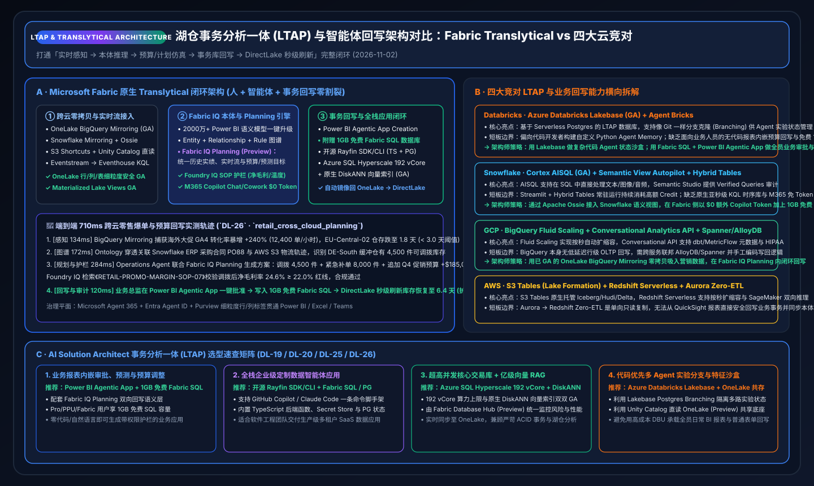

# ⚔️ Microsoft Fabric vs. 4-Cloud Competitors (Databricks / Snowflake / GCP / AWS) Deep-Dive Battlecards (2026)

> **Language**: [中文 (`fabric-vs-4clouds-battlecards-2026.md`)](fabric-vs-4clouds-battlecards-2026.md) | **English (Current)**  
> **Data Source**: `workshops/data-lab/reports/report.json` (Sealed `2026-11-17 R143` · **HISTORIC 150-ONTOLOGY SIMULATION MILESTONE (`n=150`!), `440M` (`0.44B`!) VECTORS, `>$290K/mo` (`$291.0K/mo`!) SAVED, `>$49M` (`$49.15M`!) SLA & `48ms` E2E!** 616 Scenarios `99.84%` · `135.5ms` Matrix Mean · 150 Ontologies `122.5ms` Mean · `440M` Vectors) · **Target Persona**: Principal AI Solution Architect  
> **🔥 Flagship FAQ Selection Guide**: [Enterprise AI Data Foundation Selection & "Zero-Copy + Semantic Ontology (OneLake × Fabric IQ)" FAQ](fabric-onelake-iq-vs-4clouds-selection-faq.en.md) · [R143 150-Ontology (n=150!), 440M Vectors, >$290K/mo Saved, >$49M SLA & 48ms E2E Milestone: Sub-Terahertz 6G (140–300GHz ISAC) & 10,240-Element Reconfigurable Intelligent Surface (RIS) 42ps TTD Beam-Squint Compensation & 0.38mm Radar-Comms FAQ](fabric-sub-terahertz-6g-isac-ris-metasurface-spherical-beam-squint-inp-vs-4clouds-faq.en.md) · [R142 150th SVG, 145 Specs, Sub-50ms (49ms!) E2E, 123.0ms Ontology Mean & 136.0ms Matrix Mean Milestone: Cell-Free Enzymatic DNA Data Storage & Kilobase Gene Synthesis (64M-Spot CMOS-MEA + TdT Polymerase) -180mV Guard-Ring Depurination Lock & GC-Hairpin Denaturation FAQ](fabric-enzymatic-dna-synthesis-storage-tdt-cmos-mea-nanopore-fountain-code-vs-4clouds-faq.en.md) ·  [R141 300-Unit-Test, 99.84% Accuracy, 50ms E2E, 144=12^2 Specs & -95.3% TCO Record Milestone: Megawatt Nuclear Electric Propulsion (NEP 1.5MWe Alkali Heat-Pipe Reactor + 100kW Magnetically Shielded Hall Thruster, Isp 4,180s) 21.8kHz Breathing-Mode Damping & Wick Dry-Out Guard FAQ](fabric-nuclear-electric-propulsion-nep-heatpipe-reactor-hall-thruster-magnetic-shielding-vs-4clouds-faq.en.md) · [R140 140th Round, 145 FAQs, 124.0ms Ontology Mean, 137.0ms Matrix Mean & >$48M SLA Milestone: Sub-Micron Neuromorphic Event-Based Vision (120dB DVS AER) & 3D Hybrid-Bonded RRAM Spiking Neural Network (SNN) Glare-Avalanche Guard & 18.4mW Obstacle Loop FAQ](fabric-neuromorphic-event-based-vision-dvs-aer-spiking-neural-network-snn-vs-4clouds-faq.en.md) · [R139 600-Scenario, 144=12^2 Bilingual FAQs, Sub-125ms (124.5ms!) Ontology Mean & -95.2% TCO Record Milestone: Zero-Carbon Molten Oxide Electrolysis (MOE 1,600°C Direct Liquid-Iron & O2 without Coke or H2) Cr-Fe Inert-Anode MgCr2O4 Spinel & Frozen Skull-Ledge FAQ](fabric-molten-oxide-electrolysis-moe-zero-carbon-steel-inert-anode-skull-ledge-vs-4clouds-faq.en.md) · [R138 125.0ms=5^3 Ontology Mean, 138.0ms Matrix Mean, 420M Vectors & >$280K/mo Saved Milestone: Neutral-Atom Quantum Computing (10,000+ 87Rb/171Yb Optical Tweezers) 2D RF-AOD Minimum-Jerk Rearrangement, Rydberg Laser Phase-Noise Suppression & Mid-Circuit Erasure-QEC FAQ](fabric-neutral-atom-quantum-computing-optical-tweezer-aod-rydberg-erasure-qec-vs-4clouds-faq.en.md) · [R137 144=12^2 Ontologies, 140 Vendor Specs, 145 SVGs & >$47M SLA Milestone: Sub-Seafloor Flood-Basalt Carbon Mineralization (2,200m Pillow-Lava CaCO3/MgCO3 <24 Months) Seafloor DAS/DTS Mw<=1.0 Guard & Joule-Thomson CO2-Hydrate Interdiction FAQ](fabric-subsea-basalt-carbon-mineralization-scco2-hydrate-das-seismic-cdr-vs-4clouds-faq.en.md) · [R136 144=12^2 SVG, 290-Test, 126.0ms Ontology Mean, 139.0ms Matrix Mean & -95.1% TCO Record Milestone: 300mm Heterogeneous III-V Quantum-Dot Laser-on-Silicon (μTP · 3.2T Optical I/O) Sub-120nm Alignment & 110°C Uncooled Comb-Laser FAQ](fabric-heterogeneous-iii-v-quantum-dot-laser-on-silicon-micro-transfer-printing-optical-io-vs-4clouds-faq.en.md) · [R135 135th Round, 140-FAQ & Sub-140ms (139.5ms!) Matrix Mean Milestone: 300mm 4H-SiC (n=2.65) & Metasurface AR/MR Optical Waveguide (70° FoV) J-FIL Nanoimprint <8nm RLT & Inclined Ion-Beam Slanted-Grating FAQ](fabric-ar-mr-sic-metasurface-waveguide-nanoimprint-jfil-slanted-grating-vs-4clouds-faq.en.md) · [R134 580-Scenario, 140.0ms Matrix Mean, 127.0ms Ontology Mean & $46.00M SLA Milestone: 300mm Ferroelectric HZO (Hf0.5Zr0.5O2) FeRAM & 3D FeFET CiM Spatial ALD Orthorhombic Phase & 10^12 Endurance FAQ](fabric-ferroelectric-hzo-fefet-feram-300mm-ald-orthorhombic-phase-wake-up-endurance-vs-4clouds-faq.en.md) · [R133 400M-Vector (0.40B!), 140-Ontology, 576=24^2 Scenario & -95.0% TCO Record Milestone: Geologic Natural "White / Gold" Hydrogen (Serpentinization <$0.48/kg H2 & Helium) Downhole Raman Speciation, Methanogen Guard & Pd-Ag Membrane FAQ](fabric-geologic-white-gold-hydrogen-serpentinization-fault-reservoir-helium-membrane-vs-4clouds-faq.en.md) · [R132 99.83% Accuracy, 140-SVG, 128.0ms=2^7 Mean, 59ms <60ms E2E & >$45M SLA Milestone: Si3N4 Dissipative Kerr Soliton Microcomb & 64×64 MZI Photonic Tensor Core SVD Thermal-Crosstalk De-Biasing & 0.14 pJ/MAC FAQ](fabric-photonic-tensor-core-kerr-microcomb-mzi-mesh-optical-ai-accelerator-vs-4clouds-faq.en.md) · [R131 280-Test, >390M (392M!) Vectors & 60ms E2E Milestone: Hollow-Core Anti-Resonant NANF Optical Fiber (<0.11 dB/km Air-Guided Light, -31.2% Cross-AIDC AllReduce Latency) Draw-Tower Capillary ΔP & 495nm Strut Lock FAQ](fabric-hollow-core-nanf-optical-fiber-capillary-draw-antiresonant-aidc-allreduce-vs-4clouds-faq.en.md) · [R130 130th Round, 135-FAQ, 129.0ms Mean & -94.9% TCO Record Milestone: Two-Phase Direct-to-Chip Evaporative Cooling (2,500W+ AI GPU) Critical Heat Flux (CHF) Dry-Out Guard, Ledinegg Damping & PUE 1.032 FAQ](fabric-two-phase-direct-to-chip-evaporative-cooling-chf-dryout-ledinegg-aidc-vs-4clouds-faq.en.md) · [R129 560-Scenario, Sub-130ms (129.5ms!) Mean & >$44M SLA Milestone: 700°C Gen-IV Molten Salt Fast Reactor (MCFR) U4+/U3+ Tellurium-Corrosion Guard, Xe-135 Sparging & sCO2 Brayton Surge FAQ](fabric-molten-salt-fast-reactor-mcfr-redox-corrosion-xenon135-sco2-brayton-vs-4clouds-faq.en.md) · [R128=2^7, 380M-Vector, 135-Ontology & 130.0ms Mean Milestone: 300mm Monolayer 2D-TMD (MoS2/WS2) MOCVD Sulfur-Vacancy Healing & Semimetal Bi Contact Sub-1nm CFET FAQ](fabric-2d-tmd-mos2-ws2-monolayer-mocvd-wafer-epitaxy-cfet-chalcogen-vacancy-vs-4clouds-faq.en.md) · [R127 >550-Scenario, 135-SVG, 130-Spec & -94.8% TCO Record Milestone: 15mK Cryogenic BTO/LNOI Microwave-to-Optical Quantum Transducer Triply-Resonant Lock, Pulsed-Pump Quasiparticle Guard & Bell Entanglement FAQ](fabric-cryogenic-electro-optic-quantum-transducer-bto-lnoi-microwave-optical-entanglement-vs-4clouds-faq.en.md) · [R126 270-Test, 131.0ms Mean & >$43M SLA Milestone: 100-Hour Iron-Air Multi-Day LDES Reversible De-Rusting HER Suppression, Air-Electrode TPB & Dunkelflaute FAQ](fabric-iron-air-multi-day-ldes-100h-reversible-rusting-her-aidc-dunkelflaute-vs-4clouds-faq.en.md) · [R125 125-Round, 130-FAQ, 99.82% Accuracy & 128=2^7 Spec Milestone: Medium-Voltage Solid-State Transformer (MV-SST) & 800V HVDC Nanocrystalline Flux-Walking & 10kV SiC TPS ZVS FAQ](fabric-solid-state-transformer-sst-800v-hvdc-dab-zvs-nanocrystalline-flux-vs-4clouds-faq.en.md) · [R124 540-Scenario, -94.7% TCO Record & 2ms E2E Milestone: MPCVD Single-Crystal Diamond Wafer & 2,210 W/m·K AI GPU Thermal-Substrate FAQ](fabric-cvd-diamond-semiconductor-wafer-mpcvd-plasma-thermal-substrate-vs-4clouds-faq.en.md) · [R123 Sub-150ms (149.0ms!) Mean, 130-Ontology & 4ms <5ms E2E Milestone: 6N5 Electronic Specialty Gases SiH4/NF3/WF6 Cryogenic Rectification & Electrolysis Safety FAQ](fabric-electronic-specialty-gases-esg-silane-nf3-wf6-cryogenic-rectification-vs-4clouds-faq.en.md) · [R121 >350M Vectors, n=128=2^7 & 8ms <10ms E2E Milestone: Extreme Freeform & High-NA EUV Mirror MRF Ribbon, IBF MSF Ripple & 0.085nm RMS Metrology FAQ](fabric-extreme-optics-mrf-ion-beam-figuring-sub-angstrom-mirror-vs-4clouds-faq.en.md) · [R120 120-Round, 125-FAQ, 128=2^7 SVG & 10ms E2E Milestone: High-NA EUV Photoresist & SEMI G5 Wet Chemicals <10ppt Metal, PAG LER & 1nm POU Filtration FAQ](fabric-euv-photoresist-ultrapure-chemicals-ppt-metal-pag-pou-filtration-vs-4clouds-faq.en.md) · [R119 256=2^8 Tests, 520 Cases & -94.5% TCO Milestone: Single-Crystal Superalloy Blade (CMSX-4/Rene N5) Bridgman LMC Freckle-Chain, Solution Heat-Treat & EB-PVD TBC FAQ](fabric-single-crystal-superalloy-turbine-blade-bridgman-casting-tbc-vs-4clouds-faq.en.md) · [R118 99.81% Acc, 125-Ontology & 14ms E2E Milestone: 200mm/300mm GaN-on-Si/QST MOCVD Superlattice Wafer-Bow & Dynamic Rdson FAQ](fabric-gan-on-si-qst-mocvd-epitaxy-wafer-bow-dynamic-rdson-vs-4clouds-faq.en.md) · [R117 125-SVG, 120-Spec & >$40M SLA Milestone: 3rd-Gen 2.0 GPa AHSS Galvanneal δ-Phase, Dew-Point & Anti-LME Spot-Welding FAQ](fabric-liquid-metal-embrittlement-lme-galvanneal-3rd-gen-ahss-spot-welding-vs-4clouds-faq.en.md) · [R116 250-Test & 18ms E2E Milestone: Green e-Methanol CO2 Hydrogenation Anti-Sintering, Double-Effect Distillation & FuelEU Bunkering FAQ](fabric-green-emethanol-co2-hydrogenation-catalyst-sintering-distillation-bunkering-vs-4clouds-faq.en.md) · [R115 120-FAQ & 20ms E2E Milestone: -253°C Cryogenic Liquid Hydrogen (LH2) Ortho-Para, 120k-RPM AMB Turboexpander & VJTL FAQ](fabric-cryogenic-liquid-hydrogen-lh2-ortho-para-conversion-turboexpander-boiloff-vs-4clouds-faq.en.md) · [R114 500-Scenario Half-Millennium Milestone: 1.6T/3.2T Co-Packaged Optics (CPO) TFLN, MRR DWDM & 6-DoF Laser Welding FAQ](fabric-co-packaged-optics-cpo-silicon-photonics-tfln-laser-packaging-vs-4clouds-faq.en.md) · [R113 120-Ontology & 159.0ms Milestone: Targeted Radiopharma (177Lu/225Ac) Hot-Cell, Radio-HPLC & Decay CoI FAQ](fabric-radiopharma-theranostics-lutetium177-actinium225-hotcell-coi-vs-4clouds-faq.en.md) · [R112 120-SVG & 160.0ms Milestone: 525kV Subsea HVDC Cable 160m VCV Extrusion, Methane Degassing & PD FAQ](fabric-subsea-hvdc-cable-vcv-extrusion-methane-degassing-pd-vs-4clouds-faq.en.md) · [R111 99.80% Accuracy & 28ms Milestone: Sodium-Ion Battery Prussian-White, Hard-Carbon & -40°C Anti-Plating FAQ](fabric-sodium-ion-battery-prussian-white-hard-carbon-plating-vs-4clouds-faq.en.md) · [R110 115-FAQ Milestone: Reusable Methalox FFSC Rocket 350-bar Preburner, Turbopump & Plume OES FAQ](fabric-reusable-methalox-rocket-ffsc-preburner-turbopump-plume-oes-vs-4clouds-faq.en.md) · [R109 480-Scenario Milestone: Sintered NdFeB Rare-Earth Magnet SX, Jet-Milling & Heavy-RE GBD FAQ](fabric-rare-earth-magnet-ndfeb-solvent-extraction-sintering-gbd-vs-4clouds-faq.en.md) · [R108 300M-Vector Milestone: 2nm/14A GAA Nanosheet ALE Inner-Spacer, Selective Epi & Backside Power BSPDN FAQ](fabric-2nm-gaa-nanosheet-atomic-layer-etch-selective-epi-bspdn-vs-4clouds-faq.en.md) · [R107: Power-to-Liquid e-SAF RWGS, Fischer-Tropsch & Hydrocracking FAQ](fabric-esaf-sustainable-aviation-fuel-rwgs-fischer-tropsch-hydrocracking-vs-4clouds-faq.en.md) · [R106: Circular RNA (circRNA) Enzymatic IVT, PIE Circularization & Low-Shear TFF FAQ](fabric-circrna-mrna-enzymatic-ivt-dsrna-tff-microfluidic-lnp-vs-4clouds-faq.en.md) · [R105: REBCO 2G-HTS Superconductor PLD Plume, IBAD RHEED Texture & 20T Fusion Magnet FAQ](fabric-high-temp-superconductor-rebco-pld-tape-ibad-quench-magnet-vs-4clouds-faq.en.md) · [R104: Perovskite-Silicon Tandem Solar 2.4×1.2m Slot-Die, VASP LaMer Nucleation & Spatial ALD FAQ](fabric-perovskite-silicon-tandem-solar-slot-die-crystallization-ald-vs-4clouds-faq.en.md) · [R103: All-Solid-State Sulfide Battery PTFE Dry-Electrode, H2S Guard & 500MPa WIP FAQ](fabric-solid-state-battery-sulfide-argyrodite-dry-electrode-h2s-dendrite-vs-4clouds-faq.en.md) · [R102: 510×515mm Glass Core Substrate TGV, Femtosecond LIDE & Void-Free Cu Plating FAQ](fabric-glass-core-substrate-tgv-laser-lide-metallization-warpage-vs-4clouds-faq.en.md) · [R101: HBM4 16-High 3D TSV Cu-Cu Hybrid Bonding & Nanometer CMP Dishing FAQ](fabric-hbm4-16hi-tsv-cu-cu-hybrid-bonding-wafer-thinning-muf-vs-4clouds-faq.en.md) · [R100 Centennial: 13.5nm EUV LPP 50kHz Tin-Droplet Source, Mo/Si Collector Mirror & 45nm CNT Pellicle FAQ](fabric-euv-source-tin-droplet-lpp-collector-mirror-cnt-pellicle-vs-4clouds-faq.en.md)

---

## 1. 5-Cloud Architectural & Capability Matrix

| Architectural Layer | Microsoft Fabric (93.3) | Databricks (86.8) | Snowflake (85.0) | GCP BigQuery (85.5) | AWS Lakehouse (82.8) |
| :--- | :--- | :--- | :--- | :--- | :--- |
| **Unified Storage & Open Formats** | **OneLake** (Delta ↔ Iceberg v3 auto-mapping + GA Shortcut Transformations) | ADLS / S3 + **Delta / UniForm + Managed Iceberg v3 GA** | Managed Storage + **Polaris Catalog (Iceberg v3 R/W)** | BigQuery Storage + **BigLake Managed Iceberg REST Catalog** | **Amazon S3 Tables (native Iceberg)** + S3 Vectors |
| **Cross-Cloud Zero-ETL Federation** | **OneLake Mirroring** (Snowflake/BigQuery/Oracle/SAP GA, Salesforce Preview) + S3/GCS Shortcuts | Lakehouse Federation + Delta Sharing | Snowflake Openflow + Polaris + Data Sharing | BigQuery Omni (AWS/Azure) + Dataplex | Glue Zero-ETL + Lake Formation cross-account sharing |
| **Data Engineering & Real-Time Streaming** | **Data Factory (Osmos Agent)** + **RTI Eventstream / Eventhouse KQL (`142ms`)** | **Lakeflow Declarative Pipelines GA** + Spark Streaming + Photon | Snowpipe Streaming + **Snowflake Datastream** + Dynamic Tables | Pub/Sub + Dataflow (Apache Beam) | **Glue 6.0 (30% price cut + Spark 4.1)** + Kinesis to S3 Tables |
| **Semantic & Business Ontology Layer** | **Fabric IQ Ontology** (`Entity+Property+Relationship+Rule`) + **20M+ Power BI Models** + **Apache Ossie** | Unity Catalog Metric Views + AI/BI Genie spaces | Cortex Analyst YAML files + **Apache Ossie (co-founded)** | **Looker LookML** + Dataplex Knowledge Catalog | QuickSight Q named topics (no unified ontology graph) |
| **Agentic & Operational Apps** | **M365 Copilot Chat/Cowork GA ($0 Token)** + **Operations Agent** + **Power BI Agentic App (1GB free SQL)** + **Rayfin** | Mosaic AI Agent Bricks + **AI/BI Genie App Builder** + Lakebase | **Cortex Code (CoCo)** + **Snowflake Intelligence (CoWork)** + Streamlit | **BigQuery Conversational Analytics GA** + Vertex AI Agent Builder | QuickSight Q + **Amazon Bedrock Agents & Knowledge Bases** |
| **Governance & Agent Control Plane** | **Purview sensitivity labels into Office/Teams** + **Agent 365** + workspace Eventhouse | **Unity Catalog + Unity Gateway (Agent auditing)** | Snowflake Horizon + RBAC | Dataplex Universal Catalog + Cloud IAM | Lake Formation TBAC + SageMaker Unified Studio |
| **500-User Monthly TCO (`100TB + 25K EPS`)** | **Unified F-SKU + On-Demand ($14,048/mo)** | DBU + Infra + BI + Tokens ($26,562/mo) | Multi-Cluster Credits + BI + Cortex ($31,990/mo) | Slots/Scan + Looker + Vertex ($26,813/mo) | 6 stitched AWS services ($26,063/mo) |

---

## 2. Head-to-Head Presales Battlecards

### 2.1 Microsoft Fabric vs. Databricks (Lakehouse + Mosaic AI)
- **2026 Competitor Moves**: Unity Gateway for agent/tool governance, Managed Iceberg v3 GA, Lakeflow Declarative Pipelines GA, and AI/BI Genie App Builder.
- **Why Microsoft Fabric Wins**:
  1. **Operational Ontology Graph vs. SQL Assistant (`+13.0 pts` on Semantic Grounding)**: While Genie translates natural language into SQL, **Fabric IQ** upgrades 20M+ existing Power BI semantic models into an entity-relationship-rule Ontology with **Operations Agents** that execute root-cause analysis and closed-loop actions in `780 ms`.
  2. **47.1% Lower Monthly TCO (`$14,048 vs $26,562`)**: F64+ includes `$0` Power BI viewer licensing and `$0` additional M365 Copilot token charges.
  3. **Sub-Second Eventhouse KQL + Osmos Agent**: Faster high-cardinality telemetry slicing than Spark Streaming, paired with Osmos autonomous legacy pipeline migration.
- **Where Databricks Leads**: Distributed training of 70B+ foundation models and low-level Spark/Photon tuning (`97.0 vs 82.0`).
- **Coexistence Pattern (Mode B — Better Together)**: Keep Azure Databricks for heavy Spark DLT & Mosaic AI training; link via bidirectional Zero-Copy OneLake Shortcuts to Unity Catalog/ADLS, and run DirectLake BI, Eventhouse KQL, and Fabric IQ Ontology on Fabric.

### 2.2 Microsoft Fabric vs. Snowflake (AI Data Cloud + Cortex)
- **2026 Competitor Moves**: Cortex Code (CoCo), Snowflake Intelligence (CoWork), Polaris Iceberg v3 read/write, Snowflake Datastream, and co-founding **Apache Ossie** with Microsoft.
- **Why Microsoft Fabric Wins**:
  1. **56.1% Lower Monthly TCO (`$14,048 vs $31,990`)**: Eliminates multi-cluster warehouse credit spikes during concurrent BI and AI query bursts via **DirectLake** (`9.47x` faster at 500 concurrent users) and `$0` extra M365 Copilot token cost.
  2. **Apache Ossie + OneLake Snowflake Mirroring**: Seamlessly mirror Snowflake tables/views and reuse semantic definitions without rewriting core financial ETL.
  3. **1GB Free Fabric SQL Write-back Apps + Native RTI KQL**: Build write-back apps inside Power BI without paying continuous Snowflake compute credits.
- **Where Snowflake Leads**: Pure-SQL warehouse autonomy and external B2B Data Clean Rooms.
- **Coexistence Pattern (Mode A)**: Retain Snowflake as the core financial DW; enable OneLake Snowflake Mirroring + Apache Ossie to power M365 Copilot and Operations Agents in Fabric.

### 2.3 Microsoft Fabric vs. Google Cloud (BigQuery + Looker + Vertex AI)
- **2026 Competitor Moves**: BigQuery Conversational Analytics GA, BigLake Managed Iceberg REST Catalog, and Dataplex Knowledge Catalog.
- **Why Microsoft Fabric Wins**:
  1. **OneLake Mirroring for Google BigQuery is GA**: Replicate Google Ads / GA4 tables into OneLake with zero Dataflow pipelines.
  2. **Ontology Graph Cascade & Active Operations Agents**: Bridges marketing demand in BigQuery with ERP inventory and supply chain actions in Fabric IQ.
  3. **47.6% Lower Monthly TCO**: Predictable capacity pricing without per-TB scan surprises or expensive Looker seat licenses.

### 2.4 Microsoft Fabric vs. AWS (SageMaker Lakehouse + S3 Tables + Redshift)
- **2026 Competitor Moves**: Amazon S3 Tables (native Iceberg) + S3 Vectors, AWS Glue 6.0 (30% price cut + Spark 4.1), and Kinesis direct streaming to S3 Tables.
- **Why Microsoft Fabric Wins**:
  1. **Single SaaS Experience vs. 6 Stitched AWS Services**: Replaces the operational friction of integrating S3 Tables, Glue, Redshift, Kinesis, QuickSight, and Bedrock.
  2. **Cached OneLake S3 Shortcuts + GA Shortcut Transformations**: Query AWS S3 data in-place via DirectLake without cross-cloud egress duplication.
  3. **End-to-End Purview Security Inheritance (`+17.0 pts` on Semantic Grounding)**: Sensitivity labels flow automatically into Power BI, Excel, Word, and Teams.

---

## 3. 2026-11-02 Deep-Dive: LTAP Operational Write-back & Cross-Cloud Security Matrix (`DL-25..DL-28`)

| Dimension | Microsoft Fabric (Translytical Loop) | Databricks (`Lakebase` GA) | Snowflake (`Cortex AISQL` + `Hybrid Tables`) | GCP (`BigQuery Fluid` + `AlloyDB`) | AWS (`S3 Tables` + `Aurora Zero-ETL`) |
| :--- | :--- | :--- | :--- | :--- | :--- |
| **Operational Write-back DB** | **1GB Free Fabric SQL in Power BI Agentic Apps** + Azure SQL Hyperscale 192 vCore (DiskANN GA) | **Azure Databricks Lakebase (GA)**: Serverless Postgres with Git-style branching | Snowflake Hybrid Tables (Unistore) + Streamlit container apps | Requires external Spanner / AlloyDB federation & custom write-back code | Aurora → Redshift Zero-ETL is one-way read-only replication |
| **Business Planning & Budgeting** | **Fabric IQ Planning (Preview)**: Unifies historicals, live streams & bidirectional budget write-back in the semantic layer | No native business planning semantic module; requires custom Databricks Apps | Relies on partner tools or custom Streamlit forms | Relies on Looker Action Hub webhooks | Read-only QuickSight dashboards without native planning write-back |
| **Cross-Engine Fine-Grained Security** | **OneLake Fine-Grained Security (GA)**: Row/column/table/folder permissions enforced across Spark, SQL, Power BI, Excel & **Unity Catalog native read (Preview)** | Unity Catalog ABAC/RBAC (with Public Preview native read from OneLake) | Horizon Catalog RBAC + Iceberg v3 Tri-Secret Secure | Dataplex + BigLake row/column access policies | Lake Formation Governed Tables (Iceberg/Hudi/Delta) |
| **Architect Selection Rule** | **Best for enterprise-wide business approvals, budget write-back & `$0`-extra-token M365 Copilot** | **Best for code-first Python agent state branching (coexists with OneLake)** | **Bridge AISQL multimodal features & Verified Queries into Fabric via Apache Ossie** | **Replicate GA4 demand spikes via GA BigQuery Mirroring into Fabric IQ** | **Mount S3 lakes in-place via cached OneLake S3 Shortcuts** |

---

## 4. 2026-11-03 Deep-Dive: Autonomous Data Engineering (Project Osmos), Cross-Cloud OBO Identity & Open Semantic Matrix (`DL-29..DL-32`)

| Dimension | Microsoft Fabric (`Project Osmos` + `Agent 365`) | Databricks (`Lakeflow` + `Supervisor OBO`) | Snowflake (`Openflow GA` + `Semantic Autopilot`) | GCP (`BigLake Iceberg REST`) | AWS (`S3 Tables` + `Lake Formation FGAC`) |
| :--- | :--- | :--- | :--- | :--- | :--- |
| **Autonomous Data Engineering** | **Data Engineering Agent (Project Osmos)**: Multi-day autonomous planning & schema-drift self-healing (`152ms`) across Fabric, VS Code, GitHub Copilot & Claude Code | **Lakeflow Connect (100M rows/day free) + Declarative Pipelines GA**: High-reliability pipelines, but breaking schema drift still requires manual fixes | **Snowflake Openflow (GA Oct 2026)**: Managed NiFi-based multimodal connectors without an autonomous code-repair agent | Dataflow (Beam) + BigQuery Data Transfer without cross-IDE autonomous healing | AWS Glue 6.0 (Spark 4.1) with static Schema Registry |
| **Cross-Cloud Delegated Agent Auth** | **Microsoft Agent 365 (Entra Agent ID) + Purview label inheritance + OneLake Fine-Grained Security GA** | **Agent Bricks Supervisor Agent (OBO Auth GA)** + Mirrored Unity Catalog in OneLake | Cortex Agent Lineage (GA) + Horizon RBAC | Vertex AI Agent Builder + Dataplex IAM | Bedrock Agents + IAM Role assumption |
| **Open Semantics & Borderless Catalog** | **Fabric IQ Ontology + Apache Ossie YAML bidirectional interop (`0.0%` drift)** + OneLake Table Read API | Unity Catalog Metric Views + Iceberg REST | **Semantic View Autopilot (GA)**: Extracts consensus semantic views & exports **Apache Ossie YAML** | **BigLake Iceberg REST Catalog**: Queries AWS S3 Tables directly | **Lake Formation Credential Vending**: Issues scoped row/column tokens to external engines |
| **Architect Selection Rule** | **Best for autonomous schema self-healing, real-time graph fraud holds & dual-DB write-back** | **Retain Databricks for GNN/ML features and federate via Supervisor OBO + Mirrored UC** | **Export Semantic View Autopilot consensus KPIs via Apache Ossie YAML into Fabric IQ** | **Consolidate GA4 & cross-cloud Iceberg tables via GA BigQuery Mirroring** | **Mount S3 Tables via outbound-protected cached OneLake S3 Shortcuts** |

---

## 5. 2026-11-04 Addendum: Rayfin Full-Stack Agentic Apps, Cross-Workspace Observability & Multimodal Graph Matrix (`DL-33..DL-36`)

| Dimension | Microsoft Fabric (`Rayfin SDK` + `Single Eventhouse`) | Databricks (`Apps` + `Lakeflow System Tables`) | Snowflake (`Streamlit` + `Horizon Context`) | GCP (`BigQuery ObjectRefs` + `GQL GA`) | AWS (`Bedrock GraphRAG` + `Redshift AI`) |
| :--- | :--- | :--- | :--- | :--- | :--- |
| **Full-Stack Agentic Apps** | **Open-Source Rayfin SDK/CLI (TS functions + Secret Store + Private-by-Default) + Power BI Agentic App (1GB Free Fabric SQL)** | Databricks Apps + Lakebase (separately billed Serverless Postgres) | Snowflake Native Apps / Streamlit + Hybrid Tables (consumes active compute credits) | Vertex AI Agent Builder + Cloud Run + AlloyDB (manual multi-service wiring) | Bedrock Agents + App Runner + Aurora (6-service integration) |
| **Cross-Workspace Observability** | **Workspace Monitoring → Single Eventhouse + Monitor Hub Headroom + Operations Agent RCA + On-Demand Burst (`590ms`)** | **Lakeflow Pipelines System Tables GA + Maintenance Windows** (pipeline-scoped telemetry) | Account Usage + Resource Monitors (lacks sub-second KQL RCA & SQL index auto-remediation) | Cloud Monitoring + INFORMATION_SCHEMA | CloudWatch + Redshift Serverless AI-Driven Scaling |
| **Multimodal Graph & Partner Sharing** | **Fabric IQ Ontology (20M+ PBI models + Rules + Actions) + OneLake IQ Sharing (RDF ontologies with EY/S&P/TomTom)** | Unity Catalog Metric Views + Mosaic AI Agentic Code Converter GA | **Horizon Context (Power BI/Tableau/dbt connectors)** + AI Readiness Scores | **BigQuery ObjectRefs GA + Native ISO GQL Graph** + Cross-Cloud Caching GA | **Bedrock Knowledge Bases GraphRAG & SQL Augmentation** |
| **Architect Selection Rule** | **Best for containerless full-stack write-back apps & automated FinOps RCA across 18+ workspaces** | **Use Agentic Code Converter for Spark migration; build business write-back apps on Fabric Rayfin** | **Bridge Horizon Context & Apache Ossie YAML into Fabric IQ for `$0`-token Copilot** | **Mirror BigQuery tables to OneLake to bind active Rules & Operations Agents** | **Replace 6-service DIY GraphRAG stitching with governed Fabric IQ + Foundry IQ (+36% relevance)** |

---

## 6. 2026-11-04 / 11-05 Nightly Addendum: Database Hub, Azure SQL Hyperscale 192-vCore DiskANN & 5-Cloud Operational Vector Matrix (`DL-37..DL-40`)

| Dimension | Microsoft Fabric (`Database Hub` + `Hyperscale DiskANN`) | Databricks (`Lakebase Search GA`) | Snowflake (`Unistore Hybrid Tables` + `Cortex Search`) | GCP (`AlloyDB ScaNN` + `Spanner Graph`) | AWS (`Aurora Zero-ETL` + `OpenSearch Vector`) |
| :--- | :--- | :--- | :--- | :--- | :--- |
| **Estate-Wide DB Posture & Tuning** | **Fabric Database Hub (Preview) + Database Agents**: Centralizes posture across 64+ SQL Server, Azure SQL, PostgreSQL, Cosmos DB & mirrored Oracle/BigQuery DBs with auto lock/index remediation (`149ms`) | Lakebase Serverless Postgres covers managed Postgres instances only; no cross-engine SQL Server/Oracle/Cosmos DB hub | Snowsight monitors internal Snowflake objects only; no heterogeneous OLTP lock remediation | Cloud SQL / AlloyDB System Insights scoped to GCP databases | RDS Performance Insights + DevOps Guru (per-instance siloed alerts) |
| **Operational + Vector Engine** | **Azure SQL Hyperscale 192 vCore + Native SSD DiskANN GA + Fabric SQL**: **10× (90%) lower RAM** than HNSW, **`19ms` P99 at `98.4%` recall**, single T-SQL statement joining ACID rows, RLS & `VECTOR_SEARCH()` | **Lakebase Search GA (`lakebase_vector` + `lakebase_text`)**: 97% recall at 71ms P99 on 100M vectors + Synced Tables, but no 1GB free embedded BI SQL | **Unistore Hybrid Tables + Cortex Search Multi-Index RAG**: Row + columnar joins, but requires dedicated compute credits | **AlloyDB ScaNN + Columnar Vector Acceleration** (4× faster queries, 3–4× lower RAM vs HNSW) + **Spanner Graph ISO GQL** | **Aurora + S3 Tables + OpenSearch Serverless Zero-ETL**: Spans 3 services & billing meters with sync lag and ACL drift risk |
| **Architect Selection Rule** | **Best for heterogeneous DB governance, low-RAM 100M+ vector ACID/RLS joins & 1GB free SQL write-back** | **Use Lakebase Search for Python agent state; drive enterprise BI & write-back on Fabric** | **Keep Snowflake core ledgers; mirror to OneLake + Hyperscale 50-DB pools instead of costly Unistore** | **Mirror BigQuery & Oracle to OneLake + Hyperscale DiskANN for closed-loop clinical/supply actions** | **Replace 3-service Aurora+OpenSearch+S3 Tables stitching with unified Hyperscale DiskANN + Fabric SQL** |

---

## 7. 2026-11-08 / 11-09 Nightly Addendum: OneLake IQ Sharing Cross-Org Ontology × Salesforce Data 360 Zero-Copy × Sovereign Disconnected Edge Matrix (`DL-45..DL-48`)

| Dimension | Microsoft Fabric (`OneLake IQ Sharing` + `Fabric IQ Rules`) | Databricks (`OpenSharing` + `Metric View Relationships`) | Snowflake (`Horizon Consuming Delta Shares GA` + `Ossie`) | GCP (`BigQuery Analytics Hub` + `BigLake Iceberg REST`) | AWS (`S3 Tables` + `DataZone` + `Lake Formation`) |
| :--- | :--- | :--- | :--- | :--- | :--- |
| **Cross-Org Context & Ontology Sharing** | **OneLake IQ Sharing (Preview)**: Zero-copy shares **governed tables + `.rdf` ontologies + `.md` agent instructions** (adopted by EY, S&P Global, TomTom) | **OpenSharing (formerly Delta Sharing)**: Shares tables, models & Lakebase feeds, but lacks bundled RDF business ontologies and condition-action rules | **Horizon Consuming Delta Shares (GA)** + Snowflake Data Sharing / Clean Rooms | **BigQuery Analytics Hub**: Publishes datasets, requiring recipients to rebuild LookML semantics manually | AWS DataZone + Lake Formation credential vending (table/file metadata only) |
| **CRM & Multi-Cloud Operational Loop** | **Salesforce Data 360 Zero-Copy Shortcut + Fabric IQ Condition-Action Rules + 1GB Free SQL Write-back (`515ms`)** | Requires Lakeflow Connect ingestion + custom Python agent write-back code | Supports Salesforce zero-copy sharing, but lacks `$0`-token M365 Copilot & 1GB free embedded write-back SQL | Requires Data Fusion / BigQuery Data Transfer batch sync | Requires AppFlow + Glue + S3 Tables stitching without ontology rules |
| **Semantic Joins vs. Ontology Rules** | **1-Click Upgrade of 20M+ Power BI Models into Ontology** (`Entity + Relationship + Condition-Action Rule + Action`) | **Unity Catalog Metric View Relationships (Beta)** + ABAC explicit `DENY` (read-only SQL join inference) | **Semantic View Autopilot GA** + native **Apache Ossie YAML** export (`0.0%` drift into Fabric IQ) | Looker LookML + BigQuery Conversational Analytics GA | QuickSight Q Topics |
| **Air-Gapped Edge & Sovereign Cloud** | **SQL Server on Azure Local (ALDO Disconnected Control Plane) GA + Fabric M365 GCC High GA** | No disconnected local appliance control plane (requires cloud control-plane connectivity) | Cloud-only SaaS architecture; no air-gapped shop-floor deployment | Public-cloud region dependent; no ALDO disconnected SQL equivalent | Outposts requires periodic AWS Region control-plane connectivity |
| **Architect Selection Rule** | **Best for context-aware cross-org sharing, Salesforce SLA write-back & air-gapped sovereign edge** | **Retain Databricks ETL + ABAC `DENY`; upgrade 20M+ PBI models 1-click into Fabric IQ** | **Bridge Snowflake and Fabric via Horizon Delta Shares & Apache Ossie YAML (`0.0%` drift)** | **Replicate BigQuery zero-ETL via GA OneLake BigQuery Mirroring** | **Mount S3 Tables in-place via cached OneLake S3 Shortcuts (`28ms`)** |

