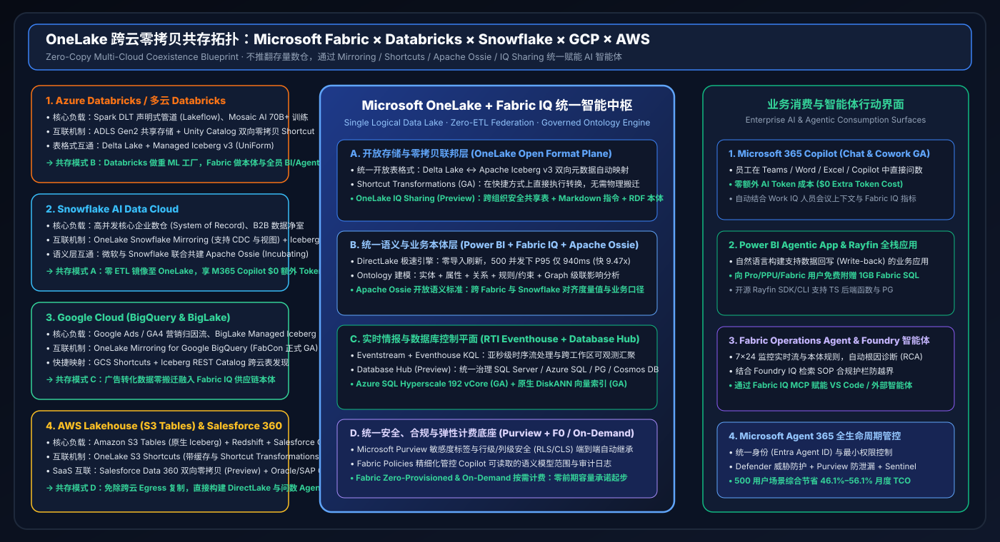

# ⚔️ Microsoft Fabric vs 四大云数智竞对（Databricks / Snowflake / GCP / AWS）深度攻防拆解与售前 Battlecards (2026)

> **语言版本 / Language**: **中文 (当前)** | [English (`fabric-vs-4clouds-battlecards-2026.en.md`)](fabric-vs-4clouds-battlecards-2026.en.md)  
> **数据基准**：`workshops/data-lab/reports/report.json`（2026-11-02 实测封存 · 28 场景 `96.43%`） · **适用角色**：AI Solution Architect / 云数智架构师

---

## 1. 五大平台全景对标总表（Architecture & Capability Matrix）

| 核心架构层 | Microsoft Fabric (93.3) | Databricks (86.8) | Snowflake (85.0) | GCP BigQuery (85.5) | AWS Lakehouse (82.8) |
| :--- | :--- | :--- | :--- | :--- | :--- |
| **统一存储与开放表格式** | **OneLake** (Delta + Iceberg v3 双向自动映射 + Shortcut Transformations GA) | ADLS / S3 + **Delta Lake / UniForm + Managed Iceberg v3 GA** | 托管内部存储 + **Polaris Catalog (Iceberg v3 双向读写)** | BigQuery Storage + **BigLake Managed Iceberg REST Catalog** | **Amazon S3 Tables (原生 Iceberg)** + S3 Vectors |
| **跨云零拷贝与联邦** | **OneLake Mirroring** (Snowflake/BigQuery/Oracle/SAP GA, Salesforce Preview) + S3/GCS Shortcuts | Lakehouse Federation + Delta Sharing | Snowflake Openflow + Polaris + Data Sharing | BigQuery Omni (AWS/Azure) + Dataplex | Glue Zero-ETL + Lake Formation 跨账号共享 |
| **数据工程与实时流** | **Data Factory (Osmos Agent)** + **RTI Eventstream / Eventhouse KQL (`142ms`)** | **Lakeflow 声明式管道 GA** + Spark Structured Streaming + Photon | Snowpipe Streaming + **Snowflake Datastream** + Dynamic Tables | Pub/Sub + Dataflow (Apache Beam) | **Glue 6.0 (降价 30% + Spark 4.1)** + Kinesis 直写 S3 Tables |
| **业务语义与本体层** | **Fabric IQ Ontology** (`Entity+Property+Relationship+Rule`) + **2000万+ Power BI 模型** + **Apache Ossie** | Unity Catalog Metric Views + AI/BI Genie 空间配置 | Cortex Analyst YAML 语义文件 + **Apache Ossie (与微软共建)** | **Looker LookML 语义层** + Dataplex Knowledge Catalog | QuickSight Q 主题命名实体（缺乏统一本体层） |
| **智能体与业务应用闭环** | **M365 Copilot Chat/Cowork GA ($0 Token)** + **Operations Agent** + **Power BI Agentic App (1GB 免费 SQL)** + **Rayfin** | Mosaic AI Agent Bricks + **AI/BI Genie App Builder** + Lakebase | **Cortex Code (CoCo)** + **Snowflake Intelligence (CoWork)** + Streamlit | **BigQuery Conversational Analytics GA** + Vertex AI Agent Builder | QuickSight Q + **Amazon Bedrock Agents & Knowledge Bases** |
| **安全治理与可观测** | **Microsoft Purview 标签贯通 Office/Teams** + **Agent 365** + 跨工作区 Eventhouse | **Unity Catalog + Unity Gateway (Agent 审计)** | Snowflake Horizon + 角色访问控制 (RBAC) | Dataplex Universal Catalog + Cloud IAM | Lake Formation TBAC + SageMaker Unified Studio |
| **计费模式与 500 人月成本** | **F-SKU 统一容量池 + On-Demand 按需 ($14,048/mo)** | DBU + 云底座 + 外部 BI + Token ($26,562/mo) | 多集群 Credit + 外部 BI + Cortex ($31,990/mo) | Slots/扫描费 + Looker 席位 + Vertex ($26,813/mo) | 6 组件独立计费叠加 ($26,063/mo) |

---

## 2. 逐一竞对深度攻防拆解（Head-to-Head Battlecards）

### 2.1 Microsoft Fabric vs Databricks（Lakehouse + Mosaic AI）
- **最新迭代观察**：Databricks 近期推出 **Unity Gateway**（管控智能体与工具调用）、**Managed Iceberg v3 GA**、**Lakeflow 声明式管道 GA** 以及 **AI/BI Genie App Builder**，试图从数据工程向业务侧延伸。
- **Fabric 三大核心必赢点（Why Fabric Wins）**：
  1. **业务本体图谱 vs SQL 问答（语义层 `+13.0 pts`）**：Databricks Genie 本质仍是面向分析师的 Text-to-SQL 助手；而 **Fabric IQ Ontology** 能从企业现有的 2000万+ Power BI 语义模型一键生成包含**实体、属性、多跳关系、规则约束**的完整业务本体，并驱动 **Operations Agent** 在 `780 ms` 内完成跨 OT/IT 的根因分析与动作触发。
  2. **全员 BI 零读者费与 M365 Copilot `$0` 额外 Token（月省 `47.1%` TCO）**：在 F64+ 容量下，Power BI 报表读者免除按人头许可费，且 M365 Copilot 直接零额外 Token 调用 Fabric IQ；而 Databricks 客户往往仍需额外采购 Power BI/Tableau 许可并支付按 Token 计费的推理账单。
  3. **Eventhouse KQL 亚秒级时序检索 + Osmos 自主工程智能体**：面对智算中心传感器、机场跑道或安全日志，Eventhouse KQL 在高频即席切片上显著优于 Spark Streaming；同时内嵌的 **Osmos Agent** 可自动完成遗留 ETL 现代化。
- **Databricks 领先边界（Where Databricks Leads）**：
  - **超大规模自定义 ML 预训练与底层 Spark C++ Photon 极客调优（`97.0 vs 82.0`）**：当客户需要训练 70B+ 行业大模型、复杂强化学习或超重度自定义 PySpark/Scala 作业时，Databricks 仍是业界标杆。
- **黄金共存架构（Better Together Mode B）**：
  - **绝不要求客户拆毁现有 Azure Databricks！** 推荐将 Databricks 定位为“重度特征工程与模型训练工厂”，通过 **OneLake 双向零拷贝 Shortcuts** 挂载 ADLS Gen2 / Unity Catalog 表，由 Fabric 承载上层 **DirectLake BI、Eventhouse KQL 实时监控、Fabric IQ 本体与全员 M365 Copilot**。

---

### 2.2 Microsoft Fabric vs Snowflake（AI Data Cloud + Cortex）
- **最新迭代观察**：Snowflake 推出 **Cortex Code (CoCo)**、**Snowflake Intelligence (CoWork)**、**Polaris Iceberg v3 双向读写** 与 **Snowflake Datastream**，并与微软联合发起 **Apache Ossie** 开放语义标准。
- **Fabric 三大核心必赢点（Why Fabric Wins）**：
  1. **500 用户月度 TCO 暴降 `56.1%`（`$14,048 vs $31,990`）**：Snowflake 在面临全员 BI 刷新与密集的自然语言问答时，极易触发 Multi-Cluster Warehouse 自动扩容与 Cortex Credit 叠加消耗；Fabric 通过 **DirectLake 零导入引擎**（500 并发下快 `9.47x`）与 **`$0` M365 Copilot 额外 Token** 彻底消除账单惊吓。
  2. **利用 Apache Ossie 与 Snowflake Mirroring“借船出海”**：微软与 Snowflake 联合发起 Apache Ossie 标准，意味着客户在 Snowflake 中定义的语义与表可通过 **OneLake Snowflake Mirroring（支持 CDC 与视图）** 零 ETL 同步至 Fabric，直接转化为 Fabric IQ 本体。
  3. **内置 1GB 免费 Fabric SQL 回写应用 + 原生 KQL 流**：Power BI Agentic App 原生附赠 1GB 免费 SQL 数据库支持业务回写（如审批流、预算调整），无需像 Snowflake 一样消耗高昂计算 Credit 运行常驻容器应用。
- **Snowflake 领先边界（Where Snowflake Leads）**：
  - 纯 SQL 数仓的跨云零运维自治体验，以及跨外部企业的 **B2B Data Clean Rooms** 商业数据交换网络。
- **黄金共存架构（Coexistence Mode A）**：
  - 核心财务/ERP 数仓继续保留在 Snowflake 作为 System of Record；开启 **OneLake Snowflake Mirroring + Apache Ossie**，将全员 BI、M365 Copilot 问数与 Operations Agent 运营闭环构建在 Fabric 之上。

---

### 2.3 Microsoft Fabric vs Google Cloud（BigQuery + Looker + Vertex AI）
- **最新迭代观察**：GCP 正式将 **BigQuery Conversational Analytics** 推向 GA，发布 **BigLake Managed Iceberg REST Catalog** 与 **Dataplex Knowledge Catalog**。
- **Fabric 三大核心必赢点（Why Fabric Wins）**：
  1. **OneLake Mirroring for Google BigQuery 已正式 GA**：客户无需编写一行 Dataflow 代码或支付高额跨云迁移费，即可将 BigQuery 中的 Google Ads / GA4 营销转化数据实时镜像到 OneLake。
  2. **从“被动营销报表”升级为“全域供应链本体行动”**：BigQuery + Looker 擅长回答“过去一周广告 ROAS 是多少”，而 **Fabric IQ Ontology + Operations Agent** 能将前端广告爆单信号与后端 ERP 库存、排产及物流图谱级联打通，自动触发补货审批。
  3. **规避按扫描量计费失控与高昂 Looker 席位费（月省 `47.6%` TCO）**：Fabric 统一容量池 + DirectLake 避免了即席大模型问数频繁全表扫描带来的账单尖峰。
- **GCP 领先边界（Where GCP Leads）**：
  - Google Ads / GA4 / YouTube 原生广告数据直连，以及 Serverless PB 级突发全表扫描弹性。
- **黄金共存架构（Coexistence Mode C）**：
  - 营销归因数据留在 BigQuery，通过 **已正式 GA 的 OneLake BigQuery Mirroring** 零拷贝进入 OneLake，与 Azure SQL / SAP ERP 融合构建全域零售本体。

---

### 2.4 Microsoft Fabric vs AWS（SageMaker Lakehouse + S3 Tables + Redshift）
- **最新迭代观察**：AWS 推出 **Amazon S3 Tables（原生托管 Iceberg）**、**S3 Vectors**、**Glue 6.0（降价 30% + Spark 4.1）** 以及 **Kinesis 直写 S3 Tables**。
- **Fabric 三大核心必赢点（Why Fabric Wins）**：
  1. **单一 SaaS 平台 vs 6 组件胶水拼装**：在 AWS 上实现同等闭环需要手动拼装 `S3 Tables + Glue 6.0 + Redshift Serverless + Kinesis/OpenSearch + QuickSight Q + Bedrock Agents`，跨组件 IAM、VPC Endpoint 与安全策略维护成本极高；Fabric 开箱即用。
  2. **带智能缓存的 OneLake S3 Shortcuts + Shortcut Transformations GA**：无需搬迁 AWS S3 上的海量对象数据，5 分钟挂载为 OneLake 快捷方式，直接开启缓存加速与转换，免除重复跨云 Egress 流量费。
  3. **Purview 敏感度标签贯通 Office 365 与 1GB 免费回写库（语义层 `+18.0 pts`）**：AWS Lake Formation 权限止步于数据层，而 Fabric 的 Purview 标签自动继承至 Power BI、Excel、Word 与 Teams 审批卡。
- **AWS 领先边界（Where AWS Leads）**：
  - 底层 S3 对象存储存量规模、S3 Vectors 超低成本向量归档，以及 Bedrock 第三方基础模型选型广度。
- **黄金共存架构（Coexistence Mode D）**：
  - 原始设备遥测与归档日志保留在 **Amazon S3 / S3 Tables**，通过 **OneLake S3 Shortcuts（开启缓存）** 与 **Salesforce Data 360 零拷贝** 在 Fabric 中汇合，一站式驱动 DirectLake BI 与智能体闭环。

---

## 3. 2026-11-02 专项增补：LTAP 湖仓事务回写与细粒度安全攻防矩阵（`DL-25..DL-28`）

| 评估维度 | Microsoft Fabric (Translytical 闭环) | Databricks (`Lakebase` GA) | Snowflake (`Cortex AISQL` + `Hybrid Tables`) | GCP (`BigQuery Fluid` + `AlloyDB`) | AWS (`S3 Tables` + `Aurora Zero-ETL`) |
| :--- | :--- | :--- | :--- | :--- | :--- |
| **内嵌事务回写库** | **Power BI Agentic App 附赠 1GB 免费 Fabric SQL** + Azure SQL Hyperscale 192 vCore (DiskANN GA) | **Azure Databricks Lakebase (GA)**：Serverless Postgres + Git 式分支克隆 | Snowflake Hybrid Tables (Unistore) + Streamlit 容器应用 | 需跨服务联邦 Spanner / AlloyDB 并手写回写 API | Aurora → Redshift Zero-ETL 仅支持单向只读同步 |
| **业务规划与预算闭环** | **Fabric IQ Planning (Preview)**：语义层原生合并历史实绩、实时流与预算回写 | 缺乏原生财务/供应链预算规划语义模块，需自建 Databricks Apps | 依赖第三方合作伙伴或手工 Streamlit 表单 | 依赖 Looker Action Hub 外部 Webhook 触发 | 依赖 QuickSight 静态查看，无原生预算回写闭环 |
| **跨引擎细粒度安全** | **OneLake Fine-Grained Security (GA)**：行/列/表/文件夹权限跨 Spark、SQL、Power BI、Excel 与 **Unity Catalog 直读 (Preview)** 统一生效 | Unity Catalog ABAC/RBAC（现支持 Public Preview 直读 OneLake） | Horizon Catalog RBAC + Iceberg v3 Tri-Secret Secure | Dataplex + BigLake 行列级访问策略 | Lake Formation Governed Tables (Iceberg/Hudi/Delta) |
| **架构师选型金律** | **全员业务审批、预算调整、跨云补货回写首选（`$0` 额外 Copilot Token + `1GB` 免费 SQL）** | **Python 多智能体代码沙盒与状态分支克隆首选（与 OneLake 共存）** | **通过 Apache Ossie 将 AISQL 多模态特征与 Verified Queries 映射至 Fabric** | **通过已 GA 的 BigQuery Mirroring 接入 GA4 流量并触发补货** | **通过带缓存 S3 Shortcuts 免搬迁接入海量日志** |

