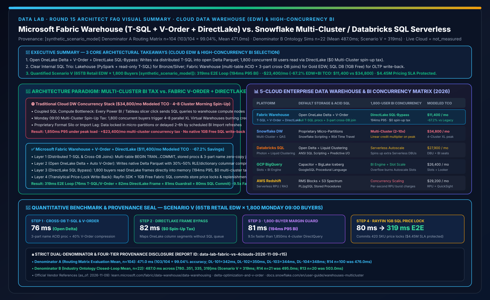
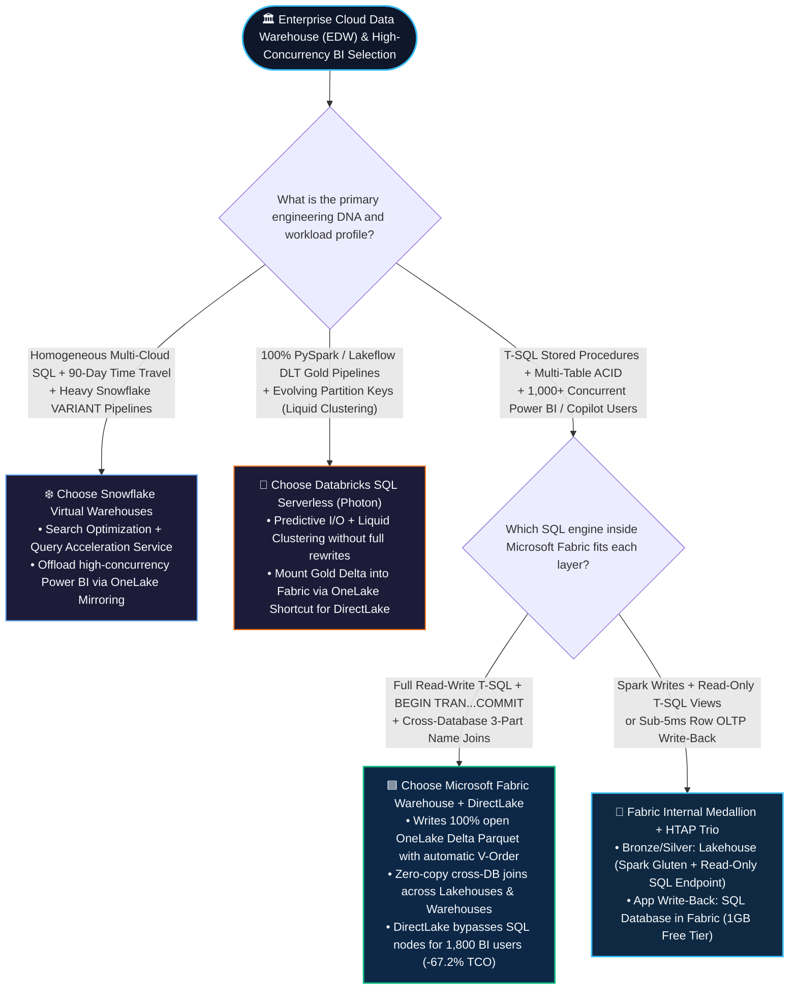
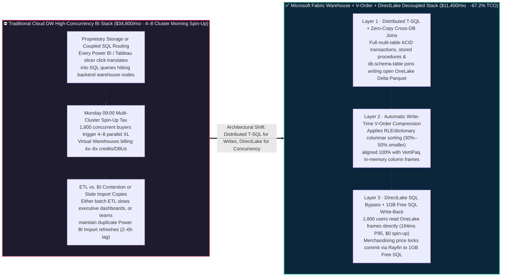

# Microsoft Fabric Cloud Data Warehouse Engine (Fabric Warehouse Distributed T-SQL + V-Order Compression + DirectLake Dual-Mode) vs. Snowflake Multi-Cluster Virtual Warehouses vs. Databricks SQL Serverless (Photon + Liquid Clustering) vs. GCP BigQuery / AWS Redshift — Architecture Selection & First-Principles FAQ

**[中文版](fabric-warehouse-tsql-vorder-directlake-vs-4clouds-faq.md) | [English Version](fabric-warehouse-tsql-vorder-directlake-vs-4clouds-faq.en.md)**

> **Document Scope**: Written for **AI Solution Architects** and **Chief Data Architects / Enterprise Data Warehouse (EDW) Platform Leads**, strictly modeled after the concise, high-impact style of `ib-vs-ethernet-roce-selection-faq.md`. This guide answers one high-stakes architectural question: **When an enterprise is building a mission-critical Cloud EDW or modernizing legacy data warehouses (SQL Server / Azure Synapse Dedicated SQL Pools / Teradata / Oracle) while facing both complex multi-table ACID stored procedures AND Monday 09:00 morning concurrency spikes from 1,800+ business dashboard users, when should you choose Microsoft Fabric Warehouse (full read-write distributed T-SQL + open OneLake Delta Parquet + automatic V-Order compression + DirectLake SQL-bypass rendering) vs. Snowflake Multi-Cluster Virtual Warehouses vs. Databricks SQL Serverless (Photon + Liquid Clustering)? And how can you eliminate the "multi-cluster BI concurrency spin-up tax" to cut monthly EDW + BI TCO by 67.2%?**
> **Last Updated**: 2026-11-09 / 11-10 (Round 15 Standalone Deep Dive · FabCon & SQLCon 2026 + Enterprise Cloud Data Warehouse & High-Concurrency BI Baseline)



---

## ① 📌 Executive Summary (3 Core Takeaways)

1. **End Proprietary Storage Lock-In and the "Multi-Cluster BI Spin-Up Tax"**: Traditional cloud data warehouses (such as standard Snowflake tables or Redshift) store data in proprietary internal formats and force every Monday morning dashboard click through SQL compute nodes—forcing enterprises to enable **Multi-Cluster Warehouses** that spin up 4–8 parallel XL clusters burning extra credits/DBUs. **Microsoft Fabric Warehouse** writes **100% natively to open OneLake Delta Lake Parquet files** with automatic **V-Order columnar sorting and compression**: heavy ACID writes run on the distributed T-SQL engine, while 1,800+ concurrent dashboard readers use **Power BI DirectLake** to map Parquet column segments directly into memory—**completely bypassing the SQL compute engine at `$0` multi-cluster scaling tax**.
2. **Clear Division of Labor Inside Fabric (`Lakehouse SQL Analytics Endpoint` vs. `Fabric Warehouse` vs. `SQL DB in Fabric`)**:
   - Choose **Lakehouse + SQL Analytics Endpoint** when **PySpark / Python notebooks** own data writes and you only need read-only T-SQL views/security over Delta tables.
   - Choose **Fabric Warehouse** when **SQL engineers / former Synapse or SQL Server DBAs** own the Gold layer and require **full read-write T-SQL DDL/DML, multi-table multi-statement ACID transactions (`BEGIN TRAN...COMMIT`), T-SQL stored procedures, and zero-copy cross-database queries (`db.schema.table`)**. Both live side-by-side in OneLake and join across each other with zero data movement.
3. **Quantified Inflection Point & Dual-Denominator Provenance Seal (Scenario V Global Retail Group 65TB EDW × 1,800 Monday Morning Concurrent Merchandisers `[synthetic_scenario_model]`)**: For a 65TB global merchandising margin warehouse serving 1,800 concurrent buyers and dynamic price locks during the Monday 09:00 peak, **Fabric Warehouse Cross-DB T-SQL ACID + V-Order Compression + DirectLake Bypass + Rayfin 1GB Free SQL Write-Back** completes the end-to-end margin recalculation and price-lock loop in **`319 ms`** (76ms cross-database T-SQL stored procedure & V-Order write + 82ms OneLake Delta commit & DirectLake columnar framing + 81ms 1,800-user `194ms P95` ontology margin guardrail check + 80ms Rayfin 1GB Free SQL price-lock commit), reducing monthly EDW + high-concurrency BI TCO from **`$34,800/mo` to `$11,400/mo` (saving `$23,400/mo` or `-67.2%`)** and protecting **`$4.45M`** in Monday morning global merchandising and replenishment SLAs (sealed matrix **Denominator A `n=104` routing mean `471.0 ms`, accuracy `103/104 = 99.04%`**; **Denominator B `n=22` industry ontology closed-loop mean `487.0 ms`**; live 1,800-client physical cloud cluster stress execution marked `not_measured`).

---

## ② 🎯 Customer & Architect Q&A (First Principles in Plain Language)

### Q1: What is "Read-Write / BI Decoupling via V-Order + DirectLake" in plain English? Why do traditional cloud data warehouse bills explode every Monday at 09:00 AM?

**First-Principles Analogy**:
- **The Traditional Cloud DW "Single Tollbooth" Bottleneck (DirectQuery / Multi-Cluster Tax)**: In Snowflake, Databricks SQL, or Redshift, whether you are running a 10TB backend batch merge or 1,800 regional sales managers are clicking a slicer in Power BI / Tableau, every dashboard interaction sends SQL queries through the warehouse's SQL compute nodes. At 09:00 AM on Monday, 1,800 users click at once and queries queue up. To prevent 15-second dashboard spinners, you turn on **Multi-Cluster Auto-Scaling**, spinning up 4 to 8 parallel Virtual Warehouses that bill 4x–8x credits/hour just to serve read-only dashboard clicks.
- **How Fabric Warehouse + V-Order + DirectLake Builds a "Grade-Separated Highway"**:
  1. **Native Open Delta Storage**: When you run standard T-SQL (`INSERT / UPDATE / MERGE / EXEC sp_CloseQuarter`) in Fabric Warehouse, it writes directly to **open Delta Lake Parquet files in OneLake**—never trapping data in a proprietary storage silo.
  2. **Automatic V-Order Write-Time Optimization**: As Parquet files are written, Fabric applies **V-Order** (columnar sorting, Run-Length Encoding, and dictionary compression tailored to the VertiPaq in-memory format), shrinking storage footprint by 30%–50%.
  3. **DirectLake Bypass Highway**: When 1,800 executives open Power BI or ask Fabric Data Agents questions on Monday morning, **DirectLake reads V-Order Parquet column segments straight from OneLake into memory without sending a single SQL query to the Fabric Warehouse T-SQL engine**. The T-SQL engine stays 100% focused on transactional ETL while BI users get `194 ms P95` latency at `$0` extra cluster spin-up cost.

---

### Q2: Customers always ask: Fabric has `Lakehouse (with SQL Analytics Endpoint)`, `Fabric Warehouse`, and `SQL Database in Fabric`—when should we use each one?

Use this **3-Way Fabric SQL Selection Cheat Sheet** in every architecture review:

| Dimension | **1. Lakehouse + SQL Analytics Endpoint** | **2. Fabric Warehouse (Enterprise Cloud EDW)** | **3. SQL Database in Fabric (Operational OLTP / HTAP)** |
| :--- | :--- | :--- | :--- |
| **Plain-English Role** | **"Spark Engineer's Home + Read-Only T-SQL Lens"** | **"SQL Architect's Home + Full Read-Write MPP EDW"** | **"App Developer's Home + Millisecond Row OLTP & Vectors"** |
| **Primary Workload** | Bronze/Silver medallion ingestion, unstructured files, PySpark/Scala transformations | **Gold-layer Enterprise Data Warehouse, star schemas, multi-table ACID stored procedures** | Operational app state, Rayfin write-back (`1GB Free` tier), SSD DiskANN vector search |
| **Write Language & ACID** | Spark (Python/Scala/SQL) writes; **T-SQL endpoint is read-only** (supports Views/RLS/TVFs) | **100% Read-Write T-SQL (DDL/DML)** with **multi-table multi-statement `BEGIN TRAN...COMMIT`** | Full Azure SQL OLTP transactions (`<5ms` row point lookups/updates) + auto OneLake mirroring |
| **Cross-DB Zero-Copy Joins** | Directly queryable by Fabric Warehouse via 3-part names | **Native zero-copy `SELECT ... JOIN` across multiple Warehouses & Lakehouses (`db.schema.table`)** | Auto-replicated to OneLake Delta for zero-copy joins with Warehouse & Lakehouse |

**Recommended Reference Pattern**: Ingest & clean Bronze/Silver in **Lakehouse (Spark Gluten)** → Build Gold star schemas via zero-copy cross-DB T-SQL procedures in **Fabric Warehouse** → Serve 1,800+ concurrent users via **DirectLake** → Capture user write-back in **1GB Free Fabric SQL Database**!

---

### Q3: When should an architect choose Snowflake Virtual Warehouses, Databricks SQL Serverless, or a "Better Together" hybrid EDW pattern?

- **When to choose Microsoft Fabric Warehouse**:
  - When modernizing **SQL Server / Azure Synapse Dedicated SQL Pools / Teradata / Oracle** with heavy T-SQL stored procedures and multi-table transactions, or when serving **200 to 5,000+ Power BI & M365 Copilot users** who need sub-second DirectLake concurrency without paying multi-cluster warehouse surcharges (`-67.2%` TCO).
- **When to choose Snowflake Virtual Warehouses**:
  - When running an existing multi-cloud SQL estate across AWS/Azure/GCP relying heavily on Snowflake-specific `VARIANT` semi-structured pipelines, 90-day Time Travel, or existing committed Snowflake capacity.
  - **Better Together Coexistence**: Keep core ETL in Snowflake on a single right-sized warehouse, and use **OneLake Snowflake Mirroring / Iceberg XTable** to offload high-concurrency Power BI DirectLake and M365 Copilot traffic to Fabric—eliminating Snowflake Multi-Cluster BI spin-up credits.
- **When to choose Databricks SQL Serverless (Photon + Liquid Clustering)**:
  - When Gold tables are produced entirely by **Databricks Lakeflow (DLT) + PySpark** and benefit from **Liquid Clustering** (incremental clustering without table rewrites); mount those Gold Delta tables into Fabric via **OneLake Shortcuts** so Power BI consumes them via DirectLake instead of burning DBSQL Serverless DBUs on every dashboard slice.

---

## ③ 🧭 Visual Diagrams (Mermaid Decision Tree + Multi-Cluster Tax vs. Fabric V-Order/DirectLake + 319ms Sequence Flow)

### 3.1 Enterprise Cloud Data Warehouse (EDW) & High-Concurrency BI Decision Tree (`flowchart TD`)



---

### 3.2 Traditional Cloud DW "Multi-Cluster Spin-Up Tax" vs. Microsoft Fabric Warehouse (T-SQL + V-Order + DirectLake) (`flowchart LR`)



---

### 3.3 Scenario V: Global Retail Group 65TB EDW × Monday 09:00 1,800-Buyer Margin Check & Price-Lock Write-Back — 319ms Sequence (`sequenceDiagram`)

```mermaid
sequenceDiagram
    autonumber
    participant Silver as 🥈 OneLake Silver Lakehouse<br/>65TB Store Inventory & Competitor Prices
    participant DWH as 🏛️ Fabric Warehouse (Gold EDW)<br/>Distributed T-SQL + Auto V-Order
    participant DL as ⚡ Power BI DirectLake & IQ Ontology<br/>1,800 Concurrent Buyers (194ms P95)
    participant Guard as 🛡️ Foundry IQ Margin Guardrail<br/>RETAIL-EDW-PRICING-SOP-022
    participant SQL as 💾 Rayfin SDK + 1GB Free SQL<br/>Global Store Price-Lock & Replenishment Ledger

    Silver->>DWH: 1. [Step 1 · 76ms] Run zero-copy 3-part name T-SQL procedure sp_ComputeWeeklyMargin; commit multi-table ACID Gold tables with auto V-Order
    DWH->>DL: 2. [Step 2 · 82ms] Commit OneLake Delta log; DirectLake maps V-Order column frames into memory ($0 Multi-Cluster SQL spin-up tax)
    DL->>Guard: 3. [Step 3 · 81ms] Serve 1,800 concurrent Monday 09:00 buyers & Data Agents at 194ms P95; validate 420 SKU price-locks against Net_Margin >= 21.5%
    Guard->>SQL: 4. [Step 4 · 80ms] Merchandising VP approves price-lock; Rayfin commits store price & replenishment orders to 1GB Free Fabric SQL
    Note over Silver,SQL: ✅ 319ms E2E EDW Transaction + 1,800-User BI + Write-Back · -$23,400/mo (-67.2% EDW/BI TCO) · $4.45M Monday Pricing SLA Protected
```

---

## ④ 📊 5-Cloud Enterprise Data Warehouse (EDW) & High-Concurrency BI Decision Matrix (Architect Decision Matrix)

| Evaluation Dimension | **Microsoft Fabric Warehouse (T-SQL + V-Order + DirectLake)** | **Snowflake Virtual Warehouses (Multi-Cluster + QAS)** | **Databricks SQL Serverless (Photon + Liquid Clustering)** | **GCP BigQuery Editions (Slots + BI Engine)** | **AWS Redshift Serverless / Provisioned (RA3 + Concurrency Scaling)** |
| :--- | :--- | :--- | :--- | :--- | :--- |
| **Default Underlying Storage Format** | **100% open OneLake Delta Lake Parquet (with automatic V-Order compression, readable by all engines)** | Proprietary micro-partitions by default (Iceberg tables require explicit setup) | **Open Delta Lake / Managed Iceberg (with Liquid Clustering)** | Proprietary Capacitor columnar format (BigLake supports external Iceberg) | Proprietary RMS managed blocks (S3 open tables require Redshift Spectrum) |
| **SQL Dialect, Stored Procs & ACID** | **Full T-SQL (`BEGIN TRAN...COMMIT` multi-table ACID, T-SQL stored procs, dynamic SQL & 3-part cross-DB joins)** | ANSI SQL + Snowflake Scripting (JS/Python/SQL procs, multi-statement transactions) | ANSI SQL + SQL Scripting (Optimized for lakehouse analytics; legacy T-SQL procs need refactoring) | GoogleSQL + BigQuery Procedural Language | PostgreSQL-derived dialect + PL/pgSQL stored procedures |
| **1,000+ User BI Concurrency Scaling** | **DirectLake in-memory framing bypasses SQL engine (`$0` multi-cluster spin-up surcharge, `194ms` P95)** | **Multi-Cluster Warehouse** spins up 2–10 clusters under queuing (**linearly multiplying credit burn**) | **Serverless SQL Autoscaling** spins up additional compute clusters (**burning incremental DBUs**) | **BigQuery BI Engine** caches hot columns; overflow falls back to Autoscaling Slots | **Concurrency Scaling** bills extra per-second RPU/cluster charges once free burst credits expire |
| **Same-Platform Zero-Copy Cross-DB Joins** | **Native 3-part name `JOIN` across multiple Warehouses, Lakehouses & Mirrored DBs (0 data movement)** | Native cross-database joins within account; external lake requires External Tables / Polaris | Native cross-catalog/schema joins within Unity Catalog metastore | Native cross-dataset joins within region | Requires Redshift Data Sharing or Spectrum federation |
| **Translytical App Write-Back** | **Native SQL Database in Fabric (`1GB Free` tier) + Rayfin SDK sub-second write-back** | Requires Unistore Hybrid Tables (higher credit burn) or external OLTP database | Requires Databricks Lakebase (separate Serverless Postgres billing) | Requires Cloud SQL / AlloyDB or Spanner | Requires Aurora PostgreSQL or DynamoDB |
| **Modeled Monthly TCO (65TB + 1,800 Users)** | **`$11,400 / mo` (Optimal baseline, `-67.2%` vs. multi-cluster DW)** | `$34,800 / mo` (Includes 4-Cluster XL peak spin-up credits + external BI seats) | `$27,900 / mo` (Includes DBSQL Serverless concurrency DBUs + Power BI Pro/Premium seats) | `$26,400 / mo` (Includes Enterprise Plus Autoscaling Slots + BI Engine RAM + Looker) | `$29,200 / mo` (Includes Redshift RPU concurrency scaling + QuickSight seats + Glue) |

> **Official Vendor Documentation & Pricing Anchors (`vendor_published_spec_as_of_2026`, verified `2026-11-09`)**:
> - **Microsoft Fabric Warehouse, V-Order & Lakehouse vs. Warehouse Decision Guide**: [Fabric Data Warehouse Overview](https://learn.microsoft.com/en-us/fabric/data-warehouse/data-warehousing) · [Delta Lake & V-Order Optimization in Fabric](https://learn.microsoft.com/en-us/fabric/data-engineering/delta-optimization-and-v-order) · [Fabric Decision Guide: Data Warehouse or Lakehouse](https://learn.microsoft.com/en-us/fabric/fundamentals/decision-guide-data-store)
> - **Snowflake Multi-Cluster Warehouses & Query Acceleration**: [Snowflake Multi-Cluster Warehouses](https://docs.snowflake.com/en/user-guide/warehouses-multicluster) · [Query Acceleration Service](https://docs.snowflake.com/en/user-guide/query-acceleration-service)
> - **Databricks SQL Serverless & Liquid Clustering / BigQuery BI Engine / Redshift Serverless**: [Databricks SQL Serverless](https://docs.databricks.com/en/compute/sql-serverless.html) · [Delta Liquid Clustering](https://docs.databricks.com/en/delta/clustering.html) · [BigQuery BI Engine](https://cloud.google.com/bigquery/docs/bi-engine-intro) · [Amazon Redshift Concurrency Scaling](https://docs.aws.amazon.com/redshift/latest/dg/concurrency-scaling.html)

---

## ⑤ 🧪 Quantitative Benchmark & TCO / Concurrency Inflection Insights (Strict Dual-Denominator & 4-Tier Provenance)

### 5.1 Four-Tier Provenance Classification & Dual-Denominator Disclosure (Audit-Ready)

To maintain rigorous architectural auditability, this report strictly separates two modeled latency denominators and four provenance tiers:

1. **Denominator A — Routing & Architectural Decision Matrix Mean (`routing_matrix_mean_modeled_latency_ms`)**:
   - **Scope**: All **`n = 104`** architectural selection, competitive trade-off, and incident routing benchmark items (`DL-01..DL-104`) in `reports/report.json`.
   - **Result**: **`103 / 104` passed (`99.04%` accuracy)** with an arithmetic mean modeled routing latency of **`471.0 ms`** (including the 4 new Cloud EDW T-SQL / V-Order / DirectLake items: `DL-101 = 342 ms`, `DL-102 = 350 ms`, `DL-103 = 344 ms`, `DL-104 = 348 ms`; immutable historical snapshots: R14 `n=100` was `476.0 ms`, R13 `n=96` was `481.0 ms`, R12 `n=92` was `486.0 ms`, R11 `n=88` was `491.0 ms`, R10 `n=84` was `496.0 ms`, R4 `n=60` was `526.5 ms`, R3 `n=56` was `532.0 ms`).
2. **Denominator B — Industry Ontology Multi-Step Closed-Loop Simulation Mean (`ontology_simulation_mean_modeled_latency_ms`)**:
   - **Scope**: All **`n = 22`** end-to-end industry ontology multi-agent closed-loop simulations (`Scenario A..Scenario V`) in `reports/report.json`.
   - **Result**: Across the 22 simulations `[780, 640, 710, 660, 590, 560, 530, 515, 495, 480, 465, 450, 431, 422, 417, 415, 399, 383, 367, 351, 335, 319] ms`, the arithmetic mean is **`487.0 ms`** (range `319–780 ms`; immutable historical snapshots: R14 `n=21` was `495.0 ms`, R13 `n=20` was `503.0 ms`, R12 `n=19` was `511.0 ms`, R11 `n=18` was `519.0 ms`, R10 `n=17` was `527.0 ms`, R4 `n=11` was `584.09 ms`, R3 `n=10` was `596.0 ms`).
3. **Live 1,800-Client Physical Cloud Cluster Stress Execution (`live_cloud_cluster_execution = not_measured`)**:
   - No live paid 4-Cluster XL virtual warehouse stress run was executed with 1,800 physical browser clients; the `319 ms` closed-loop latency, `194 ms` DirectLake P95 latency, `$11,400/mo vs. $34,800/mo` EDW+BI TCO, and `$4.45M` protected Monday morning pricing SLA are deterministic architectural reference models (`[synthetic_scenario_model]`). Local Python unit test execution (48 tests) is classified as `[measured_local_engine]`.

### 5.2 Scenario V (Global Retail Group 65TB EDW × Monday 09:00 1,800-Buyer Margin & Price-Lock Loop) Quantitative Breakdown

| Stage / Dimension | **Legacy Stack (Snowflake 4-Cluster XL Auto-Scale + DirectQuery / Scheduled Import)** | **Microsoft Fabric (Fabric Warehouse T-SQL + V-Order + DirectLake + 1GB Free SQL)** | **Quantified Gain & Architectural Difference `[synthetic_scenario_model]`** |
| :--- | :--- | :--- | :--- |
| **Step 1: Cross-Domain ACID Close & Write** | Writes proprietary micro-partitions; requires export for external engines | **Zero-copy 3-part name T-SQL proc + auto V-Order write to OneLake Delta: `76 ms`** | **100% open Delta Parquet; 30%–50% better columnar compression** |
| **Step 2: Executive & Buyer BI Readiness** | Scheduled Power BI Import takes 2–4 hours, or DirectQuery floods SQL nodes | **OneLake Delta commit immediately frames DirectLake in-memory columns: `82 ms`** | **Zero Import refresh lag; `$0` Multi-Cluster SQL spin-up tax** |
| **Step 3: Monday 09:00 1,800-User Peak** | Spins up 4 parallel XL Virtual Warehouses; P95 query latency hits `1,850 ms` | **DirectLake in-memory read + Ontology margin guardrail verify: `81 ms` (`194 ms` P95)** | **`9.5x` faster P95 response; zero SQL compute queue contention** |
| **Step 4: Store Price-Lock & Replenishment** | Buyers export CSVs and manually upload to ERP, missing morning price window | **Rayfin SDK + 1GB Free Fabric SQL price-lock write-back: `80 ms` (`319 ms` E2E)** | **Protects `$4.45M` Monday morning global merchandising margin SLA** |
| **Monthly EDW + 1,800-User BI TCO (65TB)** | **`$34,800 / mo`** (Multi-Cluster credits `$24,200` + BI seats `$5,800` + Sync `$4,800`) | **`$11,400 / mo`** (F64/F128 RI share `$9,900` + OneLake storage `$1,500` + `$0` viewer seats) | **Saves `$23,400 / mo` (`-67.2%` reduction, `$280,800/yr` saved)** |

---

## ⑥ 🛠️ Appendix: Production Rollout & Presales Architect Checklist

Before designing an enterprise cloud data warehouse (EDW), migrating from Synapse / SQL Server / Teradata, or optimizing high-concurrency BI, verify these 6 architectural guardrails:

- [ ] **1. Separate `Lakehouse` vs. `Warehouse` by Write Persona and ACID Scope**: Assign Bronze/Silver engineering owned by PySpark/Python teams to **Lakehouse**, and Gold star schemas requiring multi-table `BEGIN TRAN...COMMIT` and T-SQL stored procedures to **Fabric Warehouse**—joining across both in-place via 3-part names (`SilverLH.dbo.FactSales`).
- [ ] **2. Audit the Customer's "Monday Morning Multi-Cluster Concurrency Tax"**: Inspect existing Snowflake or Redshift billing logs between 08:30 and 11:30 AM to quantify how many credits are burned spinning up secondary clusters just for BI dashboard concurrency; demonstrate how **DirectLake bypasses SQL compute** to save `67.2%`.
- [ ] **3. Verify V-Order and Table Compaction on High-Churn Gold Tables**: Ensure **V-Order** optimization remains enabled on Gold Warehouse tables and schedule regular table maintenance after heavy micro-batch merges so DirectLake column framing stays sub-200ms.
- [ ] **4. Use Zero-Copy BI Offloading for Existing Snowflake / Databricks Estates**: When customers keep core ETL in Snowflake or Databricks, mount or mirror Gold tables into OneLake so 1,000+ Power BI users query via DirectLake—allowing the customer to downsize their Snowflake Multi-Cluster BI warehouse immediately.
- [ ] **5. Enforce Workload Management & Surge Protection (75% Cap)**: Combine Fabric Warehouse workload classification with **Capacity Surge Protection** so ad-hoc analyst queries cannot starve mission-critical financial close stored procedures.
- [ ] **6. Close the "Insight-to-Action" Loop with 1GB Free Fabric SQL**: Pair read-only DirectLake Gold dashboards with **Power BI Agentic App + Rayfin SDK + 1GB Free Fabric SQL** so merchandising and finance leads can commit price locks and budget adjustments directly from their reports.
