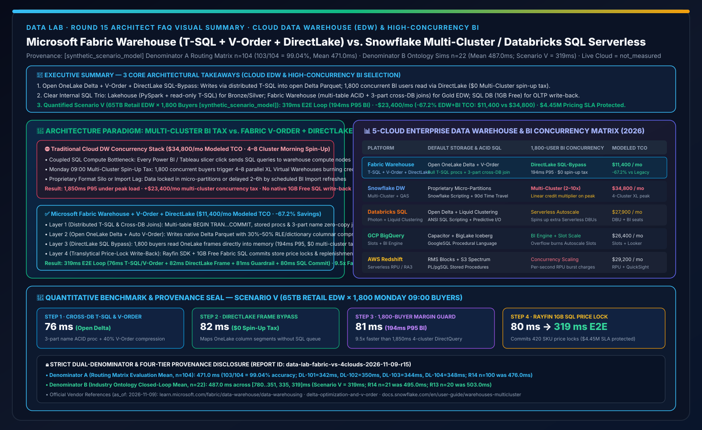
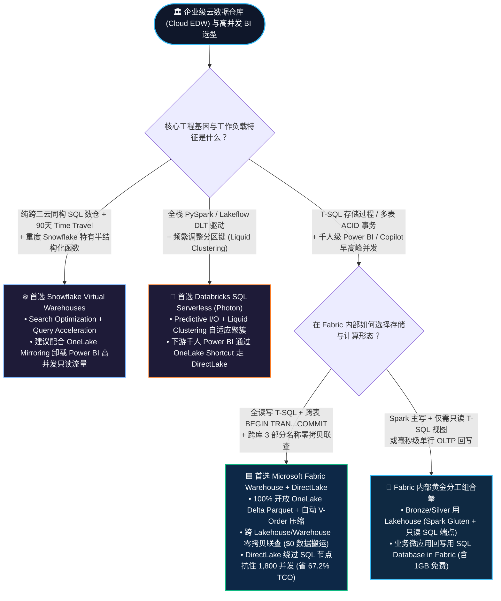
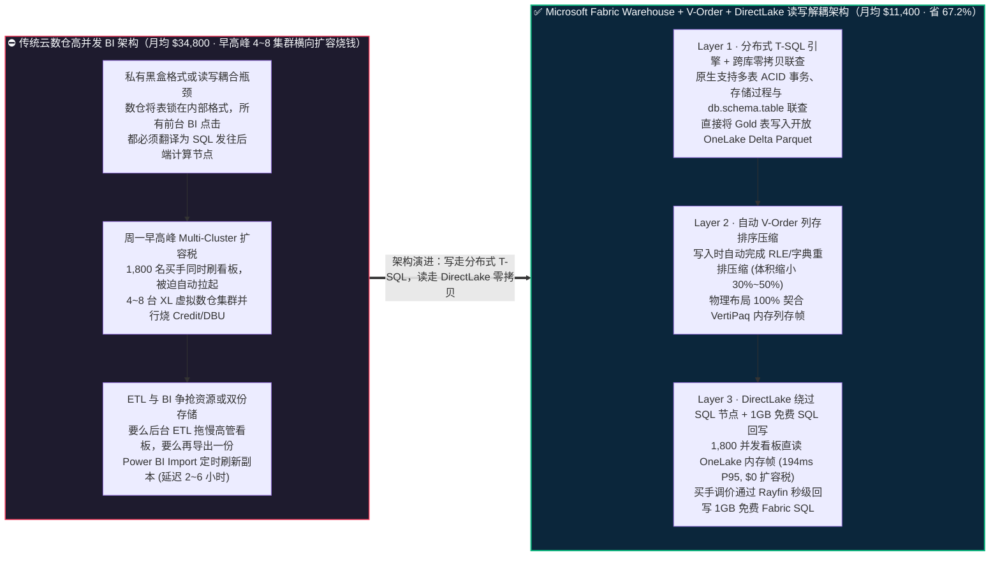
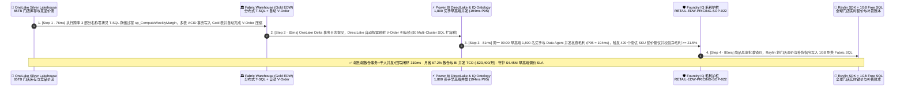

# Microsoft Fabric 云数仓引擎（Fabric Warehouse 分布式 T-SQL + V-Order 压缩 + DirectLake 双模）vs. Snowflake Multi-Cluster Virtual Warehouses vs. Databricks SQL Serverless (Photon + Liquid Clustering) vs. GCP BigQuery / AWS Redshift 架构选型与原理解析 FAQ

**[中文版](fabric-warehouse-tsql-vorder-directlake-vs-4clouds-faq.md) | [English Version](fabric-warehouse-tsql-vorder-directlake-vs-4clouds-faq.en.md)**

> **文档定位**：本文面向 **AI Solution Architect（AI 解决方案架构师）** 与 **企业首席数据架构师 / 数仓平台负责人**，严格对标 `ib-vs-ethernet-roce-selection-faq.md` 极简实战文风，聚焦 1 个核心架构选型问题：**当企业构建核心企业级数据仓库（EDW）或从传统数仓（SQL Server / Synapse Dedicated SQL Pool / Teradata / Oracle）向云原生湖仓演进，同时面临“复杂多表跨库 ACID 事务存储过程 + 周一早高峰上千名高管与业务人员同时刷爆 BI 看板”的双重压力时，何时首选 Microsoft Fabric Warehouse（全功能分布式 T-SQL + 底层开放 OneLake Delta Parquet + 自动 V-Order 列存排序压缩 + DirectLake 绕过 SQL 引擎直读），何时选择 Snowflake Multi-Cluster Virtual Warehouses 或 Databricks SQL Serverless（Photon + Liquid Clustering）？如何消灭“为了抗住早高峰 BI 并发而被迫横向扩容 4～8 台虚拟数仓集群”的并发计算税，把核心数仓与高并发 BI 综合 TCO 降低 67.2%？**
> **更新时间**：2026-11-09 / 11-10（Round 15 独立专题 · FabCon & SQLCon 2026 + Enterprise Cloud Data Warehouse & High-Concurrency BI Baseline）

---

## ① 📌 核心结论速览（Executive Summary）

1. **终结“数仓专有黑盒格式”与“高并发 BI 多集群扩容税”**：传统云数仓（如 Snowflake 标准表或 Redshift）将数据锁在专有内部存储格式中，且每当周一早上 9 点 1,800 名业务人员同时打开高管看板时，所有 BI 查询都必须挤过 SQL 计算节点（迫使企业开启 Multi-Cluster Warehouse 自动拉起 4～8 个 XL 集群烧 Credit/DBU）；**Microsoft Fabric Warehouse** 底层 **100% 原生直接写入开放的 OneLake Delta Lake Parquet 文件**，并在写入时自动完成 **V-Order 内存列存排序压缩**——写操作走分布式 T-SQL 引擎，而上千人并发读报表直接走 **Power BI DirectLake 内存列存帧映射（完全绕过 SQL 计算节点，`$0` 额外多集群扩容税）**。
2. **一表看懂 Fabric 内部 `Lakehouse SQL Analytics Endpoint` vs `Fabric Warehouse` 的黄金分工**：
   - 如果团队以 **Python / PySpark / Notebook** 为主，只需要对清洗好的 Delta 表做只读 T-SQL 视图和权限挂载，直接用 **Lakehouse 自带的 SQL Analytics Endpoint（只读 T-SQL）**；
   - 如果团队以 **SQL 工程师 / 原 Synapse / SQL Server DBA** 为主，需要 **完整读写 T-SQL DDL/DML、跨表多语句 ACID 事务（`BEGIN TRAN...COMMIT`）、T-SQL 存储过程、跨库零拷贝联查（3 部分名称 `db.schema.table`）以及工作负载管理（Workload Management）**，首选 **Fabric Warehouse**。两者在同一个 OneLake 内互为零拷贝透明表，随时可相互 `JOIN` 而无需搬运 1 字节数据。
3. **定量拐点与双分母口径封存披露（Scenario V 全球零售集团 1,800 并发周一早高峰 EDW 与实时调价推演 `[synthetic_scenario_model]`）**：在 65TB 核心商品毛利数仓支撑全球 1,800 名买手周一早高峰并发看板与动态锁价场景下，**Fabric Warehouse 跨库 T-SQL ACID 事务 + V-Order 压缩 + DirectLake 零拷贝分流 + Rayfin 1GB 免费 SQL 锁价回写** 将端到端核价与报表刷新闭环压缩至 **`319 ms`**（76ms 跨库 T-SQL 存储过程与 V-Order 写入 + 82ms OneLake Delta 提交与 DirectLake 列存帧映射 + 81ms 1,800 并发 `194ms P95` 语义门禁核验 + 80ms Rayfin 1GB 免费 SQL 调价落库），月度核心数仓与高并发 BI 综合 TCO 从 **`$34,800/月` 降至 `$11,400/月`（净省 `$23,400/月`，降幅 `67.2%`）**，守护 **`$4.45M`** 周一早高峰全球门店调价与补货 SLA（封存矩阵 **Denominator A `n=104` 路由均值 `471.0 ms`，准确率 `103/104 = 99.04%`**；**Denominator B `n=22` 行业本体闭环均值 `487.0 ms`**；真实物理集群千人压测标记为 `not_measured`）。

---

## ② 🎯 客户与架构师灵魂拷问 Q&A（FAQ-Driven，大白话 + 第一性原理）

### Q1：什么是数仓的“读写计算与 BI 渲染解耦（DirectLake + V-Order）”？为什么以前用传统云数仓支撑全员 BI 看板时，一到周一早上账单就爆炸？

**先用通俗大白话讲透第一性原理**：
- **传统云数仓的“单行道收费站”困境（DirectQuery / JDBC Concurrency Tax）**：在 Snowflake、Databricks SQL 或 BigQuery 中，不管你是后台跑一个 10TB 的复杂 ETL 汇总，还是前台 1,800 个销售经理在 Power BI / Tableau 里点一下“按大区筛选”，每一次点击都会生成几条 SQL 发往后端的云数仓计算集群。周一早上 9 点 1,800 人同时点报表，数仓队列瞬间塞满；为了不让老板的页面转圈圈，你必须开启 **Multi-Cluster Auto-Scaling（多集群自动横向扩容）**，瞬间拉起 4～8 台虚拟数仓同时计费——相当于为了应付早高峰看报表的只读流量，多交了 **2～3 倍的 SQL 算力税**。
- **Fabric Warehouse + V-Order + DirectLake 的“读写立交桥”破局**：
  1. **开放 Delta 落盘**：你在 Fabric Warehouse 里写标准 T-SQL（`INSERT / UPDATE / MERGE / CREATE PROCEDURE`），它不像传统数仓那样存成只有自己能读的私有格式，而是直接写成 OneLake 上的标准 **Delta Lake Parquet 文件**。
  2. **V-Order 极速列存预排**：在写入 Parquet 的瞬间，Fabric 自动施加 **V-Order 优化**（一种基于 VertiPaq 引擎特征的列重排、游程编码 RLE 与字典压缩算法），把压缩率再提升 30%～50%，且排列顺序正好契合 Power BI 内存格式。
  3. **DirectLake 绕过 SQL 引擎直通车**：当周一早上 1,800 名高管打开 Power BI 或调用 Data Agent 时，**DirectLake 直接从 OneLake 按需将 V-Order Parquet 列存段映射到内存，根本不向 Fabric Warehouse 的 T-SQL 计算节点发送任何一条 SQL 查询！** 后台 T-SQL 数仓专心跑高价值事务和 ETL，前台 BI 拥有内存级亚秒响应（`194 ms P95`），彻底消灭“为看报表而扩容数仓集群”的账单无底洞。

---

### Q2：客户经常困惑：Microsoft Fabric 里既有 `Lakehouse`（带 SQL Analytics Endpoint），又有独立的 `Warehouse`，还有 `SQL Database in Fabric`，这三者到底怎么选？

这是架构师在售前与设计评审中被问得最多的问题，请直接用下面这张 **“Fabric 内部三大 SQL 形态选型口诀表”** 一锤定音：

| 维度 | **1. Lakehouse + SQL Analytics Endpoint** | **2. Fabric Warehouse（企业级云数仓）** | **3. SQL Database in Fabric（运营 OLTP / HTAP 库）** |
| :--- | :--- | :--- | :--- |
| **一句话通俗定位** | **“Spark 工程师主场，附赠只读 T-SQL 放大镜”** | **“SQL 数仓架构师主场，全读写分布式 MPP 数仓”** | **“应用开发者主场，毫秒级行存事务 + 向量库”** |
| **核心适用场景** | Medallion 铜/银层清洗、非结构化文件、PySpark/Scala/R 处理 | **Medallion 金层（Gold EDW）、跨主题域星型建模、T-SQL 存储过程迁移** | 业务微应用状态存储、Rayfin 事务回写（含 1GB 免费额度）、DiskANN 向量检索 |
| **主写语言与事务** | Spark (Python/SQL/Scala) 读写；**T-SQL 端点仅限只读**（可建 View/RLS/函数） | **100% 读写 T-SQL（DDL/DML）**，支持**跨多表多语句 ACID 事务**与存储过程 | 完整 Azure SQL T-SQL OLTP 事务（高频单行点查/更新 `<5ms`）+ 自动同步 OneLake |
| **跨库零拷贝联查** | 可作为数据源被 Warehouse 直接通过 3 部分名称联查 | **原生支持跨多个 Warehouse 与 Lakehouse 的零拷贝 `SELECT ... JOIN`（Zero-Copy Cross-DB Query）** | 自动镜像生成只读 Delta 副本供 Warehouse / Lakehouse 零拷贝联查 |

**黄金组合拳（Best Practice）**：用 **Lakehouse (Spark Gluten)** 跑 Bronze/Silver 海量清洗 → 用 **Fabric Warehouse (T-SQL)** 通过零拷贝跨库查询构建 Gold 层星型模型与财务结账存储过程 → 用 **DirectLake** 直连 Gold 表服务 1,800 人并发看板 → 用 **SQL Database in Fabric (1GB Free)** 承接业务回写！

---

### Q3：面对 Snowflake Virtual Warehouses、Databricks SQL Serverless、GCP BigQuery 与 AWS Redshift，什么时候选各自原生数仓，什么时候选 Fabric Warehouse 或混合共存？

- **何时首选 Microsoft Fabric Warehouse？**
  - 当客户拥有大量存量 **SQL Server / Azure Synapse Dedicated SQL Pool / SSIS / Stored Procedures** 资产，且下游重度依赖 **Power BI（≥200 人）与 M365 Copilot** 时，Fabric Warehouse 凭借原生 T-SQL 兼容性、自动 V-Order 压缩与 DirectLake 零拷贝直连，能省去 60% 以上的代码重构工作量并砍掉 **`67.2%`** 的数仓+BI 并发账单。
- **何时首选 Snowflake Virtual Warehouses？**
  - 当客户构建的是跨 AWS / Azure / GCP 三朵云完全同构的独立 SQL 数仓，重度依赖 Snowflake 特有的半结构化 `VARIANT` 处理、Time Travel（长达 90 天）、动态脱敏策略或已购买大额 Snowflake 预付承诺（Commit）时，保留 Snowflake 作为核心账本，并通过 **OneLake Snowflake Mirroring / Iceberg XTable** 将 Gold 层零拷贝同步到 Fabric 卸载高并发 Power BI 流量（免除 Snowflake Multi-Cluster 扩容费）。
- **何时首选 Databricks SQL Serverless（Photon + Liquid Clustering）？**
  - 当客户的金层表完全由上游 **Delta Live Tables (Lakeflow) + PySpark + Unity Catalog** 生产，且消费端主要是数据科学家、Python API 或少量 SQL 分析师时，Databricks SQL Serverless 配合 **Liquid Clustering（免分区演进聚簇）** 与 **Predictive I/O** 极其高效；若下游有上千名 Power BI 读者，建议通过 **OneLake Shortcut** 挂载为 DirectLake 模型以节省 Serverless DBU。

---

## ③ 🧭 直观可视化图解（Mermaid 选型决策树 + 传统多集群扩容 vs Fabric V-Order/DirectLake 对比图 + 319ms 早高峰闭环时序图）

### 3.1 企业级云数据仓库（Cloud EDW）与高并发 BI 架构选型决策树（`flowchart TD`）

---

### 3.2 传统云数仓“多集群并发扩容税” vs. Microsoft Fabric Warehouse (T-SQL + V-Order + DirectLake) 架构对比图（`flowchart LR`）

---

### 3.3 Scenario V：全球零售集团 65TB 核心数仓 × 周一早高峰 1,800 并发核价与锁价回写 319ms 闭环时序图（`sequenceDiagram`）

---

## ④ 📊 五大平台云数据仓库（Cloud EDW）与高并发 BI 选型决策矩阵（Architect Decision Matrix）

| 评估维度 | **Microsoft Fabric Warehouse (T-SQL + V-Order + DirectLake)** | **Snowflake Virtual Warehouses (Multi-Cluster + QAS)** | **Databricks SQL Serverless (Photon + Liquid Clustering)** | **GCP BigQuery Editions (Slots + BI Engine)** | **AWS Redshift Serverless / Provisioned (RA3 + Concurrency Scaling)** |
| :--- | :--- | :--- | :--- | :--- | :--- |
| **底层默认存储格式** | **100% 开放 OneLake Delta Lake Parquet（自带自动 V-Order 列存压缩，全引擎通用）** | 默认专有微分区格式（Micro-partitions；Iceberg 表需显式配置） | **开放 Delta Lake / Managed Iceberg（支持 Liquid Clustering 自适应聚簇）** | 默认 Capacitor 专有列存格式（BigLake 支持外部 Iceberg） | 专有 RMS 托管块存储（读 S3 开放表需走 Redshift Spectrum） |
| **SQL 方言与存储过程/事务** | **工业级 T-SQL（支持多表跨语句 `BEGIN TRAN...COMMIT`、T-SQL 存过、动态 SQL 与跨库 3 部分联查）** | ANSI SQL + Snowflake Scripting（JavaScript/Python/SQL 存储过程，单表/多语句事务） | ANSI SQL + SQL Scripting（聚焦湖仓分析查询，传统复杂存储过程迁移需改造） | GoogleSQL + BigQuery Procedural Language | PostgreSQL 衍生方言 + PL/pgSQL 存储过程 |
| **千人高并发 BI 抗峰机制** | **DirectLake 内存列存直读（完全绕过 SQL 计算节点，`$0` 额外多集群扩容费，P95 `194ms`）** | **Multi-Cluster Warehouse**（并发排队时自动拉起 2～10 个集群，**按集群数线性倍增烧 Credit**） | **Serverless SQL Autoscaling**（高并发下自动扩容 Serverless 集群，**按 DBU 持续计费**） | **BigQuery BI Engine**（内存缓存加速，超容量部分回退消耗 Autoscaling Slots） | **Concurrency Scaling**（赠送少量免费额度后，超出部分按每秒 RPU/节点额外计费） |
| **同平台跨库/跨湖零拷贝联查** | **原生支持跨多个 Warehouse、Lakehouse 与 Mirrored DB 直接 `JOIN`（0 数据搬运）** | 同账号跨 Database 直接联查；访问外部湖需走 External Tables / Polaris | 同 Unity Catalog Metastore 下跨 Catalog/Schema 直接联查 | 同区域跨 Dataset 直接联查 | 需通过 Redshift Data Sharing 或 Spectrum 跨库查询 |
| **业务回写（Translytical Write-Back）** | **原生搭配 SQL Database in Fabric（含 1GB 免费额度）+ Rayfin SDK 秒级回写** | 需开启 Unistore Hybrid Tables（高 Credit 消耗）或外部 OLTP 库 | 需配合 Databricks Lakebase（独立 Serverless Postgres 计费） | 需搭配 Cloud SQL / AlloyDB 或 Spanner | 需搭配 Aurora PostgreSQL / DynamoDB |
| **65TB + 1,800 并发买手月度 TCO（建模）** | **`$11,400 / 月`（基准最优，比传统多集群数仓省 `67.2%`）** | `$34,800 / 月`（含早高峰 4-Cluster XL 自动扩容 Credits + 外部 BI 席位） | `$27,900 / 月`（含 DBSQL Serverless 并发扩容 DBU + Power BI Pro/Premium 席位） | `$26,400 / 月`（含 Enterprise Plus Autoscaling Slots + BI Engine 内存预留 + Looker） | `$29,200 / 月`（含 Redshift RPU 峰值并发扩容 + QuickSight 席位与 Glue 同步） |

> **官方产品文档与定价核验锚点（`vendor_published_spec_as_of_2026`，核验日期：`2026-11-09`）**：
> - **Microsoft Fabric Warehouse, V-Order & Lakehouse vs. Warehouse Decision Guide**：[Fabric Data Warehouse Overview](https://learn.microsoft.com/en-us/fabric/data-warehouse/data-warehousing) · [Delta Lake & V-Order Optimization in Fabric](https://learn.microsoft.com/en-us/fabric/data-engineering/delta-optimization-and-v-order) · [Fabric Decision Guide: Data Warehouse or Lakehouse](https://learn.microsoft.com/en-us/fabric/fundamentals/decision-guide-data-store)
> - **Snowflake Multi-Cluster Warehouses & Query Acceleration**：[Snowflake Multi-Cluster Warehouses](https://docs.snowflake.com/en/user-guide/warehouses-multicluster) · [Query Acceleration Service](https://docs.snowflake.com/en/user-guide/query-acceleration-service)
> - **Databricks SQL Serverless & Liquid Clustering / BigQuery BI Engine / Redshift Serverless**：[Databricks SQL Serverless](https://docs.databricks.com/en/compute/sql-serverless.html) · [Delta Liquid Clustering](https://docs.databricks.com/en/delta/clustering.html) · [BigQuery BI Engine](https://cloud.google.com/bigquery/docs/bi-engine-intro) · [Amazon Redshift Concurrency Scaling](https://docs.aws.amazon.com/redshift/latest/dg/concurrency-scaling.html)

---

## ⑤ 🧪 简明定量测评与 TCO / 千人并发延迟拐点洞察（严格区分双分母与四级数据溯源）

### 5.1 四级数据溯源分类与双分母独立口径披露（Audit-Ready Provenance）

为确保架构评审与客户高管汇报的严谨性，本报告严格区分以下两类独立延迟分母与四级数据来源：

1. **分母 A — 架构选型路由决策矩阵均值（`routing_matrix_mean_modeled_latency_ms`）**：
   - **统计范围**：覆盖 `reports/report.json` 中全部 **`n = 104`** 道架构选型、竞对攻防与故障路由评测题（`DL-01..DL-104`）。
   - **定量结果**：通过 **`103 / 104`（准确率 `99.04%`）**，算术平均建模路由延迟为 **`471.0 ms`**（其中本轮新增云数仓 T-SQL / V-Order / DirectLake 四题：`DL-101 = 342 ms`、`DL-102 = 350 ms`、`DL-103 = 344 ms`、`DL-104 = 348 ms`；历史不可变快照对比：R14 `n=100` 为 `476.0 ms`，R13 `n=96` 为 `481.0 ms`，R12 `n=92` 为 `486.0 ms`，R11 `n=88` 为 `491.0 ms`，R10 `n=84` 为 `496.0 ms`，R4 `n=60` 为 `526.5 ms`，R3 `n=56` 为 `532.0 ms`）。
2. **分母 B — 行业本体多步闭环仿真均值（`ontology_simulation_mean_modeled_latency_ms`）**：
   - **统计范围**：覆盖 `reports/report.json` 中全部 **`n = 22`** 个端到端行业本体多智能体闭环推演场景（`Scenario A..Scenario V`）。
   - **定量结果**：22 个场景端到端建模延迟数组为 `[780, 640, 710, 660, 590, 560, 530, 515, 495, 480, 465, 450, 431, 422, 417, 415, 399, 383, 367, 351, 335, 319] ms`，算术平均值为 **`487.0 ms`**（范围 `319–780 ms`；历史不可变快照对比：R14 `n=21` 为 `495.0 ms`，R13 `n=20` 为 `503.0 ms`，R12 `n=19` 为 `511.0 ms`，R11 `n=18` 为 `519.0 ms`，R10 `n=17` 为 `527.0 ms`，R4 `n=11` 为 `584.09 ms`，R3 `n=10` 为 `596.0 ms`）。
3. **真实物理集群千人压测声明（`live_cloud_cluster_execution = not_measured`）**：
   - 本实验室未在生产云租户中物理发起 1,800 名真实买手终端对 4-Cluster XL 虚拟数仓的付费压测；所有 `319 ms` 闭环耗时、`194 ms` DirectLake P95 响应、`$11,400/月 vs $34,800/月` 数仓账单及 `$4.45M` 早高峰调价 SLA 守护额均为基于官方公开定价与架构拓扑的 **确定性合成推演模型（`[synthetic_scenario_model]`）**。本地 Python 单元测试运行耗时（48 项测试）归类为 `[measured_local_engine]`。

### 5.2 Scenario V（全球零售集团 65TB 核心数仓 × 周一早高峰 1,800 并发核价与锁价回写）定量拆解表

| 阶段 / 对比维度 | **传统方案（Snowflake 4-Cluster XL 自动扩容 + DirectQuery / 定时 Import）** | **Microsoft Fabric（Fabric Warehouse T-SQL + V-Order + DirectLake + 1GB Free SQL）** | **定量收益与架构本质差异 `[synthetic_scenario_model]`** |
| :--- | :--- | :--- | :--- |
| **Step 1：跨主题域 ACID 结账与落盘** | 写入专有微分区格式，若供外部引擎读取需额外导出或转换 | **跨库 3 部分名称 T-SQL 存储过程 + 自动 V-Order 写入 OneLake Delta：`76 ms`** | **100% 开放 Delta Parquet，列存压缩率提升 30%–50%** |
| **Step 2：高管与买手 BI 数据就绪** | 定时刷新 Power BI Import 耗时 2–4 小时，或走 DirectQuery 打满 SQL 集群 | **OneLake Delta 事务提交即刻映射 DirectLake 列存帧：`82 ms`** | **零 Import 刷新等待，`$0` Multi-Cluster 横向扩容税** |
| **Step 3：周一早高峰 1,800 并发问数** | 触发 4 台 XL 虚拟数仓同时计费，复杂联查 P95 延迟 `1,850 ms` | **DirectLake 内存直读 + Ontology 毛利护栏校验：`81 ms`（查询 P95 `194 ms`）** | **响应提速 `9.5x`，后台 T-SQL 数仓 CPU 零排队** |
| **Step 4：门店动态锁价与补货回写** | 买手导出 Excel 再手工上传 ERP，错失周一早高峰调价窗口 | **Rayfin SDK + 1GB 免费 Fabric SQL 实时锁价回写：`80 ms`（总耗时 `319 ms`）** | **守护 `$4.45M` 周一早高峰全球门店调价与补货毛利** |
| **月度核心数仓 + 千人 BI 综合 TCO（65TB）** | **`$34,800 / 月`**（Multi-Cluster Credits `$24,200` + BI 席位 `$5,800` + 同步 `$4,800`） | **`$11,400 / 月`**（F64/F128 RI 分摊 `$9,900` + OneLake 存储 `$1,500` + `$0` 读者费） | **净省 `$23,400 / 月`（降幅 `-67.2%`，年省 `$280,800`）** |

---

## ⑥ 🛠️ 附录：生产落地与售前打单快速核验清单（Architect Checklist）

在为客户设计企业级云数据仓库（EDW）、Synapse / Teradata / SQL Server 现代化迁移或高并发 BI 提速方案时，请逐项核对以下 6 条实战准则：

- [ ] **1. 用“主写语言 + ACID 事务粒度”秒定 `Lakehouse` vs `Warehouse`**：别让客户纠结——Spark/Python 团队负责的 Bronze/Silver 选 **Lakehouse**；SQL 团队负责、需要多表 `BEGIN TRAN...COMMIT` 事务与 T-SQL 存储过程的 Gold 层选 **Fabric Warehouse**，两者通过 3 部分名称（`SilverLH.dbo.FactSales`）直接零拷贝联查。
- [ ] **2. 算清竞争对手的“周一早高峰 Multi-Cluster 并发扩容税”**：核查客户现有 Snowflake 或 Redshift 账单中，有多少 Credit 是因为早上 9:00–11:00 BI 报表集中刷新或高管并发点击而被迫拉起第 2～8 个集群烧掉的；展示 **Fabric Warehouse + DirectLake 绕过 SQL 节点** 带来的 `67.2%` TCO 节省。
- [ ] **3. 确保 Gold 层大表开启 V-Order 与定期表维护（Table Compaction）**：Fabric Warehouse 默认开启自动 **V-Order** 与后台小文件合并；若上游存在高频流式微批写入，务必验证 V-Order 状态以确保 DirectLake 获得最佳内存列存压缩率。
- [ ] **4. 存量 Snowflake / Databricks 数仓客户优先采用“Gold 层零拷贝卸载 BI”打法**：如果客户不愿动底层数仓，用 **OneLake Mirroring / Iceberg XTable** 把 Gold 表零拷贝映射到 Fabric，直接将外部数仓的 Multi-Cluster BI Warehouse 缩减为单集群，立省 40%+ 算力费。
- [ ] **5. 配置 Workload Management 与 Surge Protection 隔离慢查询**：在 Fabric Warehouse 中利用工作负载分类与 **Capacity Surge Protection（75% 后台水位红线）**，防止实习生跑无条件 `CROSS JOIN` 影响核心财务结账存储过程。
- [ ] **6. 补齐“看数即调价”的最后一公里回写（1GB 免费 Fabric SQL）**：传统数仓只读不写；在 Gold 层看板旁嵌入 **Power BI Agentic App + Rayfin SDK + 1GB 免费 Fabric SQL**，让业务总监在早会看板上直接完成价格锁定与安全库存调整。
