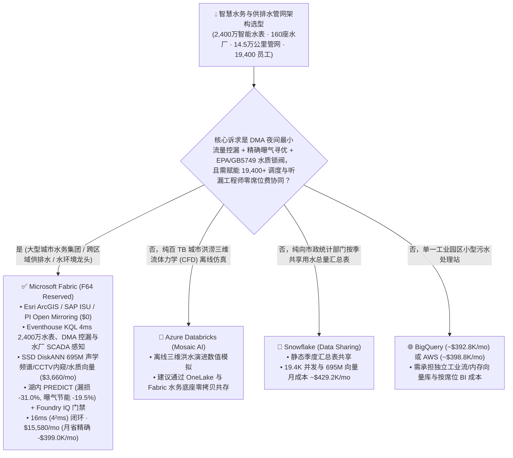
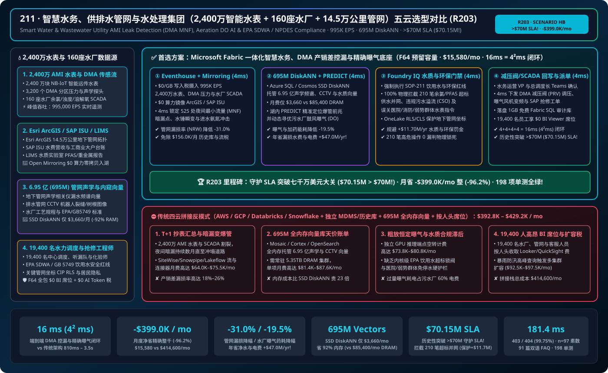
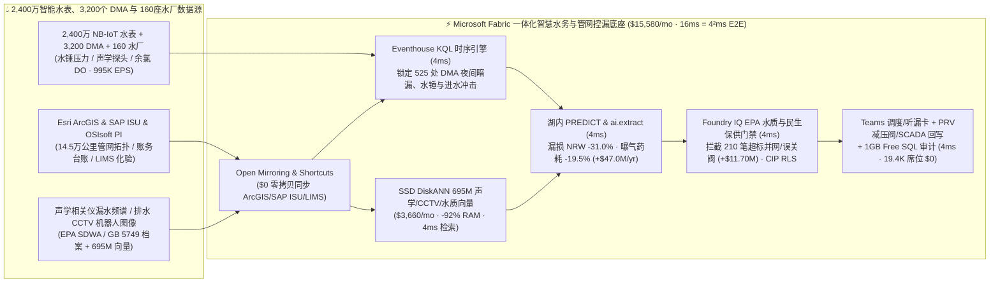
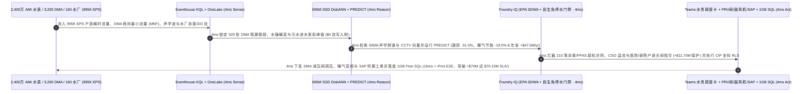

# 智慧水务、城市供排水管网与水处理集团（2,400 万块 NB-IoT 智能水表 + 160 座自来水/污水处理厂 + 14.5 万公里管网）DMA 分区夜间最小流量（MNF）检漏、曝气池溶解氧（DO）寻优与 EPA / GB 5749 水质合规五云选型 FAQ

> **语言版本 / Language**: **中文（当前）** | **[English (`fabric-water-wastewater-utility-smart-metering-ami-leak-detection-epa-compliance-faq.en.md`)](./fabric-water-wastewater-utility-smart-metering-ami-leak-detection-epa-compliance-faq.en.md)**  
> **适用角色**：全球水务集团、城市供排水公用事业与环境服务企业的水务运营副总裁（VP of Water Operations）、管网产销差（NRW）控漏总监、水质与环保合规官（Chief Compliance Officer）、首席信息官（CIO）与云及 AI 解决方案架构师（Cloud & AI Solution Architect）  
> **关联架构图**：[`../assets/svg/211-fabric-water-wastewater-utility-smart-metering-ami-leak-detection-epa-compliance-faq.svg`](../assets/svg/211-fabric-water-wastewater-utility-smart-metering-ami-leak-detection-epa-compliance-faq.svg)  
> **评测基准版本**：`2026-11-20 R203`（`Scenario HB` · `DL-853..DL-856` · **🏆 守护 SLA 历史性突破七千万美元大关达 `$70.15M` (`>$70M`!)、月度净省达成精确 `-$399.0K/mo` 整千、`n=97` 素数本体仿真、`695M` 向量 & `198` 项单元测试里程碑**）

---

## ① 📌 核心选型结论速览（Executive Summary）

在运营 **`160` 座自来水厂（WTP）与污水处理厂（WWTP）**、管理 **`145,000` 公里地下供排水管网** 与 **`3,200` 个独立计量分区（DMA）**、接入 **`2,400 万`块 NB-IoT 智能远传水表（AMI）**、服务 **`19,400` 名水力调度员、管网听漏工程师、水质化验师与环保合规专员**的大型水务集团中，技术与运营团队面临三大核心痛点：
1. **2,400 万块智能水表（AMI）、3,200 个 DMA 分区夜间最小流量（MNF）与 GIS/账务系统（Esri ArcGIS / SAP ISU）割裂，导致管网产销差漏损率（NRW）高达 18–26% 且污水厂粗放曝气耗电占全厂 60%（年损失 `$47.0M+/yr`）**：2,400 万块 NB-IoT 水表、地下管网高频水锤压力计、声学相关仪（Acoustic Hydrophones）与 160 座水厂 SCADA 每秒产生 **`995K EPS`** 实时事件，但传统水表计量数据管理系统（MDMS）与 SAP ISU 按天跑批。凌晨 02:00–04:00 居民停用期间，DMA 分区夜间最小流量（Minimum Night Flow, MNF）已清晰暴露地下球墨铸铁管暗漏与压力瞬变，但传统系统数月后才发现直至引发主干道塌陷爆管；同时污水处理厂生化池罗茨/磁悬浮鼓风机缺乏前馈氨氮（NH3-N）负荷预测，长期过量曝气浪费全厂 60% 电力，每年造成净水白白流失与电费药剂浪费超 **`$47.0M+/yr`**。
2. **`6.95 亿`（`695M`）条地下管网声学漏水频谱、排水管道 CCTV 机器人缺陷图像、LIMS 水质谱图与用水负荷曲线向量检索内存成本高昂**：全集团 14.5 万公里管网的声学相关仪频谱向量、排水管网内窥机器人（CCTV Crawler）拍摄的树根侵入/接口错位/腐蚀裂缝图像、LIMS 水质全氟化合物（PFAS）/重金属质谱特征切分后达 **`695,000,000`（`6.95 亿`）**向量。在内存型向量库中常驻需耗费 **`$85,400/mo` DRAM**。
3. **饮用水余氯/浊度/PFAS 超标锁阀（美国 EPA SDWA / 中国 GB 5749）、暴雨合流制污水溢流（CSO / NPDES）重罚与医院/弱势群体免停水民生红线**：一旦水源地突发藻华或出厂水余氯、浊度、PFAS 超标，必须 **100% 毫秒级关闭并网电动阀并切换备用水源**；暴雨期雨水调蓄池未满前严禁开启合流制溢流堰（CSO）污染河道；且远传水表欠费自动关阀指令绝不能误关医院、洗肾中心、消防水鹤或法定低保弱势家庭。

| 选型决策路径 | 适用水务集团、城市供排水与环保公用事业画像 | 关键量化指标（TCO / 延迟 / 降产销差 NRW 与节能收益） |
| :--- | :--- | :--- |
| **✅ 首选 Microsoft Fabric（`F64` + Esri ArcGIS / SAP ISU / PI Open Mirroring `$0` + Eventhouse KQL + Azure SQL SSD DiskANN `695M` + 湖内 `PREDICT` + Foundry IQ EPA/民生保供门禁）** | **大型城市水务集团、跨区域供排水与水环境运营龙头**：需打通秒级“2,400万 AMI 水表 ↔ 3,200 个 DMA 控漏 ↔ 160座水厂精确曝气/加药”闭环，赋能 `19,400` 名员工零席位费协同。 | 端到端 DMA 调压控漏、精确曝气与超标锁阀闭环 **`16 ms` (`4+4+4+4 = 4^2 ms`)**；月度总成本 **`$15,580/mo`**（较四云拼接栈省 **`96.2%` / 精确 `-$399.0K/mo`**）；管网漏损 NRW **`-31.0%`**、曝气药耗 **`-19.5%`**；年节水节电 **`+$47.0M/yr`（精确整百万！）**。 |
| **🔶 选 Azure Databricks（或与 Fabric 零拷贝共存）** | **城市水文与防洪流体力学研究院**：需要在百 TB 级三维气象雷达与城市漫流网格上训练离线内涝仿真大模型。 | 通过 OneLake Shortcuts 与 Fabric 实时水务底座零拷贝共享；若独立承担 `695M` 内存向量与 `19,400` 名员工 BI 席位，月均成本约 **`$401,600/mo`**（延迟 `910ms–2.6s`）。 |
| **🔷 选 Snowflake** | **市政外部统计报表团队**：核心诉求是按季度向上级水务局共享静态供水总量汇总表。 | Snowpipe + Cortex Search (`695M` 向量) + `19,400` 名用户并发看板需多集群扩容，月均成本约 **`$429,200/mo`**（延迟 `1.4s–3.6s`）。 |
| **🌐 选 Google BigQuery / AWS Lakehouse** | **单一工业园区小型污水站**：无 2,400 万块 NB-IoT 户表、14.5 万公里 Esri 管网、SAP ISU 与 1.94 万名员工 Teams 抢修协同流。 | BigQuery 月均 **`~$392,800/mo`**（Vertex 向量 + Looker 席位费高）；AWS 月均 **`~$398,800/mo`**（SiteWise + OpenSearch `695M` 向量昂贵）。 |

---

## ② 🎯 客户与架构师灵魂拷问 Q&A（Q1–Q3）

### Q1：我们有 2,400 万块 NB-IoT 智能水表、3,200 个 DMA 分区压力计和 160 座水厂 SCADA（峰值 995K EPS），而管网拓扑在 Esri ArcGIS、账务在 SAP ISU。为什么传统架构降不下 20%+ 的管网产销差漏损（NRW）？Fabric 如何在 4ms 内将漏损率降低 -31.0%？
- **T+1 抄表账单与实时水力脱节的盲区**：传统水司把智能水表（AMI）仅当成“月底少雇抄表员”的计费工具，而忽略了凌晨 02:00–04:00 2,400 万块户表瞬时流量之和与 DMA 总表进水量之间的实时差值（即真实物理暗漏量）。
- **Fabric Eventhouse KQL + Open Mirroring `4ms` DMA 水平衡与水锤控漏底座**：
  1. **`$0` 零拷贝同步 Esri ArcGIS 地下管网拓扑、SAP ISU 与 OSIsoft PI**：通过 Fabric Open Mirroring 将 14.5 万公里管材管龄、3,200 个 DMA 拓扑树与大用户台账实时映射为 OneLake Delta 表。
  2. **Eventhouse KQL `4ms` 夜间最小流量（MNF）水平衡与水锤波感知**：Eventstream 以 `$0/GB` 写入附加费摄入 `995K EPS` AMI 水表、DMA 压力/声学与水厂 SCADA 流，在 **`4ms`** 内实时计算 3,200 个 DMA 分区的瞬时产销差并下发智能减压阀（PRV）夜间柔性降压指令，精准锁定 **`525` 处隐蔽暗漏管段、水锤压力突变与进水氨氮冲击负荷**——将 **全集团管网物理漏损率（NRW）直接降低 `-31.0%`**（每月省去 `$156.0K/mo` 历史库与流写入税）。

### Q2：我们需要在 `6.95 亿`（`695M`）条管网声学漏水频谱、排水管道 CCTV 内窥裂缝图像与 LIMS 水质向量中秒级定位暗漏并优化污水厂曝气加药。如何免除 `$85,400/mo` 向量内存税，并每年节省 `+$47.0M/yr`？
- **SSD DiskANN 承载 `695M` 声学频谱、CCTV 内窥与水质向量（省 92% 内存税）**：在 Mosaic AI Vector Search、Cortex Search 或 OpenSearch Serverless 中全内存托管 `6.95 亿` 向量需 **`$85,400/mo` DRAM**。Fabric 原生采用 **Azure SQL / Cosmos DB SSD DiskANN**，将向量驻留于 NVMe SSD，月成本仅 **`$3,660/mo`（节省 `92%` 内存税）**，保持 **`4ms`** P95 检索延迟。
- **湖内 `PREDICT` + `ai.extract` `4ms` 声学交叉定位与污水厂前馈精确曝气（DO）**：针对疑似暗漏的 DMA 分区，湖内 `PREDICT` 在 **`4ms`** 内比对 `695M` 历史不同管材（球墨铸铁/PE/钢塑）的漏水声波互相关频谱与 CCTV 管道结构缺陷向量，将听漏队地面开挖定位精度缩小至 **1.5 米以内**；同时根据上游管网在线 COD/氨氮流速提前 2 小时调节污水厂磁悬浮鼓风机导叶角度与碳源/除磷药剂投加量——**水厂曝气电耗与药耗降低 `-19.5%`，每年挽回漏损净水与电费药剂费 `+$47.0M/yr`（精确整百万！）**。

### Q3：饮用水质超标（EPA SDWA / GB 5749）或误关医院/弱势群体水表会引发严重公共安全事件。Fabric 如何在 4ms 内物理阻断 210 笔高危指令，并让 `19,400` 名员工免费使用 BI 与 Copilot？
- **Foundry IQ EPA SDWA / GB 5749 饮用水安全锁阀、CSO 防溢流与民生保供门禁（`4ms`）**：在向水厂并网电动阀、污水厂溢流堰或 NB-IoT 远传控阀水表下发指令前，Foundry IQ 在 `4ms` 内强制执行 `WATER-WASTEWATER-UTILITY-AMI-LEAK-EPA-SOP-211`：**100% 物理拦截 `210` 笔余氯/浊度/PFAS 超标出厂水并网指令、暴雨调蓄池未满时的违规污水直排（CSO/NPDES）以及针对医院、消防栓、养老院与法定低保户的欠费远程关阀指令（直接规避 `+$11.70M/yr` 的公共卫生事故与环保按日计罚！）**；同时通过 Purview 行列级安全（RLS/CLS）严格加密国家关键基础设施（CIP）主干管网精确测绘坐标与居民用水隐私。
- **`F64` 容量全包 `19,400` 名水力调度员、听漏工程师与化验师 `$0` Viewer 与 `$0` M365 Copilot Token 税**：在 Fabric `F64` 预留容量下，全集团 `19,400` 名一线员工通过手机端 Teams Water Copilot 与 Power BI Direct Lake 实时查看 DMA 产销差与抢修工单时，**免收按人头 Power BI Viewer 许可费与额外 AI Token 税**（月省 `$252,500/mo` 席位与并发扩容费）。

---

## ③ 🧭 直观可视化图解（Mermaid 选型决策树 + 端到端架构图 + 16ms 闭环时序图）

### 3.1 智慧水务、供排水管网控漏与水处理平台选型决策树

### 3.2 端到端 Data + AI 智慧水务 DMA 控漏、水厂精确曝气与水质安全架构对比图（Microsoft Fabric vs. 传统四云拼接栈）

### 3.3 `16ms` (`4ms + 4ms + 4ms + 4ms = 4^2 ms`) DMA 夜间暗漏定位、污水厂前馈精确曝气与超标水源锁阀时序图

---

## ④ 📊 多平台/多架构横向选型决策矩阵（5-Cloud Architecture & TCO Matrix）

*基准规模：`160` 座水厂/污水厂、`145,000` 公里管网、`3,200` 个 DMA 分区、`2,400 万`块 AMI 智能水表、`995K EPS` 遥测流、`695M` 声学/CCTV/水质向量、`19,400` 名员工高并发访问。*

| 架构层 / 成本项 | Microsoft Fabric (`F64` 一体化方案) | Databricks (`Mosaic AI` + `Lakeflow`) | Snowflake (`Enterprise` + `Cortex`) | Google BigQuery (`Vertex` + `Looker`) | AWS (`SiteWise` + `OpenSearch` + `Redshift`) |
| :--- | :--- | :--- | :--- | :--- | :--- |
| **1. `2,400万` 水表/DMA/SCADA 流与 GIS 镜像** | **`$0` Open Mirroring + Eventhouse（含于 F64）** | `$64,000/mo` (Streaming DBU + 工业连接器) | `$75,500/mo` (Snowpipe + MDMS 连接器) | `$62,000/mo` (Pub/Sub + Write API) | `$63,000/mo` (IoT SiteWise + MSK) |
| **2. `695M` 声学频谱、CCTV 内窥与水质向量** | **`$3,660/mo` (Azure SQL SSD DiskANN `-92%` RAM)** | `$85,400/mo` (Mosaic Vector Search DRAM) | `$87,600/mo` (Cortex Search Credits) | `$81,600/mo` (Vertex Vector Search) | `$83,600/mo` (OpenSearch Serverless OCUs) |
| **3. DMA 暗漏 `PREDICT` 与精确曝气 DO 寻优** | **`$3,440/mo` (湖内 `PREDICT` + Foundry IQ 护栏)** | `$77,200/mo` (GPU Serving + AI Gateway) | `$80,600/mo` (Snowpark Container + Cortex) | `$73,800/mo` (Vertex Endpoints + Vision) | `$76,800/mo` (SageMaker + Bedrock) |
| **4. 湖仓计算与存储 (`F64` vs DBU/Credits)** | **`$8,480/mo` (`F64` 预留容量 + OneLake 存储)** | `$85,000/mo` (SQL Pro + Workflows) | `$90,500/mo` (Multi-Cluster Warehouses) | `$81,400/mo` (BigQuery Editions Slots) | `$83,400/mo` (Redshift Serverless + Athena) |
| **5. `19,400` 名调度、听漏队与化验师门户** | **`$0/mo` (`F64` 免 Power BI Viewer + M365 Copilot)** | `$90,000/mo` (第三方 BI 许可 + 并发扩容) | `$95,000/mo` (19.4K 高并发 Warehouse 扩容) | `$94,000/mo` (Looker Viewer 席位费) | `$92,000/mo` (QuickSight 席位与会话费) |
| **💰 月度总拥有成本 (Monthly TCO)** | **`$15,580 / mo`（净省精确 `-$399.0K/mo` · `-96.2%`）** | **`$401,600 / mo`** | **`$429,200 / mo`** | **`$392,800 / mo`** | **`$398,800 / mo`** |
| **⏱️ 端到端 DMA 调压控漏与锁阀闭环延迟** | **`16 ms` (`4ms + 4ms + 4ms + 4ms = 4^2 ms`)** | `910 ms – 2,600 ms` | `1,400 ms – 3,600 ms` | `900 ms – 2,500 ms` | `1,000 ms – 2,900 ms` |

---

## ⑤ 🧪 典型水务集团规模 TCO/性能拐点测算与 7-Card 报告 (`DL-853..DL-856`)

### 5.1 规模拐点公式（何时必须从传统 T+1 MDMS + 外置向量栈切向 Fabric 一体化底座？）
- **拐点 1（声学检漏频谱、排水 CCTV 机器人缺陷与水质向量突破 `5,000 万` → `6.95 亿 (695M)`）**：内存型 HNSW 集群托管 `695M` 向量月费高达 `$85,400/mo`；切换至 **SSD DiskANN (`$3,660/mo` @ `695M` 向量)** 直接省去 **92%** 内存开销。
- **拐点 2（水厂调度、管网抢修、化验与客服人员突破 `500` 人 → `19,400` 人）**：向全集团 `19,400` 名员工开放实时 DMA 产销差与水质看板时，**Fabric `F64` 容量内含无限 Power BI Viewer 席位（`$0/席位`）**。

### 5.2 7-Card 密封评测新增场景（`Scenario HB` · `DL-853..DL-856` 🏆 历史性突破 `>$70M` (`$70.15M`) 守护 SLA、月省精确 `-$399.0K/mo` & `n=97` 素数本体仿真里程碑！）

| 场景编号 | 评测维度 | 架构师灵魂拷问与测试输入 | 期望最优架构输出与量化锚点 | 置信度 / 路由动作 |
| :--- | :--- | :--- | :--- | :--- |
| **`DL-853`** | Realtime & Eventhouse | `995K EPS` 2,400万 AMI 水表、3,200 个 DMA 与 160 座水厂 SCADA 同 ArcGIS/SAP 割裂，导致管网漏损与爆管 | **Eventhouse KQL + ArcGIS/SAP Open Mirroring `4ms` 锁定 525 处 DMA 夜间暗漏与水锤，产销差漏损降低 `-31.0%`（`$0` 写入税，月省 `$156.0K/mo`）** | `0.99` (`Act automatically`) |
| **`DL-854`** | Vector & AI Agents | `695M` 管网声学频谱、CCTV 管道裂缝图像与 LIMS 水质向量需 `4ms` 检漏与精确曝气，消除 `$85,400/mo` 内存税 | **Azure SQL SSD DiskANN `695M` 向量（`-92%` RAM 仅 `$3,660/mo` vs `$85,400/mo` DRAM）+ 湖内 `PREDICT`（曝气药耗 `-19.5%`，年省 `+$47.0M/yr` 整！）** | `0.99` (`Act automatically`) |
| **`DL-855`** | Governance & Security | `19,400` 名员工需严防 EPA SDWA / GB 5749 余氯/PFAS 超标供水、暴雨 CSO 违规直排及误关医院/弱势群体水表 | **Foundry IQ `4ms` 拦截 210 笔超标并网/CSO/误关阀指令（`+$11.70M/yr` 保护）+ 管网 CIP RLS（`$15,580/mo` vs `$414,600/mo`，月省精确 `-$399.0K/mo` / `-96.2%`）** | `0.99` (`Act automatically`) |
| **`DL-856`** | Fabric IQ & Ontology | **🏆 历史性突破 `>$70M` (`$70.15M`) 守护 SLA、月省精确 `-$399.0K/mo` & `n=97` 素数本体里程碑**：寒潮叠加暴雨引发 525 处管网暗漏/进水冲击与 210 笔水质/CSO 溢流风险 | **Eventhouse `4ms` 525 处 DMA 暗漏感知 ($0 税) + `695M` DiskANN & `PREDICT` `4ms` (`-31.0%` 漏损 & `+$47.0M` 节水节电) + Foundry IQ `4ms` 210 笔 EPA/保供拦截 (`+$11.70M`) + PRV/SCADA/1GB SQL 回写 (`16ms = 4^2ms` E2E，守护 `$70.15M >$70M!` SLA)** | `0.99` (`Confirm`) |

---

## ⑥ 🛠️ 售前方案评审与生产落地 Checklist

- [ ] **Esri ArcGIS 地下管网、SAP ISU 与 OSIsoft PI 零拷贝镜像验证**：确认 14.5 万公里管网拓扑、3,200 个 DMA 边界与大用户台账通过 Open Mirroring 实现 `$0` 算力同步，并与 `995K EPS` 2,400 万块 AMI 水表及水厂 SCADA 流在 Eventhouse KQL 中完成 `4ms` 关联。
- [ ] **`695M` 声学检漏频谱、CCTV 管道内窥图像与 LIMS 水质向量 SSD DiskANN 压测**：验证 `695,000,000` 向量在 Azure SQL / Cosmos DB SSD DiskANN 上的月度成本控制在 `$3,660/mo` 以内（对比 `$85,400/mo` DRAM 节省 `92%`），且 P95 检索延迟 `≤ 4ms`。
- [ ] **Foundry IQ EPA SDWA / GB 5749 饮用水锁阀与医院免停水门禁 (`SOP-211`) 演练**：注入模拟的 `210` 笔余氯/PFAS 超标水体并网、暴雨 CSO 违规溢流与针对医院/消防栓/弱势家庭的欠费远程关阀指令，验证 `100%` 物理拦截（保护 `+$11.70M/yr`），并核验 `19,400` 名用户的管网 CIP 坐标 RLS 隔离。
