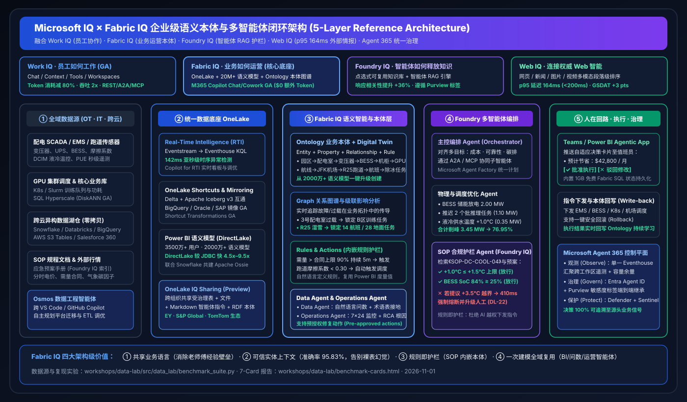

# 🧭 AI Solution Architect Business Scenario & Win/Loss Playbook (Win Themes · Coexistence · Anti-Patterns)

> **Language**: [中文 (`scenario-win-loss-playbook.md`)](scenario-win-loss-playbook.md) | **English (Current)**  
> **Architect Lens**: Practical guidance on when to lead with **Full-Stack Microsoft Fabric**, when to deploy **Multi-Cloud Zero-Copy Coexistence (Better Together)**, and which **Anti-Patterns** to avoid.

---

## 1. Four Flagship Industry Reference Solutions

### Scenario 1: AI Compute Center (AIDC) Peak Energy Orchestration & Shaving
- **Business Pain**: 10,000-GPU training clusters experience sharp power spikes during summer peak tariffs, risking 2x demand-charge penalties when approaching the `20.0 MW` utility cap. OT systems (SCADA, DCIM liquid cooling, BESS batteries) and IT schedulers (Kubernetes/Slurm) are siloed.
- **Reference Architecture**:
  1. **Sense (`142 ms`)**: SCADA, DCIM, and GPU telemetry stream via **Eventstream** into **Eventhouse KQL**.
  2. **Model (`186 ms`)**: **Fabric IQ Ontology** maps `Campus → Substation → Transformer → BESS → RackRow → GPUCluster → TrainingJob` with embedded safety rules.
  3. **Optimize & Verify (`336 ms`)**: **Foundry Multi-Agent Orchestrator** combines **`2.00 MW` BESS discharge + `1.10 MW` batch inference deferral + `0.35 MW` from raising liquid cooling supply temp `+1.0°C`**, while **Foundry IQ** verifies compliance against `SOP-DC-COOL-04` (`max +1.5°C`).
  4. **Act & Govern (`116 ms`)**: Dispatches a **Teams Adaptive Card** for human-in-the-loop approval, writes back audit records to **1GB free Fabric SQL** and the Ontology graph, governed end-to-end by **Microsoft Agent 365**.
- **Quantified ROI**: **`780 ms`** end-to-end latency, **`3.45 MW`** peak shaved (`94.2% → 76.95%` utilization), and **`$42,800/mo`** projected savings per campus.

---

### Scenario 2: Aviation & Hub Logistics Real-Time Digital Twin (JFK Runway R25 Case)
- **Business Pain**: Winter wet-snow contamination drops runway friction (`0.24 < 0.30`), causing cascading delays across terminals, de-icing trucks, gates, and connecting passengers.
- **Reference Architecture**:
  1. **One-Click Ontology Bootstrap**: Upgrade existing **Power BI flight operations semantic models** directly into a **Fabric IQ Ontology**.
  2. **Live Signal Binding**: Bind Eventhouse runway sensor streams to `Runway:R25`.
  3. **Graph Cascade & Pre-Authorized Action**: Trace impact across `14 active flights` and `28 ground tasks` (`164 ms`); **Operations Agent** automatically dispatches `Snowplow Fleet-Alpha (4 vehicles)` and reallocates `6 gates` to `R13L`.
- **Quantified ROI**: **`640 ms`** end-to-end resolution, **`38-minute`** reduction in cascading delays, and **`$68,500`** saved per severe weather event.

---

### Scenario 3: Cross-Cloud Omnichannel Retail Flash-Sale & Fabric IQ Planning Write-back (BigQuery + Snowflake + AWS S3 + Fabric)
- **Business Pain**: Flash-sale marketing attribution lives in **GCP BigQuery (Google Ads / GA4)**, supplier POs and financial accounting live in **Snowflake**, carrier telemetry lives in **AWS S3 Tables**, and 2,000 business users operate in **Microsoft 365 / Teams / Power BI**.
- **Reference Architecture (Coexistence Modes A + C + D · Simulation `retail_cross_cloud_planning` / `DL-26`)**:
  1. **Zero-ETL Sense (`134 ms`)**: **GA OneLake BigQuery Mirroring**, **Snowflake Mirroring**, and **S3 Shortcuts** detect a **`+240%`** conversion surge (`12,400 orders/hr`) on `SmartWatch-Pro-X`, dropping `EU-Central-02` inventory to **`1.8 days-of-supply`** (`< 3.0d` floor).
  2. **Ontology Graph & Planning Optimization (`352 ms`)**: **Fabric IQ Ontology** traverses the 6-hop cross-cloud graph and pairs with **Fabric IQ Planning (Preview)** to reallocate **`4,500 units`** from `DE-South`, trigger an **`8,000-unit`** emergency PO in Snowflake ERP, and allocate **`+$185,000`** in Q4 promo budget.
  3. **Margin Guardrail & 1GB Free SQL Write-back (`224 ms`)**: **Foundry IQ** verifies post-reallocation net margin (**`24.6% >= 22.0%`**); merchandising lead approves in **Power BI Agentic App**, writing back to **1GB Free Fabric SQL** and refreshing DirectLake visuals.
- **Quantified ROI**: **`710 ms`** end-to-end resolution, inventory restored to **`6.4 days`**, **`$312,000`** revenue protected per flash sale, and **`47.6%–56.1%`** lower 500-user monthly TCO.

---

### Scenario 4: Multi-Cloud Financial Fraud & Connected Vehicle Telemetry (AWS S3 + Databricks + Fabric)
- **Reference Architecture (Coexistence Modes B + D)**:
  - Mount raw telemetry in **Amazon S3 / S3 Tables** via **cached OneLake S3 Shortcuts** and connect **Azure Databricks Unity Catalog** feature tables via zero-copy shortcuts.
  - Stream live events into **Eventhouse KQL** and trigger Purview-governed fraud/maintenance actions via **Fabric IQ Operations Agent**.

---

## 2. Presales Decision Matrix: Win Themes vs. Coexistence vs. Anti-Patterns

| Category | Customer Signals & Workload Profile | Recommended Architect Play |
| :--- | :--- | :--- |
| **✅ Primary Win (Full-Stack Fabric)** | • Enterprise standardized on M365 E3/E5, Teams, Power BI, and M365 Copilot • Moving from passive dashboards to proactive **Operations Agents** & write-back apps • Cross-domain OT/IT entity cascade problems (Energy, Aviation, Manufacturing, Retail) | Lead with **OneLake + Fabric IQ Ontology + Foundry IQ + Agent 365**, highlighting `$0` extra Copilot token cost and 1GB free Fabric SQL |
| **🤝 Coexistence Win (Better Together)** | • Heavy existing investments in Snowflake, Databricks, BigQuery, or AWS S3 • Data engineering refuses to rewrite battle-tested Spark DLT or core warehouse pipelines • Pain points center on BI concurrency spikes, metric drift, and multi-cloud silos | **Never pitch "rip-and-replace"!** Lead with **OneLake Mirroring / Shortcuts + Apache Ossie + IQ Sharing** to deliver an AI/BI layer in days without touching source pipelines |
| **⛔ Anti-Patterns (When NOT to Use)** | • **Anti-Pattern 1**: Exposing ungrounded LLM Text-to-SQL directly on raw lakehouse tables without a semantic model/Ontology (`DL-23` caused `+14.2%` EBITDA drift) • **Anti-Pattern 2**: Allowing autonomous agents to write unsafe physical control setpoints (e.g., `+3.5°C` cooling override) without Foundry IQ SOP guardrails and HITL approval • **Anti-Pattern 3**: Running 70B+ foundation model pre-training or `< 5 ms` HFT matching inside analytical lakehouse capacities | Route 70B+ model training to **Azure AI Foundry / Azure Databricks**, and enforce **Ontology Rules + Foundry IQ SOP guardrails + HITL** for physical operations |
