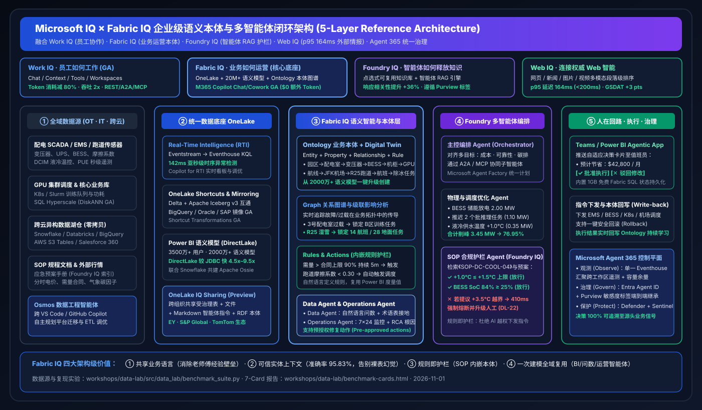

# 🧭 AI Solution Architect 业务场景方案与选型打单 Playbook（Win Themes · Coexistence · Anti-Patterns）

> **语言版本 / Language**: **中文 (当前)** | [English (`scenario-win-loss-playbook.en.md`)](scenario-win-loss-playbook.en.md)  
> **架构师视角**：从真实业务痛点出发，明确何时主推 **Fabric 原生全栈**、何时采用 **跨云零拷贝共存（Better Together）**、何时主动规避 **反模式（Anti-Patterns）**。

---

## 1. 五大高价值行业场景端到端方案（Industry Reference Solutions）

### 场景一：智算中心（AIDC）AI 能源编排与削峰填谷闭环
- **客户痛点**：单园区万卡 GPU 集群功耗剧烈波动，夏季尖峰时段极易突破电网需量合同上限（触发 2 倍罚款）；配电 SCADA、液冷 BMS、储能 BESS 与 K8s/Slurm 算力调度各自孤立，过度依赖退休老师傅经验。
- **推荐架构**：
  1. **感知层**：SCADA / DCIM / GPU 功耗遥测通过 **Eventstream** 秒级写入 **Eventhouse KQL**（`142 ms` 异常斜率检测）。
  2. **本体层**：在 **Fabric IQ Ontology** 中建模 `园区 → 配电室 → 变压器 → BESS 储能 → 机柜列 → GPU 集群 → 训练任务` 6 级拓扑与安全阈值规则。
  3. **护栏与编排层**：**Foundry 多智能体** 联合寻优（BESS 放电 `2.00 MW` + 推迟非关键批推理 `1.10 MW` + 液冷微调 `+1.0°C` 省 `0.35 MW`），并由 **Foundry IQ** 强制校验《`SOP-DC-COOL-04`》（`+1.0°C ≤ +1.5°C` 上限）。
  4. **行动与治理层**：推送 **Teams 自适应审批卡**，值班长一键批准后下发 EMS/K8s，并将执行记录回写至 **1GB 免费 Fabric SQL** 与 Ontology 图谱，全程受 **Agent 365** 审计。
- **量化业务 ROI**：端到端响应 **`780 ms`**，单次削峰 **`3.45 MW`**（负荷率从 `94.2%` 降至 `76.95%`），单园区预计**月省 `$42,800`**。

---

### 场景二：航空与枢纽物流实时运营数字孪生（纽约 JFK R25 跑道湿雪案例）
- **客户痛点**：恶劣天气下跑道摩擦系数下降、除冰车调度、登机口重分配与旅客中转通知跨越多套遗留系统，人工协调耗时 45 分钟以上，造成大面积级联延误。
- **推荐架构**：
  1. **一键本体冷启动**：直接从航司现有的 **Power BI 航班准点率语义模型**一键升级生成 **Fabric IQ Ontology**，免除从零手写图谱 schema。
  2. **实时信号绑定**：将跑道道面传感器与气象雷达流绑定至 Ontology 中的 `Runway:R25` 实体。
  3. **级联穿透与预授权执行**：当摩擦系数跌至 `0.24 (< 0.30)` 时，Ontology Graph 在 `164 ms` 内锁定受影响的 14 架航班与 28 项地面任务；**Operations Agent** 依据预授权规则自动派遣 Alpha 扫雪车队并重分配 6 个登机口。
- **量化业务 ROI**：端到端闭环 **`640 ms`**，级联延误缩减 **`38 分钟`**，单次寒潮事件规避航司损失 **`$68,500`**。

---

### 场景三：跨云全渠道零售爆单与 Fabric IQ Planning 事务回写闭环（GCP BigQuery + Snowflake + AWS S3 + Fabric）
- **客户痛点**：海外黑五闪促广告投放数据在 **GCP BigQuery (Google Ads / GA4)**，采购合同与财务结算在 **Snowflake**，跨境物流轨迹在 **AWS S3 Tables**，而全球 2,000 名业务人员日常办公在 **Microsoft 365 / Teams / Power BI**。大促爆单时库存断货响应滞后，跨云 ETL 管道脆弱且无法从报表直接修改预算。
- **推荐架构（共存模式 A + C + D，对应仿真 `retail_cross_cloud_planning` / `DL-26`）**：
  1. **跨云零拷贝感知 (`134 ms`)**：启用 **已正式 GA 的 OneLake BigQuery Mirroring**、**OneLake Snowflake Mirroring** 与 **S3 Shortcuts**，捕获旗舰单品 `SmartWatch-Pro-X` 转化率暴增 **`+240%`**（`12,400 单/小时`），欧洲中心仓可售天数跌至 **`1.8 天`**（`< 3.0 天` 阈值）。
  2. **跨云本体穿透与 Planning 寻优 (`352 ms`)**：**Fabric IQ Ontology** 穿透 6 跳跨云实体链路，联合 **Fabric IQ Planning (Preview)** 生成方案：从南德缓冲仓调拨 **`4,500 件`** + 触发 Snowflake ERP 合同 `PO88` 紧急加单 **`8,000 件`** + 动态追加 Q4 促销预算 **`+$185,000`**。
  3. **利润率护栏与 1GB 免费 SQL 回写 (`224 ms`)**：**Foundry IQ** 校验调拨后净毛利率 **`24.6% ≥ 22.0%`** 红线；业务总监在 **Power BI Agentic App** 中一键确认，直接回写至 **1GB 免费 Fabric SQL 数据库** 并通过 DirectLake 秒级刷新全员看板。
- **量化业务 ROI**：端到端闭环 **`710 ms`**，可售库存恢复至 **`6.4 天`**，单次闪促规避断货损失 **`$312,000`**，500+ 用户月度 TCO 降低 **`47.6%–56.1%`**。

---

### 场景四：多云金融实时跨境电汇反欺诈与 Project Osmos 管道自愈闭环（AWS S3 + Azure Databricks + Snowflake + Fabric）
- **客户痛点**：数以百 TB 计的移动端设备日志存放在 **AWS S3 Tables**，图神经网络（GNN）欺诈特征工程跑在 **Azure Databricks (Unity Catalog)**，核心总账在 **Snowflake**；上游 ISO-20022 报文一旦发生字段升级即导致跨云管道中断，且一线风控团队缺乏亚秒级跨云团伙阻断与可疑活动报告（SAR）双库回写闭环。
- **推荐架构（共存模式 A + B + D，对应仿真 `financial_multi_cloud_fraud` / `DL-29 & DL-30`）**：
  1. **实时流感知与 Project Osmos 管道自愈 (`270 ms`)**：**Eventhouse KQL** 配合带出站访问保护的 **OneLake S3 Shortcut** 捕获 90 秒内 **38 个合成身份账户**突发 `$4.85M` 跨境电汇（团伙风险分 `0.97 > 0.85`）；同时 **Fabric Data Engineering Agent (Project Osmos)** 在 `152 ms` 内自动修复上游新增字段 `ultmtDbtrId` 引发的 Schema 漂移。
  2. **跨四云 6 跳图谱穿透 + DiskANN 向量匹配 (`160 ms`)**：**Fabric IQ Ontology** 结合 **Databricks Agent Bricks Supervisor (OBO 委托认证)** 与 **Snowflake Apache Ossie YAML** 穿透 6 跳团伙链路，并调用 **Azure SQL Hyperscale (192 vCore + 原生 DiskANN 向量索引 GA)** 匹配到 4 起历史洗钱团伙拓扑。
  3. **Foundry IQ 规程校验与双库回写 (`230 ms`)**：校验《`FIN-AML-SAR-SOP-12`》（误报率 `1.4% ≤ 3.0%` 红线），以 `0.97` 置信度预授权自动冻结 `$4.85M` 电汇，并将 SAR 审计案卷同步回写至 **Azure SQL Hyperscale** 与 **1GB 免费 Fabric SQL**。
- **量化业务 ROI**：端到端闭环 **`660 ms`**，单次跨境团伙攻击挽回净欺诈损失 **`$4,620,000`**，跨云 Schema 漂移实现**零停机自愈**。

---

### 场景五：跨 18 工作区容量尖峰 RCA 与 Rayfin SDK 全栈智能体应用自愈闭环（FinOps & Enterprise Platform Ops）
- **客户痛点**：集团级数据平台拥有 18+ 个部门工作区与上千张高管报表，某部门分析师提交的未加索引笛卡尔积慢查询极易瞬间打满 F64 容量池（>110% CU），导致调用外部伙伴本体的核心资金门户限流报错；传统运维排查需跨多个团队耗时 30 分钟以上。
- **推荐架构（对应仿真 `finops_rayfin_observability` / `DL-33 & DL-34`）**：
  1. **跨工作区单一 Eventhouse 感知 (`108 ms`)**：通过 **Workspace Monitoring** 将 18 个生产工作区遥测实时汇入**单一 Eventhouse**，**Monitor Hub Capacity Headroom** 秒级告警 F64 利用率飙升至 **`114.8%`** 并定位 `WS-FIN-PROD-07` 的慢查询 `Q-8841`。
  2. **6 跳图谱穿透与双智能体联合寻优 (`282 ms`)**：**Fabric IQ Ontology** 穿透受影响的 **OneLake IQ Sharing（标普全球 S&P Global RDF 本体）** 与资金门户应用；**Operations Agent** 自动限流慢查询，联合 **Database Agent for SQL** 注入 **DiskANN 向量与复合索引提示**，并按需开启 **On-Demand Billing 突发缓冲（`+16 CU` 25 分钟，花费 `$48.50 ≤ $250` 护栏）**。
  3. **Rayfin TS 函数执行与 1GB 免费 SQL 审计回写 (`200 ms`)**：校验 **Foundry IQ**《`FINOPS-SURGE-SOP-09`》与 **Private-by-Default / Secret Store** 策略后，调用开源 **Rayfin SDK** 编写的 TypeScript 后端函数 `fn_remediateCapacityAndLogAudit()` 将处置记录回写至 **1GB 免费 Fabric SQL**。
- **量化业务 ROI**：端到端闭环 **`590 ms`**，F64 容量利用率从 **`114.8%` 压降至 `71.2%`（`-43.6%`）**，单次规避高管看板与资金门户 SLA 违约罚金 **`$28,400`**。

---

## 2. 选型决策树：必赢场景（Win） vs 混合共存（Coexist） vs 避坑红线（Anti-Patterns）

| 评估分类 | 典型客户信号与场景特征 | 架构师标准打法 |
| :--- | :--- | :--- |
| **✅ 必赢场景 (Primary Win)** | • 企业已广泛采购 Microsoft 365 E3/E5、Teams、Power BI 及 M365 Copilot • 需要将静态 BI 报表升级为可主动监控、根因分析并触发动作的业务智能体 • 面临跨 OT/IT（能源、制造、航空、零售）复杂多跳实体级联决策 | **主推 Fabric 原生全栈 + Fabric IQ Ontology + Foundry IQ + Agent 365**，重点展示 `$0` 额外 Copilot Token 与 1GB 免费 SQL 回写应用 |
| **🤝 混合共存 (Coexistence Win)** | • 客户已在 Snowflake、Databricks、BigQuery 或 AWS S3 投入数百万美元存量资产 • 数据工程团队拒绝推翻重写现有 Spark DLT 或核心数仓批处理作业 • 痛点集中在“最后一公里”的全员 BI 并发成本高、AI 问数口径乱、跨云孤岛 | **绝不强行替换底层数仓！** 主推 **OneLake Mirroring / Shortcuts + Apache Ossie + IQ Sharing**，7 天内在不改源端代码的条件下交付上层 AI/BI 闭环 |
| **⛔ 避坑边界 (Anti-Patterns)** | • **反模式 1**：在未定义语义模型或 Ontology 的裸湖仓表上直接开放 LLM Text-to-SQL 给高管问数（实测 `DL-23` 会产生 `+14.2%` 口径漂移） • **反模式 2**：允许智能体不经 Foundry IQ SOP 护栏校验与 Teams 人在回路审批，直接向物理生产设备下发高危控制指令（如 `+3.5°C` 越界调温） • **反模式 3**：将 70B+ 基础大模型分布式预训练强塞进 Fabric 容量，或将超低延迟高频交易（`< 5 ms` 硬件 FPGA 撮合）放进湖仓分析引擎 | 明确划分职责边界：重度模型预训练交由 **Azure AI Foundry / Azure Databricks**，物理控制指令强制绑定 **Ontology Rules + Foundry IQ 护栏 + HITL** |
