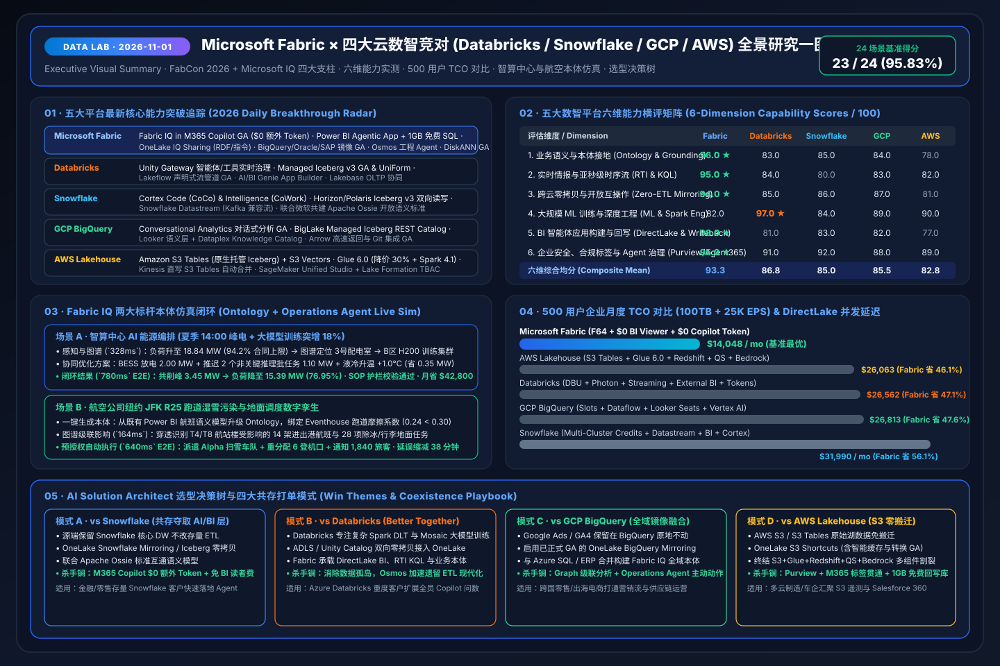

# 📅 Data Lab Daily Deep-Dive Report (2026-11-01): FabCon 2026 & Microsoft IQ Baseline × 5-Cloud Competitive Benchmark

> **Language**: [中文 (`2026-11-01.md`)](2026-11-01.md) | **English (Current)**  
> **Execution Window**: `2026-11-01 23:00–24:00 (UTC+08:00)` · **Persona**: Principal AI Solution Architect  
> **Linked Assets**: [Interactive Workbench (`live-demo.en.html`)](../../live-demo.en.html) · [7-Card Benchmark Deck (`benchmark-cards.en.html`)](../../benchmark-cards.en.html) · [4-Cloud Battlecards](../../comparisons/fabric-vs-4clouds-battlecards-2026.en.md) · [Scenario Win/Loss Playbook](../../playbooks/scenario-win-loss-playbook.en.md)

---

## 0. Daily Hottest Domain Breakthrough Tracking (5-Platform Radar)

In this inaugural baseline and daily tracking run, we synthesized the **FabCon & SQLCon Barcelona 2026** announcements, the **Microsoft IQ 4-pillar architecture**, and late-2026 product releases across **Databricks, Snowflake, GCP, and AWS**:

### 0.1 Microsoft Fabric & Microsoft IQ Breakthroughs
1. **Microsoft IQ Four-Pillar Synergy**:
   - **Work IQ (GA)**: Understands how people work across Chat, Context, Tools, and Workspaces via REST / A2A / MCP APIs, delivering **80% lower token consumption, 2x throughput, and 50% lower cost**.
   - **Fabric IQ (Operational Intelligence Core)**: Connects **① OneLake cross-cloud unified storage → ② Power BI (35M+ monthly active users, 20M+ semantic models) → ③ Ontology (`Entity + Property + Relationship + Rule/Constraint`) + Digital Twin Builder + Graph cascade impact analysis → ④ Data Agent & Operations Agent**.
   - **Foundry IQ (Enterprise Knowledge & Agentic RAG)**: Point-and-click reusable knowledge bases with agentic query planning, achieving **+36% higher response relevance** on complex multi-hop queries while enforcing Purview sensitivity labels.
   - **Web IQ (Real-Time Grounded Web Intelligence)**: Multimodal passage-level ranking across web, news, images, and video at **p95 latency of `164 ms` (`< 200 ms`)** and **+3 GSDAT quality points** over competitors.
2. **FabCon & SQLCon Barcelona 2026 Highlights**:
   - **Fabric IQ in M365 Copilot (Chat & Cowork) GA**: Employees query enterprise semantic models and ontologies directly inside M365 Copilot at **$0 additional AI token cost**.
   - **Power BI Agentic App Creation + 1GB Free Fabric SQL**: Conversational creation of full-stack operational apps with **Write-back**, backed by **1GB of free Fabric SQL database** for every Power BI Pro/PPU/Fabric user.
   - **Open-Source Rayfin SDK/CLI**: Scaffolds full-stack agentic data apps with frontend components, TypeScript backend functions, and PostgreSQL persistence in a single CLI command.
   - **OneLake IQ Sharing (Preview) & GA Multi-Cloud Mirroring**: Share governed tables, files, Markdown agent instructions, and RDF ontologies across organizations; **OneLake Mirroring for Google BigQuery, Oracle, and SAP (via Datasphere) is now GA**, with **Salesforce Data 360 bidirectional zero-copy** in Preview.
   - **Apache Ossie (Incubating)**: Joint open semantic interoperability standard launched by Microsoft and Snowflake under the Apache Software Foundation.
   - **Osmos Autonomous Data Engineering Agent (Preview)**: Native agentic pipeline migration and ETL optimization across VS Code and GitHub Copilot.
   - **Zero-Provisioned / On-Demand Billing & Database Hub**: Pay-as-you-go job billing without upfront capacity reservation; **Azure SQL Hyperscale 192 vCore** and **native DiskANN vector indexing GA**.

### 0.2 Competitor Daily Iteration Radar (Databricks / Snowflake / GCP / AWS)
- **Databricks**: Launched **Unity Gateway** for real-time agent/tool governance, **Managed Iceberg v3 GA & Delta UniForm**, **Lakeflow Declarative Pipelines GA**, and **AI/BI Genie App Builder**.
- **Snowflake**: Released **Cortex Code (CoCo)** and **Snowflake Intelligence (CoWork)**, **Horizon/Polaris Iceberg v3 bidirectional read/write**, **Snowflake Datastream**, and co-founded **Apache Ossie**.
- **Google Cloud (GCP)**: Reached GA for **BigQuery Conversational Analytics**, launched **BigLake Managed Iceberg REST Catalog** across AWS/Azure, and introduced **Dataplex Knowledge Catalog**.
- **AWS**: Rolled out **Amazon S3 Tables (native managed Iceberg)** + **S3 Vectors**, **AWS Glue 6.0 (30% price reduction + Spark 4.1)**, and direct **Kinesis-to-S3 Tables** streaming with automatic compaction.

---

## 1. Dedicated Competitive Sub-Task Summary: Fabric vs. 4 Clouds

Full battlecards are documented in [`comparisons/fabric-vs-4clouds-battlecards-2026.en.md`](../../comparisons/fabric-vs-4clouds-battlecards-2026.en.md):

1. **Why Raw-Table Text-to-SQL Fails in Production (`DL-23` Evidence)**:
   - Querying raw lakehouse tables without a governed semantic model or Ontology caused the ungrounded baseline to join a deprecated staging table (`stg_revenue_2024`) at `0.54` confidence, introducing a **`+14.2%` EBITDA metric drift**.
   - **Fabric IQ Advantage**: Bootstraps directly from **20M+ audited Power BI semantic models** into an operational Ontology with embedded rules, achieving **`23 / 24` (`95.83%`)** accuracy across the evaluation matrix.
2. **500-User Monthly TCO Comparison (`100 TB + 25K EPS + 5,000 Copilot queries/day`)**:
   - **Microsoft Fabric (`F64+`)**: **`$14,048.00 / mo`** (`$0` BI viewer seats + `$0` extra M365 Copilot token cost).
   - **Savings vs. Competitors**: **`46.1%` vs. AWS** (`$26,062.56`), **`47.1%` vs. Databricks** (`$26,562.44`), **`47.6%` vs. GCP** (`$26,812.64`), and **`56.1%` vs. Snowflake** (`$31,989.60`).

---

## 2. Flagship Ontology Simulations (AIDC Energy & Airline JFK R25)

1. **Scenario A — AI Compute Center 14:00 Peak Energy Orchestration (`energy_dc_peak`)**:
   - **Trigger**: Summer 14:00 peak tariff + `+18%` Zone-B H200 training surge pushes campus load to **`18.84 MW / 20.0 MW` (`94.2%`)**.
   - **Closed-Loop Resolution (`780 ms` E2E)**: Eventhouse KQL (`142 ms`) + Ontology Graph (`186 ms`) isolates Substation #3 (`Sub-03`) and `H200-Pod-B`. Foundry multi-agent orchestrator combines **`2.00 MW` BESS discharge + `1.10 MW` batch inference deferral + `0.35 MW` from raising liquid cooling supply temp `+1.0°C`**, shaving **`3.45 MW`** to reach **`15.39 MW` (`76.95%`)**, verified against `SOP-DC-COOL-04` (`max +1.5°C`), saving **`$42,800/mo`**.
2. **Scenario B — Airline JFK Runway R25 Wet-Snow Digital Twin (`airline_jfk_r25`)**:
   - **Trigger**: JFK Runway R25 friction drops to `0.24` (`< 0.30` threshold) under `4.2 mm` wet snow.
   - **Closed-Loop Resolution (`640 ms` E2E)**: Ontology upgraded from Power BI flight models traces `14 active flights` and `28 ground tasks` across `T4 & T8` in `164 ms`, auto-dispatching `Snowplow Fleet-Alpha (4 vehicles)` and reallocating `6 gates` to cut cascade delay by **`38 minutes`** (**`$68,500` saved**).
