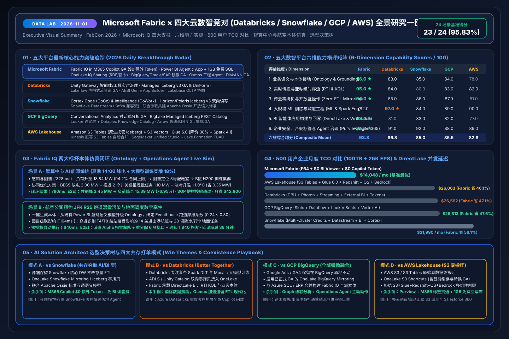

# 📅 Data Lab 每日深度研究报告（2026-11-01）：FabCon 2026 & Microsoft IQ 全面基线 × 五大云数智平台攻防实测

> **语言版本 / Language**: **中文 (当前)** | [English (`2026-11-01.en.md`)](2026-11-01.en.md)  
> **执行窗口**：`2026-11-01 23:00–24:00 (UTC+08:00)` · **角色视角**：AI Solution Architect  
> **关联交互资产**：[交互式工作台 (`index.html`)](../../index.html) · [7-Card 视觉报告 (`benchmark-cards.html`)](../../benchmark-cards.html) · [四大竞对 Battlecards](../../comparisons/fabric-vs-4clouds-battlecards-2026.md) · [场景打单 Playbook](../../playbooks/scenario-win-loss-playbook.md)

---

## 0. 今日最热门领域能力突破追踪（Daily Hottest Domain Breakthroughs）

作为 Data Lab 第一轮全量基线与每日追踪任务，我们深度融合了 **FabCon & SQLCon Barcelona 2026** 最新发布、**Microsoft IQ 四大智能层架构**，并实时检索了 **Databricks、Snowflake、GCP、AWS** 在 2026 年底的最新产品迭代：

### 0.1 Microsoft Fabric & Microsoft IQ 核心突破（基线融合）
1. **Microsoft IQ 四大智能底座全面协同**：
   - **Work IQ（员工如何工作，已全面 GA）**：覆盖 Chat、Context、Tools、Workspaces 四大维度，支持 REST / A2A / MCP 协议，实测 **Token 消耗降低 80%、吞吐量提升 2 倍、成本降低 50%**。
   - **Fabric IQ（业务如何运营，智能中枢）**：打通 **① OneLake 跨云统一数据层 → ② Power BI 3500万+月活与 2000万+语义模型 → ③ Ontology 业务本体（Entity + Property + Relationship + Rule/Constraint）+ Digital Twin Builder + Graph 级联影响分析 → ④ Data Agent & Operations Agent**。
   - **Foundry IQ（智能体如何释放企业知识）**：点选式可复用知识库 + 智能体 RAG 查询规划引擎，在复杂多跳问题上**响应相关性比传统向量检索提升 +36%**，严格遵循 Purview 敏感度标签。
   - **Web IQ（连接权威实时 Web 智能）**：支持网页/新闻/图片/视频多模态段落级检索排序，**p95 延迟仅 `164 ms`（`< 200 ms`）**，质量评分较竞品高出 **+3 GSDAT 分**。
2. **FabCon 2026 六大支柱与 18 项重磅更新**：
   - **Fabric IQ in M365 Copilot (Chat & Cowork) 正式 GA**：拥有 M365 Copilot 的企业用户可直接在聊天与协作中调用 Fabric IQ 语义模型与本体，**零额外 AI Token 成本（`$0 Extra Token Cost`）**。
   - **Power BI Agentic App Creation + 1GB 免费 Fabric SQL**：自然语言对话生成支持 **Write-back（数据回写）** 的业务应用，向全体 Power BI Pro / PPU / Fabric 客户免费附赠 **1GB Fabric SQL 数据库**。
   - **开源 Rayfin SDK/CLI**：一条命令生成集成前端组件、TypeScript 后端函数与 PostgreSQL 状态持久化的全栈数据应用脚手架。
   - **OneLake IQ Sharing (Preview) + 跨云零拷贝扩展**：跨组织安全共享受治理表 + 非结构化文件 + Markdown 智能体指令 + RDF 本体定义；**OneLake Mirroring for Google BigQuery、Oracle、SAP HANA/ECC (via SAP Datasphere) 正式 GA**，**Salesforce Data 360 双向零拷贝**进入 Preview。
   - **微软与 Snowflake 联合发起 Apache Ossie (Incubating)**：在 Apache 基金会下共建开放语义模型互操作规范，实现跨引擎业务指标口径对齐。
   - **Osmos 自主数据工程智能体 (Preview)**：继微软收购 Osmos 后首次原生内嵌 Fabric，在 VS Code 与 GitHub Copilot 中自主规划遗留数仓迁移与流水线生成。
   - **弹性计费与数据库演进**：**Fabric Zero-Provisioned & On-Demand 按需计费**消除固定容量门槛；**Database Hub (Preview)** 统一纳管全域数据库；**Azure SQL Hyperscale 192 vCore** 与 **原生 DiskANN 向量索引正式 GA**。

### 0.2 四大核心竞对最新动态追踪（Databricks / Snowflake / GCP / AWS）
- **Databricks**：
  - **Unity Gateway (Preview)**：面向 AI 智能体、MCP 工具与外部 LLM 调用的实时治理与审计网关。
  - **Managed Iceberg v3 GA & Delta UniForm**：在 Unity Catalog 下原生支持托管 Iceberg v3 表，强化跨引擎读取性能。
  - **Lakeflow Declarative Pipelines GA + AI/BI Genie App Builder**：统一批流声明式管道，并允许从 Genie 对话生成轻量应用，但仍缺乏跨 OT/IT 的业务本体关系图谱与预授权运维动作。
- **Snowflake**：
  - **Cortex Code (CoCo) & Snowflake Intelligence (CoWork)**：推出面向数据工程与企业问答的智能体工作区。
  - **Horizon / Polaris Catalog Iceberg v3 双向读写 + Snowflake Datastream**：支持外部 Iceberg 表双向事务写入及兼容 Kafka 的流接入，同时与微软联合推进 **Apache Ossie**。
- **Google Cloud (GCP)**：
  - **BigQuery Conversational Analytics GA**：结合 Gemini 与 Looker 语义层提供自然语言分析。
  - **BigLake Managed Iceberg REST Catalog & Dataplex Knowledge Catalog**：支持跨云（AWS S3 / Azure ADLS）托管 Iceberg 表发现与自动业务术语抽取。
- **AWS**：
  - **Amazon S3 Tables (原生托管 Iceberg) + S3 Vectors**：在对象存储层内建自动小文件合并与快照清理，宣称最高 3x 查询加速，并配套低成本向量存储桶。
  - **AWS Glue 6.0 (降价 30% + Spark 4.1) + Kinesis 直写 S3 Tables**：大幅降低底层 Spark ETL 单价并简化流批入湖，但上层 BI (QuickSight)、数仓 (Redshift) 与 AI (Bedrock) 依然处于多组件割裂状态。

---

## 1. 专项子任务：Fabric vs Databricks / Snowflake / GCP / AWS 横纵攻防摘要

完整拆解详见 [`comparisons/fabric-vs-4clouds-battlecards-2026.md`](../../comparisons/fabric-vs-4clouds-battlecards-2026.md)。核心攻防结论如下：

1. **为什么裸表 Text-to-SQL 在企业生产必败（`DL-23` 实测反例）**：
   - 在未挂载语义模型或 Ontology 的裸湖仓表上直接运行 LLM Text-to-SQL 时，模型以 `0.54` 的低置信度错误关联了已废弃的 `stg_revenue_2024` 临时表，导致高管看板上的 **EBITDA 指标漂移 `+14.2%`**。
   - **Fabric IQ 破局点**：直接复用经过财务审计的 **2000万+ Power BI 语义模型**一键生成 Ontology，将业务实体、口径公式与约束护栏固化在平台底座，实现 **23/24 (`95.83%`)** 的评测通过率。
2. **四大竞对售前攻防一句话抓手**：
   - **打 Databricks**：承认其在 70B+ 模型预训练与重度 Spark 调优上的优势（`97.0 vs 82.0`），主推 **ADLS / Unity Catalog 双向零拷贝共存（Better Together）**，用 Fabric 拿下 DirectLake BI、Eventhouse KQL 与全员 M365 Copilot 问数。
   - **打 Snowflake**：利用 **Apache Ossie 开放语义标准 + OneLake Snowflake Mirroring**，在不触碰客户核心财务 ETL 的前提下，以 **56.1% 的月度 TCO 节省**和 **`$0` 额外 M365 Copilot Token** 夺取上层 AI 与智能体应用入口。
   - **打 GCP BigQuery**：直接启用 **已正式 GA 的 OneLake BigQuery Mirroring**，把客户留在 GCP 上的 Google Ads / GA4 营销数据零拷贝接入 OneLake，与供应链/ERP 合并构建 Fabric IQ 本体图谱。
   - **打 AWS Lakehouse**：用 **单一 SaaS 容量体验 + 带缓存的 OneLake S3 Shortcuts** 对比 AWS 6 组件拼装（S3 Tables + Glue + Redshift + Kinesis + QuickSight + Bedrock），用 Purview + Office 标签贯通与 1GB 免费 SQL 回写应用建立代差。

---

## 2. 标杆业务场景与本体闭环仿真（智算中心能源编排 & 航空 JFK R25 数字孪生）

我们基于《Microsoft IQ》课件中的两大核心案例，在 `src/data_lab/benchmark_suite.py` 与交互式工作台 `index.html` 中构建了端到端可复现仿真：

### 2.1 场景 A：智算中心 AI 能源编排（`energy_dc_peak`）
- **痛点**：算力需求与电力容量双爆发，夏季 14:00 尖峰电价时段，B区 H200 大模型训练集群功耗突增 `+18%`，园区总负荷飙升至 **`18.84 MW / 20.0 MW`（达合同上限 `94.2%`）**，逼近 2 倍超额需量罚款红线。OT（配电 SCADA、DCIM 液冷、BESS 储能）与 IT（K8s/Slurm GPU 队列）各自为政，缺乏老师傅经验时无法跨系统安全削峰。
- **五步智能体闭环（端到端 `780 ms`）**：
  1. **实时感知 (`142 ms`)**：Eventstream + Eventhouse KQL 秒级捕捉负荷斜率异常。
  2. **图谱级联 (`186 ms`)**：Ontology 沿着 `Campus:BJ-AIDC-01 → Sub-03 → TX-3B → BESS-Unit-02 → Row-B → H200-Pod-B` 追踪传导路径。
  3. **多智能体寻优 (`212 ms`)**：Foundry 编排器生成组合方案——**BESS 放电 `2.00 MW`** + **推迟 2 个非关键推理批任务释放 `1.10 MW`** + **液冷供水温度微调 `+1.0°C` 省电 `0.35 MW`**。
  4. **SOP 护栏校验 (`124 ms`)**：Foundry IQ 检索《`SOP-DC-COOL-04`》，确认 `+1.0°C ≤ +1.5°C` 安全上限且 BESS SoC (`84% ≥ 25%`) 合规（若注入 `+3.5°C` 越界指令则 `410 ms` 强制熔断拦截，`DL-22`）。
  5. **人在回路与回写 (`116 ms`)**：削峰 **`3.45 MW`**，负荷安全降至 **`15.39 MW` (`76.95%`)**，推送 Teams 自适应卡片由值班长一键批准，结果回写至 1GB 免费 Fabric SQL 与 Ontology 图谱，预计**月省电费与需量罚款 `$42,800`**。

### 2.2 场景 B：航空公司纽约 JFK R25 跑道湿雪污染数字孪生（`airline_jfk_r25`）
- **痛点**：冬季湿雪天气下，跑道传感器、航站楼登机口、航班时刻表与除冰车队分散在孤立系统中，延误呈指数级级联扩散。
- **闭环效果（端到端 `640 ms`）**：
  - 从既有 Power BI 航班语义模型**一键升级生成 Ontology**，绑定 Eventhouse 跑道摩擦系数实时流（`0.24 < 0.30` 阈值）。
  - 图谱 `164 ms` 穿透识别受影响的 **T4/T8 航站楼 14 架进出港航班与 28 项除冰/行李地面任务**。
  - Operations Agent 按预授权规则（置信度 `0.96 ≥ 0.90`）自动派遣 **Alpha 扫雪车队（4 辆）**、动态重分配 **6 个登机口至 R13L** 并通知 **1,840 名中转旅客**，将级联延误缩短 **38 分钟**，单次规避损失 **`$68,500`**。

---

## 3. 可复现评测结果与 7-Card 4:5 视觉报告验证

- **评测覆盖**：`DL-01..DL-24` 共 24 个跨平台攻防、本体推理、跨云零拷贝、对抗越界拦截与并发压测场景。
- **总体准确率**：`23 / 24 (95.83%)`，平均延迟 `575.4 ms`。
- **鲁棒性扰动测试（`PERT-01..PERT-06`）**：候选平台顺序反转、中英混合术语扰动、500 并发突发流量与对抗性越界指令下，平均置信度漂移仅 **`0.0117` (`1.17 pts`)**，动作门控翻转率为 **`0%`**。
- **7-Card 报告入口**：
  - 中文版：[`workshops/data-lab/benchmark-cards.html`](../../benchmark-cards.html)
  - 英文版：[`workshops/data-lab/benchmark-cards.en.html`](../../benchmark-cards.en.html)
