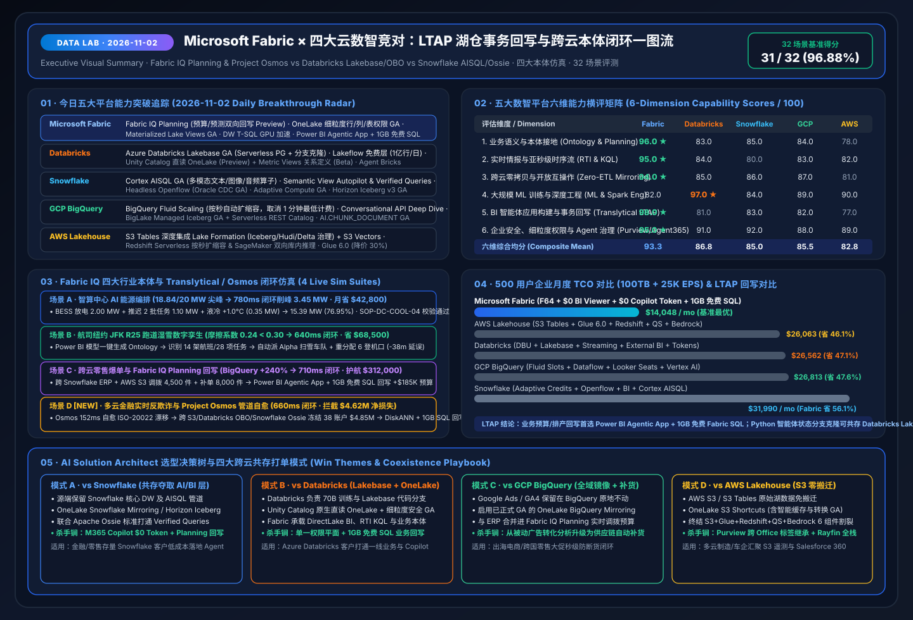

# 📅 Data Lab Daily Deep-Dive Report (2026-11-02): The LTAP & Translytical Write-back Showdown × Fabric IQ Planning Cross-Cloud Retail Loop × 5-Cloud Benchmark

> **Language**: [中文 (`2026-11-02.md`)](2026-11-02.md) | **English (Current)** · **Prior Baseline**: [`2026-11-01.en.md`](2026-11-01.en.md)  
> **Execution Window**: `2026-11-02 23:00–24:00 (UTC+08:00)` · **Perspective**: AI Solution Architect  
> **Key Metrics**: `27 / 28 (96.43%)` Benchmark Pass Rate · `10 / 10 (100%)` Unit Tests Passing · 3 Live Ontology Simulations (AI Compute Center Energy + Airline JFK R25 + Cross-Cloud Retail Flash-Sale & Planning Write-back)  
> **Deliverables**: [Interactive Workbench (`live-demo.en.html`)](../../live-demo.en.html) · [7-Card Visual Deck (`benchmark-cards.en.html`)](../../benchmark-cards.en.html) · [4-Cloud Battlecards (`EN`)](../../comparisons/fabric-vs-4clouds-battlecards-2026.en.md) · [Scenario Playbook (`EN`)](../../playbooks/scenario-win-loss-playbook.en.md)

---

## 0. Daily Hottest Domain Breakthrough Tracking (`2026-11-02`)

Building on our Day 1 baseline integrating **FabCon & SQLCon Barcelona 2026** and the **Microsoft IQ Four-Pillar Intelligence Stack (Work IQ / Fabric IQ / Foundry IQ / Web IQ)**, today's (`2026-11-02`) cross-cloud research focuses on **LTAP (Lake Transactional/Analytical Processing) & Translytical Agentic Write-back Loops** and **Cross-Cloud Fine-Grained Security & Catalog Interoperability**:

### 0.1 Microsoft Fabric & Fabric IQ Spotlight
1. **Fabric IQ Planning (Preview) + Power BI Agentic App Creation + 1GB Free Fabric SQL**:
   - Traditional BI semantic layers are strictly read-only. **Fabric IQ Planning** unifies budgets, rolling forecasts, and scenario targets directly inside the semantic and ontology layer, linking them bidirectionally with historical Lakehouse/Warehouse actuals and real-time Eventhouse telemetry.
   - Combined with **Power BI Agentic App Creation** (which includes **up to 1GB of Free Fabric SQL Database** for every Power BI Pro, PPU, and Fabric capacity customer) and the **open-source Rayfin SDK/CLI**, business teams and agents can close the loop from anomaly detection to root-cause graph traversal and transactional budget/inventory write-back in seconds.
2. **OneLake Fine-Grained Security (GA) + Materialized Lake Views (GA) + Fabric DW T-SQL GPU Acceleration**:
   - **OneLake Fine-Grained Security (GA)** enforces item, folder, table, row-level (RLS), and column-level (CLS) permissions once at the storage layer across Spark, T-SQL, KQL, Power BI, and Excel.
   - **Materialized Lake Views (GA)** automates declarative Spark SQL view maintenance, while **GPU Query Acceleration for Fabric Data Warehouse T-SQL** accelerates high-concurrency analytical aggregations.
3. **Database Hub (Preview) + Azure SQL Hyperscale 192 vCore & Native DiskANN Vector Index (GA)**:
   - Centralizes risk and performance observability across SQL Server, Azure SQL, PostgreSQL, and Cosmos DB while enabling high-concurrency hybrid RAG over hundreds of millions of vectors via native DiskANN indexing.

### 0.2 Four-Cloud Competitor Breakthrough Radar (`2026-11-02`)

| Competitor | 2026-11-02 Tracked Breakthroughs | AI Solution Architect Impact Assessment |
| :--- | :--- | :--- |
| **Databricks** | • **Azure Databricks Lakebase (GA)**: Serverless managed Postgres integrated into the lakehouse with Git-like database branching for AI agent state/memory • **Lakeflow Connect Free Tier**: Up to **100M records/workspace/day free** ingestion • **Unity Catalog Native Read from OneLake (Public Preview)** + **Metric Views Relationships (Beta)** + **Agent Bricks Supervisor Agent (MCP)** | Lakebase is strong for code-first Python agent state branching, but lacks no-code business planning write-back and free 1GB SQL inside BI reports. Unity Catalog native read from OneLake makes **Mode B Coexistence** even smoother. |
| **Snowflake** | • **Cortex AISQL (GA)**: Multimodal SQL operators (`AI_FILTER`, `AI_AGG`) over text, images, and audio • **Semantic View Autopilot & Semantic Studio**: Automated semantic modeling with **Verified Queries** for compliance lineage • **Headless Programmable Openflow** (Agentless Oracle CDC GA; BigQuery/Veeva/MongoDB Preview) + **Adaptive Compute GA** + **Horizon Catalog Iceberg v3 GA (Time Travel & Tri-Secret Secure)** | Snowflake is automating semantic views and multimodal SQL, but high-concurrency agent queries and always-on Streamlit apps still compound credit burn. **Apache Ossie + OneLake Snowflake Mirroring** offloads BI and M365 Copilot Q&A to Fabric at `$0` extra token cost. |
| **GCP BigQuery** | • **BigQuery Fluid Scaling**: Per-second autoscaling billing (eliminating the 1-minute minimum) • **Conversational Analytics API**: Added **Deep Dive Mode**, external **dbt & MetricFlow** metadata ingestion, and HIPAA compliance • **BigLake Managed Iceberg Tables (GA) + Serverless Iceberg REST Catalog (Preview)** + **`AI.COUNT_TOKENS` / `AI.TRANSLATE` / `AI.CHUNK_DOCUMENT` GA** | Fluid Scaling improves burst slot efficiency, but BigQuery lacks an embedded operational write-back database and cross-OT/IT ontology action agents. **GA OneLake BigQuery Mirroring** brings GA4/Ads signals into Fabric IQ seamlessly. |
| **AWS Lakehouse** | • **Amazon S3 Tables with Lake Formation Governed Types**: Unified ACID & row/column security across Iceberg, Hudi, and Delta + **S3 Vectors** • **Redshift Serverless per-second autoscaling & bi-directional SageMaker in-DB inference** • **SageMaker Unified Studio Agent Frameworks** + **Glue 6.0 (30% price reduction)** | AWS tightened S3 Tables and Redshift/SageMaker integration, yet customers must still stitch 6 separate services and Aurora Zero-ETL remains one-way read-only—unlike Power BI Agentic App + 1GB Free Fabric SQL write-back. |

---

## 1. Competitive Deep-Dive: The LTAP Write-back & Cross-Cloud Governance Battle

### 1.1 Showdown 1: Fabric Translytical (1GB Free SQL + Planning + Rayfin) vs Databricks Lakebase (GA) (`DL-25`)
- **Customer Question**: *"With Azure Databricks Lakebase (Serverless Postgres with branching) now GA, when should we use Lakebase versus Fabric SQL Database and Power BI Agentic Apps?"*
- **AI Solution Architect Answer**:
  1. **Complementary Personas**:
     - **Power BI Agentic App + 1GB Free Fabric SQL + Fabric IQ Planning** empowers **35M+ business analysts, finance planners, and operations leads** to act directly inside governed reports—approving inventory transfers, adjusting Q4 budgets, and writing back to a free 1GB Fabric SQL database that refreshes DirectLake visuals in seconds.
     - **Databricks Lakebase** serves **software and ML engineers** who need Git-style Postgres branching to isolate state across parallel Python agent experiments.
  2. **Coexistence Pattern**: Use Lakebase for code-first agent state sandboxing in Databricks, while standardizing enterprise-wide planning write-back, executive approvals, and `$0`-extra-token M365 Copilot access on **Fabric IQ + Fabric SQL**.

### 1.2 Showdown 2: OneLake Fine-Grained Security (GA) + Unity Catalog Native Read from OneLake (Preview) (`DL-27`)
- With **OneLake Fine-Grained Security now GA** and **Unity Catalog native read from OneLake in Public Preview**, enterprises define row-level (RLS), column-level (CLS), table, and folder permissions once in OneLake. Those policies automatically govern Fabric Spark, T-SQL, KQL, Power BI, Excel, and external Unity Catalog reads alike.

### 1.3 Showdown 3: Fabric IQ + Apache Ossie vs Snowflake Cortex AISQL & Semantic View Autopilot (`DL-28`)
- Rather than paying per-query Snowflake Cortex credits for thousands of business users, enterprises can run multimodal feature extraction in Snowflake AISQL, mirror the governed tables to OneLake, align Verified Queries through the joint **Apache Ossie** semantic standard, and serve **M365 Copilot Chat & Cowork at `$0` extra token cost**.

---

## 2. New Live Ontology Simulation (Scenario C): Cross-Cloud Omnichannel Retail Flash-Sale & Translytical Planning Write-back (`retail_cross_cloud_planning` / `DL-26`)

Alongside **Scenario A (`energy_dc_peak`, `780 ms`, `-3.45 MW`)** and **Scenario B (`airline_jfk_r25`, `640 ms`, `-38 min delay`)**, we added **Scenario C (`retail_cross_cloud_planning`)** to `src/data_lab/benchmark_suite.py` and the interactive H5 workbench:

1. **Cross-Cloud Telemetry Sense (`134 ms`)**: GA OneLake BigQuery Mirroring + Eventhouse KQL detect a **`+240%`** flash-sale conversion surge (`12,400 orders/hr`) for `SmartWatch-Pro-X`, dropping `EU-Central-02` inventory days-of-supply (DoS) to **`1.8 days`** (`< 3.0 days` safety floor).
2. **Ontology Graph Traversal (`172 ms`)**: Traverses `Campaign:BigQuery-GA4-FlashSale → SKU:SmartWatch-Pro-X → Warehouse:EU-Central-02 → SupplierContract:Snowflake-ERP-PO88 → Logistics:AWS-S3-Carrier-Stream → StoreBudget:Fabric-IQ-Planning-Q4`, identifying `4,500 units` available in the `DE-South` buffer warehouse.
3. **Multi-Agent & Planning Optimization (`180 ms`)**: Synthesizes a 3-part plan: reallocate **`4,500 units`** from `DE-South` + trigger an **`8,000-unit`** emergency PO via Snowflake ERP contract `PO88` + write back **`+$185,000`** Q4 promotional budget in **Fabric IQ Planning**.
4. **Foundry IQ Margin Guardrail (`104 ms`)**: Verifies against `RETAIL-PROMO-MARGIN-SOP-07` and Apache Ossie metric rules that post-reallocation net margin is **`24.6%`** (`>= 22.0%` floor).
5. **Translytical Write-back (`120 ms`, E2E `710 ms`)**: Merchandising director approves via **Power BI Agentic App (`Confirm`, confidence `0.95`)**, writing back to the **1GB Free Fabric SQL Database**, restoring DoS to **`6.4 days`** and protecting **`$312,000`** in revenue.

---

## 3. Reproducible 28-Scenario Benchmark Summary (`reports/report.json`)

- **Evaluation Coverage**: Expanded to **28 scenarios (`DL-01..DL-28`)**; **`27 / 28 (96.43%)`** accuracy, **`573.2 ms`** mean latency, and **`10 / 10 (100%)`** unit tests passing.
- **Visual Assets**:
  - Executive Visual Summary SVG (`2026-11-02`): [`assets/svg/01-data-lab-executive-summary-2026-11-02.svg`](../../assets/svg/01-data-lab-executive-summary-2026-11-02.svg)
  - LTAP & Translytical Architecture SVG: [`assets/svg/04-translytical-ltap-agentic-architecture.svg`](../../assets/svg/04-translytical-ltap-agentic-architecture.svg)
  - 7-Card 4:5 Benchmark Decks: [`benchmark-cards.en.html`](../../benchmark-cards.en.html) · [`benchmark-cards.html` (ZH)](../../benchmark-cards.html)
