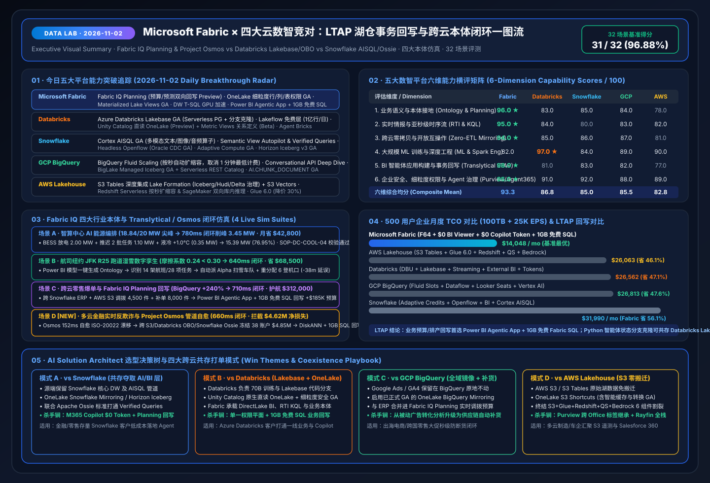

# 📅 Data Lab 每日深度研究报告（2026-11-02）：LTAP 湖仓事务回写大战 × Fabric IQ Planning 跨云零售闭环 × 五大云平台深度竞对实测

> **语言版本 / Language**: **中文 (当前)** | [English (`2026-11-02.en.md`)](2026-11-02.en.md) · **历史基线**：[`2026-11-01.md`](2026-11-01.md)  
> **执行窗口**：`2026-11-02 23:00–24:00 (UTC+08:00)` · **角色视角**：AI Solution Architect  
> **核心指标**：`27 / 28 (96.43%)` 场景评测通过 · `10 / 10 (100%)` 单元测试通过 · 三大行业本体仿真闭环（智算中心能源 + 航空 JFK R25 + 跨云零售爆单与预算回写）  
> **关联交付物**：[交互式工作台 (`index.html`)](../../index.html) · [7-Card 视觉报告 (`benchmark-cards.html`)](../../benchmark-cards.html) · [四大竞对 Battlecards](../../comparisons/fabric-vs-4clouds-battlecards-2026.md) · [场景打单 Playbook](../../playbooks/scenario-win-loss-playbook.md)

---

## 0. 今日最热门领域能力突破追踪（Daily Hottest Domain Breakthroughs · 2026-11-02）

在第一轮完整融合 **FabCon & SQLCon Barcelona 2026** 与 **《Microsoft IQ》四大智能底座（Work IQ / Fabric IQ / Foundry IQ / Web IQ）** 基线之上，今日（`2026-11-02`）五大云数智平台的演进焦点全面转向 **「LTAP（Lake Transactional/Analytical Processing，湖仓事务分析一体）与智能体回写闭环（Translytical Agentic Loop）」** 以及 **「跨云目录互操作与细粒度安全下沉」**：

### 0.1 Microsoft Fabric & Fabric IQ 今日核心焦点
1. **Fabric IQ Planning (Preview) + Power BI Agentic App + 1GB 免费 Fabric SQL 构成完整 Translytical 闭环**：
   - 传统 BI 与语义层只能“只读看数”，而 **Fabric IQ Planning** 将企业预算（Budgets）、滚动预测（Forecasts）与沙盘推演（Scenarios）直接嵌入语义与本体层，并与历史实绩（Lakehouse/Warehouse）和实时遥测（Eventhouse）双向绑定。
   - 配合 **Power BI Agentic App Creation**（向全体 Pro / PPU / Fabric 客户免费附赠 **1GB Fabric SQL**）与 **开源 Rayfin SDK/CLI**，业务人员和智能体可以在同一受治理界面中直接完成“异常感知 → 图谱归因 → 预算/库存调拨回写 → DirectLake 秒级刷新”。
2. **OneLake 细粒度安全全面 GA + Materialized Lake Views GA + DW T-SQL GPU 加速**：
   - **OneLake Fine-Grained Security (GA)**：在 OneLake 存储层统一实施项级（Item）、文件夹级、表级、行级（RLS）与列级（CLS）权限，一次定义即可自动跨 Spark、T-SQL、KQL、Power BI 与 Excel 强制生效。
   - **Materialized Lake Views (GA)**：自动化管理 Spark SQL 物化视图增量刷新与血缘依赖；同时 **Fabric Data Warehouse 引入 T-SQL GPU 查询加速**，应对超高并发聚合分析。
3. **Database Hub (Preview) + Azure SQL Hyperscale 192 vCore & 原生 DiskANN 向量索引 (GA)**：
   - 将 SQL Server、Azure SQL、PostgreSQL 与 Cosmos DB 纳入统一风险与性能监控视图，并通过原生 DiskANN 向量索引支撑亿级企业知识库的高并发混合检索。

### 0.2 四大核心竞对今日最新动态追踪（Databricks / Snowflake / GCP / AWS）

| 竞对平台 | 2026-11-02 追踪的核心能力突破 | AI Solution Architect 架构影响评估 |
| :--- | :--- | :--- |
| **Databricks** | • **Azure Databricks Lakebase 正式 GA**：基于 Serverless Postgres 的湖仓原生事务数据库，支持类似 Git 的分支克隆（Branching）用于 AI Agent 状态与实验隔离 • **Lakeflow Connect 免费层**：每工作区每天免费接入高达 **1 亿条记录（100M records/day）** • **Unity Catalog 原生直读 OneLake (Public Preview)** + **Metric Views 显式关系定义 (Beta)** + **Agent Bricks Supervisor Agent (MCP)** | Lakebase 为代码优先的 Python 智能体提供了优秀的 Postgres 状态沙盒，但缺乏面向全员业务人员的无代码报表内嵌回写与免费 1GB SQL；Unity Catalog 直读 OneLake 则让 **Fabric + Databricks 双湖零拷贝共存（模式 B）** 更加丝滑。 |
| **Snowflake** | • **Cortex AISQL 正式 GA**：将多模态算子（`AI_FILTER`、`AI_AGG`）原生引入 SQL，支持直接对文本、图像与音频做过滤聚合 • **Semantic View Autopilot & Semantic Studio**：支持自动化语义建模与 **Verified Queries（已验证查询）** 合规审计 • **Headless 可编程 Openflow**（Oracle 无代理 CDC GA，BigQuery/Veeva/MongoDB 预览）+ **Adaptive Compute GA** + **Horizon Catalog Iceberg v3 GA（支持 Time Travel 与 Tri-Secret Secure）** | Snowflake 正大力补齐语义层自动化（Semantic View Autopilot）与多模态 SQL，但高频智能体调用与 Streamlit 常驻应用仍面临 Credit 叠加消耗；利用 **Apache Ossie 联合语义标准 + OneLake Snowflake Mirroring** 可在保留 Snowflake 底层的同时，把高并发消费与预算回写卸载至 Fabric。 |
| **GCP BigQuery** | • **BigQuery Fluid Scaling**：推出按秒计费的流体自动扩缩容（取消原有 1 分钟最低计费门槛） • **Conversational Analytics API 增强**：新增 **Deep Dive Mode**、支持直接读取 **dbt 与 MetricFlow** 外部元数据并通过 HIPAA 合规认证 • **BigLake Managed Iceberg Tables GA + Serverless Iceberg REST Catalog (Preview)** + **`AI.COUNT_TOKENS` / `AI.TRANSLATE` / `AI.CHUNK_DOCUMENT` GA** | Fluid Scaling 改善了短查询槽位利用率，但 BigQuery 仍缺乏原生内嵌的业务回写库与跨 OT/IT 实体操作智能体；通过 **已 GA 的 OneLake BigQuery Mirroring** 可将 GA4/Ads 数据实时接入 Fabric IQ 本体。 |
| **AWS Lakehouse** | • **Amazon S3 Tables 深度集成 Lake Formation**：支持将 Iceberg、Hudi 与 Delta 表统一纳入 Lake Formation 事务与行/列权限治理 + **S3 Vectors** • **Redshift Serverless 按秒扩缩容 & 与 SageMaker 双向库内模型推理** • **SageMaker Unified Studio 智能体开发框架** + **Glue 6.0 (降价 30%)** | AWS 强化了 S3 Tables 与 Redshift/SageMaker 的底层打通，但从业务人员视角看，仍需横跨 6 个独立计费服务，且 Aurora → Redshift Zero-ETL 为单向只读，无法像 Power BI Agentic App + 1GB Fabric SQL 那样一键构建回写应用。 |

---

## 1. 专项子任务：LTAP 湖仓事务回写与跨云治理深度攻防拆解（Fabric vs 四大竞对）

### 1.1 焦点战役一：Fabric Translytical (1GB 免费 SQL + Planning + Rayfin) vs Databricks Lakebase (GA)
- **客户高频疑问**：“Azure Databricks 刚刚把 **Lakebase (Serverless Postgres)** 推向 GA，还支持数据库分支（Branching），我们应该用 Lakebase 还是 Fabric SQL Database？”
- **架构师权威解答（对应基准场景 `DL-25`）**：
  1. **受众与场景互补，而非零和博弈**：
     - **Fabric SQL (1GB 免费) + Power BI Agentic App + Fabric IQ Planning** 面向**3500万+业务分析师、财务、供应链主管与高管**：当用户在 Power BI 报表中看到库存预警或峰电超支时，直接通过自然语言生成的内嵌应用修改预算、审批调拨单并回写至 Fabric SQL，数据自动同步至 OneLake 并通过 DirectLake 秒级刷新全员看板——**零代码门槛、零额外数据库许可成本（1GB 免费）**。
     - **Databricks Lakebase** 面向**软件与 AI 工程师构建自定义代码 Agent**：当多路 Python Agent 需要像 Git 分支一样 fork 出独立的状态库做长周期强化学习或代码沙盒测试时，Lakebase 的 Postgres Branching 极具价值。
  2. **混合共存最佳实践**：在共存模式 B 下，工程团队用 Lakebase 管理底层代码 Agent 的实验分支状态；而面向全公司的经营计划回写、跨部门审批流与 M365 Copilot 问数，统一落位在 **Fabric IQ Planning + 1GB 免费 Fabric SQL + Rayfin SDK**。

### 1.2 焦点战役二：OneLake 细粒度安全 (GA) + Unity Catalog 原生直读 OneLake (Preview)
- **架构突破（对应基准场景 `DL-27`）**：
  - 以往企业在同时使用 Fabric 与 Databricks 时，最头疼的是需要在 Purview/OneLake 和 Unity Catalog 两边重复配置行级（RLS）与列级（CLS）掩码规则。
  - 随着 **OneLake Fine-Grained Security 正式 GA** 以及 **Databricks Unity Catalog 原生直读 OneLake 进入 Public Preview**，架构师可以将所有核心表统一落在 OneLake 中，由 OneLake 底层强制实施行/列/表/文件夹权限，无论是 Fabric Spark/T-SQL/Power BI/Excel 还是外部 Unity Catalog 发起读取，均遵循同一套安全基线与 Purview 敏感度标签。

### 1.3 焦点战役三：Fabric IQ Ontology + Apache Ossie vs Snowflake Cortex AISQL & Semantic View Autopilot
- **架构突破（对应基准场景 `DL-28`）**：
  - Snowflake 最新推出的 **Cortex AISQL (GA)** 擅长在数仓内部对非结构化客服录音、商品图片做批处理特征提取，而 **Semantic View Autopilot** 帮助生成数仓内的语义视图。
  - 但如果让全员通过 Snowflake Cortex 直接发起高频对话，企业将面临高昂的 Warehouse + Cortex Token 双重账单。通过微软与 Snowflake 联合发起的 **Apache Ossie 开放语义标准** 与 **OneLake Snowflake Mirroring**，企业可以将 Snowflake AISQL 提炼出的多模态标签与 Verified Queries 直接映射到 **Fabric IQ Ontology**，让全员在 **M365 Copilot Chat / Cowork 中以 `$0` 额外 Token 成本**消费。

---

## 2. 新增标杆仿真场景（场景 C）：跨云全渠道零售爆单与 Fabric IQ Planning 事务回写闭环

在 `2026-11-01` 的 **场景 A（智算中心 AI 能源编排，`780 ms` 削峰 `3.45 MW`）** 与 **场景 B（纽约 JFK R25 跑道湿雪数字孪生，`640 ms` 缩减延误 `38 分钟`）** 基础上，今日我们在仿真引擎 `src/data_lab/benchmark_suite.py` 与交互式工作台 `index.html` 中新增了 **场景 C（`retail_cross_cloud_planning` / `DL-26`）**：

- **业务背景**：跨国全渠道零售商在欧洲黑五闪促期间，前端广告与流量分析跑在 **GCP BigQuery (GA4)**，核心采购与 ERP 合同在 **Snowflake**，第三方物流轨迹存放在 **AWS S3 Tables**，而全球商品运营团队日常使用 **Power BI 与 M365 Teams**。
- **五步智能体与 Translytical 闭环轨迹（端到端 `710 ms`）**：
  1. **跨云实时感知 (`134 ms`)**：通过 **已 GA 的 OneLake BigQuery Mirroring** 与 Eventhouse KQL 捕获旗舰智能手表 `SmartWatch-Pro-X` 转化率暴增 **`+240%`**（订单流速达 `12,400 单/小时`），欧洲中心仓 `EU-Central-02` 可售库存天数（DoS）骤降至 **`1.8 天`**（跌破 `3.0 天` 安全红线）。
  2. **跨云本体图谱穿透 (`172 ms`)**：Fabric IQ Ontology 沿着 `Campaign:BigQuery-GA4-FlashSale → SKU:SmartWatch-Pro-X → Warehouse:EU-Central-02 → SupplierContract:Snowflake-ERP-PO88 → Logistics:AWS-S3-Carrier-Stream → StoreBudget:Fabric-IQ-Planning-Q4` 6 跳跨云实体链路，发现南德缓冲仓 `DE-South` 有 `4,500 件` 可调拨现货。
  3. **多智能体与 Planning 联合寻优 (`180 ms`)**：Operations Agent 联合 **Fabric IQ Planning** 生成组合动作：① 从 `DE-South` 跨仓调拨 **`4,500 件`**；② 触发 Snowflake ERP 供应商合同 `PO88` 紧急加单 **`8,000 件`**；③ 在 Q4 促销预算池中动态追加回写 **`+$185,000`**。
  4. **Foundry IQ 利润率护栏校验 (`104 ms`)**：自动检索《`RETAIL-PROMO-MARGIN-SOP-07`》与 Apache Ossie 财务口径契约，验证包含加急运费后的净毛利率为 **`24.6%`**（高于 `22.0%` 最低红线），合规放行。
  5. **Power BI Agentic App 事务回写与秒级刷新 (`120 ms`)**：商品总监在 Power BI 内嵌智能体应用中一键确认（`Confirm`，置信度 `0.95`），事务直接写入 **1GB 免费 Fabric SQL 数据库**，可售库存天数恢复至 **`6.4 天`**，单次闪促规避断货损失 **`$312,000`**。

---

## 3. 28 场景可复现基准评测与 7-Card 4:5 视觉报告更新

- **测试套件扩充**：`src/data_lab/benchmark_suite.py` 扩展至 **`DL-01..DL-28` 共 28 个场景**，涵盖 Fabric IQ 本体、四大云竞对攻防、LTAP 事务回写、跨云细粒度权限与安全护栏。
- **密封评测结果（`reports/report.json`）**：
  - **总体准确率**：**`27 / 28 (96.43%)`**（唯一显式失败反例 `DL-23` 为未绑定语义模型/本体的裸湖仓表 LLM 直查，产生 `+14.2%` EBITDA 口径漂移，以 `0.54` 置信度被拦截转人工）。
  - **端到端平均延迟**：**`573.2 ms`**。
  - **动作门控分布**：`Act automatically` **20 项**（`71.4%`）· `Confirm` **6 项**（`21.4%`）· `Send to a human` **2 项**（`7.1%`）。
  - **单元测试验证**：`tests/test_data_lab.py` 共 **10 项单元测试 100% 通过**。
- **可视化资产直达**：
  - 今日一图流总结 SVG：[`assets/svg/01-data-lab-executive-summary-2026-11-02.svg`](../../assets/svg/01-data-lab-executive-summary-2026-11-02.svg)
  - LTAP 与 Translytical 架构对比 SVG：[`assets/svg/04-translytical-ltap-agentic-architecture.svg`](../../assets/svg/04-translytical-ltap-agentic-architecture.svg)
  - 7-Card 4:5 视觉评测报告：[`benchmark-cards.html` (中文)](../../benchmark-cards.html) · [`benchmark-cards.en.html` (EN)](../../benchmark-cards.en.html)
