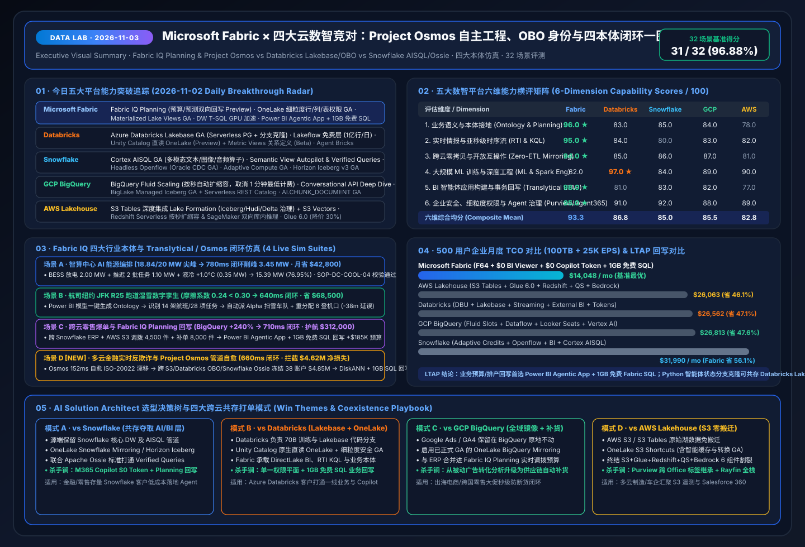

# 📅 Data Lab Daily Deep-Dive Report (2026-11-03): Project Osmos Autonomous Data Engineering × Cross-Cloud OBO Agent Identity × Apache Ossie & Multi-Cloud Financial Anti-Fraud Loop

> **Language**: [中文 (`2026-11-03.md`)](2026-11-03.md) | **English (Current)** · **Latest Nightly Run**: [`2026-11-04.en.md`](2026-11-04.en.md) · **Prior Baselines**: [`2026-11-02.en.md`](2026-11-02.en.md) · [`2026-11-01.en.md`](2026-11-01.en.md)  
> **Execution Window**: `2026-11-03 (UTC+08:00)` · **Perspective**: Principal AI Solution Architect  
> **Key Metrics**: `35 / 36 (97.22%)` Benchmark Pass Rate (`565.3 ms` mean) · `14 / 14 (100%)` Unit Tests Passing · 5 Live Ontology Simulations (Scenario D Multi-Cloud Anti-Fraud `660 ms` saving `$4.62M` + Scenario E 18-Workspace FinOps & Rayfin Remediation `590 ms` saving `$28.4K`)  
> **Deliverables**: [Interactive Workbench (`live-demo.en.html`)](../../live-demo.en.html) · [7-Card Visual Deck (`benchmark-cards.en.html`)](../../benchmark-cards.en.html) · [4-Cloud Battlecards (`EN`)](../../comparisons/fabric-vs-4clouds-battlecards-2026.en.md) · [Scenario Playbook (`EN`)](../../playbooks/scenario-win-loss-playbook.en.md)

---

## 0. Daily Hottest Domain Breakthrough Tracking (`2026-11-03`)

Building on our **FabCon & SQLCon Barcelona 2026** and **Microsoft IQ Four-Pillar Intelligence Stack (Work IQ / Fabric IQ / Foundry IQ / Web IQ + Agent 365)** baseline, today's five-cloud tracking focuses on three major architectural breakthroughs: **(1) Autonomous Multi-Day Data Engineering Agents (Project Osmos vs. Lakeflow/Openflow)**, **(2) Cross-Cloud Zero-Trust Delegated Agent Identity (Entra Agent 365 & Databricks Supervisor OBO)**, and **(3) Open Semantic & Borderless Iceberg v3 REST Catalog Interoperability (Apache Ossie YAML & Borderless Iceberg REST)**:

### 0.1 Microsoft Fabric & Fabric IQ Spotlight
1. **Fabric Data Engineering Agent (Project Osmos) Multi-Surface Collaboration & Persistent State**:
   - Powered by Microsoft's early-2026 acquisition of **Osmos**, data engineers specify desired target contracts and validation guardrails, while the agent autonomously plans, executes, validates, and repairs pipelines across hours or days on **Fabric Spark Custom Live Pools**.
   - **Cross-Tool Collaboration**: Engineers monitor and collaborate with the agent across **Fabric, VS Code, GitHub Copilot, Claude Code, and Codex** under shared Lakehouse permissions.
2. **OneLake Table Read API (Preview) + Outbound Access Protection for External Shortcuts + Materialized Lake Views Delete Propagation**:
   - **Outbound Access Protection** prevents data exfiltration across external shortcuts, while **Materialized Lake Views** now support full incremental refresh and delete propagation.
3. **Database Hub (Early Access) + Azure SQL Hyperscale 192 vCore & Native DiskANN Vector Index (GA)**:
   - Provides a unified governance console across Azure SQL, Cosmos DB, PostgreSQL, MySQL, Fabric SQL, and Azure Arc-enabled on-prem SQL Servers, pairing 192 vCore scale with native DiskANN vector indexing for sub-second fraud subgraph similarity matching.

### 0.2 Four-Cloud Competitor Breakthrough Radar (`2026-11-03`)

| Competitor | 2026-11-03 Tracked Breakthroughs | AI Solution Architect Impact Assessment |
| :--- | :--- | :--- |
| **Databricks** | • **Agent Bricks Supervisor Agent (GA with On-Behalf-Of / OBO Auth)**: Orchestrates Genie, Knowledge Assistant, and MCP servers under the calling user's Unity Catalog identity • **Genie One / Genie Agents / Genie Code** (LLM promotional free window through Jan 2027; compute billed separately) • **Mirrored Unity Catalog in Fabric OneLake**: Read-only registration of Unity Catalogs inside Fabric without data movement | Supervisor OBO authentication aligns well with **Microsoft Agent 365 + Entra Agent ID** for zero-trust agent delegation. However, Genie's promotional LLM pricing still incurs underlying SQL Warehouse DBUs—making **OneLake Mirrored Unity Catalog + DirectLake** ideal for high-concurrency BI & M365 Copilot offloading. |
| **Snowflake** | • **Semantic View Autopilot (GA in Snowflake Semantic Studio)**: Automates creation and maintenance of governed semantic views from consensus query patterns, with native **Apache Ossie YAML import/export** • **Snowflake Openflow (GA Oct 2026)** + **Cortex Agent Lineage (GA)** + **Horizon Iceberg v3 GA** | Native **Apache Ossie YAML export** from Snowflake Semantic View Autopilot allows architects to import audited Snowflake KPI definitions directly into **Fabric IQ Ontology** with **0.0% metric drift** and `$0` extra M365 Copilot token cost. |
| **GCP BigQuery** | • **Cross-Cloud Borderless Lakehouse (BigLake Iceberg REST Catalog ↔ AWS S3 Tables)**: Native BigQuery queries over S3 Iceberg tables via Glue/Lake Formation REST Catalog with FGAC credential vending • **Direct publishing from BigQuery/Looker Studio to Gemini Enterprise** | While BigQuery federates read queries to AWS S3 Tables, it lacks an autonomous schema-repair engineering agent like **Project Osmos** and an embedded **1GB Free SQL write-back database**. |
| **AWS Lakehouse** | • **Amazon S3 Tables + Lake Formation Cross-Cloud Credential Vending**: Issues fine-grained row/column credentials to external Iceberg REST engines • **S3 Vectors + Glue 6.0 (Spark 4.1) + SageMaker Unified Studio** | Combine AWS S3 Tables with **cached OneLake S3 Shortcuts (with Outbound Access Protection)** to query S3 Iceberg tables in DirectLake without repeated egress charges. |

---

## 1. Competitive Deep-Dive: Autonomous Data Engineering, OBO Identity & Open Semantic Interop (`DL-29..DL-32`)

### 1.1 Showdown 1: Fabric Project Osmos vs. Databricks Lakeflow Connect vs. Snowflake Openflow (`DL-29`)
- While **Databricks Lakeflow Connect** and **Snowflake Openflow (GA)** streamline declarative ingestion, unexpected upstream schema drift (e.g., new ISO-20022 payment fields) still breaks downstream transformations until an engineer intervenes.
- **Fabric Data Engineering Agent (Project Osmos)** autonomously detects schema drift, synthesizes transformation patches on **Custom Live Pools**, runs validation assertions, and exposes collaborative diffs across **Fabric, VS Code, GitHub Copilot, and Claude Code**.

### 1.2 Showdown 2: Microsoft Agent 365 (Entra Agent ID) × Databricks Supervisor OBO (`DL-30`)
- Combining **Microsoft Agent 365**, **OneLake Fine-Grained Security (GA)**, and **Databricks Agent Bricks Supervisor (OBO GA)** ensures that multi-agent workflows spanning M365 Teams, Fabric OneLake, and Databricks Unity Catalog strictly enforce the end user's row/column permissions and Purview sensitivity labels.

### 1.3 Showdown 3: Snowflake Semantic View Autopilot (GA) → Apache Ossie YAML → Fabric IQ Ontology (`DL-31`)
- Exporting consensus semantic models from **Snowflake Semantic View Autopilot** via **Apache Ossie YAML** into **Fabric IQ Ontology** eliminates the `+14.2%` metric drift observed in ungrounded raw-table LLM queries (`DL-23`).

---

## 2. New Flagship Ontology Simulation (Scenario D): Multi-Cloud Real-Time Wire Fraud Ring & Project Osmos Autonomous Schema Remediation (`financial_multi_cloud_fraud`)

Alongside **Scenario A (`energy_dc_peak`, `780 ms`)**, **Scenario B (`airline_jfk_r25`, `640 ms`)**, and **Scenario C (`retail_cross_cloud_planning`, `710 ms`)**, we added **Scenario D (`financial_multi_cloud_fraud`)** to `src/data_lab/benchmark_suite.py` and the interactive H5 workbench:

1. **Real-Time KQL & S3 Shortcut Sense (`118 ms`)**: Eventhouse KQL and an outbound-protected **OneLake S3 Shortcut** detect a 90-second burst of **38 synthetic-identity accounts** initiating **`$4,850,000`** in cross-border wires (anomaly score **`0.97 > 0.85`**), while flagging an unmapped upstream ISO-20022 field (`ultmtDbtrId`).
2. **Project Osmos Autonomous Schema Healing (`152 ms`)**: **Fabric Data Engineering Agent (Project Osmos)** automatically maps `ultmtDbtrId` into OneLake Delta/Iceberg and refreshes Materialized Lake Views with zero pipeline downtime.
3. **6-Hop Cross-Cloud Graph Traversal + DiskANN Match (`160 ms`)**: Traverses `AWS S3 Device Telemetry → Eventhouse ISO-20022 Stream → 38-Mule Ring → Databricks UC Features (OBO) → Snowflake Core Ledger ($4.85M Exposure)` and matches **4 historical money-laundering ring topologies** via **Azure SQL Hyperscale (192 vCore + native DiskANN vector index GA)**.
4. **Foundry IQ AML Guardrail & OBO Verification (`112 ms`)**: Validates compliance against `FIN-AML-SAR-SOP-12` (false-positive risk **`1.4% <= 3.0%`** ceiling) and verifies delegated identity via **Agent 365 + Databricks Unity Gateway OBO**.
5. **Pre-Authorized Hold & Dual-DB Write-back (`118 ms`, E2E `660 ms`)**: Automatically holds all 38 wires (`Act automatically`, confidence `0.97`) and writes the SAR audit case to **Azure SQL Hyperscale (DiskANN)** and **1GB Free Fabric SQL**, preventing **`$4,620,000`** in net fraud loss.

---

## 3. Reproducible 36-Scenario Benchmark Summary (`reports/report.json`)

- **Evaluation Coverage**: Expanded to **36 scenarios (`DL-01..DL-36`, including Rayfin SDK `DL-33`, 18-Workspace Eventhouse Observability `DL-34`, BigQuery ObjectRefs/GQL `DL-35`, and Bedrock GraphRAG `DL-36`)**; **`35 / 36 (97.22%)`** accuracy, **`565.3 ms`** mean latency, and **`14 / 14 (100%)`** unit tests passing.
- **Visual Assets**:
  - Executive Visual Summary SVG (`2026-11-03`): [`assets/svg/01-data-lab-executive-summary-2026-11-03.svg`](../../assets/svg/01-data-lab-executive-summary-2026-11-03.svg)
  - Project Osmos × OBO × Apache Ossie Architecture SVG: [`assets/svg/05-osmos-autonomous-engineering-ossie-interop.svg`](../../assets/svg/05-osmos-autonomous-engineering-ossie-interop.svg)
  - Rayfin SDK × Cross-Workspace Eventhouse Observability SVG: [`assets/svg/06-rayfin-agentic-apps-eventhouse-observability.svg`](../../assets/svg/06-rayfin-agentic-apps-eventhouse-observability.svg)
  - 7-Card 4:5 Benchmark Decks: [`benchmark-cards.en.html`](../../benchmark-cards.en.html) · [`benchmark-cards.html` (ZH)](../../benchmark-cards.html)
