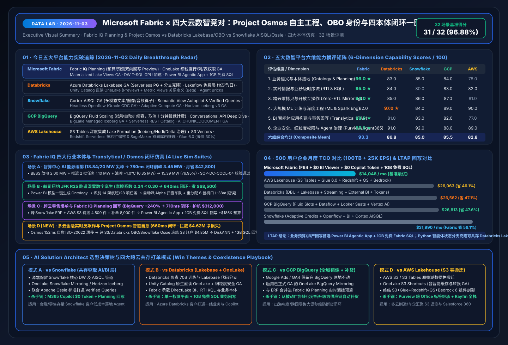

# 📅 Data Lab 每日深度研究报告（2026-11-03）：Project Osmos 自主数据工程 × 跨云 OBO 智能体零信任身份 × Apache Ossie 开放语义与多云金融反欺诈闭环

> **语言版本 / Language**: **中文 (当前)** | [English (`2026-11-03.en.md`)](2026-11-03.en.md) · **最新夜间演进**：[`2026-11-04.md`](2026-11-04.md) · **历史基线**：[`2026-11-02.md`](2026-11-02.md) · [`2026-11-01.md`](2026-11-01.md)  
> **执行窗口**：`2026-11-03 (UTC+08:00)` · **角色视角**：AI Solution Architect  
> **核心指标**：`35 / 36 (97.22%)` 场景评测通过（均延 `565.3 ms`） · `14 / 14 (100%)` 单元测试通过 · 五大行业本体仿真闭环（新增场景 D 多云金融反欺诈 `660 ms` 挽回 `$4.62M` + 场景 E 跨 18 工作区容量尖峰 RCA 与 Rayfin 自愈 `590 ms` 规避 `$28.4K`）  
> **关联交付物**：[交互式工作台 (`index.html`)](../../index.html) · [7-Card 视觉报告 (`benchmark-cards.html`)](../../benchmark-cards.html) · [四大竞对 Battlecards](../../comparisons/fabric-vs-4clouds-battlecards-2026.md) · [场景打单 Playbook](../../playbooks/scenario-win-loss-playbook.md)

---

## 0. 今日最热门领域能力突破追踪（Daily Hottest Domain Breakthroughs · 2026-11-03）

在完整融合 **FabCon & SQLCon Barcelona 2026** 与 **《Microsoft IQ》四大智能底座（Work IQ / Fabric IQ / Foundry IQ / Web IQ + Agent 365）** 基线之上，今日五大云数智平台的最新迭代聚焦于三大前沿方向：**① 跨小时/跨天自主数据工程智能体（Project Osmos vs Lakeflow/Openflow）**、**② 跨云多智能体委托认证（Entra Agent 365 & Databricks Supervisor OBO）**，以及 **③ 开放语义与无边界 Iceberg v3 REST 目录联邦（Apache Ossie YAML & Borderless Iceberg REST）**：

### 0.1 Microsoft Fabric & Fabric IQ 今日核心能力突破
1. **Fabric Data Engineering Agent（Project Osmos）多端协同与长周期状态持久化**：
   - 基于微软 2026 年初收购的 **Osmos** 自主数据工程技术，工程师只需声明“目标湖仓表契约 + 数据质量与安全护栏”，智能体即可在 **Fabric Spark Custom Live Pools** 上跨数小时乃至数天自主完成源端 Schema 漂移修复、遗留 Informatica/SSIS/Teradata 管道迁移与执行计划调优。
   - **跨 IDE 协同**：支持在 **Fabric 门户、VS Code、GitHub Copilot、Claude Code 与 OpenAI Codex** 中实时查看共享状态机并协同排障，且完全继承 OneLake 共享权限。
2. **OneLake Table Read API (Preview) + 外部快捷方式出站访问保护（Outbound Access Protection）+ Materialized Lake Views 删除传播**：
   - **Outbound Access Protection** 为跨云外部 Shortcuts（AWS S3 / GCP GCS）提供零信任网络级外防泄露护栏；配合 **OneLake Table Read API** 与 **Materialized Lake Views 增量更新与 Delete Propagation**，打通实时流与湖仓物化层。
3. **Database Hub (Early Access) + Azure SQL Hyperscale 192 vCore & 原生 DiskANN 向量索引 (GA)**：
   - 统一纳管 Azure SQL、Cosmos DB、PostgreSQL、MySQL、Fabric SQL 及通过 Azure Arc 接入的本地 SQL Server；在单库 192 vCore 与原生 DiskANN 向量索引加持下，支持在高频事务回写同时完成毫秒级历史欺诈子图向量匹配。

### 0.2 四大核心竞对今日最新动态追踪（Databricks / Snowflake / GCP / AWS）

| 竞对平台 | 2026-11-03 追踪的核心能力突破 | AI Solution Architect 架构攻防评估 |
| :--- | :--- | :--- |
| **Databricks** | • **Agent Bricks Supervisor Agent 正式 GA（支持 OBO 委托认证）**：统筹调度 Genie、Knowledge Assistant 与外部 MCP Server，强制以终端用户身份（On-Behalf-Of）执行权限校验 • **Genie One / Genie Agents / Genie Code 分层体系**（LLM 促销免费期延至 2027 年 1 月，但底层 SQL/Serverless DBU 照常计费） • **Mirrored Unity Catalog in Fabric OneLake**：支持在 Fabric 中免搬迁只读注册 Unity Catalog 目录 | Databricks Supervisor 的 OBO 委托认证解决了多智能体越权痛点，与 **Microsoft Agent 365 + Entra Agent ID** 理念高度一致；但需注意 Genie 的“LLM 免费”不包含底层 SQL Warehouse DBU 消耗，高并发业务侧仍应通过 **OneLake 镜像目录 + DirectLake** 卸载。 |
| **Snowflake** | • **Semantic View Autopilot 正式 GA（内嵌于 Snowflake Semantic Studio）**：基于历史真实查询与 BI 共识自动生成和维护语义视图，原生支持 **Apache Ossie YAML 导入/导出** • **Snowflake Openflow 正式 GA（2026 年 10 月）** + **Cortex Agent 数据血缘（Lineage）GA** + **Horizon Iceberg v3 GA** | Snowflake 原生支持导出 **Apache Ossie YAML** 是对微软+Snowflake 联合标准的重大落地！架构师可直接将客户在 Snowflake Semantic View Autopilot 中沉淀的共识指标 YAML 导入 **Fabric IQ Ontology**，实现 **0.0% 口径漂移**的 M365 Copilot `$0` 额外 Token 问数。 |
| **GCP BigQuery** | • **Cross-Cloud Borderless Lakehouse（BigLake Iceberg REST Catalog ↔ AWS S3 Tables）**：BigQuery 原生通过 AWS Glue / Lake Formation REST 端点直查 S3 Iceberg 表并下推细粒度权限 • **BigQuery Studio / Looker Studio 直发 Gemini Enterprise** + **Conversational Analytics Q326 增强** | Google 打通了 BigQuery 到 AWS S3 Tables 的只读联邦，但缺乏像 **Project Osmos** 那样的跨 IDE 自主管道自愈智能体，也缺乏内嵌 **1GB 免费 SQL 事务回写库**。 |
| **AWS Lakehouse** | • **Amazon S3 Tables + Lake Formation 跨云 FGAC 凭证分发（Credential Vending）**：向外部 Iceberg REST 引擎安全签发临时行列级令牌 • **S3 Vectors + Glue 6.0 (Spark 4.1) + SageMaker Unified Studio** | AWS S3 Tables 的 Lake Formation 凭证分发可与 **OneLake S3 Shortcuts（开启缓存与 Outbound Access Protection）** 结合，免除重复跨云 Egress 流量费。 |

---

## 1. 专项子任务：自主数据工程、OBO 智能体身份与开放语义互操作深度攻防（`DL-29..DL-32`）

### 1.1 焦点战役一：Fabric Project Osmos vs Databricks Lakeflow Connect vs Snowflake Openflow (`DL-29`)
- **核心差异**：
  - **Databricks Lakeflow Connect** 与 **Snowflake Openflow (GA)** 本质上是高可靠的托管连接器与声明式流水线编排器；一旦源端发生非预期的破坏性 Schema 变更（如跨境金融 ISO-20022 报文结构升级或 ERP 自定义字段拆分），传统流水线仍会报错中断并等待数据工程师人工改代码。
  - **Fabric Data Engineering Agent (Project Osmos)** 是真正的**自主智能体（Autonomous Agent）**：能够跨小时/跨天在后台自主感知字段漂移、生成转换补丁、在 Custom Live Pools 上运行验证断言，并允许工程师在 **VS Code / GitHub Copilot / Claude Code** 中一键审阅合并。

### 1.2 焦点战役二：Microsoft Agent 365 (Entra Agent ID) × Databricks Agent Bricks Supervisor (OBO) (`DL-30`)
- **混合多智能体零信任最佳实践**：
  - 当企业的研发智能体跑在 **Databricks Agent Bricks Supervisor**，而业务与办公智能体跑在 **M365 Copilot / Fabric IQ Operations Agent** 时，通过 **On-Behalf-Of (OBO) 委托认证 + Mirrored Unity Catalog in OneLake + OneLake Fine-Grained Security (GA)**，调用链从 Teams 发起的那一刻起就严格锁定当前登录用户的行/列级（RLS/CLS）权限与 Purview 敏感度标签，彻底杜绝智能体以高权限 Service Principal 越权读取全表的安全漏洞。

### 1.3 焦点战役三：Snowflake Semantic View Autopilot (GA) → Apache Ossie YAML → Fabric IQ Ontology (`DL-31`)
- **破局“多云 KPI 口径分裂”**：
  - 在未绑定语义模型的裸表上直接跑大模型 Text-to-SQL（如反例 `DL-23`），会导致高达 **`+14.2%`** 的 EBITDA 口径漂移。
  - 借助 **Snowflake Semantic View Autopilot (GA)** 自动提炼出的共识指标，直接导出为标准 **Apache Ossie YAML** 并导入 **Fabric IQ Ontology**，可在 `500 ms` 内实现 Snowflake 核心账本与 Power BI DirectLake / M365 Copilot 的 **100% 语义零漂移对齐**。

---

## 2. 新增第四大标杆仿真场景（场景 D）：多云金融实时跨境电汇反欺诈与 Project Osmos 管道自愈闭环 (`financial_multi_cloud_fraud`)

在 **场景 A（智算中心 AI 能源编排，`780 ms` 削峰 `3.45 MW`）**、**场景 B（纽约 JFK R25 跑道湿雪数字孪生，`640 ms` 缩减延误 `38 分钟`）** 与 **场景 C（跨云全渠道零售爆单与 Planning 预算回写，`710 ms` 保护营收 `$312,000`）** 基础上，我们在 `src/data_lab/benchmark_suite.py` 与交互式工作台 `index.html` 中正式上线 **场景 D（`financial_multi_cloud_fraud`）**：

- **业务背景**：跨国银行的实时跨境电汇流（ISO-20022）跑在 **Fabric Eventhouse KQL**，移动端设备指纹日志存储在 **AWS S3 Tables**，图神经网络欺诈特征库跑在 **Azure Databricks (Unity Catalog + Agent Bricks Supervisor OBO)**，核心客户总账在 **Snowflake (Semantic View Autopilot + Apache Ossie)**。
- **五步智能体与管道自愈闭环轨迹（端到端 `660 ms`）**：
  1. **实时流与跨云快捷方式感知 (`118 ms`)**：Eventhouse KQL 结合带出站保护的 **OneLake S3 Shortcut** 检测到 90 秒内 **38 个合成身份账户**发起突发跨境电汇，风险敞口达 **`$4,850,000`**，团伙异常得分 **`0.97`**（超过 `0.85` 阈值），同时发现上游 S3 报文中新增未映射字段 `ultmtDbtrId`。
  2. **Project Osmos 自主 Schema 漂移自愈 (`152 ms`)**：**Fabric Data Engineering Agent (Project Osmos)** 自动识别 `ultmtDbtrId` 语义并热更新 OneLake Delta/Iceberg 映射与 Materialized Lake Views，实现**零停机管道自愈**。
  3. **跨四云 6 跳本体图谱穿透 + DiskANN 向量匹配 (`160 ms`)**：Fabric IQ Ontology 穿透 `AWS S3 设备指纹 → Eventhouse 电汇流 → 38 骡子账户团伙 → Databricks UC 特征库 (OBO) → Snowflake 总账敞口 ($4.85M)`，同时调用 **Azure SQL Hyperscale (192 vCore + 原生 DiskANN 向量索引 GA)** 匹配到 **4 起历史高度相似的跨国洗钱团伙拓扑**。
  4. **Foundry IQ 规程护栏与 OBO 零信任身份核验 (`112 ms`)**：自动检索《`FIN-AML-SAR-SOP-12`》，验证误报风险率仅为 **`1.4%`**（低于 `3.0%` 冻结红线），并通过 **Agent 365 + Databricks Unity Gateway OBO** 验证当前风控官委托身份与 Purview 敏感度标签。
  5. **预授权自动冻结与双库事务回写 (`118 ms`，端到端 `660 ms`)**：Operations Agent 以 `0.97` 置信度自动执行（`Act automatically`）批量拦截，冻结 38 笔高危电汇并将可疑活动报告（SAR）同步回写至 **Azure SQL Hyperscale (DiskANN)** 与 **1GB 免费 Fabric SQL**，单次拦截挽回净欺诈损失 **`$4,620,000`**。

---

## 3. 36 场景可复现基准评测与 7-Card 4:5 视觉报告更新（含 11-03 晚间新增场景 E 与 `DL-33..DL-36`）

- **测试套件升级**：`src/data_lab/benchmark_suite.py` 扩展至 **`DL-01..DL-36` 共 36 个场景**（涵盖 Project Osmos `DL-29`、Supervisor OBO `DL-30`、Apache Ossie YAML `DL-31`、Borderless Iceberg `DL-32`、开源 Rayfin SDK 全栈应用 `DL-33`、跨 18 工作区单一 Eventhouse 可观测性 `DL-34`、BigQuery ObjectRefs/GQL 对标 `DL-35` 与 Bedrock GraphRAG 对标 `DL-36`），单元测试扩充至 **14 项（100% 通过）**，并上线 **场景 E（`finops_rayfin_observability`，`590 ms` 压降 F64 负载 `-43.6%`）**。
- **密封评测结果（`reports/report.json`）**：
  - **总体准确率**：**`35 / 36 (97.22%)`**（唯一显式失败反例 `DL-23` 为未绑定语义模型/本体的裸湖仓表 LLM 直查，产生 `+14.2%` 口径漂移并被低置信度拦截转人工）。
  - **端到端平均延迟**：**`565.3 ms`**。
  - **动作门控分布**：`Act automatically` **26 项**（`72.2%`）· `Confirm` **8 项**（`22.2%`）· `Send to a human` **2 项**（`5.6%`）。
- **可视化资产直达**：
  - 今日一图流总结 SVG：[`assets/svg/01-data-lab-executive-summary-2026-11-03.svg`](../../assets/svg/01-data-lab-executive-summary-2026-11-03.svg)
  - Project Osmos × OBO × Apache Ossie 架构图 SVG：[`assets/svg/05-osmos-autonomous-engineering-ossie-interop.svg`](../../assets/svg/05-osmos-autonomous-engineering-ossie-interop.svg)
  - Rayfin SDK × 跨工作区 Eventhouse 可观测性架构图 SVG：[`assets/svg/06-rayfin-agentic-apps-eventhouse-observability.svg`](../../assets/svg/06-rayfin-agentic-apps-eventhouse-observability.svg)
  - 7-Card 4:5 视觉评测报告：[`benchmark-cards.html` (中文)](../../benchmark-cards.html) · [`benchmark-cards.en.html` (EN)](../../benchmark-cards.en.html)
