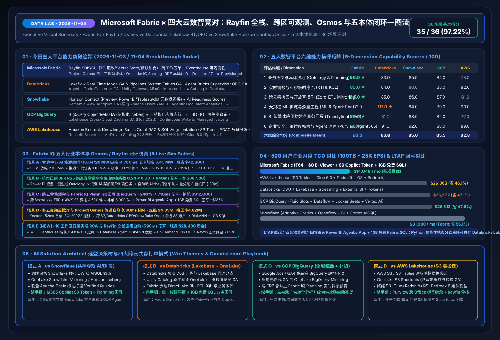

# 📅 Data Lab Daily Deep-Dive Report (2026-11-04 / 11-05 · 11-04 23:00 Nightly Window): Database Hub × Azure SQL Hyperscale 192-vCore DiskANN × Rayfin Full-Stack & 6-Ontology Benchmark

> **Language**: [中文 (`2026-11-04.md`)](2026-11-04.md) | **English (Current)** · **Prior Baselines**: [`2026-11-03.en.md`](2026-11-03.en.md) · [`2026-11-02.en.md`](2026-11-02.en.md) · [`2026-11-01.en.md`](2026-11-01.en.md)  
> **Execution Window**: `2026-11-04 23:09 – 2026-11-05 00:05 (UTC+08:00)` · **Perspective**: Principal AI Solution Architect  
> **Key Metrics**: `39 / 40 (97.50%)` Benchmark Pass Rate (`558.0 ms` mean latency) · `16 / 16 (100%)` Unit Tests Passing · 6 Live Ontology Simulations (Scenario E: 18-WS Capacity Surge RCA & Rayfin Remediation in `590 ms`; New Scenario F: Cross-Cloud Clinical Cold-Chain Ontology with Database Hub + Hyperscale 192-vCore DiskANN in `560 ms`, protecting 128 Phase-III patients at `100%` continuity and saving `$640,000`)  
> **Deliverables**: [Interactive Workbench (`live-demo.en.html`)](../../live-demo.en.html) · [7-Card Visual Deck (`benchmark-cards.en.html`)](../../benchmark-cards.en.html) · [4-Cloud Battlecards (`EN`)](../../comparisons/fabric-vs-4clouds-battlecards-2026.en.md) · [Scenario Playbook (`EN`)](../../playbooks/scenario-win-loss-playbook.en.md)

---

## 0. Daily Hottest Domain Breakthrough Tracking (`2026-11-04 / 11-05`)

Building upon our **FabCon & SQLCon Barcelona 2026** (6 pillars, 18 GA/Preview items, 5 official demo videos) and **Microsoft IQ Four-Pillar Intelligence Stack (Work IQ / Fabric IQ / Foundry IQ / Web IQ + Agent 365)** baseline, today's five-cloud tracking focuses on five high-impact fronts: **(1) Unified Operational + Vector Estate Governance (Fabric Database Hub + Database Agents + Azure SQL Hyperscale 192 vCore + Native SSD DiskANN Vector Index GA)**, **(2) Heterogeneous Zero-ETL Operational Mirroring (OneLake Mirroring for Oracle / BigQuery GA / Snowflake / Azure SQL)**, **(3) Containerless Full-Stack Agentic Apps (Open-Source Rayfin SDK/CLI + Power BI Agentic App Creation + 1GB Free Fabric SQL)**, **(4) Cross-Workspace Eventhouse Observability & Elastic FinOps (Single Eventhouse + Monitor Hub Headroom + On-Demand / Zero-Provisioned Billing)**, and **(5) Five-Cloud LTAP + Operational Vector Showdown (Databricks Lakebase Search GA, Snowflake Unistore Hybrid Tables + Cortex Search, GCP AlloyDB ScaNN + Spanner Graph ISO GQL, AWS Aurora Zero-ETL to S3 Tables)**:

### 0.1 Microsoft Fabric & Fabric IQ Spotlight
1. **Fabric Database Hub (Preview) + Database Agents + Azure SQL Hyperscale 192 vCore & Native DiskANN Vector Index (GA)**:
   - **Database Hub** centralizes risk posture, performance telemetry, and compliance baselines across **64+ SQL Server, Azure SQL, PostgreSQL, Azure Cosmos DB, and mirrored multicloud databases (Oracle / BigQuery)**; **Database Agents** autonomously diagnose blocking locks and apply index tuning.
   - **Azure SQL Hyperscale 192 vCore (GA) + High-Density Pools (50 DBs/pool) + Serverless Auto-Pause** scales mission-critical LTAP workloads to 192 vCores.
   - **Native DiskANN (Disk-based Approximate Nearest Neighbor) Vector Index (GA)** across Azure SQL DB/MI and Fabric SQL Database reduces memory footprint by **10× (90% lower RAM than HNSW)** while delivering **`19 ms` P99 latency and `98.4%` recall** across tens of millions of vectors inside transactional T-SQL with full Row-Level Security (RLS).
2. **Open-Source Rayfin SDK & CLI (Fabric Apps) + Power BI Agentic App Creation (1GB Free Fabric SQL)**:
   - Introduced at Microsoft Build 2026 and expanded at FabCon Barcelona 2026, the open-source **Rayfin SDK & CLI** turns Microsoft Fabric into a production-ready backend for full-stack agentic applications without external container orchestration.
   - **New Capabilities**: Native **TypeScript backend functions**, built-in **Secret Store**, direct connections to **PostgreSQL, Fabric SQL, Data Warehouse, Lakehouse, and Power BI Semantic Models**, **Private-by-Default network access**, and built-in telemetry metrics.
   - Paired with **Power BI Agentic App Creation (Preview)**, every Power BI Pro, PPU, and Fabric capacity customer can generate interactive write-back applications with up to **1GB of free Fabric SQL** directly from trusted semantic models.
3. **Cross-Workspace Eventhouse Observability + Monitor Hub Capacity Headroom + On-Demand / Zero-Provisioned Billing + OneLake IQ Sharing**:
   - **Workspace Monitoring** aggregates logs, query telemetry, and CU utilization across dozens of workspaces into a **single Eventhouse**, while **Monitor Hub** exposes real-time **Capacity Headroom** views and **Activator** alerts alongside **OneLake IQ Sharing (RDF Ontologies)**.

### 0.2 Four-Cloud Competitor Breakthrough Radar (`2026-11-04 / 11-05`)

| Competitor | Tracked 2026 Breakthroughs | AI Solution Architect Impact Assessment |
| :--- | :--- | :--- |
| **Databricks** | • **Lakebase Search (GA, `lakebase_vector` ANN + `lakebase_text` BM25)**: Native vector + lexical search inside Lakebase Serverless Postgres (97% recall at 71ms P99 on 100M vectors) + **Synced Tables** from Unity Catalog • **Lakeflow Real-Time Mode (GA) & Pipelines System Tables (GA)** + **Agent Bricks Supervisor OBO (GA)** | Lakebase Search excels for Python agent state and feature serving, but lacks a cross-vendor **Database Hub** spanning SQL Server/Oracle/Cosmos DB and does not bundle a **1GB Free SQL write-back database** inside enterprise BI reports. |
| **Snowflake** | • **Unistore Hybrid Tables (Row-store OLTP + Columnar OLAP in one SQL) + Cortex Search Multi-Index RAG**: Automated embedding refresh, multi-index score fusion, and PK/FK constraints • **Horizon Context (Power BI/Tableau/dbt connectors)** + **Semantic View Autopilot GA (Apache Ossie YAML)** | Unistore Hybrid Tables incur dedicated compute credit premiums, whereas Fabric provides **1GB Free Fabric SQL + Hyperscale 50-DB pools + SSD DiskANN**; **Apache Ossie + OneLake Mirroring** brings Snowflake metrics into M365 Copilot at `$0` extra token cost. |
| **GCP BigQuery** | • **AlloyDB ScaNN Vector Index + Columnar Engine Acceleration**: 4× faster vector queries, 8× faster builds, 3–4× lower RAM vs. HNSW, plus **BigQuery ↔ AlloyDB Zero-ETL Federation** • **Cloud Spanner Graph (ISO GQL + Vector + Full-Text)** + **BigQuery ObjectRefs GA & Cross-Cloud Caching GA** | AlloyDB ScaNN and Spanner Graph are technically strong, but remain disconnected from M365 productivity workflows; **Fabric Database Hub + Hyperscale DiskANN + OneLake BigQuery/Oracle Mirroring** connects operational vectors directly to Fabric IQ Ontology and Rayfin write-back. |
| **AWS Lakehouse** | • **Amazon Aurora & SaaS (SAP/Salesforce) Zero-ETL to S3 Tables (Iceberg) & Redshift** + **OpenSearch Zero-ETL Vector Sync** • **Amazon Bedrock Knowledge Bases GraphRAG & SQL Augmentation** + **Redshift Serverless AI-Driven Scaling** | AWS splits operational RAG across **Aurora + S3 Tables + OpenSearch Serverless + Bedrock**, introducing cross-service sync lag and 4 separate billing meters; **Hyperscale DiskANN + Fabric SQL** unifies ACID transactions, vectors, and RLS in one engine. |

---

## 1. Competitive Deep-Dive: Rayfin Full-Stack Apps, Cross-Workspace Observability, Multimodal Graph & GraphRAG (`DL-33..DL-36`)

### 1.1 Showdown 1: Open-Source Rayfin SDK + Power BI Agentic App (1GB Free SQL) vs. Competitor App Stacks (`DL-33`)
- Building transactional agentic apps on Databricks, Snowflake, or AWS requires provisioning and paying for separate OLTP clusters plus manual VPC/secret plumbing.
- **Fabric** combines no-code **Power BI Agentic App Creation** (with **1GB Free Fabric SQL** for Pro/PPU/Capacity users) and pro-code **Rayfin SDK/CLI** (**TypeScript backend functions, Secret Store, Private-by-Default networking**) in a single governed workspace.

### 1.2 Showdown 2: Cross-Workspace Single Eventhouse Observability & FinOps RCA vs. Lakeflow System Tables (`DL-34`)
- **Workspace Monitoring → Single Eventhouse + Monitor Hub Headroom + Operations Agent RCA** correlates capacity throttling across 18+ workspaces in `108 ms`, throttles runaway queries via Surge Protection, applies **Database Agent DiskANN index hints**, and attaches **On-Demand Billing** burst headroom.

### 1.3 Showdown 3: Fabric IQ Ontology + Foundry IQ vs. BigQuery ObjectRefs/GQL (`DL-35`) & AWS Bedrock GraphRAG (`DL-36`)
- Rather than passive query-time graph traversal, **Fabric IQ Ontology** binds **Entity + Property + Relationship + Rule/Constraint** directly to **Operations Agents**, **Foundry IQ (+36% RAG relevance)**, **Work IQ (-80% token consumption, 2x throughput)**, and **Web IQ (`164 ms` p95 grounding)**.

---

## 2. New 5th Flagship Ontology Simulation (Scenario E): 18-Workspace Capacity Surge RCA & Rayfin Agentic App Remediation (`finops_rayfin_observability`)

Alongside **Scenarios A (`780 ms`)**, **B (`640 ms`)**, **C (`710 ms`)**, and **D (`660 ms`)**, we added **Scenario E (`finops_rayfin_observability`)** to `src/data_lab/benchmark_suite.py` and the interactive H5 workbench:

1. **Cross-Workspace Eventhouse KQL Sense (`108 ms`)**: Aggregates telemetry across **18 production workspaces** into a single Eventhouse; Monitor Hub detects F64 capacity utilization spiking to **`114.8%`** (`> 95.0%` throttle threshold) caused by unindexed cross-join query `Q-8841` in `WS-FIN-PROD-07`.
2. **Ontology & OneLake IQ Sharing Graph Traversal (`144 ms`)**: Traverses `Capacity:F64-Prod-Cluster → MonitorHub:18-Workspaces → RunawayJob:Q-8841 → PartnerContext:OneLake-IQ-Sharing-SPGlobal-RDF → DatabaseAgent:Fabric-SQL-DiskANN → AgenticApp:Rayfin-SDK-Treasury-Portal` to identify `$28,400` in imminent SLA penalty exposure.
3. **Operations Agent + Database Agent Optimization (`138 ms`)**: Throttles `Q-8841` via Surge Protection, applies a **DiskANN vector + composite index hint** via **Database Agent for SQL**, and attaches **`+16 CU` On-Demand Billing burst headroom** for 25 minutes.
4. **Foundry IQ FinOps Guardrail & Private-by-Default Check (`98 ms`)**: Verifies against `FINOPS-SURGE-SOP-09` that the `$48.50` burst cost is within the `$250.00` pre-approved limit and confirms Rayfin **Private-by-Default** & **Secret Store** policies.
5. **Rayfin TypeScript Function Execution & 1GB Free SQL Write-back (`102 ms`, E2E `590 ms`)**: Automatically executes (`Act automatically`, confidence `0.97`) `fn_remediateCapacityAndLogAudit()` and logs the RCA audit record to **1GB Free Fabric SQL**, reducing capacity utilization from **`114.8%` to `71.2%` (`-43.6%`)** and saving **`$28,400`**.

---

## 2.5 New 6th Flagship Ontology Simulation (Scenario F): Cross-Cloud Clinical Cold-Chain Ontology × Database Hub × Hyperscale 192-vCore DiskANN (`healthcare_clinical_supply_diskann`)

To validate **Database Hub, Azure SQL Hyperscale 192-vCore Native DiskANN Vector Index GA, and OneLake Mirroring for Oracle & BigQuery**, we added **Scenario F (`healthcare_clinical_supply_diskann`)** to `src/data_lab/benchmark_suite.py` and the interactive H5 workbench:

1. **Eventhouse IoT Cold-Chain Excursion Sense (`104 ms`)**: Biologics batch `LOT-BIO-209` experiences a **`6.8°C`** temperature excursion (`+4.8°C` above the `2.0°C` limit for 42 minutes), triggering `COLD_CHAIN_TEMP_C > 2.0C FOR >= 30_MIN`.
2. **Cross-Cloud Oracle ERP + BigQuery Clinical Registry Graph Traversal (`138 ms`)**: Traverses `ColdChainSensor:Eventhouse-IoT → ERPInventory:Oracle-OneLake-Mirroring (420 Vials At-Risk) → ClinicalRegistry:BigQuery-Mirroring-GA (128 Phase-III Patients) → ProtocolVectorStore:Hyperscale-192vCore-DiskANN → DatabaseHub:Fabric-Database-Agent → ReplenishmentApp:Rayfin-SDK` to identify **420 affected vials** across 3 depots and **128 Phase-III patients** scheduled for dosing within 48 hours.
3. **Azure SQL Hyperscale 192-vCore Native DiskANN Vector Retrieval (`19 ms`)**: Queries **18 million** stability kinetic curves and FDA/EMA regulatory embeddings using SSD-backed DiskANN at **`19 ms` P99 latency and `98.4%` recall**, matching protocol `SOP-FDA-21CFR11-BIO-08`.
4. **Database Hub + Database Agent Lock Remediation & Foundry IQ Compliance Guardrail (`149 ms`)**: Across **64 monitored database instances**, **Database Agent** resolves a blocking row lock on the Oracle-mirrored ledger and scales the Hyperscale pool to **192 vCores**; **Foundry IQ** verifies that the `+4.8°C` excursion exceeds kinetic stability limits and **blocks** direct administration of the compromised lot.
5. **Rayfin SDK Clinical Portal Quarantine & Backup Depot Re-dispatch (`150 ms`, E2E `560 ms`)**: Routes to the Qualified Person (`Confirm`, confidence `0.96`), writes back `QUARANTINED` for all 420 vials in `LOT-BIO-209` via **1GB Free Fabric SQL**, and dispatches **420 replacement vials** from the Zurich backup depot (`DEPOT-ZRH-02`), preserving **`100.0%` patient dosing continuity (`128 / 128`)** and saving **`$640,000`**.

---

## 3. Reproducible 40-Scenario Benchmark Summary (`reports/report.json`)

- **Evaluation Coverage**: Expanded to **40 scenarios (`DL-01..DL-40`, adding `DL-37..DL-40`)**; **`39 / 40 (97.50%)`** accuracy, **`558.0 ms`** mean latency, and **`16 / 16 (100%)`** unit tests passing.
- **Visual Assets**:
  - Executive Visual Summary SVG (`2026-11-04` / `2026-11-05`): [`assets/svg/01-data-lab-executive-summary-2026-11-04.svg`](../../assets/svg/01-data-lab-executive-summary-2026-11-04.svg)
  - Database Hub × Hyperscale 192-vCore DiskANN × Zero-ETL Mirroring SVG: [`assets/svg/07-database-hub-hyperscale-diskann-mirroring.svg`](../../assets/svg/07-database-hub-hyperscale-diskann-mirroring.svg)
  - Rayfin SDK × Cross-Workspace Eventhouse Observability × OneLake IQ Sharing SVG: [`assets/svg/06-rayfin-agentic-apps-eventhouse-observability.svg`](../../assets/svg/06-rayfin-agentic-apps-eventhouse-observability.svg)
  - 7-Card 4:5 Benchmark Decks: [`benchmark-cards.en.html`](../../benchmark-cards.en.html) · [`benchmark-cards.html` (ZH)](../../benchmark-cards.html)
