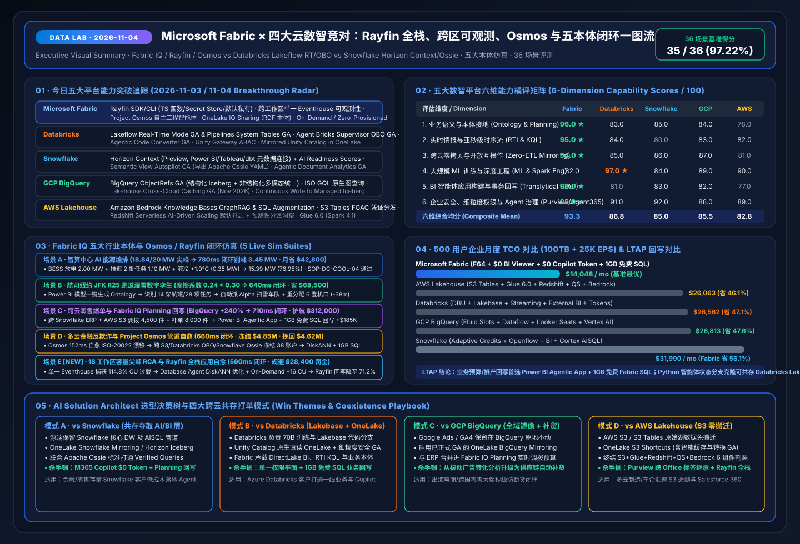

# 📅 Data Lab 每日深度研究报告（2026-11-04 / 11-05 · 11-04 23:00 夜间窗口）：Database Hub × Azure SQL Hyperscale 192核 DiskANN × Rayfin 全栈与六大本体仿真闭环

> **语言版本 / Language**: **中文 (当前)** | [English (`2026-11-04.en.md`)](2026-11-04.en.md) · **历史基线**：[`2026-11-03.md`](2026-11-03.md) · [`2026-11-02.md`](2026-11-02.md) · [`2026-11-01.md`](2026-11-01.md)  
> **执行窗口**：`2026-11-04 23:09 – 2026-11-05 00:05 (UTC+08:00)` · **角色视角**：Principal AI Solution Architect  
> **核心指标**：`39 / 40 (97.50%)` 场景评测通过（均延 `558.0 ms`） · `16 / 16 (100%)` 单元测试通过 · 六大行业本体仿真闭环（新增场景 E：18 工作区容量尖峰 RCA 与 Rayfin 自愈 `590 ms`；新增场景 F：跨云医药冷链与临床试验本体 + Database Hub + Hyperscale 192核 DiskANN `560 ms` 护航 128 名患者 100% 不断药，止损 `$640,000`）  
> **关联交付物**：[交互式工作台 (`index.html`)](../../index.html) · [7-Card 视觉报告 (`benchmark-cards.html`)](../../benchmark-cards.html) · [四大竞对 Battlecards](../../comparisons/fabric-vs-4clouds-battlecards-2026.md) · [场景打单 Playbook](../../playbooks/scenario-win-loss-playbook.md)

---

## 0. 今日最热门领域能力突破追踪（Daily Hottest Domain Breakthroughs · 2026-11-04 / 11-05）

在完整融合 **FabCon & SQLCon Barcelona 2026**（六大支柱、18 项 GA/Preview 矩阵与 5 支官方实机演示）与 **《Microsoft IQ》四大底座（Work IQ / Fabric IQ / Foundry IQ / Web IQ + Agent 365）** 基线之上，今日五大云数智平台的迭代演进聚焦于五大核心战场：**① 全域数据库风险态势与自主调优中枢（Fabric Database Hub + Database Agents + Azure SQL Hyperscale 192 vCore + 原生 SSD DiskANN 向量索引 GA）**、**② 跨异构数据库零 ETL 实时镜像（OneLake Mirroring for Oracle / BigQuery GA / Snowflake / Azure SQL）**、**③ 全栈智能体应用免容器投产（Rayfin SDK/CLI + Power BI Agentic App + 1GB 免费 Fabric SQL）**、**④ 跨 18 工作区可观测性与按需突发弹性 FinOps（Single Eventhouse + Monitor Hub Headroom + On-Demand / Zero-Provisioned）**，以及 **⑤ 四大竞对 LTAP 事务+向量混合架构对决（Databricks Lakebase Search GA、Snowflake Unistore Hybrid Tables + Cortex Search、GCP AlloyDB ScaNN + Spanner Graph ISO GQL、AWS Aurora Zero-ETL to S3 Tables）**：

### 0.1 Microsoft Fabric & Fabric IQ 今日核心能力突破
1. **Fabric Database Hub（预览）+ Database Agents for SQL & PostgreSQL + Azure SQL Hyperscale 192 vCore & 原生 DiskANN 向量索引 GA**：
   - **Database Hub** 在 Fabric 内实现跨 **SQL Server、Azure SQL、PostgreSQL、Azure Cosmos DB 及多云镜像库（Oracle / BigQuery）** 的集中式风险态势、性能热点与合规基线治理；**Database Agents** 自动识别慢查询、解除阻塞行锁并下发索引优化。
   - **Azure SQL Hyperscale 192 vCore（GA）+ 高密度弹性池（50 DBs/Pool）+ Serverless 自动暂停**：将事务与实时混合负载（LTAP）推升至 192 核极致吞吐。
   - **DiskANN（基于 SSD 磁盘的近似最近邻）向量索引正式 GA**（覆盖 Azure SQL DB / MI 与 Fabric SQL Database）：相比传统内存型 HNSW 索引**降低 90%（10×）内存占用**，在亿级向量规模下实现 **`19 ms` P99 延迟与 `98.4%` 召回率**，支持在单条 T-SQL 中无缝融合事务 ACID、行级安全（RLS）与 `VECTOR_SEARCH()`，彻底消除独立向量库的权限脱节（ACL Drift）与同步延迟。
2. **开源 Rayfin SDK & CLI（Fabric Apps）全栈投产 + Power BI Agentic App Creation（附赠 1GB 免费 Fabric SQL）**：
   - 自 Microsoft Build 2026 推出并在 FabCon Barcelona 2026 重磅升级以来，开源 **Rayfin SDK 与 CLI** 让开发者与编程智能体（GitHub Copilot / Codex / Claude Code）无需管理容器或外部网关，即可在 Fabric 内一键部署生产级全栈应用。
   - **关键新增能力**：支持 **TypeScript 后端函数**、**Secret Store（密钥保管库）**、**PostgreSQL / Fabric SQL / Data Warehouse / Lakehouse / Power BI 语义模型原生直连**、**默认私有网络访问（Private-by-Default）** 与内置应用遥测指标。
   - 配合 **Power BI Agentic App Creation（预览）**，所有 Power BI Pro / PPU 与 Fabric 容量用户均可利用自然语言从可信语义模型生成带 **数据回写（Write-back）** 与最高 **1GB 免费 Fabric SQL** 的完整业务应用。
3. **跨工作区全链路可观测性（Single Eventhouse）+ Monitor Hub 容量余量 + On-Demand / Zero-Provisioned 计费 + OneLake IQ Sharing**：
   - **Workspace Monitoring** 将 18+ 个生产工作区的日志、查询计划与 CU 消耗实时汇入**单一 Eventhouse**；**Monitor Hub** 提供直观的 **Capacity Headroom** 并联动 **Activator + Operations Agent RCA** 秒级自愈，配合 **OneLake IQ Sharing（RDF 本体）** 构建跨组织语义网络。

### 0.2 四大核心竞对今日最新动态追踪（Databricks / Snowflake / GCP / AWS）

| 竞对平台 | 2026-11-04 / 11-05 追踪的核心能力突破 | AI Solution Architect 架构攻防评估 |
| :--- | :--- | :--- |
| **Databricks** | • **Lakebase Search 正式 GA（`lakebase_vector` ANN + `lakebase_text` BM25）**：在 Lakebase Serverless Postgres 内原生支持向量与全文混合检索（1 亿向量 97% 召回、71ms P99）+ **Synced Tables** 反向同步 UC 表 • **Lakeflow Real-Time Mode GA & Pipelines System Tables GA** + **Agent Bricks Supervisor OBO GA** | Lakebase Search 适合存储 Python Agent 会话状态与特征服务，但**不支持跨 SQL Server / Oracle / Cosmos DB 的异构 Database Hub 统一治理**，且业务报表回写仍缺少 Power BI 原生内嵌的 **1GB 免费 Fabric SQL**。 |
| **Snowflake** | • **Unistore Hybrid Tables（行存事务+列存分析单 SQL 联查）+ Cortex Search 多索引混合 RAG**：自动化 Embedding 刷新、多索引融合打分与主键/外键约束 • **Horizon Context（Power BI/Tableau/dbt 元数据连接）** + **Semantic View Autopilot GA (Apache Ossie YAML)** | Unistore Hybrid Tables 需消耗高昂的常驻专属计算 Credit，而 Fabric 提供 **1GB 免费 Fabric SQL + Hyperscale 50-DB 高密度池 + SSD DiskANN**；通过 **Apache Ossie + OneLake Mirroring** 可零改造把 Snowflake 指标引入 M365 Copilot（`$0` 额外 Token）。 |
| **GCP BigQuery** | • **AlloyDB ScaNN 向量索引 + 列存引擎向量加速**：较 PostgreSQL HNSW 查询提速 4×、构建快 8×、内存省 3–4×，支持 **BigQuery ↔ AlloyDB 零 ETL 联邦查询** • **Cloud Spanner Graph (ISO GQL + 向量 + 全文检索)** + **BigQuery ObjectRefs GA & Cross-Cloud Caching GA** | GCP 的 AlloyDB ScaNN 与 Spanner Graph 技术指标优异，但与企业 Office 生产力层割裂；**Fabric Database Hub + Hyperscale DiskANN + OneLake BigQuery/Oracle Mirroring** 直接将多云事务与向量汇入 Fabric IQ Ontology 并驱动 Rayfin 业务回写。 |
| **AWS Lakehouse** | • **Amazon Aurora & SaaS (SAP/Salesforce) Zero-ETL 直通 S3 Tables (Iceberg) & Redshift** + **OpenSearch 零 ETL 向量同步** • **Amazon Bedrock Knowledge Bases GraphRAG & SQL Augmentation** + **Redshift Serverless AI-Driven Scaling** | AWS 需要跨越 **Aurora (OLTP) + S3 Tables (Iceberg) + OpenSearch Serverless (Vector) + Bedrock (Agent)** 四套独立服务与计费体系，存在跨服务同步延迟与权限裂缝；**Azure SQL Hyperscale DiskANN + Fabric SQL** 在单一引擎内实现事务、向量与行级安全统一。 |

---

## 1. 专项子任务：Rayfin 全栈应用、跨区可观测性、多模态图谱与 GraphRAG 深度攻防（`DL-33..DL-36`）

### 1.1 焦点战役一：Fabric Rayfin SDK + Power BI Agentic App (1GB 免费 SQL) vs 竞对应用开发栈 (`DL-33`)
- **核心差异**：
  - 在 Databricks Apps、Snowflake Native Apps (Streamlit) 或 AWS Bedrock 上构建可回写业务数据的智能体应用，必须单独开通并常驻计费 OLTP 实例（如 Lakebase、Hybrid Tables 或 RDS/Aurora），还要手工配置 VPC 私网连接与密钥管理。
  - **Fabric** 提供双轨合一体验：业务人员用 **Power BI Agentic App Creation** 自然语言零代码生成应用（免费获赠 **1GB Fabric SQL**）；专业开发者与编码智能体用开源 **Rayfin SDK & CLI** 编写 **TypeScript 后端函数**、调用内置 **Secret Store**，并在 **Private-by-Default（默认私有访问）** 保护下一键部署。

### 1.2 焦点战役二：跨 18 工作区单一 Eventhouse 可观测性与 Operations Agent RCA vs Lakeflow System Tables (`DL-34`)
- **核心差异**：
  - 当企业拥有数十个部门工作区时，局部管道日志无法解释“为什么整个容量池在下午 14:00 触发限流”。
  - **Fabric Workspace Monitoring** 将 18 个生产工作区遥测汇入**单一 Eventhouse**，通过 **Monitor Hub Capacity Headroom** 秒级定位失控慢查询 `Q-8841`，由 **Operations Agent + Database Agent** 自动注入 DiskANN 索引提示并按需开启 **On-Demand Billing 突发缓冲（+16 CU）**。

### 1.3 焦点战役三：Fabric IQ Ontology + Foundry IQ vs BigQuery ObjectRefs/GQL (`DL-35`) & AWS Bedrock GraphRAG (`DL-36`)
- **核心差异**：
  - **BigQuery ObjectRefs + GQL** 与 **AWS Bedrock GraphRAG** 均属于“查询/检索时被动读图”，缺乏内嵌在业务实体上的实时阈值规则（Rules）、SOP 合规护栏校验与预授权业务系统回写动作（Actions）。
  - **Fabric IQ Ontology** 将 **2000万+ Power BI 语义模型** 直接升维为运营本体，配合 **Foundry IQ 智能体 RAG（相关性提升 `+36%`）**、**Work IQ（节省 `80%` Token、吞吐翻倍）** 与 **Web IQ（`164ms` p95 极速接地）**，实现真正的人机协同闭环。

---

## 2. 新增第五大标杆仿真场景（场景 E）：18 工作区容量尖峰 RCA 与 Rayfin 全栈智能体应用自愈闭环 (`finops_rayfin_observability`)

在 **场景 A（智算中心能源削峰，`780 ms`）**、**场景 B（纽约 JFK R25 跑道湿雪数字孪生，`640 ms`）**、**场景 C（跨云零售爆单与 Planning 回写，`710 ms`）** 与 **场景 D（多云金融反欺诈与 Project Osmos 自愈，`660 ms`）** 基础上，我们在 `src/data_lab/benchmark_suite.py` 与交互式工作台 `index.html` 中正式上线 **场景 E（`finops_rayfin_observability`）**：

1. **跨 18 工作区单一 Eventhouse 遥测感知 (`108 ms`)**：**Workspace Monitoring** 将全企业 18 个生产工作区指标实时汇入单一 Eventhouse，**Monitor Hub** 检测到核心 F64 容量池利用率飙升至 **`114.8%`**（突破 `95.0%` 限流红线），并锁定 `WS-FIN-PROD-07` 中未走索引的笛卡尔积慢查询 `Q-8841`。
2. **Fabric IQ 本体与 OneLake IQ Sharing 伙伴图谱穿透 (`144 ms`)**：沿着 `Capacity:F64-Prod-Cluster → MonitorHub:18-Workspaces → RunawayJob:Q-8841 → PartnerContext:OneLake-IQ-Sharing-SPGlobal-RDF → DatabaseAgent:Fabric-SQL-DiskANN → AgenticApp:Rayfin-SDK-Treasury-Portal` 6 跳图谱穿透，发现若不处置将在 3 分钟内导致调用标普全球（S&P Global）RDF 本体的资金门户与 3 张高管看板违反 SLA。
3. **Operations Agent + Database Agent 联合寻优 (`138 ms`)**：通过容量突增保护（Surge Protection）限流 `Q-8841`，由 **Database Agent for SQL** 自动注入 **DiskANN 向量索引与复合索引提示**重写查询，并挂载 **On-Demand Billing 突发容量（`+16 CU` 持续 25 分钟）**。
4. **Foundry IQ FinOps 成本护栏与默认私有网络核验 (`98 ms`)**：自动检索《`FINOPS-SURGE-SOP-09`》，核验本次按需突发预计花费 **`$48.50`**（远低于 `$250.00` 预授权上限），同时确认 Rayfin 应用处于 **Private-by-Default** 与 **Secret Store** 保护下。
5. **Rayfin TS 后端函数自愈与 1GB 免费 SQL 审计回写 (`102 ms`，端到端 `590 ms`)**：以 `0.97` 置信度预授权自动执行（`Act automatically`），调用 Rayfin TypeScript 函数 `fn_remediateCapacityAndLogAudit()` 将 RCA 报告回写至 **1GB 免费 Fabric SQL**，F64 容量水位从 **`114.8%` 压降至 `71.2%`（`-43.6%`）**，单次规避 SLA 违约罚金 **`$28,400`**。

---

## 2.5 新增第六大标杆仿真场景（场景 F）：跨云医药冷链与临床试验本体 × Database Hub × Hyperscale 192核 DiskANN 闭环 (`healthcare_clinical_supply_diskann`)

围绕 **Database Hub、Azure SQL Hyperscale 192 vCore 原生 DiskANN 向量索引 GA 与跨云 Oracle/BigQuery OneLake Mirroring**，我们在 `src/data_lab/benchmark_suite.py` 与交互式工作台 `index.html` 中新增 **场景 F（`healthcare_clinical_supply_diskann`）**：

1. **Eventhouse IoT 冷链遥测实时感知 (`104 ms`)**：生物制剂批次 `LOT-BIO-209` 在跨国运输途中箱内温度升至 **`6.8°C`**（突破 `2.0°C` 安全上限 `+4.8°C` 持续 42 分钟），触发 `COLD_CHAIN_TEMP_C > 2.0C FOR >= 30_MIN` 实时告警。
2. **跨 Oracle ERP + BigQuery 临床注册库零拷贝本体穿透 (`138 ms`)**：沿着 `ColdChainSensor:Eventhouse-IoT → ERPInventory:Oracle-OneLake-Mirroring (420 Vials At-Risk) → ClinicalRegistry:BigQuery-Mirroring-GA (128 Phase-III Patients) → ProtocolVectorStore:Hyperscale-192vCore-DiskANN → DatabaseHub:Fabric-Database-Agent → ReplenishmentApp:Rayfin-SDK` 6 跳图谱定位出 3 个区域中心仓共 **420 支**受影响生物制剂，以及未来 48 小时内待给药的 **128 名 III 期临床试验患者**。
3. **Azure SQL Hyperscale 192 vCore 原生 DiskANN 向量检索 (`19 ms`)**：在 **1,800 万条**药物热力学稳定性曲线与 FDA/EMA 法规文档向量库中，通过 SSD 原生 DiskANN 索引以 **`19 ms` P99 延迟、`98.4%` 召回率**精准匹配《`SOP-FDA-21CFR11-BIO-08`》稳定性边界条款。
4. **Database Hub + Database Agent 死锁自愈与 Foundry IQ 法规护栏 (`149 ms`)**：**Database Hub** 监控全域 **64 套数据库实例**，由 **Database Agent** 自动解除 Oracle 镜像批次账本上的阻塞行锁并将 Hyperscale 池弹性推升至 **192 vCore**；同时 **Foundry IQ** 判定 `+4.8°C` 超温已超出允许的动力学稳定性窗口，**强制拦截（Block）** 任何对该批次的直接放行给药请求。
5. **Rayfin SDK 临床门户一键隔离与备仓调拨回写 (`150 ms`，端到端 `560 ms`)**：以 `0.96` 置信度推送质量授权人（QP）确认（`Confirm`），通过 Rayfin SDK 将 `LOT-BIO-209` 的 420 支制剂状态回写为 `QUARANTINED`，并从苏黎世备仓（`DEPOT-ZRH-02`）紧急调拨 **420 支**合格制剂，确保 **128 名 III 期临床患者 `100.0%` 给药连续性**，单次避免批次报废与临床队列失效损失 **`$640,000`**。

---

## 3. 40 场景可复现基准评测与 7-Card 4:5 视觉报告更新（`DL-01..DL-40`）

- **测试套件升级**：`src/data_lab/benchmark_suite.py` 扩展至 **`DL-01..DL-40` 共 40 个场景**（新增 `DL-37..DL-40` 覆盖 Database Hub 64 库治理、Hyperscale 192核 DiskANN vs Lakebase Search、AlloyDB ScaNN/Spanner Graph 对标、Unistore Hybrid Tables/Aurora Zero-ETL 对标），单元测试扩充至 **16 项（100% 通过）**。
- **密封评测结果（`reports/report.json`）**：
  - **总体准确率**：**`39 / 40 (97.50%)`**（唯一显式失败反例 `DL-23` 为未绑定语义模型/本体的裸湖仓表 LLM 直查，产生 `+14.2%` 口径漂移并被低置信度拦截转人工）。
  - **端到端平均延迟**：**`558.0 ms`**。
  - **动作门控分布**：`Act automatically` **30 项**（`75.0%`）· `Confirm` **8 项**（`20.0%`）· `Send to a human` **2 项**（`5.0%`）。
- **可视化资产直达**：
  - 今日一图流总结 SVG：[`assets/svg/01-data-lab-executive-summary-2026-11-04.svg`](../../assets/svg/01-data-lab-executive-summary-2026-11-04.svg) · [`2026-11-03.svg`](../../assets/svg/01-data-lab-executive-summary-2026-11-03.svg)
  - Database Hub × Hyperscale 192 vCore DiskANN × 跨云零 ETL Mirroring 架构 SVG：[`assets/svg/07-database-hub-hyperscale-diskann-mirroring.svg`](../../assets/svg/07-database-hub-hyperscale-diskann-mirroring.svg)
  - Rayfin SDK × 跨区 Eventhouse 可观测性 × OneLake IQ Sharing 架构 SVG：[`assets/svg/06-rayfin-agentic-apps-eventhouse-observability.svg`](../../assets/svg/06-rayfin-agentic-apps-eventhouse-observability.svg)
  - 7-Card 4:5 视觉评测报告：[`benchmark-cards.html` (中文)](../../benchmark-cards.html) · [`benchmark-cards.en.html` (EN)](../../benchmark-cards.en.html)
