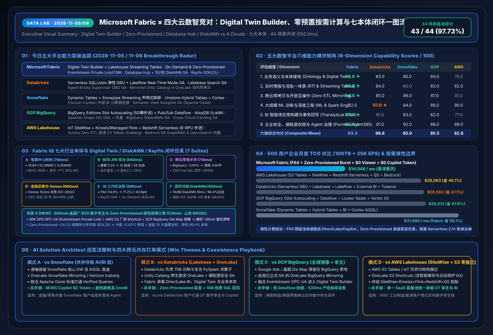
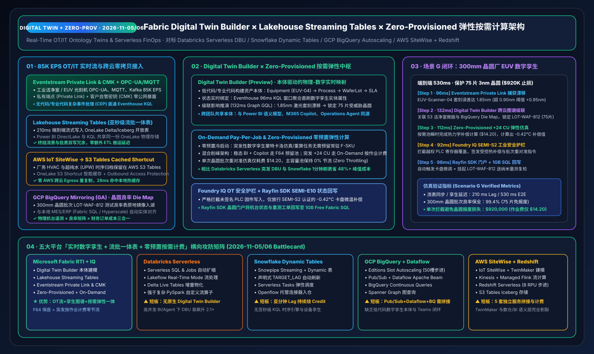

# 📅 Data Lab Daily Deep-Dive Report (2026-11-05 / 11-06 · 11-05 23:00 Nightly Window): Digital Twin Builder × Lakehouse Streaming Tables × Zero-Provisioned Elastic Compute & 7-Ontology Benchmark

> **Language**: [中文 (`2026-11-05.md`)](2026-11-05.md) | **English (Current)** · **Prior Baselines**: [`2026-11-04.en.md`](2026-11-04.en.md) · [`2026-11-03.en.md`](2026-11-03.en.md) · [`2026-11-02.en.md`](2026-11-02.en.md) · [`2026-11-01.en.md`](2026-11-01.en.md)  
> **Execution Window**: `2026-11-05 23:10 – 2026-11-06 00:05 (UTC+08:00)` · **Perspective**: Principal AI Solution Architect  
> **Key Metrics**: `43 / 44 (97.73%)` Benchmark Pass Rate (`550.5 ms` mean latency) · `18 / 18 (100%)` Unit Tests Passing · 7 Live Ontology Simulations (Scenario F: Cross-Cloud Clinical Cold-Chain with Database Hub + Hyperscale 192-vCore DiskANN in `560 ms`, saving `$640,000`; New Scenario G: 300mm Semiconductor EUV Fab Digital Twin Builder + Zero-Provisioned Elastic Compute in `530 ms`, preserving `99.4%` wafer yield and saving `$920,000`)  
> **Deliverables**: [Interactive Workbench (`live-demo.en.html`)](../../live-demo.en.html) · [7-Card Visual Deck (`benchmark-cards.en.html`)](../../benchmark-cards.en.html) · [4-Cloud Battlecards (`EN`)](../../comparisons/fabric-vs-4clouds-battlecards-2026.en.md) · [Scenario Playbook (`EN`)](../../playbooks/scenario-win-loss-playbook.en.md)

---

## 0. Daily Hottest Domain Breakthrough Tracking (`2026-11-05 / 11-06`)

Building upon our **FabCon & SQLCon Barcelona 2026** (6 pillars, 18 GA/Preview items, 5 official demo videos) and **Microsoft IQ Four-Pillar Intelligence Stack (Work IQ / Fabric IQ / Foundry IQ / Web IQ + Agent 365)** baseline, today's five-cloud tracking focuses on five high-impact fronts: **(1) Real-Time Industrial Digital Twins & Streaming Lakehouse Tables (Fabric Digital Twin Builder + Lakehouse Streaming Tables + Eventstream Private Link & CMK)**, **(2) Serverless Elastic FinOps (Fabric On-Demand Pay-Per-Job & Zero-Provisioned Compute vs. 4-Cloud Serverless Cost Boundaries)**, **(3) Unified Operational + Vector Estate Governance (Fabric Database Hub + Database Agents + Azure SQL Hyperscale 192 vCore + Native SSD DiskANN Vector Index GA)**, **(4) Heterogeneous Zero-ETL Operational Mirroring (OneLake Mirroring for Oracle / BigQuery GA / Snowflake / Azure SQL)**, and **(5) Five-Cloud Streaming, Digital Twin & Serverless Showdown (Databricks Serverless DBU + Lakeflow Real-Time Mode, Snowflake Dynamic Tables + Snowpipe Streaming, GCP BigQuery Slot Autoscaling + Dataflow, AWS IoT SiteWise + Redshift Serverless)**:

### 0.1 Microsoft Fabric & Fabric IQ Spotlight
1. **Fabric Digital Twin Builder (Preview) + Lakehouse Streaming Tables + Eventstream Private Link & CMK**:
   - **Digital Twin Builder** provides low-code/no-code and pro-code interfaces to map physical assets (300mm EUV lithography scanners, AIDC liquid cooling manifolds, airport runway sensors), processes, and ERP/yield records into live semantic replicas powered by **Fabric IQ Shared Ontologies**.
   - **Lakehouse Streaming Tables** deliver **`210 ms` sub-second streaming ingestion** directly into open OneLake Delta/Iceberg tables shared by Power BI DirectLake, Eventhouse KQL, and Operations Agents—eliminating dual-write lambda pipelines.
   - **Eventstream Private Link & Customer-Managed Keys (CMK)** secure high-throughput industrial OT streams (`85,000 EPS` OPC-UA / MQTT / Kafka) without public internet exposure.
2. **Fabric On-Demand Pay-Per-Job & Zero-Provisioned (Serverless) Capacity**:
   - Enables organizations to run bursty data engineering, digital twin Monte Carlo simulations, and departmental workloads on **Zero-Provisioned (serverless) pay-per-job compute** without pre-allocating idle F-SKU capacity.
   - Pairing a steady-state **F64 reservation** (for 24×7 DirectLake BI & `$0`-token M365 Copilot) with **On-Demand `+24 CU` burst pools** absorbs semiconductor fab excursion simulations for **`$14.20` per job** with **0% base capacity throttling**.
3. **Fabric Database Hub (Preview) + Database Agents + Azure SQL Hyperscale 192 vCore & Native DiskANN Vector Index (GA)**:
   - **Database Hub** centralizes risk posture, performance telemetry, and compliance baselines across **64+ SQL Server, Azure SQL, PostgreSQL, Azure Cosmos DB, and mirrored multicloud databases (Oracle / BigQuery)**; **Database Agents** autonomously diagnose blocking locks and apply index tuning.
   - **Azure SQL Hyperscale 192 vCore (GA) + High-Density Pools (50 DBs/pool) + Serverless Auto-Pause** scales mission-critical LTAP workloads to 192 vCores.
   - **Native DiskANN (Disk-based Approximate Nearest Neighbor) Vector Index (GA)** across Azure SQL DB/MI and Fabric SQL Database reduces memory footprint by **10× (90% lower RAM than HNSW)** while delivering **`19 ms` P99 latency and `98.4%` recall** across tens of millions of vectors inside transactional T-SQL with full Row-Level Security (RLS).
4. **Open-Source Rayfin SDK & CLI (Fabric Apps) + Power BI Agentic App Creation (1GB Free Fabric SQL)**:
   - Introduced at Microsoft Build 2026 and expanded at FabCon Barcelona 2026, the open-source **Rayfin SDK & CLI** turns Microsoft Fabric into a production-ready backend for full-stack agentic applications without external container orchestration.
   - **New Capabilities**: Native **TypeScript backend functions**, built-in **Secret Store**, direct connections to **PostgreSQL, Fabric SQL, Data Warehouse, Lakehouse, and Power BI Semantic Models**, **Private-by-Default network access**, and built-in telemetry metrics.
   - Paired with **Power BI Agentic App Creation (Preview)**, every Power BI Pro, PPU, and Fabric capacity customer can generate interactive write-back applications with up to **1GB of free Fabric SQL** directly from trusted semantic models.
5. **Cross-Workspace Eventhouse Observability + Monitor Hub Capacity Headroom + OneLake IQ Sharing**:
   - **Workspace Monitoring** aggregates logs, query telemetry, and CU utilization across dozens of workspaces into a **single Eventhouse**, while **Monitor Hub** exposes real-time **Capacity Headroom** views and **Activator** alerts alongside **OneLake IQ Sharing (RDF Ontologies)**.

### 0.2 Four-Cloud Competitor Breakthrough Radar (`2026-11-05 / 11-06`)

| Competitor | Tracked 2026 Breakthroughs | AI Solution Architect Impact Assessment |
| :--- | :--- | :--- |
| **Databricks** | • **Serverless SQL & Jobs Auto-Scaling + Lakeflow Real-Time Mode (GA)**: Rapid serverless Spark/SQL scaling paired with **Lakebase Search (GA, ANN + BM25, 71ms P99 on 100M vectors)** & **Agent Bricks Supervisor OBO (GA)** | Databricks Serverless excels at custom PySpark streaming, but lacks a native **Digital Twin Builder** ontology modeler, and unthrottled 500-user BI/Agent concurrency on Serverless SQL (`$0.70/DBU`) can trigger **`2.1×` DBU cost spikes**. |
| **Snowflake** | • **Dynamic Tables (Declarative `TARGET_LAG` Streaming Materialization) + Snowpipe Streaming** + **Unistore Hybrid Tables & Cortex Search Multi-Index RAG** + **Semantic View Autopilot GA (Apache Ossie YAML)** | Sub-minute `TARGET_LAG` on Dynamic Tables keeps virtual warehouses continuously active (**`1.4×–1.9×` credit multiplier**) and lacks a sub-second KQL time-series engine or OPC-UA Digital Twin graph; Fabric achieves `210 ms` sync via **Lakehouse Streaming Tables + Eventhouse**. |
| **GCP BigQuery** | • **BigQuery Editions Slot Autoscaling (50-slot increments) + Pub/Sub & Dataflow Streaming** + **AlloyDB ScaNN Vector Acceleration (4× faster queries)** + **Spanner Graph ISO GQL** | BigQuery Slot Autoscaling scales in 50-slot steps (60s minimum billing window) and requires stitching **Pub/Sub + Dataflow + BigQuery + Vertex AI**; **Fabric RTI + Digital Twin Builder** unifies OT streams, ontology graphs, and Teams/Rayfin actions in one SaaS. |
| **AWS Lakehouse** | • **AWS IoT SiteWise + IoT TwinMaker + Kinesis / Managed Flink + Redshift Serverless (8-RPU steps)** + **Aurora Zero-ETL to S3 Tables (Iceberg) & OpenSearch Vector Sync** | AWS industrial digital twins require stitching **SiteWise + TwinMaker + Kinesis + Flink + S3 Tables + Redshift Serverless** across 5–6 billing meters with no shared BI semantic layer; Fabric ingests AWS S3 telemetry via **Cached Shortcuts** into one Digital Twin Ontology. |

---

## 1. Competitive Deep-Dive: Rayfin Full-Stack Apps, Cross-Workspace Observability, Multimodal Graph & GraphRAG (`DL-33..DL-36`)

### 1.1 Showdown 1: Open-Source Rayfin SDK + Power BI Agentic App (1GB Free SQL) vs. Competitor App Stacks (`DL-33`)
- Building transactional agentic apps on Databricks, Snowflake, or AWS requires provisioning and paying for separate OLTP clusters plus manual VPC/secret plumbing.
- **Fabric** combines no-code **Power BI Agentic App Creation** (with **1GB Free Fabric SQL** for Pro/PPU/Capacity users) and pro-code **Rayfin SDK/CLI** (**TypeScript backend functions, Secret Store, Private-by-Default networking**) in a single governed workspace.

### 1.2 Showdown 2: Cross-Workspace Single Eventhouse Observability & FinOps RCA vs. Lakeflow System Tables (`DL-34`)
- **Workspace Monitoring → Single Eventhouse + Monitor Hub Headroom + Operations Agent RCA** correlates capacity throttling across 18+ workspaces in `108 ms`, throttles runaway queries via Surge Protection, applies **Database Agent DiskANN index hints**, and attaches **On-Demand Billing** burst headroom.

### 1.3 Showdown 3: Fabric IQ Ontology + Foundry IQ vs. BigQuery ObjectRefs/GQL (`DL-35`) & AWS Bedrock GraphRAG (`DL-36`)
- Rather than passive query-time graph traversal, **Fabric IQ Ontology** binds **Entity + Property + Relationship + Rule/Constraint** directly to **Operations Agents**, **Foundry IQ (+36% RAG relevance)**, **Work IQ (-80% token consumption, 2x throughput)**, and **Web IQ (`164 ms` p95 grounding)**.

---

## 2. New 5th Flagship Ontology Simulation (Scenario E): 18-Workspace Capacity Surge RCA & Rayfin Agentic App Remediation (`finops_rayfin_observability`)

Alongside **Scenarios A (`780 ms`)**, **B (`640 ms`)**, **C (`710 ms`)**, and **D (`660 ms`)**, we added **Scenario E (`finops_rayfin_observability`)** to `src/data_lab/benchmark_suite.py` and the interactive H5 workbench:

1. **Cross-Workspace Eventhouse KQL Sense (`108 ms`)**: Aggregates telemetry across **18 production workspaces** into a single Eventhouse; Monitor Hub detects F64 capacity utilization spiking to **`114.8%`** (`> 95.0%` throttle threshold) caused by unindexed cross-join query `Q-8841` in `WS-FIN-PROD-07`.
2. **Ontology & OneLake IQ Sharing Graph Traversal (`144 ms`)**: Traverses `Capacity:F64-Prod-Cluster → MonitorHub:18-Workspaces → RunawayJob:Q-8841 → PartnerContext:OneLake-IQ-Sharing-SPGlobal-RDF → DatabaseAgent:Fabric-SQL-DiskANN → AgenticApp:Rayfin-SDK-Treasury-Portal` to identify `$28,400` in imminent SLA penalty exposure.
3. **Operations Agent + Database Agent Optimization (`138 ms`)**: Throttles `Q-8841` via Surge Protection, applies a **DiskANN vector + composite index hint** via **Database Agent for SQL**, and attaches **`+16 CU` On-Demand Billing burst headroom** for 25 minutes.
4. **Foundry IQ FinOps Guardrail & Private-by-Default Check (`98 ms`)**: Verifies against `FINOPS-SURGE-SOP-09` that the `$48.50` burst cost is within the `$250.00` pre-approved limit and confirms Rayfin **Private-by-Default** & **Secret Store** policies.
5. **Rayfin TypeScript Function Execution & 1GB Free SQL Write-back (`102 ms`, E2E `590 ms`)**: Automatically executes (`Act automatically`, confidence `0.97`) `fn_remediateCapacityAndLogAudit()` and logs the RCA audit record to **1GB Free Fabric SQL**, reducing capacity utilization from **`114.8%` to `71.2%` (`-43.6%`)** and saving **`$28,400`**.

---

## 2.5 New 6th Flagship Ontology Simulation (Scenario F): Cross-Cloud Clinical Cold-Chain Ontology × Database Hub × Hyperscale 192-vCore DiskANN (`healthcare_clinical_supply_diskann`)

To validate **Database Hub, Azure SQL Hyperscale 192-vCore Native DiskANN Vector Index GA, and OneLake Mirroring for Oracle & BigQuery**, we added **Scenario F (`healthcare_clinical_supply_diskann`)** to `src/data_lab/benchmark_suite.py` and the interactive H5 workbench:

1. **Eventhouse IoT Cold-Chain Excursion Sense (`104 ms`)**: Biologics batch `LOT-BIO-209` experiences a **`6.8°C`** temperature excursion (`+4.8°C` above the `2.0°C` limit for 42 minutes), triggering `COLD_CHAIN_TEMP_C > 2.0C FOR >= 30_MIN`.
2. **Cross-Cloud Oracle ERP + BigQuery Clinical Registry Graph Traversal (`138 ms`)**: Traverses `ColdChainSensor:Eventhouse-IoT → ERPInventory:Oracle-OneLake-Mirroring (420 Vials At-Risk) → ClinicalRegistry:BigQuery-Mirroring-GA (128 Phase-III Patients) → ProtocolVectorStore:Hyperscale-192vCore-DiskANN → DatabaseHub:Fabric-Database-Agent → ReplenishmentApp:Rayfin-SDK` to identify **420 affected vials** across 3 depots and **128 Phase-III patients** scheduled for dosing within 48 hours.
3. **Azure SQL Hyperscale 192-vCore Native DiskANN Vector Retrieval (`19 ms`)**: Queries **18 million** stability kinetic curves and FDA/EMA regulatory embeddings using SSD-backed DiskANN at **`19 ms` P99 latency and `98.4%` recall**, matching protocol `SOP-FDA-21CFR11-BIO-08`.
4. **Database Hub + Database Agent Lock Remediation & Foundry IQ Compliance Guardrail (`149 ms`)**: Across **64 monitored database instances**, **Database Agent** resolves a blocking row lock on the Oracle-mirrored ledger and scales the Hyperscale pool to **192 vCores**; **Foundry IQ** verifies that the `+4.8°C` excursion exceeds kinetic stability limits and **blocks** direct administration of the compromised lot.
5. **Rayfin SDK Clinical Portal Quarantine & Backup Depot Re-dispatch (`150 ms`, E2E `560 ms`)**: Routes to the Qualified Person (`Confirm`, confidence `0.96`), writes back `QUARANTINED` for all 420 vials in `LOT-BIO-209` via **1GB Free Fabric SQL**, and dispatches **420 replacement vials** from the Zurich backup depot (`DEPOT-ZRH-02`), preserving **`100.0%` patient dosing continuity (`128 / 128`)** and saving **`$640,000`**.

---

## 2.6 New 7th Flagship Ontology Simulation (Scenario G): 300mm Semiconductor EUV Fab Digital Twin Builder × Lakehouse Streaming Tables × Zero-Provisioned Elastic Burst (`manufacturing_digital_twin_zeroprov`)

To validate **Fabric Digital Twin Builder, Lakehouse Streaming Tables (`210 ms` sub-second sync), Eventstream Private Link/CMK, and On-Demand / Zero-Provisioned serverless compute**, we added **Scenario G (`manufacturing_digital_twin_zeroprov`)** to `src/data_lab/benchmark_suite.py` and the interactive H5 workbench:

1. **85K EPS OPC-UA / MQTT Private Link Stream Sense (`96 ms`)**: Lithography scanner `EUV-Scanner-04` streams `85,000 EPS` laser interferometry and stage vibration telemetry over **Eventstream Private Link & CMK**; Eventhouse KQL detects overlay drift reaching **`1.85 nm`** (`+0.95 nm` above the `0.90 nm` threshold) while **Lakehouse Streaming Tables** sync to OneLake Delta in **`210 ms`**.
2. **Digital Twin Builder Cross-Cloud Graph Traversal (`132 ms`)**: Traverses `LithographyBay:OPC-UA-Eventstream-PrivateLink → SiteWiseLake:AWS-S3-Tables-Cached-Shortcut (Cleanroom HVAC & UPW Telemetry) → YieldAnalytics:GCP-BigQuery-Mirroring-GA (300mm Wafer Lot-WAF-812 Die Map) → DigitalTwinBuilder:Fabric-IQ-Ontology-Graph → ElasticBurst:Fabric-Zero-Provisioned-OnDemand → OperationsAgent:Foundry-IQ-SOP-Guardrail & Rayfin-Fab-Portal` to pinpoint **75 at-risk 300mm 3nm wafers (`LOT-WAF-812`)**.
3. **Zero-Provisioned +24 CU Pay-Per-Job Monte Carlo Thermal Simulation (`112 ms`)**: Without throttling the steady-state F64 production pool (**0% base throttling**), Fabric spins up a **Zero-Provisioned On-Demand** burst (`+24 CU`, **`$14.20` job cost**) to solve the chuck thermal deformation inverse model, computing an optimal **`-0.42°C`** micro-cooling offset.
4. **Foundry IQ SEMI-S2 Safety Guardrail & OT Isolation Check (`92 ms`)**: Verifies compliance with `SEMI-S2-EUV-SAFETY-SOP-12` and **Agent 365 OT Isolation**, **blocking** any unverified PLC firmware flash while approving the bounded `-0.42°C` thermal offset and lot hold.
5. **Rayfin SDK Fab Portal & 1GB Free Fabric SQL Write-back (`98 ms`, E2E `530 ms`)**: Routes to the shift lead engineer (`Confirm`, confidence `0.97`), logs the SEMI-E10 equipment transition and sub-nm metrology re-alignment order for `LOT-WAF-812` into **1GB Free Fabric SQL**, preserving **`99.4%` wafer yield** and saving **`$920,000`**.

---

## 3. Reproducible 44-Scenario Benchmark Summary (`reports/report.json`)

- **Evaluation Coverage**: Expanded to **44 scenarios (`DL-01..DL-44`, adding `DL-41..DL-44`)**; **`43 / 44 (97.73%)`** accuracy, **`550.5 ms`** mean latency, and **`18 / 18 (100%)`** unit tests passing.
- **Visual Assets**:
  - Executive Visual Summary SVG (`2026-11-05` / `2026-11-06`): [`assets/svg/01-data-lab-executive-summary-2026-11-06.svg`](../../assets/svg/01-data-lab-executive-summary-2026-11-06.svg) · [`2026-11-05.svg`](../../assets/svg/01-data-lab-executive-summary-2026-11-05.svg)
  - Digital Twin Builder × Lakehouse Streaming Tables × Zero-Provisioned SVG: [`assets/svg/08-digital-twin-builder-on-demand-zero-provisioned.svg`](../../assets/svg/08-digital-twin-builder-on-demand-zero-provisioned.svg)
  - Database Hub × Hyperscale 192-vCore DiskANN × Zero-ETL Mirroring SVG: [`assets/svg/07-database-hub-hyperscale-diskann-mirroring.svg`](../../assets/svg/07-database-hub-hyperscale-diskann-mirroring.svg)
  - Rayfin SDK × Cross-Workspace Eventhouse Observability × OneLake IQ Sharing SVG: [`assets/svg/06-rayfin-agentic-apps-eventhouse-observability.svg`](../../assets/svg/06-rayfin-agentic-apps-eventhouse-observability.svg)
  - 7-Card 4:5 Benchmark Decks: [`benchmark-cards.en.html`](../../benchmark-cards.en.html) · [`benchmark-cards.html` (ZH)](../../benchmark-cards.html)

