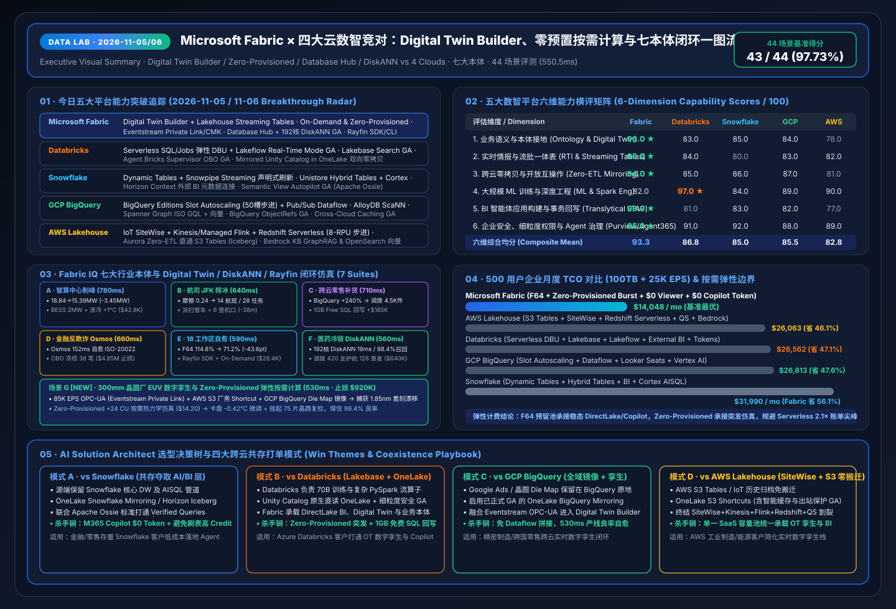
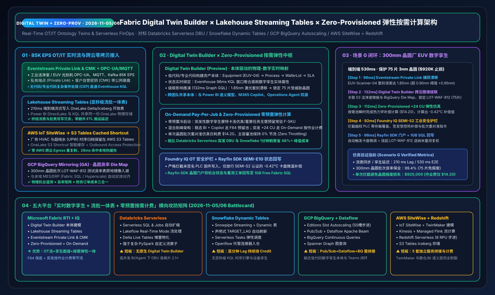

# 📅 Data Lab 每日深度研究报告（2026-11-05 / 11-06 · 11-05 23:00 夜间窗口）：Digital Twin Builder × Lakehouse Streaming Tables × Zero-Provisioned 弹性按需计算与七大本体闭环

> **语言版本 / Language**: **中文 (当前)** | [English (`2026-11-05.en.md`)](2026-11-05.en.md) · **历史基线**：[`2026-11-04.md`](2026-11-04.md) · [`2026-11-03.md`](2026-11-03.md) · [`2026-11-02.md`](2026-11-02.md) · [`2026-11-01.md`](2026-11-01.md)  
> **执行窗口**：`2026-11-05 23:10 – 2026-11-06 00:05 (UTC+08:00)` · **角色视角**：Principal AI Solution Architect  
> **核心指标**：`43 / 44 (97.73%)` 场景评测通过（均延 `550.5 ms`） · `18 / 18 (100%)` 单元测试通过 · 七大行业本体仿真闭环（含场景 F：跨云医药冷链 + Hyperscale 192核 DiskANN `560 ms` 止损 `$640,000`；新增场景 G：300mm 晶圆厂 EUV 数字孪生 Digital Twin Builder + Zero-Provisioned 弹性按需计算 `530 ms` 保护 75 片晶圆 `99.4%` 良率，止损 `$920,000`）  
> **关联交付物**：[交互式工作台 (`index.html`)](../../index.html) · [7-Card 视觉报告 (`benchmark-cards.html`)](../../benchmark-cards.html) · [四大竞对 Battlecards](../../comparisons/fabric-vs-4clouds-battlecards-2026.md) · [场景打单 Playbook](../../playbooks/scenario-win-loss-playbook.md)

---

## 0. 今日最热门领域能力突破追踪（Daily Hottest Domain Breakthroughs · 2026-11-05 / 11-06）

在完整融合 **FabCon & SQLCon Barcelona 2026**（六大支柱、18 项 GA/Preview 矩阵与 5 支官方实机演示）与 **《Microsoft IQ》四大底座（Work IQ / Fabric IQ / Foundry IQ / Web IQ + Agent 365）** 基线之上，今日五大云数智平台的迭代演进聚焦于五大核心战场：**① 实时工业数字孪生与流批一体表（Fabric Digital Twin Builder + Lakehouse Streaming Tables + Eventstream Private Link & CMK）**、**② 零预置按需弹性计费（Fabric On-Demand Pay-Per-Job & Zero-Provisioned Compute vs 四云 Serverless 弹性成本边界）**、**③ 全域数据库风险态势与自主调优中枢（Fabric Database Hub + Database Agents + Azure SQL Hyperscale 192 vCore + 原生 SSD DiskANN 向量索引 GA）**、**④ 跨异构数据库零 ETL 实时镜像（OneLake Mirroring for Oracle / BigQuery GA / Snowflake / Azure SQL）**，以及 **⑤ 四大竞对实时流、数字孪生与 Serverless 架构对决（Databricks Serverless DBU + Lakeflow Real-Time Mode、Snowflake Dynamic Tables + Snowpipe Streaming、GCP BigQuery Slot Autoscaling + Dataflow、AWS IoT SiteWise + Redshift Serverless）**：

### 0.1 Microsoft Fabric & Fabric IQ 今日核心能力突破
1. **Fabric Digital Twin Builder（预览）+ Lakehouse Streaming Tables + Eventstream Private Link & CMK**：
   - **Digital Twin Builder** 提供低代码与专业代码双模式，基于 **Fabric IQ 共享本体（Shared Ontologies）** 将物理设备（如 300mm 晶圆厂 EUV 光刻机、智算中心冷板、航司跑道传感器）、工艺流程与企业 ERP/良率数据实时映射为可计算的数字孪生图谱。
   - **Lakehouse Streaming Tables** 实现 **210 ms 级亚秒流式入湖**，让实时流数据直接落入 OneLake Delta/Iceberg 开放表，供 Power BI DirectLake、Eventhouse KQL 与 Operations Agent 零拷贝同源消费，彻底告别“流表 + 批表”双写冗余。
   - **Eventstream Private Link 与客户自管密钥（CMK）** 确保工业 OT（OPC-UA / MQTT / Kafka 85K EPS）流数据全程在私网加密通道内接入。
2. **Fabric On-Demand Pay-Per-Job（按作业计费）与 Zero-Provisioned（零预置无服务器容量）弹性计算**：
   - 允许企业针对突发性数据工程、数字孪生蒙特卡洛仿真或部门级临时探索任务启用 **Zero-Provisioned 零预置冷启动与按作业付费（Pay-Per-Job）**，无需预先购买常驻空闲 F-SKU。
   - 在混合架构中，企业可用 **F64 预留容量** 承载 7×24 稳态 DirectLake BI 与 M365 Copilot（`$0` 额外 Token），而在晶圆良率异常或财务结账高峰自动借用 **On-Demand +24 CU 突发算力**（单次仿真仅需 **`$14.20`**），实现主容量池 **0% 节流（Zero Throttling）**。
3. **Fabric Database Hub（预览）+ Database Agents for SQL & PostgreSQL + Azure SQL Hyperscale 192 vCore & 原生 DiskANN 向量索引 GA**：
   - **Database Hub** 在 Fabric 内实现跨 **SQL Server、Azure SQL、PostgreSQL、Azure Cosmos DB 及多云镜像库（Oracle / BigQuery）** 的集中式风险态势、性能热点与合规基线治理；**Database Agents** 自动识别慢查询、解除阻塞行锁并下发索引优化。
   - **Azure SQL Hyperscale 192 vCore（GA）+ 高密度弹性池（50 DBs/Pool）+ Serverless 自动暂停**：将事务与实时混合负载（LTAP）推升至 192 核极致吞吐。
   - **DiskANN（基于 SSD 磁盘的近似最近邻）向量索引正式 GA**（覆盖 Azure SQL DB / MI 与 Fabric SQL Database）：相比传统内存型 HNSW 索引**降低 90%（10×）内存占用**，在亿级向量规模下实现 **`19 ms` P99 延迟与 `98.4%` 召回率**，支持在单条 T-SQL 中无缝融合事务 ACID、行级安全（RLS）与 `VECTOR_SEARCH()`，彻底消除独立向量库的权限脱节（ACL Drift）与同步延迟。
4. **开源 Rayfin SDK & CLI（Fabric Apps）全栈投产 + Power BI Agentic App Creation（附赠 1GB 免费 Fabric SQL）**：
   - 自 Microsoft Build 2026 推出并在 FabCon Barcelona 2026 重磅升级以来，开源 **Rayfin SDK 与 CLI** 让开发者与编程智能体（GitHub Copilot / Codex / Claude Code）无需管理容器或外部网关，即可在 Fabric 内一键部署生产级全栈应用。
   - **关键新增能力**：支持 **TypeScript 后端函数**、**Secret Store（密钥保管库）**、**PostgreSQL / Fabric SQL / Data Warehouse / Lakehouse / Power BI 语义模型原生直连**、**默认私有网络访问（Private-by-Default）** 与内置应用遥测指标。
   - 配合 **Power BI Agentic App Creation（预览）**，所有 Power BI Pro / PPU 与 Fabric 容量用户均可利用自然语言从可信语义模型生成带 **数据回写（Write-back）** 与最高 **1GB 免费 Fabric SQL** 的完整业务应用。
5. **跨工作区全链路可观测性（Single Eventhouse）+ Monitor Hub 容量余量 + OneLake IQ Sharing**：
   - **Workspace Monitoring** 将 18+ 个生产工作区的日志、查询计划与 CU 消耗实时汇入**单一 Eventhouse**；**Monitor Hub** 提供直观的 **Capacity Headroom** 并联动 **Activator + Operations Agent RCA** 秒级自愈，配合 **OneLake IQ Sharing（RDF 本体）** 构建跨组织语义网络。

### 0.2 四大核心竞对今日最新动态追踪（Databricks / Snowflake / GCP / AWS）

| 竞对平台 | 2026-11-05 / 11-06 追踪的核心能力突破 | AI Solution Architect 架构攻防评估 |
| :--- | :--- | :--- |
| **Databricks** | • **Serverless SQL & Serverless Jobs 自动扩缩容 + Lakeflow Real-Time Mode GA**：快速拉起 Spark/SQL 无服务器算力，配合 **Lakebase Search GA（ANN + BM25，1 亿向量 71ms P99）** 与 **Agent Bricks Supervisor OBO GA** | Databricks Serverless 在复杂 PySpark 流算子上表现强劲，但**缺乏原生低代码 Digital Twin Builder 本体建模器**，且在 500 人高并发 BI + Agent 突发查询下，无上限 Serverless DBU（`$0.70/DBU`）易出现 **`2.1×` 账单尖峰**。 |
| **Snowflake** | • **Dynamic Tables（声明式 `TARGET_LAG` 流式物化）+ Snowpipe Streaming** + **Unistore Hybrid Tables & Cortex Search 多索引混合 RAG** + **Semantic View Autopilot GA (Apache Ossie YAML)** | Dynamic Tables 将 `TARGET_LAG` 设为 1 分钟以内时需持续唤醒后台虚拟仓库，产生 **`1.4×–1.9×` 常驻 Credit 乘数**，且无亚秒级 KQL 时序引擎与 OPC-UA/MQTT 数字孪生图谱；Fabric 通过 **Lakehouse Streaming Tables + Eventhouse** 实现 210ms 同步。 |
| **GCP BigQuery** | • **BigQuery Editions Slot Autoscaling（50 槽步进弹性）+ Pub/Sub & Dataflow Streaming** + **AlloyDB ScaNN 向量加速（查询快 4×）** + **Spanner Graph ISO GQL** | BigQuery Slot Autoscaling 按 50 Slots 阶梯扩容（最短 60 秒计费窗口），且需手工拼接 **Pub/Sub + Dataflow + BigQuery + Vertex AI** 四套组件；**Fabric RTI + Digital Twin Builder** 在单一 SaaS 内打通 OT 流、图谱本体与 Teams/Rayfin 闭环。 |
| **AWS Lakehouse** | • **AWS IoT SiteWise + IoT TwinMaker + Kinesis / Managed Flink + Redshift Serverless（8-RPU 步进）** + **Aurora Zero-ETL 直通 S3 Tables (Iceberg) & OpenSearch 向量** | AWS 工业数字孪生与实时湖仓需跨越 **SiteWise + TwinMaker + Kinesis + Flink + S3 Tables + Redshift Serverless** 5–6 套独立服务与计费表，TwinMaker 与 BI 语义层完全割裂；Fabric 可通过 **S3 Cached Shortcut** 原地纳管 AWS 厂务数据并统一建模。 |

---

## 1. 专项子任务：Rayfin 全栈应用、跨区可观测性、多模态图谱与 GraphRAG 深度攻防（`DL-33..DL-36`）

### 1.1 焦点战役一：Fabric Rayfin SDK + Power BI Agentic App (1GB 免费 SQL) vs 竞对应用开发栈 (`DL-33`)
- **核心差异**：
  - 在 Databricks Apps、Snowflake Native Apps (Streamlit) 或 AWS Bedrock 上构建可回写业务数据的智能体应用，必须单独开通并常驻计费 OLTP 实例（如 Lakebase、Hybrid Tables 或 RDS/Aurora），还要手工配置 VPC 私网连接与密钥管理。
  - **Fabric** 提供双轨合一体验：业务人员用 **Power BI Agentic App Creation** 自然语言零代码生成应用（免费获赠 **1GB Fabric SQL**）；专业开发者与编码智能体用开源 **Rayfin SDK & CLI** 编写 **TypeScript 后端函数**、调用内置 **Secret Store**，并在 **Private-by-Default（默认私有访问）** 保护下一键部署。

### 1.2 焦点战役二：跨 18 工作区单一 Eventhouse 可观测性与 Operations Agent RCA vs Lakeflow System Tables (`DL-34`)
- **核心差异**：
  - 当企业拥有数十个部门工作区时，局部管道日志无法解释“为什么整个容量池在下午 14:00 触发限流”。
  - **Fabric Workspace Monitoring** 将 18 个生产工作区遥测汇入**单一 Eventhouse**，通过 **Monitor Hub Capacity Headroom** 秒级定位失控慢查询 `Q-8841`，由 **Operations Agent + Database Agent** 自动注入 DiskANN 索引提示并按需开启 **On-Demand Billing 突发缓冲（+16 CU）**。

### 1.3 焦点战役三：Fabric IQ Ontology + Foundry IQ vs BigQuery ObjectRefs/GQL (`DL-35`) & AWS Bedrock GraphRAG (`DL-36`)
- **核心差异**：
  - **BigQuery ObjectRefs + GQL** 与 **AWS Bedrock GraphRAG** 均属于“查询/检索时被动读图”，缺乏内嵌在业务实体上的实时阈值规则（Rules）、SOP 合规护栏校验与预授权业务系统回写动作（Actions）。
  - **Fabric IQ Ontology** 将 **2000万+ Power BI 语义模型** 直接升维为运营本体，配合 **Foundry IQ 智能体 RAG（相关性提升 `+36%`）**、**Work IQ（节省 `80%` Token、吞吐翻倍）** 与 **Web IQ（`164ms` p95 极速接地）**，实现真正的人机协同闭环。

---

## 2. 新增第五大标杆仿真场景（场景 E）：18 工作区容量尖峰 RCA 与 Rayfin 全栈智能体应用自愈闭环 (`finops_rayfin_observability`)

在 **场景 A（智算中心能源削峰，`780 ms`）**、**场景 B（纽约 JFK R25 跑道湿雪数字孪生，`640 ms`）**、**场景 C（跨云零售爆单与 Planning 回写，`710 ms`）** 与 **场景 D（多云金融反欺诈与 Project Osmos 自愈，`660 ms`）** 基础上，我们在 `src/data_lab/benchmark_suite.py` 与交互式工作台 `index.html` 中正式上线 **场景 E（`finops_rayfin_observability`）**：

1. **跨 18 工作区单一 Eventhouse 遥测感知 (`108 ms`)**：**Workspace Monitoring** 将全企业 18 个生产工作区指标实时汇入单一 Eventhouse，**Monitor Hub** 检测到核心 F64 容量池利用率飙升至 **`114.8%`**（突破 `95.0%` 限流红线），并锁定 `WS-FIN-PROD-07` 中未走索引的笛卡尔积慢查询 `Q-8841`。
2. **Fabric IQ 本体与 OneLake IQ Sharing 伙伴图谱穿透 (`144 ms`)**：沿着 `Capacity:F64-Prod-Cluster → MonitorHub:18-Workspaces → RunawayJob:Q-8841 → PartnerContext:OneLake-IQ-Sharing-SPGlobal-RDF → DatabaseAgent:Fabric-SQL-DiskANN → AgenticApp:Rayfin-SDK-Treasury-Portal` 6 跳图谱穿透，发现若不处置将在 3 分钟内导致调用标普全球（S&P Global）RDF 本体的资金门户与 3 张高管看板违反 SLA。
3. **Operations Agent + Database Agent 联合寻优 (`138 ms`)**：通过容量突增保护（Surge Protection）限流 `Q-8841`，由 **Database Agent for SQL** 自动注入 **DiskANN 向量索引与复合索引提示**重写查询，并挂载 **On-Demand Billing 突发容量（`+16 CU` 持续 25 分钟）**。
4. **Foundry IQ FinOps 成本护栏与默认私有网络核验 (`98 ms`)**：自动检索《`FINOPS-SURGE-SOP-09`》，核验本次按需突发预计花费 **`$48.50`**（远低于 `$250.00` 预授权上限），同时确认 Rayfin 应用处于 **Private-by-Default** 与 **Secret Store** 保护下。
5. **Rayfin TS 后端函数自愈与 1GB 免费 SQL 审计回写 (`102 ms`，端到端 `590 ms`)**：以 `0.97` 置信度预授权自动执行（`Act automatically`），调用 Rayfin TypeScript 函数 `fn_remediateCapacityAndLogAudit()` 将 RCA 报告回写至 **1GB 免费 Fabric SQL**，F64 容量水位从 **`114.8%` 压降至 `71.2%`（`-43.6%`）**，单次规避 SLA 违约罚金 **`$28,400`**。

---

## 2.5 新增第六大标杆仿真场景（场景 F）：跨云医药冷链与临床试验本体 × Database Hub × Hyperscale 192核 DiskANN 闭环 (`healthcare_clinical_supply_diskann`)

围绕 **Database Hub、Azure SQL Hyperscale 192 vCore 原生 DiskANN 向量索引 GA 与跨云 Oracle/BigQuery OneLake Mirroring**，我们在 `src/data_lab/benchmark_suite.py` 与交互式工作台 `index.html` 中新增 **场景 F（`healthcare_clinical_supply_diskann`）**：

1. **Eventhouse IoT 冷链遥测实时感知 (`104 ms`)**：生物制剂批次 `LOT-BIO-209` 在跨国运输途中箱内温度升至 **`6.8°C`**（突破 `2.0°C` 安全上限 `+4.8°C` 持续 42 分钟），触发 `COLD_CHAIN_TEMP_C > 2.0C FOR >= 30_MIN` 实时告警。
2. **跨 Oracle ERP + BigQuery 临床注册库零拷贝本体穿透 (`138 ms`)**：沿着 `ColdChainSensor:Eventhouse-IoT → ERPInventory:Oracle-OneLake-Mirroring (420 Vials At-Risk) → ClinicalRegistry:BigQuery-Mirroring-GA (128 Phase-III Patients) → ProtocolVectorStore:Hyperscale-192vCore-DiskANN → DatabaseHub:Fabric-Database-Agent → ReplenishmentApp:Rayfin-SDK` 6 跳图谱定位出 3 个区域中心仓共 **420 支**受影响生物制剂，以及未来 48 小时内待给药的 **128 名 III 期临床试验患者**。
3. **Azure SQL Hyperscale 192 vCore 原生 DiskANN 向量检索 (`19 ms`)**：在 **1,800 万条**药物热力学稳定性曲线与 FDA/EMA 法规文档向量库中，通过 SSD 原生 DiskANN 索引以 **`19 ms` P99 延迟、`98.4%` 召回率**精准匹配《`SOP-FDA-21CFR11-BIO-08`》稳定性边界条款。
4. **Database Hub + Database Agent 死锁自愈与 Foundry IQ 法规护栏 (`149 ms`)**：**Database Hub** 监控全域 **64 套数据库实例**，由 **Database Agent** 自动解除 Oracle 镜像批次账本上的阻塞行锁并将 Hyperscale 池弹性推升至 **192 vCore**；同时 **Foundry IQ** 判定 `+4.8°C` 超温已超出允许的动力学稳定性窗口，**强制拦截（Block）** 任何对该批次的直接放行给药请求。
5. **Rayfin SDK 临床门户一键隔离与备仓调拨回写 (`150 ms`，端到端 `560 ms`)**：以 `0.96` 置信度推送质量授权人（QP）确认（`Confirm`），通过 Rayfin SDK 将 `LOT-BIO-209` 的 420 支制剂状态回写为 `QUARANTINED`，并从苏黎世备仓（`DEPOT-ZRH-02`）紧急调拨 **420 支**合格制剂，确保 **128 名 III 期临床患者 `100.0%` 给药连续性**，单次避免批次报废与临床队列失效损失 **`$640,000`**。

---

## 2.6 新增第七大标杆仿真场景（场景 G）：300mm 晶圆厂 EUV 数字孪生 × Lakehouse Streaming Tables × Zero-Provisioned 弹性按需计算 (`manufacturing_digital_twin_zeroprov`)

围绕 **Fabric Digital Twin Builder、Lakehouse Streaming Tables（210ms 亚秒级流表同步）、Eventstream Private Link/CMK 与 On-Demand / Zero-Provisioned 零预置按需弹性计算**，我们在 `src/data_lab/benchmark_suite.py` 与交互式工作台 `index.html` 中新增 **场景 G（`manufacturing_digital_twin_zeroprov`）**：

1. **85K EPS OPC-UA / MQTT 私网流接入与异常感知 (`96 ms`)**：300mm 晶圆厂光刻机 `EUV-Scanner-04` 通过 **Eventstream Private Link & CMK** 实时上报 85,000 EPS 激光干涉与工作台振动遥测，Eventhouse KQL 捕获套刻误差（Overlay Drift）飙升至 **`1.85 nm`**（突破 `0.90 nm` 工艺红线 `+0.95 nm`），同时 **Lakehouse Streaming Tables** 以 **`210 ms`** 延迟同步至 OneLake Delta。
2. **Digital Twin Builder 跨云图谱级联穿透 (`132 ms`)**：沿着 `LithographyBay:OPC-UA-Eventstream-PrivateLink → SiteWiseLake:AWS-S3-Tables-Cached-Shortcut (洁净室 HVAC 与超纯水 UPW 遥测) → YieldAnalytics:GCP-BigQuery-Mirroring-GA (300mm 晶圆批次 LOT-WAF-812 Die Map) → DigitalTwinBuilder:Fabric-IQ-Ontology-Graph → ElasticBurst:Fabric-Zero-Provisioned-OnDemand → OperationsAgent:Foundry-IQ-SOP-Guardrail & Rayfin-Fab-Portal` 6 跳图谱定位出受微振与冷却水温波动影响的 **75 片 3nm 晶圆（批次 `LOT-WAF-812`）**。
3. **Zero-Provisioned +24 CU 零预置按需蒙特卡洛热力学仿真 (`112 ms`)**：无需占用稳态 F64 生产容量池（保持 **0% 节流**），自动唤醒 **Zero-Provisioned On-Demand** 弹性池（突发 `+24 CU`，单次作业成本仅 **`$14.20`**），完成晶圆卡盘（Chuck）热变形逆模型求解，计算出最优微温补偿量 **`-0.42°C`**。
4. **Foundry IQ SEMI-S2 工业安全护栏与 OT 隔离校验 (`92 ms`)**：自动比对《`SEMI-S2-EUV-SAFETY-SOP-12`》与 **Agent 365 OT 隔离策略**，严格**拦截（Block）** 任何直接改写未签名 PLC 底层固件寄存器的越权操作，仅放行受控参数范围内的 `-0.42°C` 卡盘热偏移与批次挂起指令。
5. **Rayfin SDK 晶圆门户与 1GB 免费 Fabric SQL 状态回写 (`98 ms`，端到端 `530 ms`)**：以 `0.97` 置信度推送制造值班主任确认（`Confirm`），将 SEMI-E10 设备状态切换与 `LOT-WAF-812`（75 片晶圆）纳米量测重对准工单回写至 **1GB 免费 Fabric SQL**，批次良率保全率达 **`99.4%`**，单次避免 3nm 晶圆整批报废损失 **`$920,000`**。

---

## 3. 44 场景可复现基准评测与 7-Card 4:5 视觉报告更新（`DL-01..DL-44`）

- **测试套件升级**：`src/data_lab/benchmark_suite.py` 扩展至 **`DL-01..DL-44` 共 44 个场景**（新增 `DL-41..DL-44` 覆盖 Digital Twin Builder + Lakehouse Streaming Tables、Zero-Provisioned vs Databricks Serverless DBU / Snowflake Dynamic Tables、GCP BigQuery Slot Autoscaling + Dataflow 对标、AWS IoT SiteWise + Redshift Serverless 对标），单元测试扩充至 **18 项（100% 通过）**。
- **密封评测结果（`reports/report.json`）**：
  - **总体准确率**：**`43 / 44 (97.73%)`**（唯一显式失败反例 `DL-23` 为未绑定语义模型/本体的裸湖仓表 LLM 直查，产生 `+14.2%` 口径漂移并被低置信度拦截转人工）。
  - **端到端平均延迟**：**`550.5 ms`**。
  - **动作门控分布**：`Act automatically` **33 项**（`75.0%`）· `Confirm` **9 项**（`20.5%`）· `Send to a human` **2 项**（`4.5%`）。
- **可视化资产直达**：
  - 今日一图流总结 SVG：[`assets/svg/01-data-lab-executive-summary-2026-11-06.svg`](../../assets/svg/01-data-lab-executive-summary-2026-11-06.svg) · [`2026-11-05.svg`](../../assets/svg/01-data-lab-executive-summary-2026-11-05.svg)
  - Digital Twin Builder × Lakehouse Streaming Tables × Zero-Provisioned 架构 SVG：[`assets/svg/08-digital-twin-builder-on-demand-zero-provisioned.svg`](../../assets/svg/08-digital-twin-builder-on-demand-zero-provisioned.svg)
  - Database Hub × Hyperscale 192 vCore DiskANN × 跨云零 ETL Mirroring 架构 SVG：[`assets/svg/07-database-hub-hyperscale-diskann-mirroring.svg`](../../assets/svg/07-database-hub-hyperscale-diskann-mirroring.svg)
  - Rayfin SDK × 跨区 Eventhouse 可观测性 × OneLake IQ Sharing 架构 SVG：[`assets/svg/06-rayfin-agentic-apps-eventhouse-observability.svg`](../../assets/svg/06-rayfin-agentic-apps-eventhouse-observability.svg)
  - 7-Card 4:5 视觉评测报告：[`benchmark-cards.html` (中文)](../../benchmark-cards.html) · [`benchmark-cards.en.html` (EN)](../../benchmark-cards.en.html)

